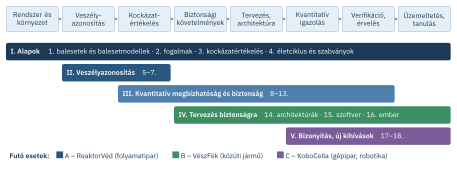
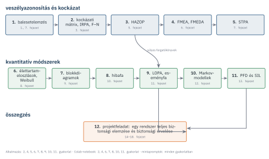

# Biztonságkritikus rendszerek

**Kockázat, megbízhatóság és funkcionális biztonság a veszélyazonosítástól a biztonsági érvelésig**  
Abonyi János · Pannon Egyetem, Veszprém, 2026

Nyílt hozzáférésű tankönyv a biztonságkritikus rendszerek tervezéséről és igazolásáról. A kézikönyv a balesetmodellektől és a kockázatértékeléstől a HAZOP-, FMEA- és STPA-elemzésen, a hibafákon, a Markov-modelleken és a SIL-igazoláson át a biztonságos architektúrákig, a szoftver és az ember szerepéig, a biztonsági érvelésig, valamint a gépi tanulás és a kiberbiztonság új kérdéseiig vezet. A gyakorlati útmutató böngészőben futó alkalmazásokkal, Google Colab-notebookokkal és mintapromptokkal teszi kipróbálhatóvá a módszereket.

| Olvasás és gyakorlás | |
|:--|:--|
| A webhely nyitóoldala | <https://complexsystemsintelligence.github.io/biztonsagkritikus-rendszerek/> |
| Kézikönyv – webkönyv (kereshető) | <https://complexsystemsintelligence.github.io/biztonsagkritikus-rendszerek/kezikonyv/> |
| Kézikönyv – PDF (nyomtatható, A4) | [biztonsagkritikus-rendszerek.pdf](https://complexsystemsintelligence.github.io/biztonsagkritikus-rendszerek/kezikonyv/biztonsagkritikus-rendszerek.pdf) |
| Kézikönyv – EPUB (e-könyv-olvasóra) | [biztonsagkritikus-rendszerek.epub](https://complexsystemsintelligence.github.io/biztonsagkritikus-rendszerek/kezikonyv/biztonsagkritikus-rendszerek.epub) |
| Gyakorlati útmutató – webkönyv | <https://complexsystemsintelligence.github.io/biztonsagkritikus-rendszerek/gyakorlat/> |
| Gyakorlati útmutató – PDF | [biztonsagkritikus-rendszerek-gyakorlat.pdf](https://complexsystemsintelligence.github.io/biztonsagkritikus-rendszerek/gyakorlat/biztonsagkritikus-rendszerek-gyakorlat.pdf) |
| Böngészős alkalmazások (9) | [gyakorlat/alkalmazasok/](gyakorlat/alkalmazasok/README.md) – telepítés nélkül, internetkapcsolat nélkül is |
| Colab-notebookok (7) | [gyakorlat/notebookok/](gyakorlat/notebookok/README.md) – egy kattintással futtathatók |

## Kinek szól a könyv?

Minden mérnöknek és szakembernek, aki biztonságkritikus rendszert tervez, fejleszt, üzemeltet, értékel vagy engedélyez, iparágtól függetlenül. A könyv a közös elméleti magot tanítja, és mindig megmutatja, hogyan jelenik meg ugyanaz a gondolat a folyamatiparban (IEC 61511), a közúti járműveknél (ISO 26262, ISO 21448), a gépiparban (ISO 13849, IEC 62061), a vasútnál (EN 50126-sorozat), a repülésben (ARP4754B, ARP4761A, DO-178C) és az orvostechnikában (ISO 14971, IEC 62304). A szükséges valószínűségszámítási alapokat az A. függelék foglalja össze.

## Három végigvitt eset

A módszereket három esettanulmány kapcsolja össze, amelyek fejezetről fejezetre továbbépülnek, így az eredmények egymásra épülnek és összevethetők:

- **ReaktorVéd** (folyamatipar): egy exoterm reaktor védelmi rendszere – HAZOP, LOPA, hibafa, Markov-modell és SIL-igazolás az IEC 61508 és az IEC 61511 szerint.
- **VészFék** (gépjárműipar): egy automatikus vészfékező asszisztens – HARA, a radarérzékelő FMEA-ja, STPA, hibafa, hardvermetrikák és SOTIF az ISO 26262 és az ISO 21448 szerint.
- **KoboCella** (gépbiztonság): egy kollaboratív robotcella – háromlépcsős kockázatcsökkentés, PLr-meghatározás, STPA, PFH-számítás és az ember–robot együttműködés emberi tényezői az ISO 12100 és az ISO 13849 szerint.

A három eset adatait és a könyv minden számolt eredményét a [`_shared/esetek/`](_shared/esetek/) szkriptjei reprodukálják; az összefoglalás a [B. függelékben](https://complexsystemsintelligence.github.io/biztonsagkritikus-rendszerek/kezikonyv/fuggelek/b-esettanulmanyok.html) olvasható.

## A kézikönyv felépítése



| Fejezet | Kapcsolódó gyakorlat |
|:--|:--|
| **I. Alapok** | |
| 1. [Miért hibáznak a rendszerek? Balesetek és balesetmodellek](https://complexsystemsintelligence.github.io/biztonsagkritikus-rendszerek/kezikonyv/fejezetek/01-balesetek.html) | [1. gyakorlat](https://complexsystemsintelligence.github.io/biztonsagkritikus-rendszerek/gyakorlat/laborok/01-balesetelemzes.html) |
| 2. [Fogalmak: veszély, kockázat, biztonság, megbízhatóság](https://complexsystemsintelligence.github.io/biztonsagkritikus-rendszerek/kezikonyv/fejezetek/02-fogalmak.html) |  |
| 3. [Kockázatértékelés és a kockázat elfogadhatósága](https://complexsystemsintelligence.github.io/biztonsagkritikus-rendszerek/kezikonyv/fejezetek/03-kockazatertekeles.html) | [2. gyakorlat](https://complexsystemsintelligence.github.io/biztonsagkritikus-rendszerek/gyakorlat/laborok/02-kockazati-matrix.html) |
| 4. [A biztonsági életciklus és a szabványok rendszere](https://complexsystemsintelligence.github.io/biztonsagkritikus-rendszerek/kezikonyv/fejezetek/04-eletciklus.html) |  |
| **II. Veszélyazonosítás** | |
| 5. [Veszélyazonosítás: a veszélylistáktól a HAZOP-ig](https://complexsystemsintelligence.github.io/biztonsagkritikus-rendszerek/kezikonyv/fejezetek/05-veszelyazonositas.html) | [3. gyakorlat](https://complexsystemsintelligence.github.io/biztonsagkritikus-rendszerek/gyakorlat/laborok/03-hazop.html) |
| 6. [FMEA, FMECA és FMEDA](https://complexsystemsintelligence.github.io/biztonsagkritikus-rendszerek/kezikonyv/fejezetek/06-fmea.html) | [4. gyakorlat](https://complexsystemsintelligence.github.io/biztonsagkritikus-rendszerek/gyakorlat/laborok/04-fmea.html) |
| 7. [Rendszerelméleti veszélyelemzés: STAMP és STPA](https://complexsystemsintelligence.github.io/biztonsagkritikus-rendszerek/kezikonyv/fejezetek/07-stpa.html) | [5. gyakorlat](https://complexsystemsintelligence.github.io/biztonsagkritikus-rendszerek/gyakorlat/laborok/05-stpa.html) |
| **III. Kvantitatív megbízhatóság és biztonság** | |
| 8. [Megbízhatóság-elmélet és élettartam-adatok](https://complexsystemsintelligence.github.io/biztonsagkritikus-rendszerek/kezikonyv/fejezetek/08-megbizhatosag.html) | [6. gyakorlat](https://complexsystemsintelligence.github.io/biztonsagkritikus-rendszerek/gyakorlat/laborok/06-megbizhatosag.html) |
| 9. [Rendszermegbízhatóság: blokkdiagramok és k-ból-n rendszerek](https://complexsystemsintelligence.github.io/biztonsagkritikus-rendszerek/kezikonyv/fejezetek/09-rbd.html) | [7. gyakorlat](https://complexsystemsintelligence.github.io/biztonsagkritikus-rendszerek/gyakorlat/laborok/07-rbd.html) |
| 10. [Hibafa-elemzés](https://complexsystemsintelligence.github.io/biztonsagkritikus-rendszerek/kezikonyv/fejezetek/10-hibafa.html) | [8. gyakorlat](https://complexsystemsintelligence.github.io/biztonsagkritikus-rendszerek/gyakorlat/laborok/08-hibafa.html) |
| 11. [Eseményfa, rétegzett védelem és csokornyakkendő-modell](https://complexsystemsintelligence.github.io/biztonsagkritikus-rendszerek/kezikonyv/fejezetek/11-esemenyfa.html) | [9. gyakorlat](https://complexsystemsintelligence.github.io/biztonsagkritikus-rendszerek/gyakorlat/laborok/09-lopa.html) |
| 12. [Markov-modellek és rendelkezésre állás](https://complexsystemsintelligence.github.io/biztonsagkritikus-rendszerek/kezikonyv/fejezetek/12-markov.html) | [10. gyakorlat](https://complexsystemsintelligence.github.io/biztonsagkritikus-rendszerek/gyakorlat/laborok/10-markov.html) |
| 13. [A biztonsági integritás igazolása: PFD, PFH és SIL](https://complexsystemsintelligence.github.io/biztonsagkritikus-rendszerek/kezikonyv/fejezetek/13-sil.html) | [11. gyakorlat](https://complexsystemsintelligence.github.io/biztonsagkritikus-rendszerek/gyakorlat/laborok/11-sil.html) |
| **IV. Tervezés biztonságra** | |
| 14. [Biztonságos architektúrák és tervezési elvek](https://complexsystemsintelligence.github.io/biztonsagkritikus-rendszerek/kezikonyv/fejezetek/14-architekturak.html) | [12. gyakorlat](https://complexsystemsintelligence.github.io/biztonsagkritikus-rendszerek/gyakorlat/laborok/12-projekt.html) |
| 15. [A szoftver biztonsága](https://complexsystemsintelligence.github.io/biztonsagkritikus-rendszerek/kezikonyv/fejezetek/15-szoftver.html) | [12. gyakorlat](https://complexsystemsintelligence.github.io/biztonsagkritikus-rendszerek/gyakorlat/laborok/12-projekt.html) |
| 16. [Az ember a biztonságkritikus rendszerben](https://complexsystemsintelligence.github.io/biztonsagkritikus-rendszerek/kezikonyv/fejezetek/16-ember.html) | [12. gyakorlat](https://complexsystemsintelligence.github.io/biztonsagkritikus-rendszerek/gyakorlat/laborok/12-projekt.html) |
| **V. Bizonyítás és új kihívások** | |
| 17. [Biztonsági érvelés és igazolás](https://complexsystemsintelligence.github.io/biztonsagkritikus-rendszerek/kezikonyv/fejezetek/17-biztonsagi-erveles.html) | [12. gyakorlat](https://complexsystemsintelligence.github.io/biztonsagkritikus-rendszerek/gyakorlat/laborok/12-projekt.html) |
| 18. [Új kihívások: rendeltetésszerű funkció, mesterséges intelligencia és kiberbiztonság](https://complexsystemsintelligence.github.io/biztonsagkritikus-rendszerek/kezikonyv/fejezetek/18-uj-kihivasok.html) | [12. gyakorlat](https://complexsystemsintelligence.github.io/biztonsagkritikus-rendszerek/gyakorlat/laborok/12-projekt.html) |

**Függelékek:** [A. Valószínűségszámítási összefoglaló](https://complexsystemsintelligence.github.io/biztonsagkritikus-rendszerek/kezikonyv/fuggelek/a-valoszinuseg.html) · [B. A három esettanulmány](https://complexsystemsintelligence.github.io/biztonsagkritikus-rendszerek/kezikonyv/fuggelek/b-esettanulmanyok.html) · [C. Magyar–angol szószedet](https://complexsystemsintelligence.github.io/biztonsagkritikus-rendszerek/kezikonyv/fuggelek/c-szoszedet.html) · [D. Szabványok és jogszabályok](https://complexsystemsintelligence.github.io/biztonsagkritikus-rendszerek/kezikonyv/fuggelek/d-szabvanyok.html)

Minden fejezet tanulási eredményekkel indul, a módszereket kidolgozott példák és a futó esetek mutatják be, a végén módszer-összefoglaló, önellenőrző feladatok (lenyitható megoldással) és továbbolvasási javaslatok állnak.

## A gyakorlati útmutató



| Gyakorlat | Kézikönyv | Böngészős alkalmazás | Colab-notebook |
|:--|:--|:--|:--|
| 1. [Balesetelemzés három szemüvegen át](https://complexsystemsintelligence.github.io/biztonsagkritikus-rendszerek/gyakorlat/laborok/01-balesetelemzes.html) | 1., 7. fejezet |  |  |
| 2. [Kockázati mátrix, egyéni és társadalmi kockázat](https://complexsystemsintelligence.github.io/biztonsagkritikus-rendszerek/gyakorlat/laborok/02-kockazati-matrix.html) | 3. fejezet | [Kockázati mátrix tervező](https://complexsystemsintelligence.github.io/biztonsagkritikus-rendszerek/gyakorlat/alkalmazasok/kockazati-matrix.html) | [Colab](https://colab.research.google.com/github/ComplexSystemsIntelligence/biztonsagkritikus-rendszerek/blob/main/gyakorlat/notebookok/02_kockazat_irpa_fn.ipynb) |
| 3. [HAZOP a ReaktorVéd adagolókörére](https://complexsystemsintelligence.github.io/biztonsagkritikus-rendszerek/gyakorlat/laborok/03-hazop.html) | 5. fejezet |  |  |
| 4. [FMEA és FMEDA](https://complexsystemsintelligence.github.io/biztonsagkritikus-rendszerek/gyakorlat/laborok/04-fmea.html) | 6. fejezet | [FMEA-munkalap](https://complexsystemsintelligence.github.io/biztonsagkritikus-rendszerek/gyakorlat/alkalmazasok/fmea.html) | [Colab](https://colab.research.google.com/github/ComplexSystemsIntelligence/biztonsagkritikus-rendszerek/blob/main/gyakorlat/notebookok/04_fmeda.ipynb) |
| 5. [STPA-munkalap](https://complexsystemsintelligence.github.io/biztonsagkritikus-rendszerek/gyakorlat/laborok/05-stpa.html) | 7. fejezet | [STPA-munkalap](https://complexsystemsintelligence.github.io/biztonsagkritikus-rendszerek/gyakorlat/alkalmazasok/stpa.html) |  |
| 6. [Élettartam-eloszlások és megbízhatósági becslés](https://complexsystemsintelligence.github.io/biztonsagkritikus-rendszerek/gyakorlat/laborok/06-megbizhatosag.html) | 8. fejezet | [Élettartam-eloszlások](https://complexsystemsintelligence.github.io/biztonsagkritikus-rendszerek/gyakorlat/alkalmazasok/eloszlasok.html) | [Colab](https://colab.research.google.com/github/ComplexSystemsIntelligence/biztonsagkritikus-rendszerek/blob/main/gyakorlat/notebookok/06_megbizhatosag_weibull.ipynb) |
| 7. [Megbízhatósági blokkdiagramok](https://complexsystemsintelligence.github.io/biztonsagkritikus-rendszerek/gyakorlat/laborok/07-rbd.html) | 9. fejezet | [Blokkdiagram](https://complexsystemsintelligence.github.io/biztonsagkritikus-rendszerek/gyakorlat/alkalmazasok/rbd.html) | [Colab](https://colab.research.google.com/github/ComplexSystemsIntelligence/biztonsagkritikus-rendszerek/blob/main/gyakorlat/notebookok/07_rbd_hid_mc.ipynb) |
| 8. [Hibafa-elemzés](https://complexsystemsintelligence.github.io/biztonsagkritikus-rendszerek/gyakorlat/laborok/08-hibafa.html) | 10. fejezet | [Hibafa-elemző](https://complexsystemsintelligence.github.io/biztonsagkritikus-rendszerek/gyakorlat/alkalmazasok/hibafa.html) | [Colab](https://colab.research.google.com/github/ComplexSystemsIntelligence/biztonsagkritikus-rendszerek/blob/main/gyakorlat/notebookok/08_hibafa.ipynb) |
| 9. [LOPA és eseményfa](https://complexsystemsintelligence.github.io/biztonsagkritikus-rendszerek/gyakorlat/laborok/09-lopa.html) | 11. fejezet | [LOPA és eseményfa](https://complexsystemsintelligence.github.io/biztonsagkritikus-rendszerek/gyakorlat/alkalmazasok/lopa.html) |  |
| 10. [Markov-modellek és rendelkezésre állás](https://complexsystemsintelligence.github.io/biztonsagkritikus-rendszerek/gyakorlat/laborok/10-markov.html) | 12. fejezet | [Markov-szerkesztő](https://complexsystemsintelligence.github.io/biztonsagkritikus-rendszerek/gyakorlat/alkalmazasok/markov.html) | [Colab](https://colab.research.google.com/github/ComplexSystemsIntelligence/biztonsagkritikus-rendszerek/blob/main/gyakorlat/notebookok/10_markov.ipynb) |
| 11. [PFD és SIL-igazolás](https://complexsystemsintelligence.github.io/biztonsagkritikus-rendszerek/gyakorlat/laborok/11-sil.html) | 13. fejezet | [PFD- és SIL-kalkulátor](https://complexsystemsintelligence.github.io/biztonsagkritikus-rendszerek/gyakorlat/alkalmazasok/sil.html) | [Colab](https://colab.research.google.com/github/ComplexSystemsIntelligence/biztonsagkritikus-rendszerek/blob/main/gyakorlat/notebookok/11_sil.ipynb) |
| 12. [Projektfeladat: egy rendszer teljes biztonsági elemzése](https://complexsystemsintelligence.github.io/biztonsagkritikus-rendszerek/gyakorlat/laborok/12-projekt.html) | 14–18. fejezet |  |  |

Minden gyakorlat tanulási eredményekkel, számozott feladatokkal, a nagy nyelvi modellek felelős használatát segítő mintapromptokkal és ellenőrző szempontokkal készült. A notebookok első cellája a Colabban nyitja meg a jegyzetfüzetet; a kód csak a Colab alapcsomagjait (NumPy, SciPy, pandas, Matplotlib) használja.

## A tároló szerkezete

```
kezikonyv/                 a kézikönyv
  _quarto.yml              a könyv konfigurációja (HTML, PDF, EPUB)
  fejezetek/, fuggelek/    a 18 fejezet és a 4 függelék forrása (Quarto Markdown)
  abrak/tikz/              a 98 TikZ-ábra forrása; abrak/gen/: a lefordított PDF és SVG
gyakorlat/                 a gyakorlati útmutató
  laborok/                 a 12 gyakorlat
  alkalmazasok/src/        a böngészős alkalmazások forrása (az epit.py fűzi önálló HTML-fájllá)
  notebookok/              a Colab-notebookok (a _keszit.py állítja elő és futtatja le)
_shared/                   a két könyv közös elemei
  latex/, pe.scss, epub.css  a Pannon Egyetem arculata a PDF-, web- és EPUB-kimenethez
  filters/                 Lua-szűrők: kiemelődobozok, képformátum-választás
  scripts/                 előkészítés (ábrák, alkalmazások, betűk), magyar feliratsorrend
  tikz/peabra.sty          a TikZ-ábrák közös stílusa
  esetek/                  a könyv számpéldáit reprodukáló Python-szkriptek
  fonts/                   IBM Plex és Raleway (SIL OFL 1.1)
  references.bib           a közös irodalomjegyzék
landing/index.html         a webhely nyitóoldala
build.sh                   a teljes webhely összeállítása a _site/ mappába
.github/workflows/         automatikus fordítás és közzététel
```

## A könyv fordítása saját gépen

Követelmények: [Quarto](https://quarto.org) 1.11.9, XeLaTeX (TeX Live a `latex-extra`, `pictures` és `science` csomagcsoporttal), `pdftocairo` (poppler-utils), Python ≥ 3.10, valamint a `_shared/fonts/ttf` betűi telepítve (Linuxon `cp _shared/fonts/ttf/*.ttf ~/.fonts/ && fc-cache -f`, macOS-en a Betűkészlet-albummal).

```bash
git clone https://github.com/ComplexSystemsIntelligence/biztonsagkritikus-rendszerek.git
cd biztonsagkritikus-rendszerek
./build.sh            # mindkét könyv minden formátumban + nyitóoldal a _site/ mappába
./build.sh html       # csak a webes változat (gyors előnézet)
cd kezikonyv && quarto preview   # egy könyv élő előnézete szerkesztés közben
```

A fordítás előtt a `prepare.py` automatikusan újrafordítja a megváltozott TikZ-ábrákat és összeállítja az alkalmazásokat. A notebookok lefuttatott kimenettel szerepelnek a tárolóban; újragenerálásuk: `pip install -r requirements.txt && python gyakorlat/notebookok/_keszit.py`.

## Közzététel és archiválás

- A `main` ágra feltöltött minden változás után a [`publish.yml`](.github/workflows/publish.yml) munkafolyamat lefordítja a két könyvet (HTML, PDF, EPUB), és a `gh-pages` ágon közzéteszi a GitHub Pages-en.
- A kiadásokat (GitHub Release) a Zenodo–GitHub integráció archiválja és DOI-val látja el; a metaadatokat a [`.zenodo.json`](.zenodo.json) és a [`CITATION.cff`](CITATION.cff) adja. Kiadáskor a munkafolyamat a PDF- és EPUB-fájlokat is a kiadáshoz csatolja.
- Kiadás előtt a `CITATION.cff` `version` és `date-released` mezőjét kell frissíteni; az első kiadás után a Zenodo közös (concept) DOI-ja a `CITATION.cff` fájlba és a nyitóoldal hivatkozási blokkjába kerül.

## Hibajelzés, javaslat

A webkönyv minden oldalán „Hiba vagy javaslat bejelentése” hivatkozás található; ez a tároló [Issues](https://github.com/ComplexSystemsIntelligence/biztonsagkritikus-rendszerek/issues) felületére visz. A szöveg közvetlen javítása az „Oldal szerkesztése” hivatkozással, pull requestként is beküldhető.

## Licenc

A könyvek szövege és ábrái: [CC BY-NC-SA 4.0](LICENSE). A programkód (alkalmazások, notebookok, szkriptek, szűrők): [MIT](LICENSE-CODE). A betűkészletek: SIL Open Font License 1.1.

## Hivatkozás

```bibtex
@book{abonyi2026biztonsagkritikus,
  author    = {Abonyi, János},
  title     = {Biztonságkritikus rendszerek: kockázat, megbízhatóság és funkcionális biztonság a veszélyazonosítástól a biztonsági érvelésig},
  publisher = {Pannon Egyetem},
  address   = {Veszprém},
  year      = {2026},
  url       = {https://complexsystemsintelligence.github.io/biztonsagkritikus-rendszerek/}
}
```
