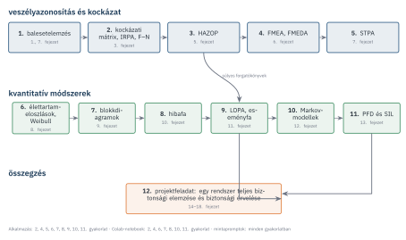

# Bevezetés {.unnumbered}

Ez a gyakorlati útmutató a *Biztonságkritikus rendszerek* kézikönyv [párja](https://complexsystemsintelligence.github.io/biztonsagkritikus-rendszerek/kezikonyv/). A kézikönyv a módszerek elméletét és indoklását adja, az útmutató pedig azt, hogy a módszereket a saját kezeddel, valós léptékű példákon alkalmazd. A tizenkét gyakorlat a kézikönyv fejezeteit követi, és ugyanazt a három futó esetet használja: a ReaktorVéd exoterm reaktor védelmi rendszerét, a VészFék vészfékező asszisztenst és a KoboCella kollaboratív robotcellát.

{#fig-attekintes width=100%}

## Mit kínál az útmutató? {.unnumbered}

**Böngészős alkalmazások.** Kilenc gyakorlathoz önálló, telepítés nélkül futó alkalmazás tartozik (kockázati mátrix, FMEA-munkalap, STPA-munkalap, élettartam-eloszlások, blokkdiagram, hibafa-elemző, LOPA és eseményfa, Markov-szerkesztő, PFD- és SIL-kalkulátor). Az alkalmazások az útmutató oldalaiba ágyazva és külön lapon is megnyithatók, internetkapcsolat nélkül is működnek, és a munkádat a böngésző helyi tárolójában megőrzik (ha a böngésző ezt engedi). Az eredmények CSV- vagy Markdown-fájlként letölthetők.

**Colab-notebookok.** Hét gyakorlathoz Python-notebook tartozik, amely a Google Colab felületén egy kattintással megnyílik, és a kézikönyv számpéldáit reprodukálja: a megbízhatósági becslésektől a hibafa-elemzésen és a Markov-modelleken át a SIL-igazolás Monte Carlo-bizonytalanságáig. A notebookok kódja szabadon módosítható; a feladatcellák a továbbgondolást segítik.

**Mintapromptok.** Minden gyakorlat ad mintapromptokat a nagy nyelvi modellek felelős használatához: kritikus olvasótársként, ötletgyűjtő partnerként vagy a saját számításaid ellenőrzőjeként. A promptok mindig kérik, hogy a modell jelölje a bizonytalanságait, és ne találjon ki adatokat vagy hivatkozásokat.

## Tanulási eredmények {.unnumbered}

Az útmutató teljes feldolgozása után képes leszel

- egy balesetvizsgálati jelentést a lineáris, a rétegmodell alapú és a rendszerelméleti balesetmodell szemléletével elemezni, és a tanulságokat tervezési követelményekké alakítani;
- veszélyazonosítást végezni HAZOP-, FMEA- és STPA-módszerrel, és a módszerek eredményeit összevetni;
- kalibrált kockázati mátrixot tervezni, felismerni a korlátait, és egyéni és társadalmi kockázatot számolni;
- élettartam-adatokból megbízhatósági jellemzőket becsülni, és a becslés bizonytalanságát számszerűsíteni;
- blokkdiagramot, hibafát, eseményfát és Markov-modellt felállítani és kiértékelni, és tudni, melyik kérdéshez melyik modell illik;
- LOPA-val meghatározni egy biztonsági funkció integritási követelményét, és a tervezett funkcióról PFD-számítással, architekturális korlátokkal és érzékenységvizsgálattal igazolni, hogy teljesíti;
- egy választott rendszer teljes biztonsági elemzését elkészíteni, és az eredményeket biztonsági érvelésbe rendezni;
- a nagy nyelvi modelleket a biztonsági elemzés támogatására felelősen, a kimenetek ellenőrzésével használni.

| Gyakorlat | Kézikönyv | Alkalmazás | Notebook | Fő kompetencia |
|:--|:--|:--:|:--:|:--|
| 1. balesetelemzés | 1., 7. fejezet | – | – | baleseti okok rendszerszintű elemzése |
| 2. kockázati mátrix, IRPA, F–N | 3. fejezet | igen | igen | kockázatértékelés és -elfogadhatóság |
| 3. HAZOP | 5. fejezet | – | – | szisztematikus veszélyazonosítás |
| 4. FMEA, FMEDA | 6. fejezet | igen | igen | meghibásodási módok és diagnosztika |
| 5. STPA | 7. fejezet | igen | – | irányítási hibák feltárása |
| 6. élettartam-eloszlások | 8. fejezet | igen | igen | megbízhatósági becslés adatokból |
| 7. blokkdiagramok | 9. fejezet | igen | igen | rendszermegbízhatóság |
| 8. hibafa | 10. fejezet | igen | igen | deduktív elemzés, fontosság |
| 9. LOPA, eseményfa | 11. fejezet | igen | – | integritási követelmény meghatározása |
| 10. Markov-modellek | 12. fejezet | igen | igen | javítható és tesztelt rendszerek |
| 11. PFD és SIL | 13. fejezet | igen | igen | a biztonsági integritás igazolása |
| 12. projektfeladat | 14–18. fejezet | – | – | teljes elemzés és biztonsági érvelés |

: A gyakorlatok áttekintése {#tbl-gyakorlatok tbl-colwidths="[26,16,13,12,33]"}

## Hogyan dolgozz a nagy nyelvi modellekkel? {.unnumbered}

A nagy nyelvi modellek hasznos segítők lehetnek a biztonsági elemzésben: ötleteket adnak a veszélyazonosításhoz, összefoglalnak hosszú jelentéseket, magyaráznak, kódot írnak és ellenőriznek. A kézikönyv [18. fejezete](https://complexsystemsintelligence.github.io/biztonsagkritikus-rendszerek/kezikonyv/fejezetek/18-uj-kihivasok.html) azonban arra is figyelmeztet, hogy a javaslataik egy része téves vagy irreleváns, és a magabiztos megfogalmazás könnyen automatizálási torzításhoz vezet. Néhány elv, amelyet minden gyakorlatban érdemes követni:

1. **Előbb te gondolkodj.** Készítsd el a saját elemzésed első változatát, és csak utána kérd a modell véleményét. Így a modell kiegészít, nem helyettesít.
2. **Adj kontextust, és kérj bizonytalanságjelölést.** Írd le a rendszert, a feltevéseket és a célt; kérd, hogy a modell jelölje a bizonytalan állításait, és ne találjon ki számokat vagy hivatkozásokat.
3. **Ellenőrizz mindent.** Különösen a számokat, a szabványpontokat, a jogi állításokat és a hivatkozásokat. A modell kimenete csak akkor kerülhet az elemzésbe, ha egy szakértő ellenőrizte.
4. **Dokumentáld a modell szerepét.** A jegyzőkönyvben vagy a biztonsági érvelésben rögzítsd, mire használtad a modellt, és ki ellenőrizte a kimenetét.
5. **Vigyázz a bizalmas adatokkal.** Valós tervadatokat csak a munkahelyed adatvédelmi szabályainak megfelelő eszközzel ossz meg.

::: {.prompt title="Általános keretprompt"}
*„Biztonságkritikus rendszerek elemzésében segítesz. A feladat: [a feladat rövid leírása]. A rendszer: [a rendszer leírása, határai, üzemállapotai]. Az eddigi elemzésem: [saját eredmény]. Kérlek, (1) mutass rá a hiányosságokra és a téves feltevésekre, (2) javasolj kiegészítéseket, (3) minden állításodnál jelöld, mennyire vagy biztos benne, (4) ne találj ki számadatot, szabványpontot vagy hivatkozást; ha valamit nem tudsz, mondd meg.”*
:::

## Technikai tudnivalók {.unnumbered}

Az alkalmazások modern böngészőben (Chrome, Firefox, Edge, Safari) futnak. A notebookok megnyitásához Google-fiók kell; a Colab ingyenes változata minden számításhoz elegendő. A notebookok helyi Jupyter-környezetben is futtathatók (NumPy, SciPy, Matplotlib és pandas szükséges). Az útmutató, az alkalmazások és a notebookok forrása a könyv [GitHub-tárolójában](https://github.com/ComplexSystemsIntelligence/biztonsagkritikus-rendszerek) található. A szöveg CC BY-NC-SA 4.0, a kód MIT licenc alatt használható.
