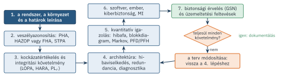

# Projektfeladat: egy rendszer teljes biztonsági elemzése {#sec-gy-projekt}

::: {.cel}
A projektfeladat végére képes leszel

- egy általad választott rendszer biztonsági elemzését a veszélyazonosítástól a biztonsági érvelésig önállóan elvégezni;
- a módszereket a kérdéshez illesztve kiválasztani és összekapcsolni;
- az eredményeket ellenőrizhető biztonsági érvelésbe rendezni, és az üzemeltetési feltevéseket mutatókká alakítani;
- a nagy nyelvi modelleket a munka minden lépésében felelősen, dokumentáltan használni.
:::

**Háttér:** a kézikönyv egésze, különösen a [14.](https://complexsystemsintelligence.github.io/biztonsagkritikus-rendszerek/kezikonyv/fejezetek/14-architekturak.html), [15.](https://complexsystemsintelligence.github.io/biztonsagkritikus-rendszerek/kezikonyv/fejezetek/15-szoftver.html), [16.](https://complexsystemsintelligence.github.io/biztonsagkritikus-rendszerek/kezikonyv/fejezetek/16-ember.html), [17.](https://complexsystemsintelligence.github.io/biztonsagkritikus-rendszerek/kezikonyv/fejezetek/17-biztonsagi-erveles.html) és [18. fejezet](https://complexsystemsintelligence.github.io/biztonsagkritikus-rendszerek/kezikonyv/fejezetek/18-uj-kihivasok.html).

## Választható rendszerek

- automatizált raktári szállítójármű (AMR) emberekkel közös térben;
- orvostechnikai infúziós pumpa;
- vasúti átjáró sorompójának vezérlése;
- hidrogéntöltő állomás nyomásvédelme;
- egy saját, munkahelyi vagy kutatási rendszer (a gyakorlatvezetővel egyeztetve).

## A munka menete

A projekt hét lépésből áll ([-@fig-projekt]. ábra). A lépések egymásra épülnek, de a tervezés természeténél fogva iteratív: ha a kvantitatív igazolás nem teljesül, az architektúrához kell visszatérni.

{#fig-projekt width=100%}

| Lépés | Elvárt eredmény | Kézikönyv |
|:--|:--|:--|
| 1. rendszer és határok | a funkciók, az üzemállapotok, a környezet és a határok leírása; feltevések | 2., 4. fejezet |
| 2. veszélyazonosítás | PHA, illetve a rendszerhez illő HAZOP, FHA/HARA vagy STPA | 5–7. fejezet |
| 3. kockázat és integritás | kockázatértékelés; LOPA, HARA vagy PL~r~ alapján a biztonsági funkciók integritási követelménye | 3., 4., 11. fejezet |
| 4. architektúra | hibaviselkedési stratégia, redundancia, diagnosztika, közös okok elleni intézkedések | 14. fejezet |
| 5. kvantitatív igazolás | hibafa vagy blokkdiagram, szükség esetén Markov-modell; PFD vagy PFH, érzékenység | 8–13. fejezet |
| 6. szoftver, ember, kiberbiztonság, MI | a releváns szempontok elemzése és intézkedései | 15., 16., 18. fejezet |
| 7. biztonsági érvelés | GSN-váz a fő állításokkal, bizonyítékokkal és feltevésekkel; az üzemeltetési mutatók | 17. fejezet |

: A projektfeladat lépései és elvárt eredményei {#tbl-projekt}

## Mintapromptok a lépésekhez

::: {.prompt title="1–2. lépés: rendszerleírás és veszélyazonosítás"}
*„Egy [rendszer] biztonsági elemzését kezdem. A rendszerleírásom: […]. Kérdezz rá azokra a határokra, üzemállapotokra és külső feltételekre, amelyeket nem adtam meg, és amelyek a veszélyazonosításhoz szükségesek! Utána javasolj egy előzetes veszélylistát, de mindegyik veszélynél jelöld, hogy ez a leírásomból következik vagy általános tapasztalat.”*
:::

::: {.prompt title="3–5. lépés: integritási követelmény és igazolás"}
*„Az alábbi biztonsági funkcióra [SIL/PL] követelményt határoztam meg ezzel az indoklással: […]. Ellenőrizd a gondolatmenetet: van-e benne kettős beszámítás, nem független védelem vagy indokolatlan feltevés? Az architektúrámra kapott PFD/PFH-értéket ne számold újra; a feltevéseimet vizsgáld.”*
:::

::: {.prompt title="6. lépés: szoftver, ember, kiberbiztonság, MI"}
*„A rendszeremben [szoftveres / emberi / hálózati / gépi tanulási] elem is van: […]. Sorold fel azokat a veszélyforrásokat, amelyeket a hagyományos meghibásodás-alapú elemzés nem tár fel (például a rendeltetésszerű funkció korlátai, az automatizálás iróniái, támadási útvonalak), és mindegyikhez javasolj egy tervezési intézkedést!”*
:::

::: {.prompt title="7. lépés: biztonsági érvelés"}
*„Az alábbi GSN-vázat készítettem a biztonsági érvelésemhez: […]. Keress benne rejtett feltevéseket, a bizonyíték és az állítás közötti réseket, és olyan állításokat, amelyek nem ellenőrizhetők! Mindegyikre javasolj pontosabb megfogalmazást.”*
:::

## Ellenőrző szempontok

A projekt akkor jó, ha a lépések következetesen egymásra épülnek (a veszélyekből követelmények, a követelményekből architektúra, az architektúrából igazolás lesz); a módszerválasztás indokolt; minden szám és feltevés forráshoz kötött; a kvantitatív eredmény mellett az érzékenység és a bizonytalanság is szerepel; a biztonsági érvelés a gyenge pontokat is őszintén megmutatja; és dokumentált, mire és hogyan használtad a nagy nyelvi modelleket.
