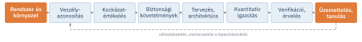
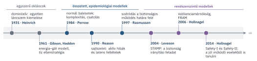
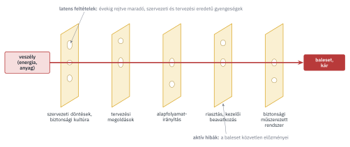
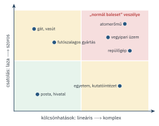
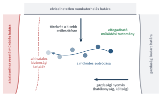

# Miért hibáznak a rendszerek? Balesetek és balesetmodellek {#sec-balesetek}

{width=100%}

A biztonságtechnika a balesetekből tanult meg mindent, amit tud. A szabványok előírásai, a tervezési elvek és az elemzési módszerek mögött szinte mindig egy-egy konkrét katasztrófa áll, amelyet utólag sokan „elkerülhetőnek” neveztek. Ebben a fejezetben hat jól dokumentált balesetet vizsgálunk meg, és megkeressük, mi a közös bennük. Ezután áttekintjük, hogyan gondolkodott a mérnöki és a pszichológiai szakirodalom a balesetek keletkezéséről az elmúlt száz évben. A fejezet célja nem a félelemkeltés, hanem a szemléletformálás: a későbbi módszerek akkor használhatók jól, ha értjük, milyen jelenségek ellen dolgoznak.

::: {.cel}
A fejezet végére képes leszel

- hat jelentős baleset (Therac-25, Ariane 5, Texas City, Buncefield, Boeing 737 MAX, Uber ATG) okait és tanulságait a vizsgálati jelentések alapján összefoglalni;
- megkülönböztetni a lineáris okláncmodelleket, az epidemiológiai modelleket és a rendszerszintű balesetmodelleket;
- a sajtszelet-modell, a Rasmussen-féle sodródás és a STAMP fogalmaival elemezni egy balesetet;
- megindokolni, miért nem elég a biztonsághoz az egyes alkatrészek megbízhatóságát növelni.
:::

## Mit tanulhatunk a balesetekből? {#sec-balesetek-tanulsag}

Edward Murphy amerikai mérnök nevéhez fűződik a mondás, hogy „ami elromolhat, az el is romlik”. A történet szerint 1949-ben egy gyorsulásmérési kísérletsorozatot kellett megismételni, mert a mérőátalakítókat fordítva szerelték be. A mondás szellemes, de a mérnök számára veszélyes is, mert azt sugallja, hogy a hiba sorsszerű. A balesetvizsgálatok tapasztalata ennél árnyaltabb: a súlyos balesetek ritkán egyetlen hibából fakadnak, és szinte mindig megelőzik őket figyelmeztető jelek, elmaradt intézkedések, rosszul értelmezett kockázatok.

A balesetvizsgálat célja ma már nem a bűnös megtalálása, hanem annak megértése, hogyan válhatott lehetővé a baleset, és hogyan lehet megakadályozni az ismétlődését. Ezt a szemléletet követik a független vizsgálószervek, például az amerikai Közlekedésbiztonsági Testület (NTSB), a Vegyipari Biztonsági Testület (CSB) vagy a francia polgári repülési balesetvizsgáló hatóság (BEA). Jelentéseik nyilvánosak, és a biztonságtechnika legfontosabb tananyagai közé tartoznak.

## Hat baleset, hat tanulság {#sec-hat-baleset}

Az alábbi esetek különböző iparágakból származnak, és mindegyikük más okból vált a szakma közös emlékezetének részévé. A leírások a hivatalos vizsgálati jelentéseken és az azokat feldolgozó szakirodalmon alapulnak.

::: {.baleset title="Therac-25: amikor a szoftver átveszi a hardveres védelem szerepét (1985–1987)"}
A Therac-25 sugárterápiás gyorsító két üzemmódban működött: kis intenzitású elektronnyalábbal és nagy intenzitású, céltárgyon átvezetett röntgensugárzással. Az elődmodellekben hardveres reteszelés akadályozta meg, hogy a nagy intenzitású nyaláb céltárgy nélkül érje a beteget. A Therac-25-ben ezt a reteszelést szoftveres ellenőrzés váltotta fel. Hat ismert balesetben a betegek a tervezett dózis sokszorosát kapták, több eset halálos kimenetelű volt [@leveson1993].

A vizsgálat több egymást erősítő okot tárt fel. A szoftverben versenyhelyzet (*race condition*) volt: ha a kezelő gyorsan módosította a bevitt adatokat, a gép beállítása és a képernyőn látható érték eltérhetett egymástól. A hibaüzenetek rejtélyesek voltak („MALFUNCTION 54”), a kezelők megszokták, hogy egyszerűen továbblépnek. A gyártó az első bejelentések után nem tudta reprodukálni a hibát, és hosszú ideig kizártnak tartotta, hogy a szoftver okozza. A szoftvert nem vetették alá független felülvizsgálatnak, a régebbi modellekből átvett kódrészleteket újrafelhasználták, pedig azok korábban a hardveres reteszelés „árnyékában” működtek.

**Tanulság:** a szoftver nem hibázik véletlenszerűen, hanem szisztematikusan; a hardveres védelem kiváltása szoftverrel új veszélyeket teremt; a kezelőfelület és a hibajelzések tervezése biztonsági kérdés.
:::

::: {.baleset title="Ariane 5, 501-es repülés: hibátlan kód rossz környezetben (1996)"}
1996\. június 4-én az Európai Űrügynökség új hordozórakétája az első repülésén mintegy negyven másodperccel a start után letért a pályájáról, és megsemmisült. A vizsgálóbizottság szerint az inerciális referenciarendszer (SRI) szoftvere egy 64 bites lebegőpontos értéket (a vízszintes sebességhez kapcsolódó változót) 16 bites előjeles egész számmá alakított, és a túlcsordulás kezeletlen kivételt okozott [@lions1996]. A kódot az Ariane 4-ből vették át, ahol a rakéta pályája miatt ez az érték soha nem nőhetett ekkorára. Az Ariane 5 nagyobb vízszintes gyorsulása mellett viszont igen. Ráadásul az érintett függvénynek a start után már nem volt szerepe.

A redundancia nem segített: a két SRI-egység ugyanazt a szoftvert futtatta, így ugyanabban a pillanatban, ugyanazért hibásodott meg. A fedélzeti számítógép a hibás egység diagnosztikai adatait repülési adatként értelmezte, és teljes kitérítést adott a fúvókáknak.

**Tanulság:** az újrafelhasznált komponens csak az eredeti feltételei között bizonyított; az azonos redundáns egységek közös okú hibája ellen a megtöbbszörözés nem véd; a követelmények és feltevések nyomon követése (mit tételezett fel a kód írója?) biztonsági kérdés.
:::

::: {.baleset title="BP Texas City: a figyelmeztető jelek erodálódása (2005)"}
2005\. március 23-án a texasi finomító izomerizációs üzemének indításakor egy desztillálókolonnát túltöltöttek. A túlnyomás miatt nyíló biztonsági szelepeken keresztül éghető folyadék került egy légköri lefúvató tartályba és kéménybe, onnan a szabadba. A kialakuló gőzfelhő berobbant. Tizenöt ember meghalt, több mint százhetvenen megsérültek; a halálos áldozatok a közelben elhelyezett ideiglenes konténerirodákban tartózkodtak [@csb2007].

A CSB jelentése a technikai okok (hibás szintmérés, a magasszint-riasztás elmaradása, elavult lefúvató rendszer) mellett hangsúlyosan szervezeti okokat nevezett meg: költségcsökkentést a karbantartásban, a kezelők fáradtságát, a korábbi hasonló események figyelmen kívül hagyását, és azt, hogy a vállalat a munkabiztonsági mutatók (például a munkaidő-kieséses balesetek száma) javulását a folyamatbiztonság javulásának tekintette.

**Tanulság:** a személyi munkabiztonság és a folyamatbiztonság két különböző dolog, más mutatókkal mérhető; a kisebb események és a „majdnem balesetek” a nagy balesetek előjelei; a telepítési döntések (hová kerülnek az emberek) a kockázat részei.
:::

::: {.baleset title="Buncefield: a nem független védelmi réteg (2005)"}
2005\. december 11-én hajnalban az angliai Buncefield üzemanyag-tárolójában egy tartályt túltöltöttek. A szintmérő megakadt, és állandó értéket mutatott, a független magasszint-kapcsoló pedig nem működött, mert egy szerelési és karbantartási hiba miatt hatástalan volt. A kiömlő benzin gőzfelhőt alkotott, amely berobbant és a környék több tartályára átterjedő tűzvészt okozott. Halálos áldozat nem volt, de negyvenhárom ember megsérült, és a kár Európa egyik legnagyobb ipari kára volt [@buncefield2008].

**Tanulság:** a papíron független védelmi rétegek a gyakorlatban közös gyengeséggel rendelkezhetnek (közös karbantartási gyakorlat, közös téves feltevés); a védelmi funkciót rendszeresen, valósághűen kell vizsgálni (*proof test*); a tervezett kockázatcsökkentés csak akkor valós, ha az üzemeltetés is fenntartja.
:::

::: {.baleset title="Boeing 737 MAX: egyetlen érzékelő és egy rejtett automatizmus (2018–2019)"}
A Lion Air 610-es (2018. október 29.) és az Ethiopian Airlines 302-es (2019. március 10.) járatának lezuhanásában összesen 346 ember halt meg. Mindkét esetben a repülésvezérlés egy új funkciója, az MCAS (*Maneuvering Characteristics Augmentation System*) hibás állásszögjel alapján ismételten lefelé trimmelte a gépet. Az MCAS egyetlen állásszög-érzékelő jelére támaszkodott, ismételten aktiválódhatott, és a hatásköre a fejlesztés során megnőtt. A pilóták képzési anyagai nem írták le részletesen [@jatr2019].

A nemzetközi szakértői vizsgálat (JATR) többek között azt állapította meg, hogy a funkció hibás működésének veszélyességi besorolása és a tanúsítás során tett feltevések (például hogy a pilóták néhány másodpercen belül felismerik és kezelik a helyzetet) nem követték a funkció módosításait.

**Tanulság:** egy biztonságkritikus funkció nem támaszkodhat egyetlen érzékelőre; a tervezés során módosuló funkciók veszélyelemzését újra kell értékelni; az emberi beavatkozásra vonatkozó feltevéseket igazolni kell, nem csak feltételezni.
:::

::: {.baleset title="Uber ATG, Tempe: az automatizálás és a felügyelő ember (2018)"}
2018\. március 18-án éjjel az arizonai Tempe városában egy fejlesztés alatt álló önvezető tesztjármű halálosan elütött egy kerékpárját toló gyalogost. Az NTSB vizsgálata szerint a rendszer körülbelül 5,6 másodperccel az ütközés előtt észlelte a gyalogost, de többször átsorolta (jármű, egyéb objektum, kerékpár), és minden átsorolásnál elvetette a mozgáspályájának előzményeit. A jármű saját vészfékező funkcióját a tesztek idejére kikapcsolták, és a rendszer a beavatkozást a biztonsági vezetőre bízta, aki a vizsgálat szerint a baleset előtt a telefonján nézett videót [@ntsb2019].

Az NTSB a valószínű okok között a biztonsági vezető figyelmetlenségét, de a hozzájáruló tényezők között a vállalat elégtelen biztonsági kockázatértékelését, a kezelők figyelmének hiányzó felügyeletét és a „automatizálási elkényelmesedés” (*automation complacency*) kezelésének hiányát is megnevezte.

**Tanulság:** a passzív felügyeletre szoruló ember megbízhatatlan biztonsági tartalék; az érzékelés és osztályozás bizonytalanságát a rendszer architektúrájának kell kezelnie; a fejlesztési és tesztelési tevékenység maga is biztonsági kockázatot hordoz.
:::

## Közös mintázatok {#sec-kozos-mintazatok}

A hat eset között évtizedek és iparágak húzódnak, mégis feltűnően hasonlóak. A [-@tbl-mintazatok]. táblázat összefoglalja azokat a mintázatokat, amelyekre a könyv további fejezetei módszereket kínálnak.

| Mintázat | Példa | A könyv válasza |
|:--|:--|:--|
| A hiba a specifikációban vagy a feltevésekben van, nem az alkatrészben | Ariane 5, Therac-25, 737 MAX | veszélyazonosítás (5–7. fejezet), követelmények nyomon követése (15. fejezet) |
| A redundáns egységek közös okból hibásodnak meg | Ariane 5, Buncefield | közös okú hibák modellezése (10. és 13. fejezet) |
| A védelmi rétegek idővel erodálódnak | Texas City, Buncefield | proof teszt, üzemeltetési fázis (13. fejezet) |
| A szoftver új, szisztematikus hibamódokat hoz | Therac-25, Ariane 5 | szoftverbiztonság (15. fejezet) |
| Az ember felügyelőként és tartalékként nem megbízható | Uber, 737 MAX | ember a rendszerben (16. fejezet) |
| Szervezeti nyomás és gyenge biztonsági kultúra | Texas City, Uber | biztonsági érvelés és menedzsment (17. fejezet) |
| Az új technológia a meglévő módszerek határain túl működik | Uber | SOTIF, gépi tanulás (18. fejezet) |

: A balesetek közös mintázatai és a kapcsolódó fejezetek {#tbl-mintazatok}

Két általános következtetés adódik. Az első, hogy **a megbízhatóság és a biztonság nem ugyanaz.** Az Ariane 5 szoftvere azt tette, amit specifikáltak; a Therac-25 szoftvere a specifikációja szerinti esetek túlnyomó többségében helyesen működött. Egy rendszer lehet megbízható és mégis veszélyes, és lehet kevéssé megbízható, mégis biztonságos (például ha minden hibájakor biztonságos állapotba áll). A [-@sec-fogalmak]. fejezet ezt a különbséget pontosan definiálja.

A második, hogy **a balesetek mögött rendszerszintű okok állnak.** Az alkatrészhiba, az emberi tévedés vagy a szoftverhiba közvetlen ok, de az, hogy ebből baleset lett, a rendszer felépítésén, a szervezet működésén és a szabályozási környezeten múlt. Ezt a felismerést követték a balesetmodellek.

## A balesetmodellek fejlődése {#sec-balesetmodellek}

A balesetmodell az a gondolati keret, amellyel a balesetek keletkezését magyarázzuk. A választott modell meghatározza, mit keresünk a vizsgálat során, és milyen intézkedéseket tartunk hatékonynak. A [-@fig-modellek-idovonal]. ábra a legfontosabb modelleket mutatja időrendben.

{#fig-modellek-idovonal width=100%}

### Lineáris okláncmodellek {#sec-oklanc}

Herbert W. Heinrich biztosítási szakember 1931-ben megjelent könyvében a balesetet egymás után dőlő dominók sorozataként írta le: a társadalmi környezet és a személyes hiányosságok vezetnek a nem biztonságos cselekedethez vagy állapothoz, ez a balesethez, az pedig a sérüléshez [@heinrich1931]. Ha egy dominót kiveszünk, a lánc megszakad. Heinrich nevéhez fűződik az a sokat idézett, de módszertanilag gyenge állítás is, hogy a balesetek túlnyomó többségét emberi „nem biztonságos cselekedet” okozza.

A dominóelv egyszerű és jól kommunikálható, ezért ma is él például a gyökérok-elemzés (*root cause analysis*) naiv változataiban. Két korlátja van: a balesetet egyetlen láncra szűkíti, holott a valóságban több, egymással kölcsönható ok vezet hozzá, és könnyen az utolsó láncszemnél, a kezelő hibájánál áll meg.

### Energia–gát modell {#sec-energia-gat}

James Gibson és William Haddon az 1960-as és 1970-es években a balesetet a nem kívánt **energiaátadás** jelenségeként írta le [@haddon1973]. A kár akkor keletkezik, ha mechanikai, hő-, vegyi, villamos vagy sugárzási energia olyan mértékben jut el az emberhez vagy a védendő értékhez, amely meghaladja annak tűrőképességét. A megelőzés eszközei a **gátak** (*barriers*): az energia mennyiségének csökkentése, a felhalmozódás megakadályozása, a felszabadulás lassítása, a térbeli vagy időbeli elválasztás, a védendő érték ellenállóbbá tétele. Haddon tíz ilyen ellenstratégiát sorolt fel.

Az energia–gát gondolat a mai folyamatbiztonság alapja. A [-@sec-esemenyfa]. fejezetben tárgyalt rétegzett védelem (LOPA) és a bow-tie diagram közvetlenül erre épül, és a [-@sec-architekturak]. fejezetben tárgyalt inherens biztonság elve (kevesebb veszélyes anyag, alacsonyabb nyomás) is az energiaforrás csökkentéséről szól.

### A sajtszelet-modell: aktív hibák és latens feltételek {#sec-sajtszelet}

James Reason pszichológus a *Human Error* (1990) és a *Managing the Risks of Organizational Accidents* (1997) című könyveiben a szervezeti balesetek magyarázatára vezette be a sokszor „svájci sajt modellnek” nevezett ábrázolást [@reason1990; @reason1997]. A rendszer védelmi rétegeit (szervezeti döntések, tervezés, irányítás, riasztás, védelmi rendszer) szeletekként képzeljük el, amelyeken lyukak vannak ([-@fig-sajtszelet]. ábra). Baleset akkor következik be, ha egy pillanatra minden szelet lyukai egy vonalba kerülnek, és a veszély átjut rajtuk.

{#fig-sajtszelet width=100%}

Reason két hibatípust különböztet meg. Az **aktív hibák** (*active failures*) a frontvonalban dolgozók (kezelők, pilóták, karbantartók) tévedései és szabályszegései, amelyeknek azonnali hatásuk van. A **latens feltételek** (*latent conditions*) a tervezők, a vezetők és a szabályozók döntéseiből fakadnak: elégtelen képzés, félrevezető kezelőfelület, karbantartási hiányosság, időnyomás. Ezek évekig rejtve maradhatnak, amíg egy aktív hibával találkozva balesethez nem vezetnek. A modell legfontosabb üzenete, hogy a kezelő hibája gyakran csak a lánc utolsó, látható eleme; a tartós javulást a latens feltételek felszámolása hozza.

A sajtszelet-modell a gyakorlatban rendkívül népszerű, és a 2014-es jegyzet is ezzel szemléltette a független védelmi rétegek jelentőségét. Fontos azonban látni a korlátait: a lyukak „egy vonalba kerülését” nem magyarázza meg, a rétegeket egymástól függetlennek ábrázolja, és könnyen arra csábít, hogy egyszerűen több szeletet tegyünk a rendszerbe.

::: {.hiba title="„Még egy védelmi réteg” mindig segít?"}
A sajtszelet-modell félreérthető üzenete, hogy minél több a szelet, annál biztonságosabb a rendszer. A valóságban az új réteg új hibamódokat, új bonyolultságot és hamis biztonságérzetet is hozhat. A kezelők például jobban támaszkodhatnak az automatikus védelemre, és ritkábban figyelnek a folyamatra. A rétegek csak akkor szorozzák a kockázatcsökkentést, ha valóban függetlenek egymástól. Ezt a [-@sec-esemenyfa]. fejezetben a független védelmi réteg (IPL) szigorú kritériumaival fogjuk megfogalmazni.
:::

### Normál balesetek: komplexitás és csatolás {#sec-perrow}

Charles Perrow szociológus az 1979-es Three Mile Island-i atomerőmű-baleset elemzése nyomán jutott arra a következtetésre, hogy bizonyos rendszerekben a balesetek elkerülhetetlenek, „normálisak” [@perrow1984]. Két jellemzőt emelt ki ([-@fig-perrow]. ábra):

- **interaktív komplexitás:** a rendszer elemei váratlan, nem tervezett és nehezen átlátható módon hathatnak egymásra;
- **szoros csatolás:** a folyamatok gyorsan, kötött sorrendben és kevés tartalékkal futnak, így nincs idő beavatkozni, ha valami eltér a tervezettől.

{#fig-perrow width=72%}

Perrow szerint a jobb felső negyedbe eső rendszerekben a több független hiba váratlan kölcsönhatása előbb-utóbb balesethez vezet, és a redundancia tovább növelheti a komplexitást. Az elmélet vitatott, mert a magas megbízhatóságú szervezetek (például a repülőgép-hordozók vagy a légiforgalmi irányítás) kutatói kimutatták, hogy megfelelő szervezeti kultúrával ezek a rendszerek is tartósan biztonságosan működtethetők. A mérnök számára mégis fontos üzenetet hordoz: a komplexitás és a csatolás tervezési paraméter, és csökkentésük maga is biztonsági intézkedés.

### Sodródás a határ felé {#sec-rasmussen}

Jens Rasmussen dán mérnök és pszichológus 1997-es tanulmányában a biztonságot dinamikus egyensúlyként írta le [@rasmussen1997]. A rendszer működése egy olyan térben mozog, amelyet három határ fog közre ([-@fig-rasmussen]. ábra): a gazdasági kudarc határa, az elviselhetetlen munkaterhelés határa és a balesethez vezető működés határa. A vezetés a hatékonyság növelésére, a dolgozók az erőfeszítés csökkentésére törekednek. Ez a két nyomás a működést lassan, észrevétlenül a biztonsági határ felé sodorja. Minden egyes lépés ésszerűnek tűnik, és mivel a baleset elmarad, a kisebb tartalék megszokottá válik.

{#fig-rasmussen width=82%}

A Texas City-i baleset jó példája ennek a sodródásnak: az elhalasztott karbantartások, a mellőzött eljárások és az elfogadott rendellenességek külön-külön nem okoztak balesetet, együtt viszont eltüntették a biztonsági tartalékot. A Rasmussen-modell üzenete, hogy a biztonságot nem lehet egyszer „beépíteni” a rendszerbe, hanem folyamatosan figyelni kell, és a határokat láthatóvá kell tenni a döntéshozók számára.

### STAMP: a biztonság irányítási feladat {#sec-stamp-bevezetes}

Nancy Leveson az MIT professzoraként a 2000-es évek elején fogalmazta meg a STAMP-modellt (*Systems-Theoretic Accident Model and Processes*), amelyet *Engineering a Safer World* című könyvében foglalt össze [@leveson2011]. A STAMP a balesetet nem hibák láncolataként, hanem **irányítási problémaként** értelmezi: a biztonság a rendszer emergens tulajdonsága, amely akkor áll fenn, ha a rendszer viselkedésére vonatkozó biztonsági korlátokat (*safety constraints*) a hierarchikus irányítási struktúra minden szintje érvényesíti. A baleset oka az, hogy egy korlát nem érvényesült: az irányító hibás vagy hiányos folyamatmodell alapján döntött, a visszacsatolás hiányzott vagy késett, vagy az irányító beavatkozása nem hatott.

Ebben a szemléletben az alkatrészhiba csak egy a lehetséges okok közül. A baleset akkor is bekövetkezhet, ha egyetlen alkatrész sem hibásodik meg, de az alkatrészek kölcsönhatása nem biztonságos. Erre a Mars Polar Lander 1999-es elvesztése a klasszikus példa: a leszállóláb kinyitásakor keletkező rezgést a szoftver a talajérés jelének értelmezte, és idő előtt leállította a fékezőhajtóművet. Az érzékelő és a szoftver is a specifikációja szerint működött.

A STAMP-ra épülő veszélyelemzési módszert, az STPA-t a [-@sec-stpa]. fejezet részletesen tárgyalja.

### Safety-I és Safety-II {#sec-safety-ii}

Erik Hollnagel és a rezilienciamérnökség (*resilience engineering*) képviselői arra hívták fel a figyelmet, hogy a hagyományos biztonságtechnika (Safety-I) a ritka hibákból és balesetekből tanul, és a biztonságot a nem kívánt események hiányaként határozza meg [@hollnagel2014]. A Safety-II szemlélet szerint a biztonság az a képesség, hogy a rendszer változó körülmények között is sikeresen működjön. Ezt pedig leginkább a jól működő esetekből, az emberek folyamatos alkalmazkodásából lehet megérteni. A két szemlélet nem zárja ki, hanem kiegészíti egymást: a tervezésnél a Safety-I módszerei (veszélyazonosítás, kockázatcsökkentés), az üzemeltetésnél a Safety-II szemlélete (a mindennapi alkalmazkodás megértése és támogatása) egyaránt szükséges.

## Mit jelent mindez a mérnök számára? {#sec-balesetek-mernok}

A balesetmodellek nem egymást felváltó divatok, hanem egymásra épülő rétegek. A könyv módszertana mindegyikből merít:

- a **redukcionista módszerek** (FMEA, hibafa, megbízhatósági blokkdiagram, Markov-modell) az alkatrészhibák és kombinációik hatását számszerűsítik, és nélkülözhetetlenek a biztonsági funkciók integritásának igazolásához (III. rész);
- a **gát- és rétegszemlélet** (LOPA, bow-tie) a kockázatcsökkentés felépítését teszi átláthatóvá ([-@sec-esemenyfa]. fejezet);
- a **rendszerelméleti szemlélet** (STAMP, STPA) a kölcsönhatásokból, a specifikációs hibákból és az ember–automatizálás együttműködéséből fakadó veszélyeket tárja fel ([-@sec-stpa]. fejezet);
- a **szervezeti és emberi szemlélet** (Reason, Rasmussen, Hollnagel) az üzemeltetés és a biztonsági kultúra kérdéseire figyelmeztet ([-@sec-ember]. és [-@sec-biztonsagi-erveles]. fejezet).

::: {.eset eset="A" title="ReaktorVéd: melyik baleset tanulsága érinti a reaktort?"}
A ReaktorVéd reaktorát exoterm reakció hőfejlődése teszi veszélyessé. A Texas City- és a Buncefield-baleset közvetlenül releváns: mindkettőben túltöltés és a védelmi rétegek eróziója vezetett a katasztrófához. A tervezőcsapat ezért már a koncepciós fázisban három kérdést tesz fel: Mennyi energiát tárolunk, és csökkenthető-e (kisebb adag, lassabb adagolás)? Mely védelmi rétegek valóban függetlenek egymástól? Hogyan biztosítjuk, hogy a védelmi funkciók az üzemeltetés évei alatt is működőképesek maradjanak?
:::

::: {.eset eset="B" title="VészFék: az Uber-baleset tanulsága"}
A VészFék fejlesztőcsapata az Uber-baleset jelentéséből két tervezési elvet szűr le. Az érzékelés bizonytalanságát (az objektum osztályozásának ingadozását) a funkció logikájának kell kezelnie, nem a vezetőnek. Továbbá a rendszer nem építhet olyan emberi beavatkozásra, amelyre a vezetőnek nincs ideje vagy figyelme. Ezek a szempontok a [-@sec-uj-kihivasok]. fejezetben, a rendeltetésszerű funkció biztonságánál (SOTIF) térnek vissza.
:::

::: {.labor}
A gyakorlati útmutató első feladata egy választott, nyilvános balesetvizsgálati jelentés elemzése a sajtszelet-modell és a STAMP szemléletével. A feladatlap mintapromptokat is ad ahhoz, hogyan lehet egy nagy nyelvi modellt kritikus olvasótársként használni a jelentés feldolgozásához (lásd a gyakorlati útmutató 1. laborját).
:::

::: {.osszefoglalo}
- A súlyos balesetek ritkán egyetlen hibából fakadnak; mögöttük specifikációs hibák, közös okú hibák, erodálódó védelmi rétegek, emberi tényezők és szervezeti nyomás áll.
- A megbízhatóság (a specifikáció szerinti működés) és a biztonság (a nem elfogadható kár elkerülése) két különböző tulajdonság.
- A balesetmodellek a lineáris okláncoktól (Heinrich) az energia–gát modellen és az epidemiológiai modelleken (Reason) át a rendszerszintű modellekig (Rasmussen, STAMP, Safety-II) fejlődtek.
- A modern biztonságtechnika a redukcionista, a gát-, a rendszerelméleti és a szervezeti szemléletet együtt alkalmazza.
:::

::: {.onell}
1. Miért nem védett a két inerciális referenciaegység az Ariane 5 balesete ellen?
2. Mi a különbség Reason fogalmai szerint az aktív hiba és a latens feltétel között? Adj egy-egy példát a Texas City-i balesetből!
3. Hogyan magyarázza a Rasmussen-modell, hogy egy üzem évekig baleset nélkül működik, majd egyszer csak súlyos baleset történik?
4. Lehet-e baleset akkor, ha a rendszer minden eleme a specifikációja szerint működik? Indokold egy példával!

::: {.megoldas}
1. Mert ugyanazt a szoftvert futtatták, így ugyanaz a bemenet ugyanabban a pillanatban mindkettőben ugyanazt a kezeletlen kivételt váltotta ki. Ez közös okú hiba; ellene az azonos egységek megtöbbszörözése nem véd, csak a diverzitás (eltérő kialakítás) vagy a hiba okának megszüntetése.
2. Az aktív hiba azonnali hatású, a frontvonalban elkövetett tévedés vagy szabályszegés (például a kolonna túltöltése az indításkor, a szintjelzés figyelmen kívül hagyása). A latens feltétel tervezési vagy szervezeti eredetű, rejtett gyengeség (például az elavult lefúvató rendszer, a kezelők túlterhelése, a karbantartási költségek csökkentése, az ideiglenes irodák rossz elhelyezése).
3. A gazdasági nyomás és a kisebb erőfeszítésre való törekvés lassan csökkenti a biztonsági tartalékot. Mivel a baleset sokáig elmarad, minden kisebb lépés elfogadottá válik, és a működés észrevétlenül a biztonsági határig sodródik. Ekkor már egy kis zavar is elegendő a balesethez.
4. Igen. A STAMP szerint a baleset az elemek nem biztonságos kölcsönhatásából is fakadhat. Példa a Mars Polar Lander: a lábak kinyitásakor keletkező jelet a szoftver a talajérés jelének vette, és leállította a hajtóművet, holott minden komponens a specifikációja szerint működött. A hiba a specifikációban (a kölcsönhatás figyelmen kívül hagyásában) volt.
:::
:::

::: {.forras}
- Leveson, N. G. (2011): *Engineering a Safer World.* MIT Press – nyílt hozzáférésű; a 2. és 3. fejezet a balesetmodellek kritikai áttekintése [@leveson2011].
- Reason, J. (1997): *Managing the Risks of Organizational Accidents.* Ashgate – a latens feltételek és a szervezeti balesetek klasszikus műve [@reason1997].
- Rasmussen, J. (1997): Risk management in a dynamic society. *Safety Science* 27, 183–213 [@rasmussen1997].
- A vizsgálati jelentések: Leveson és Turner (1993) a Therac-25-ről, Lions (1996) az Ariane 5-ről, a CSB (2007) a Texas City-i és az NTSB (2019) a tempei balesetről.
:::
