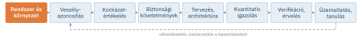
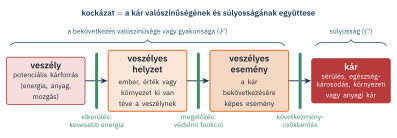
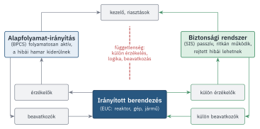
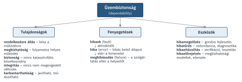
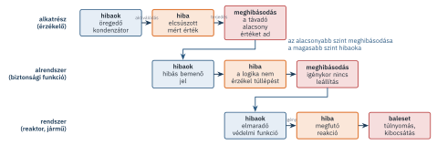
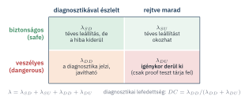

# Fogalmak: veszély, kockázat, biztonság, megbízhatóság {#sec-fogalmak}

{width=100%}

A biztonságtechnikában a pontos szóhasználat nem formalitás. Ha a tervező „veszélyről” beszél, a menedzser „kockázatról”, a szabvány pedig „veszélyes eseményről”, és mindhárman mást értenek rajta, akkor a kockázatértékelés eredménye értelmezhetetlen lesz. Ebben a fejezetben a könyv fogalmi alapjait rakjuk le a nemzetközi szabványok (ISO/IEC Guide 51, IEC 61508-4, IEC 60050-192) és az üzembiztonság-kutatás alapművének számító taxonómia [@avizienis2004] szerint. Először a veszélytől a kárig vezető utat írjuk le, majd a kockázat és a biztonság fogalmát, végül a meghibásodások osztályozását, amelyre a III. rész kvantitatív módszerei épülnek.

::: {.cel}
A fejezet végére képes leszel

- pontosan definiálni és megkülönböztetni a veszély, a veszélyes helyzet, a veszélyes esemény, a kár és a kockázat fogalmát;
- elmagyarázni, mit jelent a biztonság, a funkcionális biztonság és a biztonsági funkció;
- leírni az üzembiztonság (dependability) tulajdonságait, fenyegetéseit és eszközeit;
- a hibaok–hiba–meghibásodás láncot több rendszerszinten alkalmazni;
- osztályozni a meghibásodásokat (véletlenszerű és szisztematikus, biztonságos és veszélyes, észlelt és rejtett, közös okú).
:::

## A veszélytől a kárig {#sec-veszely-kar}

A biztonsági szabványok fogalomrendszerének közös alapja az ISO/IEC Guide 51:2014 [@isoguide51], amely a szabványírók számára rögzíti a biztonsággal kapcsolatos alapfogalmakat. A definíciók láncot alkotnak ([-@fig-veszely-kar]. ábra).

::: {.fogalom title="Kár, veszély, veszélyes helyzet, veszélyes esemény"}
- **Kár** (*harm*): sérülés vagy az emberi egészség károsodása, illetve vagyontárgyak vagy a környezet károsodása.
- **Veszély** (*hazard*): a kár lehetséges forrása.
- **Veszélyes helyzet** (*hazardous situation*): olyan körülmény, amelyben ember, vagyontárgy vagy a környezet egy vagy több veszélynek ki van téve.
- **Veszélyes esemény** (*hazardous event*): olyan esemény, amely kárt okozhat.
:::

{#fig-veszely-kar width=100%}

A veszély a rendszer tulajdonsága: a reaktorban tárolt reakcióhő, a jármű mozgási energiája, a robotkar tömege és sebessége. A veszély önmagában nem okoz kárt; ehhez az kell, hogy valaki vagy valami ki legyen téve neki (veszélyes helyzet), és bekövetkezzen egy esemény, amely a veszélyt kárrá alakítja. A műszaki rendszerekben tipikus veszélyhelyzet az, amikor egy anyag vagy berendezés a környezeténél magasabb energiaszinten van, és a működés eltér a tervezett állapottól.

A lánc három pontján lehet beavatkozni. A leghatékonyabb a **veszély elkerülése vagy csökkentése**: kevesebb veszélyes anyag, kisebb nyomás, kisebb sebesség. Ha a veszély nem szüntethető meg, a **veszélyes esemény megelőzése** következik, például egy védelmi funkcióval, amely leállítja a folyamatot, mielőtt a veszély kárrá alakulna. Végül a **következmények csökkentése**: kármentő, védőburkolat, légzsák, vészhelyzeti terv. Ez a sorrend a kockázatcsökkentés hierarchiájának alapja, amelyre a [-@sec-kockazatertekeles]. fejezetben visszatérünk.

A veszélyeket a hatásuk és eredetük szerint is csoportosíthatjuk ([-@tbl-veszelykategoriak]. táblázat). A könyv elsősorban a műszaki rendszerek belső veszélyeivel foglalkozik, de a természeti és a szándékos (biztonsági, *security*) veszélyek a kockázatértékelésnél külső hatásként jelennek meg.

| Eredet | Példa veszélyre | Tipikus veszélyes esemény | Lehetséges kár |
|:--|:--|:--|:--|
| Mechanikai | mozgó géprész, nyomás alatti tartály | ütközés, becsípődés, tartályhasadás | sérülés, halál, anyagi kár |
| Termikus, vegyi | exoterm reakció, gyúlékony gőz | megfutó reakció, robbanás, kibocsátás | égés, mérgezés, környezetszennyezés |
| Villamos | feszültség alatt álló rész | áramütés, ív, tűz | sérülés, halál |
| Sugárzás | ionizáló sugárzás, lézer | túladagolás, besugárzás | egészségkárosodás |
| Természeti | árvíz, földrengés, villám | infrastruktúra-kiesés, tartályfelúszás | közvetett műszaki baleset |
| Szándékos | kibertámadás, szabotázs | jogosulatlan beavatkozás a vezérlésbe | bármelyik fenti |

: A veszélyek csoportosítása eredetük szerint {#tbl-veszelykategoriak}

## Kockázat {#sec-kockazat-fogalom}

::: {.fogalom title="Kockázat"}
**Kockázat** (*risk*): a kár bekövetkezése valószínűségének és a kár súlyosságának együttese [@isoguide51].
:::

A definíció szándékosan nem mondja meg, hogyan kell a két összetevőt „összekombinálni”. A legegyszerűbb, a mérnöki gyakorlatban gyakran használt forma a szorzat, a várható kár:

$$
R = F \cdot C,
$$ {#eq-kockazat}

ahol $F$ a veszélyes esemény gyakorisága (például 1/év), $C$ a következmény súlyossága (például halálesetek száma vagy pénzben kifejezett kár). Ha a rendszerben több, egymást kizáró veszélyes forgatókönyv lehetséges, a teljes kockázat ezek összege:

$$
R = \sum_{i=1}^{n} F_i \, C_i .
$$ {#eq-kockazat-osszeg}

::: {.pelda title="Várható kár két forgatókönyvből"}
Egy tárolótelepen két veszélyes forgatókönyvet azonosítottak. A kisebb tömítetlenség becsült gyakorisága $F_1 = 0{,}1/\text{év}$, kára $C_1 = 2$ millió Ft; a tartály katasztrofális meghibásodásáé $F_2 = 10^{-4}/\text{év}$, kára $C_2 = 5$ milliárd Ft. A várható éves kár

$$
R = 0{,}1 \cdot 2 \cdot 10^6 + 10^{-4} \cdot 5 \cdot 10^9 = 2 \cdot 10^5 + 5 \cdot 10^5 = 7 \cdot 10^5~\text{Ft/év}.
$$

A két forgatókönyv várható kára azonos nagyságrendű, mégsem egyenértékűek: a második ritka, de katasztrofális esemény, amely a vállalat létét is veszélyeztetheti, és emberéleteket követelhet. Az ilyen esetekben a várható érték önmagában nem elég a döntéshez. A [-@sec-kockazatertekeles]. fejezet ezért a kockázat elfogadhatóságát a gyakoriság és a súlyosság kétdimenziós terében vizsgálja.
:::

A kockázat fogalmát árnyalja, hogy kit érint. Az **egyéni kockázat** (*individual risk*) annak a valószínűsége, hogy egy meghatározott személy egy év alatt meghal (vagy megsérül) a vizsgált tevékenység miatt. A **társadalmi kockázat** (*societal risk*) azt fejezi ki, milyen gyakorisággal következnek be adott számú áldozatot követelő balesetek. A kettő különbözik: egy ritkán lakott környezetben álló üzem egyéni kockázata nagy lehet a kerítés mellett, a társadalmi kockázata mégis kicsi, és fordítva. Mindkettő mérőszámaival a [-@sec-kockazatertekeles]. fejezet foglalkozik.

::: {.hiba title="Veszély vagy kockázat?"}
A két szó a köznyelvben összemosódik, de a biztonságtechnikában nem cserélhető fel. A **veszély** a kár forrása, a **kockázat** a kár valószínűségének és súlyosságának együttese. „Ennek a gépnek nagy a veszélye” helyett pontosabb így: „a gép mozgó részei veszélyt jelentenek; a kezelő becsípődésének kockázata nem elfogadható”. Egy nagy veszély (például egy atomreaktor maghője) kis kockázattal is társulhat, ha a védelmi rendszerek miatt a kár bekövetkezése rendkívül valószínűtlen.
:::

## Biztonság és funkcionális biztonság {#sec-biztonsag-fogalom}

::: {.fogalom title="Biztonság, tolerálható kockázat"}
- **Biztonság** (*safety*): nem tolerálható kockázattól való mentesség [@isoguide51].
- **Tolerálható kockázat** (*tolerable risk*): az a kockázatszint, amelyet adott körülmények között, a társadalom aktuális értékrendje alapján elfogadnak.
:::

A definíció két fontos dolgot mond ki. Először, a biztonság nem a kockázat teljes hiánya: kockázatmentes rendszer nem létezik, ezért a biztonság mindig egy elfogadott maradó kockázathoz viszonyítva értelmezhető. Másodszor, a „tolerálható” szint nem a mérnök egyéni döntése, hanem társadalmi, jogi és szervezeti megállapodás eredménye. Az, hogy mi számít elfogadhatónak, iparáganként, országonként és koronként változik.

A tervezés során a kockázat három szintjét érdemes megkülönböztetni:

- az **eredeti kockázat** az, amelyet a rendszer védelmi intézkedések nélkül jelentene;
- a **tolerálható kockázat** a cél;
- a **maradó kockázat** (*residual risk*) az, amely a kockázatcsökkentő intézkedések után megmarad; sikeres kockázatkezelés esetén ez nem nagyobb a tolerálható kockázatnál.

A nem azonosított kockázat külön figyelmet érdemel: az a kockázat, amelyet egyik elemzés sem tárt fel. Ezt nem lehet közvetlenül csökkenteni, csak a veszélyazonosítás alaposságával és a módszerek sokféleségével szűkíteni.

### Funkcionális biztonság {#sec-funkcionalis-biztonsag}

A modern műszaki rendszerekben a kockázatcsökkentés jelentős részét villamos, elektronikus és programozható elektronikus (E/E/PE) rendszerek végzik: a reaktor hőmérséklet-védelme, a jármű blokkolásgátlója, a robot sebességfelügyelete. Az IEC 61508 [@iec61508] ezért vezette be a funkcionális biztonság fogalmát.

::: {.fogalom title="Funkcionális biztonság, biztonsági funkció, biztonsági rendszer"}
- **Funkcionális biztonság** (*functional safety*): a teljes biztonság azon része, amely az irányított berendezéssel és annak irányítórendszerével kapcsolatos, és amely az E/E/PE biztonsági rendszerek és más kockázatcsökkentő intézkedések helyes működésétől függ.
- **Irányított berendezés** (*equipment under control, EUC*): az a gép, berendezés vagy üzem, amelynek veszélyeit a biztonsági funkciók kezelik.
- **Biztonsági funkció** (*safety function*): az a funkció, amelyet egy biztonsági rendszer valósít meg, hogy egy meghatározott veszélyes eseményre vonatkozóan az irányított berendezés biztonságos állapotát elérje vagy fenntartsa.
- **Biztonsági rendszer** (*safety-related system*): az a rendszer, amely a szükséges biztonsági funkciókat megvalósítja, és ehhez elegendő biztonsági integritással rendelkezik.
:::

A funkcionális biztonság tehát nem a teljes biztonságot jelenti. A tartály falvastagsága, a robbanásbiztos kialakítás vagy a védőkorlát a biztonság része, de nem a funkcionális biztonságé, mert nem egy irányítórendszer helyes működésén múlik. Ugyanakkor a funkcionális biztonság szemlélete (meghatározott funkció, meghatározott integritás, igazolt teljesítés) a mechanikai és az emberi védelmi rétegekre is jól alkalmazható.

A **biztonsági integritás** (*safety integrity*) annak valószínűsége, hogy a biztonsági rendszer a megkövetelt biztonsági funkciókat meghatározott körülmények között, meghatározott időtartam alatt kielégítően végrehajtja. Ennek diszkrét lépcsői a biztonsági integritási szintek (SIL), amelyekkel a [-@sec-eletciklus]. és a [-@sec-sil]. fejezet foglalkozik.

### Az alapfolyamat-irányítás és a védelmi rendszer {#sec-bpcs-sis}

A folyamatiparban az irányított berendezést két, egymástól független rendszer felügyeli ([-@fig-bpcs-sis]. ábra). Az **alapfolyamat-irányító rendszer** (*basic process control system*, BPCS) a normál üzemet valósítja meg: szabályozza a hőmérsékletet, a nyomást és a szintet. A **biztonsági műszerezett rendszer** (*safety instrumented system*, SIS) csak akkor lép működésbe, ha a folyamat a biztonságos tartományból kilép, és ilyenkor biztonságos állapotba viszi azt (például leállítja az adagolást).

{#fig-bpcs-sis width=88%}

A két rendszer hibáinak jellege eltérő ([-@tbl-bpcs-sis-hibak]. táblázat). Az alapirányítás folyamatosan aktív, ezért hibái hamar kiderülnek: a kezelő látja, ha a szabályozott jellemző eltér az alapjeltől, és beavatkozik. A védelmi rendszer passzív: hónapokig vagy évekig nem kap igényt, és ha közben egy eleme meghibásodik, az rejtve maradhat egészen a következő igényig. Ezért kell a védelmi rendszert rendszeresen, a valós működést utánzó **bizonyító erejű vizsgálattal** (*proof test*) ellenőrizni, amely feltárja a rejtett hibákat, és a rendszert a lehető legjobban az „újszerű” állapotába hozza vissza.

| Alapfolyamat-irányítás (BPCS) | Védelmi rendszer (SIS) |
|:--|:--|
| A beavatkozó szerv véghelyzetbe szorul vagy beragad | Igénykor nem működik (veszélyes meghibásodás) |
| A szabályozó kimenete túl nagy vagy túl kicsi | Késve működik (veszélyes meghibásodás) |
| A távadó jele vagy a beavatkozó mozgása akadozik | Igény nélkül működik, téves leállítás (biztonságos meghibásodás) |
| A hiba üzem közben kiderül | A veszélyes hiba rejtve maradhat a következő igényig vagy proof tesztig |

: Az alapirányítás és a védelmi rendszer jellemző meghibásodási módjai {#tbl-bpcs-sis-hibak}

A két rendszer függetlenségét a szabványok kezdettől fogva megkövetelik. Az 1990-es évek közepéig a fizikai szétválasztás volt az egyetlen elfogadott megoldás. Ma, amikor mindkét funkciót programozható eszközök valósítják meg, a szabványok (IEC 61511) a funkcionális függetlenséget követelik: külön érzékelőket, külön logikai egységet és külön beavatkozó szerveket (vagy ezek igazoltan független részeit). Az adatkommunikáció közös hálózaton is történhet, ha nem befolyásolhatja a védelmi funkció működését. A függetlenség hiánya, ahogyan Buncefield példáján láttuk, a rétegzett védelem egyik leggyakoribb gyengesége.

## Az üzembiztonság fogalomrendszere {#sec-uzembiztonsag}

A biztonság csak az egyik tulajdonsága annak, amit az angol szakirodalom *dependability* néven foglal össze, és amelyet ebben a könyvben **üzembiztonságnak** nevezünk: a rendszer azon képessége, hogy olyan szolgáltatást nyújtson, amelyben jogosan meg lehet bízni. Avižienis, Laprie, Randell és Landwehr 2004-es tanulmánya ennek egységes taxonómiáját adta meg [@avizienis2004], amelyet a [-@fig-uzembiztonsag]. ábra foglal össze.

{#fig-uzembiztonsag width=100%}

::: {.fogalom title="Az üzembiztonság tulajdonságai"}
- **Rendelkezésre állás** (*availability*): a rendszer adott időpontban kész a helyes működésre.
- **Megbízhatóság** (*reliability*): a rendszer adott időtartamon át folyamatosan helyesen működik.
- **Biztonság** (*safety*): a rendszer működése nem okoz katasztrofális következményt a felhasználókra és a környezetre.
- **Integritás** (*integrity*): a rendszer nem változik meg nem megengedett módon.
- **Karbantarthatóság** (*maintainability*): a rendszer javítható és módosítható.
:::

A magyar szakirodalomban a *reliability* fordítására a megbízhatóság és a hibamentesség szó egyaránt használatos. Ebben a könyvben a **megbízhatóság** szót a szűkebb, matematikailag pontos értelemben használjuk: annak valószínűsége, hogy a rendszer egy adott időtartamon át hibamentesen működik. Ezt az $R(t)$ megbízhatósági függvény írja le ([-@sec-megbizhatosag]. fejezet).

A megbízhatóság és a rendelkezésre állás különbségét érdemes kiemelni. A megbízhatóság a $[0,t]$ intervallum *egészére* vonatkozik: az első meghibásodásig eltelt időről szól. A rendelkezésre állás egy *adott pillanatra* vonatkozik: lehet, hogy a rendszer közben többször meghibásodott, de a vizsgált pillanatban (a javítás után) éppen működik. Javítható rendszereknél a rendelkezésre állás tartósan magas lehet akkor is, ha a megbízhatóság hosszú időre nézve közel nullára csökken. Ha a meghibásodások közötti átlagos idő (MTTF) $T_1$, az átlagos helyreállítási idő (MTTR) $T_2$, akkor hosszú távon a rendelkezésre állás

$$
A = \frac{T_1}{T_1 + T_2} = \frac{\text{MTTF}}{\text{MTTF}+\text{MTTR}}.
$$ {#eq-rendelkezesre-allas-elozetes}

Ezt az összefüggést a [-@sec-markov]. fejezetben Markov-modellből vezetjük le.

A biztonság és a megbízhatóság között sajátos feszültség is lehet. Egy olyan védelmi rendszer, amely minden kétes helyzetben leállítja a folyamatot, biztonságos, de a gyakori téves leállítások rontják a rendelkezésre állást, és arra csábítják a kezelőket, hogy áthidalják a védelmet. Egy jól tervezett rendszer mindkét szempontot egyensúlyban tartja; ezt a [-@sec-sil]. fejezetben a téves leállítások gyakoriságának (*spurious trip rate*) elemzésével is vizsgáljuk.

## Hibaok, hiba, meghibásodás {#sec-hibalanc}

A magyar „hiba” szó három különböző angol fogalmat takar, és a pontos elemzéshez ezeket szét kell választani.

::: {.fogalom title="A hibaok–hiba–meghibásodás lánc"}
- **Meghibásodás** (*failure*): az az esemény, amikor a rendszer által nyújtott szolgáltatás eltér a helyes szolgáltatástól. Más megfogalmazásban: a rendszer elveszíti azt a képességét, hogy a megkövetelt funkciót ellássa.
- **Hiba** (*error*): a rendszer állapotának az a része, amely a meghibásodáshoz vezethet; hibás belső állapot.
- **Hibaok** (*fault*): a hiba megállapított vagy feltételezett oka.
:::

A lánc működése: egy hibaok (például egy forrasztási repedés vagy egy szoftverben elírt határérték) sokáig **szunnyadhat** (*dormant fault*), amíg egy bemenet vagy egy környezeti feltétel **aktiválja**, és hibás belső állapotot hoz létre. Ha a hibás állapot eléri a rendszer kimenetét, és a szolgáltatás eltér a helyestől, meghibásodás következik be.

A lánc **rekurzív** ([-@fig-hibalanc]. ábra): az alacsonyabb rendszerszint meghibásodása a magasabb szint szempontjából hibaok. Az érzékelő meghibásodása a biztonsági funkció hibaoka, a biztonsági funkció meghibásodása a reaktor szintjén hibaok, amely egy igény (a hűtés kiesése) esetén balesethez vezet. Az ISO 26262 fogalomhasználatában a jármű (az *item*) szintjén megjelenő meghibásodás a veszély, míg egy komponens meghibásodása a jármű szintjén hibaokként jelenik meg.

{#fig-hibalanc width=100%}

Ez a rekurzió a hibafa-elemzés lényege: a csúcseseménytől lefelé haladva minden szinten megkeressük azokat a hibaokokat, amelyek az adott szint meghibásodásához vezetnek ([-@sec-hibafa]. fejezet). Az FMEA a lánc másik irányát követi: egy alkatrész meghibásodásából kiindulva felfelé keresi a hatásokat ([-@sec-fmea]. fejezet).

## A meghibásodások osztályozása {#sec-meghibasodas-osztalyok}

### Véletlenszerű és szisztematikus meghibásodások {#sec-veletlen-szisztematikus}

Az IEC 61508 két alapvetően különböző meghibásodásfajtát különböztet meg, és ez a megkülönböztetés a funkcionális biztonság egész módszertanát meghatározza.

::: {.fogalom title="Véletlenszerű hardvermeghibásodás és szisztematikus meghibásodás"}
- **Véletlenszerű hardvermeghibásodás** (*random hardware failure*): véletlen időpontban bekövetkező meghibásodás, amely a hardver egy vagy több lehetséges degradációs mechanizmusából ered (öregedés, kopás, korrózió, félvezető-meghibásodás).
- **Szisztematikus meghibásodás** (*systematic failure*): olyan meghibásodás, amely determinisztikusan egy meghatározott okra vezethető vissza, és csak a terv, a gyártási folyamat, az üzemeltetési eljárás, a dokumentáció vagy más tényező módosításával szüntethető meg.
:::

A véletlenszerű meghibásodások egy alkatrész-populációban statisztikailag jól leírhatók: a meghibásodási ráta mérhető, adatbázisokban gyűjthető, és valószínűségi modellekkel számolható. A szisztematikus meghibásodások ezzel szemben nem „ritkák” vagy „gyakoriak”, hanem vagy jelen vannak a rendszerben, vagy nincsenek. Egy specifikációs hiba minden példányban ott van, és mindig ugyanazon feltételek mellett aktiválódik. Az Ariane 5 mindkét inerciális egysége azért hibásodott meg egyszerre, mert ugyanaz a szisztematikus hiba volt bennük.

A **szoftverhibák kivétel nélkül szisztematikusak**: a szoftver nem kopik, nem öregszik, nem romlik el véletlenszerűen. Ezért a szoftver biztonsági integritását nem lehet meghibásodási rátával igazolni; helyette a fejlesztési folyamat szigorúságát (módszerek, verifikáció, független értékelés) kell a megkövetelt integritáshoz igazítani ([-@sec-szoftver]. fejezet). Ugyanez igaz a hardver tervezési hibáira is.

### Biztonságos és veszélyes, észlelt és rejtett meghibásodások {#sec-biztonsagos-veszelyes}

A védelmi rendszerek elemzésében a meghibásodásokat két szempont szerint osztályozzuk ([-@fig-meghibasodas-osztalyok]. ábra):

- **biztonságos meghibásodás** (*safe failure*): nem akadályozza a biztonsági funkciót, sőt gyakran kiváltja (például téves leállítás); **veszélyes meghibásodás** (*dangerous failure*): megakadályozza, hogy a biztonsági funkció igény esetén működjön;
- **észlelt meghibásodás** (*detected*): a beépített diagnosztika (önteszt, plauzibilitásvizsgálat, figyelőáramkör) felfedi; **rejtett meghibásodás** (*undetected*): csak igénykor vagy a proof teszt során derül ki.

{#fig-meghibasodas-osztalyok width=88%}

A négy részráta közül a **veszélyes, rejtett** ($\lambda_{DU}$) a legkritikusabb: ez az a meghibásodás, amely csendben megfosztja a rendszert a védelemtől. A **diagnosztikai lefedettség** (*diagnostic coverage*, DC) azt fejezi ki, hogy a veszélyes meghibásodások mekkora hányadát fedi fel a diagnosztika:

$$
DC = \frac{\lambda_{DD}}{\lambda_{DD} + \lambda_{DU}} .
$$ {#eq-dc}

Ezek a részráták az FMEDA ([-@sec-fmea]. fejezet) eredményei, és a [-@sec-sil]. fejezet PFD-számításának bemenő adatai.

### Független, közös okú és kaszkád meghibásodások {#sec-kozos-ok}

A megbízhatósági modellek legtöbbje feltételezi, hogy az elemek egymástól függetlenül hibásodnak meg. A valóságban ez a feltevés gyakran sérül:

- **Közös okú meghibásodás** (*common cause failure*, CCF): két vagy több elem meghibásodása, amelyek egyetlen közös okra vezethetők vissza (közös tápellátás, azonos tervezési hiba, közös környezeti hatás, például hő, nedvesség vagy rezgés, közös karbantartási hiba).
- **Közös módusú meghibásodás** (*common mode failure*): több elem ugyanazon a módon hibásodik meg. Gyakran a közös ok következménye, de nem feltétlenül.
- **Kaszkád meghibásodás** (*cascading failure*): egy elem meghibásodása más elemek meghibásodását idézi elő (például egy rövidzár kiold egy közös biztosítékot).
- **Kétpontos meghibásodás** (*dual-point failure*, ISO 26262): két független hiba együttese sért meg egy biztonsági célt, tipikusan egy biztonsági elem és az azt védő biztonsági mechanizmus egyidejű meghibásodása.

A közös okú meghibásodás a redundáns rendszerek legfontosabb korlátja. Két azonos elem párhuzamos kapcsolása elméletben a meghibásodási valószínűség négyzetére csökkenti a kockázatot, a gyakorlatban azonban a közös okú rész gyakran nagyságrendekkel nagyobb, mint a független rész. A [-@sec-sil]. fejezet számpéldájában a ReaktorVéd két redundáns szelepének PFD-jéből a közös okú tag nagyjából 89%-ot tesz ki.

### Időbeli lefolyás és mérték szerint {#sec-ido-mertek}

A meghibásodások az időbeli lefolyásuk szerint lehetnek **tartósak** (*permanent*), **átmenetiek** (*transient*, például egy sugárzás okozta bitátbillenés) és **időszakosak** (*intermittent*, például egy laza csatlakozó). Az átmeneti hibaok rövid ideig hat, de a következménye tartós lehet: egy átbillent bit a memóriában hibás vezérlőjelhez vezethet. A működőképesség elvesztésének mértéke szerint degradációs, részleges, teljes és katasztrofális meghibásodást különböztetünk meg; a fokozatosan kialakuló (degradációs) meghibásodások előrejelzése a prediktív karbantartás tárgya.

## A hibák kezelésének négy eszköze {#sec-hibakezeles}

Avižienis és munkatársai a hibák elleni védekezés négy alapvető eszközét különböztetik meg [@avizienis2004]:

1. **Hibamegelőzés** (*fault prevention*): a hibaokok keletkezésének megakadályozása gondos specifikációval, bevált tervezési elvekkel, minőségirányítással, képzéssel.
2. **Hibatűrés** (*fault tolerance*): a szolgáltatás fenntartása hibaok jelenlétében is, redundanciával, diagnosztikával, hibaelszigeteléssel és biztonságos állapotba vezérléssel.
3. **Hibaeltávolítás** (*fault removal*): a hibaokok felderítése és megszüntetése verifikációval (felülvizsgálat, analízis, tesztelés) a fejlesztés során, illetve karbantartással az üzemeltetés során.
4. **Hibaelőrejelzés** (*fault forecasting*): a jelen lévő hibaokok számának, a jövőbeli előfordulásuknak és következményeiknek becslése megbízhatósági modellekkel és elemzésekkel.

Egyik eszköz sem tökéletes önmagában. A hibamegelőzés nem garantálja, hogy nem marad hiba a rendszerben; a hibatűrés a közös okú hibák ellen korlátozottan hatékony; a tesztelés csak a hibák jelenlétét mutathatja ki, a hiányukat nem; az előrejelzés pedig csak annyira jó, amennyire a modell és az adatok. A biztonságkritikus rendszerek fejlesztése ezért mindig a négy eszköz összehangolt alkalmazása. A szabványok követelményrendszere is ezt tükrözi: a véletlenszerű hardvermeghibásodások ellen elsősorban a hibatűrés és az előrejelzés (kvantitatív célértékek), a szisztematikus meghibásodások ellen a hibamegelőzés és a hibaeltávolítás (folyamatkövetelmények) véd.

## A futó esetek fogalmi térképe {#sec-fogalmak-esetek}

::: {.eset eset="A" title="ReaktorVéd: veszély, veszélyes esemény, kár"}
- **Irányított berendezés:** a 6 m³-es félszakaszos keverős reaktor a hűtőköpennyel, az adagolórendszerrel és a hűtővízkörrel.
- **Veszély:** az exoterm reakció hőtermelése és a reaktorban felhalmozódó, még el nem reagált reaktáns.
- **Veszélyes helyzet:** a reakciós fázisban a reaktor hűtése csak a hűtővízkörön múlik, és a reaktor közelében kezelők dolgoznak.
- **Veszélyes esemény:** a hűtés kiesése után a hőmérséklet megfut, a nyomás a tervezési nyomás fölé nő, és a reaktor felhasad.
- **Kár:** a közelben tartózkodók halálos sérülése, mérgező anyag kibocsátása, a berendezés megsemmisülése.
- **Biztonsági funkció:** „Ha bármelyik hőmérséklet-távadó a 95 °C-os határértéket meghaladja, a biztonsági rendszer 10 másodpercen belül zárja az adagoló vezeték mindkét gyorszáró szelepét.”
:::

::: {.eset eset="B" title="VészFék: egy funkció, két veszély"}
A vészfékező asszisztens kétféleképpen okozhat kárt. Ha **indokolatlanul fékez** (például egy híd árnyékát akadálynak érzékeli), a hátulról érkező jármű ráfuthat. Ha **nem fékez, amikor kellene**, a frontális ütközés elmarad megakadályozásra. Az első tipikusan meghibásodás vagy téves érzékelés következménye, a második gyakran az érzékelés teljesítőképességének korlátja (például ködben). A két veszély más-más szabvány fogalmaival kezelhető: az előbbi főként az ISO 26262 (funkcionális biztonság), az utóbbi az ISO 21448 (a rendeltetésszerű funkció biztonsága) tárgya ([-@sec-uj-kihivasok]. fejezet).
:::

::: {.eset eset="C" title="KoboCella: a veszély az együttműködésből fakad"}
A kollaboratív robotcellában a fő veszély a robotkar mozgási energiája és szorítóereje. A veszélyes helyzet maga a munka célja: a szerelő és a robot közös munkatérben dolgozik. A veszélyes esemény az ütközés vagy a becsípődés, a kár a szerelő sérülése. A cella biztonsági funkciói (sebesség- és távolságfelügyelet, erő- és teljesítménykorlátozás) nem megszüntetik a veszélyes helyzetet, hanem a kár súlyosságát és valószínűségét tartják elfogadható szinten.
:::

::: {.osszefoglalo}
- A veszély a kár forrása; a kockázat a kár valószínűségének és súlyosságának együttese; a biztonság a nem tolerálható kockázattól való mentesség.
- A kockázatcsökkentés három pontja: a veszély elkerülése, a veszélyes esemény megelőzése, a következmények csökkentése.
- A funkcionális biztonság az E/E/PE biztonsági rendszerek helyes működésén múló biztonság; a biztonsági funkciót meghatározott integritással kell megvalósítani.
- Az üzembiztonság tulajdonságai a rendelkezésre állás, a megbízhatóság, a biztonság, az integritás és a karbantarthatóság.
- A hibaok–hiba–meghibásodás lánc rekurzív: az alsóbb szint meghibásodása a felsőbb szint hibaoka.
- A véletlenszerű hardvermeghibásodások valószínűségi modellekkel, a szisztematikus meghibásodások (köztük minden szoftverhiba) folyamatkövetelményekkel kezelhetők.
- A veszélyes, rejtett meghibásodás ($\lambda_{DU}$) és a közös okú meghibásodás a védelmi rendszerek legfontosabb gyengeségei.
:::

::: {.onell}
1. Egy autópálya-alagútban a szellőztetés kiesése esetén a levegő szén-monoxid-koncentrációja megnőhet. Nevezd meg a veszélyt, a veszélyes helyzetet, a veszélyes eseményt és a kárt!
2. Miért nem lehet a szoftver biztonsági integritását meghibásodási rátával igazolni?
3. Egy rendszer meghibásodásai közötti átlagos idő 2000 óra, az átlagos javítási idő 10 óra. Mekkora a hosszú távú rendelkezésre állás? Mit mond ez a rendszer megbízhatóságáról 5000 órás időtartamra?
4. Egy nyomástávadó veszélyes meghibásodási rátája $\lambda_D = 2\cdot 10^{-6}\,\text{h}^{-1}$, amelyből a diagnosztika $1{,}2\cdot 10^{-6}\,\text{h}^{-1}$-et fed fel. Mekkora a diagnosztikai lefedettség és a $\lambda_{DU}$?

::: {.megoldas}
1. Veszély: a mérgező szén-monoxid (a járművek kipufogógáza). Veszélyes helyzet: az alagútban járművek és utasok tartózkodnak, a szellőztetés kiesett. Veszélyes esemény: a koncentráció az egészségre ártalmas szint fölé nő, miközben az emberek nem tudják elhagyni az alagutat (például torlódás miatt). Kár: mérgezés, haláleset.
2. Mert a szoftverhibák szisztematikusak: nem véletlen időpontban, egymástól függetlenül következnek be, hanem determinisztikusan, meghatározott bemenetek és állapotok mellett, minden példányban azonosan. A meghibásodási ráta fogalma egy populáció véletlenszerű meghibásodásaira értelmes; a szoftver integritását a fejlesztési folyamat szigorúságával kell biztosítani.
3. $A = 2000/(2000+10) \approx 0{,}995$. Ez a rendelkezésre állás nagy, de nem mond semmit arról, hogy az első meghibásodás előtt a rendszer kibír-e 5000 órát. Exponenciális élettartam esetén $R(5000) = e^{-5000/2000} \approx 0{,}082$, vagyis a rendszer 92%-os valószínűséggel meghibásodik ennyi idő alatt, csak gyorsan javítják.
4. $DC = 1{,}2/2{,}0 = 60\%$, $\lambda_{DU} = 2\cdot 10^{-6} - 1{,}2\cdot 10^{-6} = 8\cdot 10^{-7}\,\text{h}^{-1}$.
:::
:::

::: {.forras}
- Avižienis, A. et al. (2004): Basic concepts and taxonomy of dependable and secure computing. *IEEE TDSC* 1(1), 11–33 – az üzembiztonsági fogalmak alapműve [@avizienis2004].
- ISO/IEC Guide 51:2014 – a biztonsági alapfogalmak forrása a szabványírók számára [@isoguide51].
- Rausand, M. (2014): *Reliability of Safety-Critical Systems.* Wiley, 2–3. fejezet – a meghibásodások osztályozása a védelmi rendszerek nézőpontjából [@rausand2014].
:::
