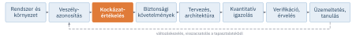
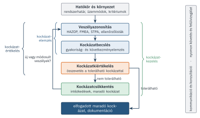
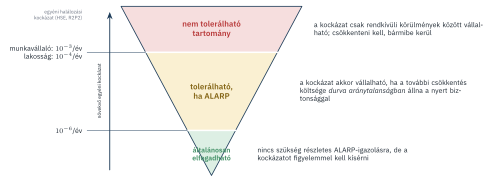
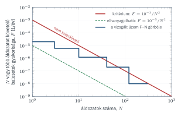
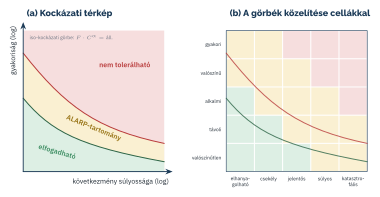
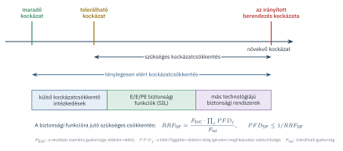
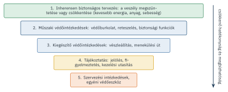

# Kockázatértékelés és a kockázat elfogadhatósága {#sec-kockazatertekeles}

{width=100%}

A veszélyek azonosítása után két kérdésre kell válaszolni: mekkora a kockázat, és elfogadható-e. Az első kérdés mérnöki becslés, a második társadalmi, jogi és szervezeti értékítélet. Ez a fejezet a kockázatkezelés folyamatával kezdődik, majd bemutatja a kockázat elfogadhatóságának nemzetközileg használt kritériumait (ALARP, GAMAB, MEM, F–N görbe). Részletesen tárgyalja a gyakorlatban legelterjedtebb, de sokszor rosszul használt eszközt, a kockázati mátrixot. Végül azt mutatja meg, hogyan lesz a kockázatértékelés eredményéből a biztonsági funkciókra kiosztható, számszerű kockázatcsökkentési követelmény.

::: {.cel}
A fejezet végére képes leszel

- leírni a kockázatkezelés folyamatát és fogalmait (kockázatelemzés, -kiértékelés, -értékelés, -kezelés);
- alkalmazni az ALARP-elvet, és megkülönböztetni a nem tolerálható, a tolerálható és az általánosan elfogadható kockázati tartományt;
- egyéni és társadalmi kockázatot számolni, és F–N görbét értelmezni;
- következetes kockázati mátrixot tervezni és kalibrálni, valamint felismerni a mátrixok tipikus hibáit;
- a tolerálható kockázatból meghatározni a szükséges kockázatcsökkentést.
:::

## A kockázatkezelés folyamata {#sec-kockazatkezeles-folyamat}

A kockázatkezelés (*risk management*) a kockázatok azonosítására, elemzésére, kiértékelésére és kezelésére irányuló tevékenységek összehangolt rendszere. Általános kerete az ISO 31000 [@iso31000], a módszerek tárháza az IEC 31010 [@iec31010], a biztonsági szabványok pedig ugyanezt a folyamatot követik a saját fogalmaikkal ([-@fig-kockazatkezeles]. ábra).

{#fig-kockazatkezeles width=95%}

::: {.fogalom title="A kockázatkezelés fogalmai"}
- **Kockázatelemzés** (*risk analysis*): a rendelkezésre álló információ módszeres felhasználása a veszélyek azonosítására és a kockázat becslésére.
- **Kockázatbecslés** (*risk estimation*): a kockázat mértékének meghatározása gyakoriság- és következményelemzéssel.
- **Kockázatkiértékelés** (*risk evaluation*): a becsült kockázat összevetése a kockázati kritériumokkal, annak eldöntésére, hogy a kockázat tolerálható-e.
- **Kockázatértékelés** (*risk assessment*): a kockázatelemzés és a kockázatkiértékelés együttese.
- **Kockázatcsökkentés, kockázatkezelés** (*risk reduction, risk treatment*): intézkedések kiválasztása és megvalósítása a kockázat csökkentésére, majd a maradó kockázat újbóli értékelése.
:::

A folyamat nem egyszeri, hanem iteratív. Egy kockázatcsökkentő intézkedés (például egy új védelmi funkció) maga is új veszélyeket hozhat (téves leállítás, karbantartási hibák), ezért az elemzést meg kell ismételni. A folyamatos kockázatkezelés (*continuous risk management*, CRM) a projektmenedzsmentben is elterjedt formában hat lépés ismétlődő ciklusaként írja le ezt: azonosítás, elemzés, tervezés, nyomon követés, beavatkozás, és minden lépést kísérő kommunikáció és dokumentálás [@goldberg1994]. A dokumentálás nem adminisztratív teher: a kockázatértékelés eredménye a biztonsági érvelés ([-@sec-biztonsagi-erveles]. fejezet) egyik legfontosabb bizonyítéka.

### Kvalitatív, félkvantitatív és kvantitatív értékelés {#sec-kval-kvant}

A kockázatbecslés pontossága és ráfordítása széles skálán mozog:

- a **kvalitatív** értékelés szóbeli kategóriákkal dolgozik (például „ritka”, „súlyos”), gyors és átfogó, de szubjektív;
- a **félkvantitatív** értékelés a kategóriákhoz számtartományokat (például gyakoriság-nagyságrendeket) rendel, így következetesebb és ellenőrizhetőbb. Ilyen a kockázati mátrix kalibrált formája és a LOPA ([-@sec-esemenyfa]. fejezet);
- a **kvantitatív kockázatelemzés** (*quantitative risk assessment*, QRA) a gyakoriságokat és a következményeket modellekkel (hibafa, eseményfa, terjedési és hatásmodellek) számolja, és egyéni, illetve társadalmi kockázati mutatókat ad.

A jó gyakorlat a fokozatosság: kvalitatív szűréssel kezdünk, és a nagy vagy bizonytalan kockázatú forgatókönyveket vizsgáljuk egyre részletesebben.

## Mikor elfogadható a kockázat? {#sec-elfogadhatosag}

A tolerálható kockázat meghatározása nem tisztán mérnöki feladat. A társadalom a kockázatot nem csak a várható kár nagysága szerint ítéli meg: más a viszonya az önként vállalt (autóvezetés) és a kényszerűen elszenvedett (egy veszélyes üzem közelében lakás), az ismert és az új, a megszokott és a katasztrofális kockázathoz. 2012-ben Magyarországon 541-en haltak meg közúti balesetben, mégis naponta milliók közlekednek, vagyis a társadalom ezt a kockázatot a gyakorlatban elfogadja. Ugyanez a szám egy ipari létesítmény esetén elképzelhetetlen volna. A mérnöki gyakorlat ezért néhány jól definiált, nemzetközileg elterjedt kritériumrendszert használ.

### Az ALARP-elv {#sec-alarp}

Az egyesült királysági munkavédelmi hatóság (HSE) *Reducing Risks, Protecting People* (R2P2) című kiadványa fogalmazta meg a ma legszélesebb körben használt keretrendszert, a kockázat tolerálhatóságának modelljét [@hse2001]. A kockázati teret három tartományra osztja ([-@fig-alarp]. ábra):

- **Nem tolerálható tartomány:** a kockázat csak rendkívüli körülmények között vállalható, mértékétől függetlenül csökkenteni kell.
- **Tolerálható tartomány, ha ALARP:** a kockázat akkor vállalható, ha „ésszerűen megvalósítható módon a lehető legkisebb” (*As Low As Reasonably Practicable*, ALARP). Ez azt jelenti, hogy a további kockázatcsökkentés költsége (pénzben, időben, erőfeszítésben) **durva aránytalanságban** (*gross disproportion*) állna az elérhető biztonsági előnnyel.
- **Általánosan elfogadható tartomány:** a kockázat olyan kicsi, hogy nincs szükség részletes ALARP-igazolásra, de a kockázatot továbbra is figyelemmel kell kísérni.

{#fig-alarp width=96%}

A HSE irányértékei az egyéni halálozási kockázatra: a nem tolerálható és a tolerálható tartomány határa munkavállalókra évi $10^{-3}$, a lakosságra évi $10^{-4}$; az általánosan elfogadható tartomány felső határa mindkét csoportra évi $10^{-6}$. Ezek irányértékek, nem jogszabályi határok, de a nemzetközi gyakorlatban (és sok vállalati kockázati kritériumrendszerben) referenciaként szolgálnak.

::: {.hiba title="ALARP: „Reasonably Practicable”, nem „Possible”"}
A rövidítést gyakran hibásan „As Low As Reasonably Possible” formában oldják fel; ez a hiba a könyv 2014-es elődjében is szerepelt. A különbség nem szőrszálhasogatás. A *practicable* (megvalósítható) azt jelenti, hogy a kockázatcsökkentés költségét és hasznát mérlegelni kell, és az intézkedés csak akkor hagyható el, ha a költség *durván aránytalan* a haszonhoz képest. A bizonyítási teher a kockázatot létrehozón van: neki kell igazolnia, hogy minden ésszerűen megvalósítható intézkedést megtett. A rokon brit jogi fogalom a SFAIRP (*So Far As Is Reasonably Practicable*).
:::

Az ALARP-igazolás gyakran költség–haszon elemzéssel történik. Ha egy intézkedés $\Delta R$ kockázatcsökkentést (például évi várható halálesetszám-csökkenést) eredményez $T$ év élettartam alatt, és költsége $K$, akkor az intézkedés kötelező, ha

$$
K < d \cdot \Delta R \cdot T \cdot V_{\mathrm{VPF}},
$$ {#eq-alarp-koltseg}

ahol $V_{\mathrm{VPF}}$ egy statisztikai haláleset megelőzésének értéke (*value of preventing a fatality*), $d \ge 1$ pedig az aránytalansági tényező. Ez utóbbi a kockázat nagyságával nő: a nem tolerálható határhoz közel 10 is lehet. Az összefüggés a döntést segíti, de nem helyettesíti a mérnöki és etikai mérlegelést.

### Más kritériumrendszerek: GAMAB és MEM {#sec-gamab-mem}

A vasúti szabványok (EN 50126 [@en50126]) két további elvet is ismernek:

- **GAMAB** (*Globalement Au Moins Aussi Bon*, francia eredetű): egy új rendszer összességében legalább olyan biztonságos legyen, mint az általa kiváltott, már elfogadott rendszer. Az elv az összehasonlítás alapját egy ismert referenciában keresi.
- **MEM** (*Minimale Endogene Mortalität*, német eredetű): a legalacsonyabb természetes halálozási arány (a fejlett országokban a fiatal korosztálynál nagyjából évi $2\cdot 10^{-4}$) ne nőjön meg érzékelhetően egy technikai rendszer miatt. Egyetlen rendszer egyéni kockázata tipikusan ennek legfeljebb 5%-a, azaz évi $10^{-5}$ lehet.

A három elv más-más kérdésre ad választ (mennyire csökkentsük, legyen legalább olyan jó, ne növelje érdemben az alapkockázatot), de a gyakorlatban hasonló nagyságrendű kritériumokhoz vezetnek.

### Egyéni kockázat {#sec-egyeni-kockazat}

Az egyéni kockázat (*individual risk per annum*, IRPA) egy meghatározott személy évi halálozási valószínűsége a vizsgált tevékenység miatt. Ha az $i$-edik veszélyes forgatókönyv gyakorisága $F_i$, a halálos kimenetel feltételes valószínűsége $P_{\mathrm{h},i}$, a személy jelenlétének valószínűsége pedig $P_{\mathrm{j},i}$, akkor

$$
\text{IRPA} = \sum_i F_i \, P_{\mathrm{h},i} \, P_{\mathrm{j},i} .
$$ {#eq-irpa}

::: {.pelda title="Egy kezelő egyéni kockázata"}
Egy kezelő a műszakja alatt a ReaktorVéd reaktorcsarnokában az idő 25%-át tölti, a többit a vezérlőteremben. Három forgatókönyvet vizsgálnak:

| Forgatókönyv | $F_i$ [1/év] | $P_{\mathrm{h},i}$ | $P_{\mathrm{j},i}$ | hozzájárulás [1/év] |
|:--|--:|--:|--:|--:|
| reaktor felhasadása megfutó reakció miatt | $6{,}8\cdot 10^{-6}$ | 0,9 | 0,25 | $1{,}5\cdot 10^{-6}$ |
| mérgező gőz kis szivárgása | $10^{-2}$ | $10^{-4}$ | 0,25 | $2{,}5\cdot 10^{-7}$ |
| tűz a betöltőnyílásnál | $10^{-4}$ | 0,1 | 0,25 | $2{,}5\cdot 10^{-6}$ |
| **összesen** | | | | $\mathbf{4{,}3\cdot 10^{-6}}$ |

: Egy kezelő egyéni kockázatának összetevői {#tbl-irpa-pelda}

Az eredmény a tolerálható tartomány alsó részébe esik, így ALARP-igazolás szükséges. A legnagyobb hozzájárulás a tűz forgatókönyvé, tehát a kockázatcsökkentést ott érdemes kezdeni (például zárt betöltéssel), nem a látványosabb, de ritkább reaktorfelhasadásnál. A reaktorfelhasadás gyakorisága már a biztonsági funkcióval együtt értendő; ezt az értéket a [-@sec-esemenyfa]. fejezet eseményfája adja.
:::

### Társadalmi kockázat és az F–N görbe {#sec-fn-gorbe}

A társadalmi kockázatot az **F–N görbe** ábrázolja ([-@fig-fn]. ábra): a vízszintes tengelyen az áldozatok száma ($N$), a függőlegesen annak a gyakorisága ($F$), hogy egy évben $N$ vagy annál több áldozatot követelő baleset történik. Mindkét tengely logaritmikus. A kritériumvonal általános alakja

$$
F(N) = \frac{C}{N^{\alpha}},
$$ {#eq-fn-kriterium}

ahol $\alpha = 1$ kockázatsemleges, $\alpha > 1$ kockázatkerülő hozzáállást fejez ki: a sok áldozatot követelő balesetek gyakoriságát aránytalanul jobban korlátozza. A holland külső biztonsági szabályozás például $C = 10^{-3}$ és $\alpha = 2$ értékkel dolgozik (tíz vagy több áldozat esetén).

{#fig-fn width=80%}

A kockázatkerülés ($\alpha>1$) a mérnöki megfontolásokban is megjelenik. Az iso-kockázati görbe általánosított alakja $F \cdot C^{\alpha} = \text{állandó}$. Ha egy csaknem elhanyagolható súlyosságú eseménynél ($C_0$) a tolerálható gyakoriság $F_0$, akkor egy $C$ súlyosságú eseménynél

$$
F_{\mathrm{tol}}(C) = F_0 \left( \frac{C_0}{C} \right)^{\alpha}.
$$ {#eq-iso-kockazat}

Ez az összefüggés a kockázati mátrix celláinak kalibrálásához ad elvi alapot.

## A kockázati mátrix {#sec-kockazati-matrix}

A kockázati mátrix (*risk matrix*) a legelterjedtebb kvalitatív és félkvantitatív kockázatértékelési eszköz. A következmény súlyosságát és a bekövetkezés gyakoriságát kategóriákba sorolja, és a két kategória kombinációjához kockázati szintet rendel. Népszerűségét egyszerűségének és szemléletességének köszönheti; a NASA mérnöki eszköztára is az előzetes kockázatelemzés alapeszközeként mutatja be [@goldberg1994]. Ugyanakkor a kockázati mátrix az egyik leggyakrabban rosszul használt eszköz is.

### A mátrix felépítése {#sec-matrix-felepites}

A mátrix az iso-kockázati görbék diszkrét közelítése ([-@fig-iso-matrix]. ábra). A felépítés lépései:

1. **A gyakorisági kategóriák meghatározása.** Például a MIL-STD-882E [@milstd882e] szerinti fokozatok: gyakori, valószínű, alkalmi, távoli, valószínűtlen, kizárt. A félkvantitatív változatban minden kategóriához nagyságrendi tartomány tartozik.
2. **A súlyossági kategóriák meghatározása.** Például: katasztrofális, kritikus, jelentős, elhanyagolható. Minden kategóriát érdemes több dimenzióban (emberi sérülés, környezeti kár, anyagi kár, hírnév) definiálni.
3. **A kockázati szintek hozzárendelése a cellákhoz.** A cellák az iso-kockázati görbéket közelítik. Fontos, hogy az elfogadhatósági határokat nem az elemző, hanem a kockázatkezelésért felelős vezetés határozza meg.
4. **Kalibráció.** Néhány ismert, elfogadottnak tekintett veszélyhelyzetet elhelyezünk a mátrixban, és ellenőrizzük, hogy a besorolásuk megfelel-e a szervezet értékítéletének. Ezek a kalibrációs pontok a későbbi értékelések viszonyítási alapjai.

{#fig-iso-matrix width=100%}

A félkvantitatív mátrix kategóriáit célszerű logaritmikusan, egy-egy nagyságrendnyi lépésekkel definiálni ([-@tbl-matrix-kategoriak]. táblázat). Így a cellák közötti átlós vonalak valóban iso-kockázati vonalak: egy lépés lefelé a gyakoriságban és egy lépés felfelé a súlyosságban azonos kockázatot jelent ($\alpha = 1$ esetén).

| Gyakoriság | Tartomány [1/év] | Súlyosság | Emberi következmény | Anyagi kár |
|:--|:--|:--|:--|:--|
| gyakori | $> 10^{-1}$ | katasztrofális | több haláleset | $> 10^{10}$ Ft |
| valószínű | $10^{-2}$ – $10^{-1}$ | súlyos | egy haláleset vagy maradandó egészségkárosodás | $10^{9}$ – $10^{10}$ Ft |
| alkalmi | $10^{-3}$ – $10^{-2}$ | jelentős | súlyos, visszafordítható sérülés | $10^{8}$ – $10^{9}$ Ft |
| távoli | $10^{-4}$ – $10^{-3}$ | csekély | könnyű sérülés, elsősegély | $10^{7}$ – $10^{8}$ Ft |
| valószínűtlen | $< 10^{-4}$ | elhanyagolható | nincs sérülés | $< 10^{7}$ Ft |

: Egy félkvantitatív kockázati mátrix kategóriái (példa) {#tbl-matrix-kategoriak}

### Tervezési szabályok {#sec-matrix-szabalyok}

A 2014-es jegyzet a NASA eszköztára nyomán néhány fontos tervezési szabályt fogalmazott meg, amelyek ma is érvényesek, és amelyeket a későbbi kutatások megerősítettek:

- **Kevés kategória.** Az értékelés szubjektív, ezért a túl finom felbontás (például 12 × 8-as mátrix) nem növeli a pontosságot, csak a következetlenséget. A $4\times 4$-es vagy $5 \times 5$-ös mátrix általában elég.
- **Kevés kockázati zóna.** Három zóna (nem tolerálható, tolerálható ALARP mellett, általánosan elfogadható) a legtöbb célra megfelel, és közvetlenül illeszkedik az ALARP-modellhez.
- **Folytonos, monoton zónák.** Egy cellából a szomszédos cellába lépve legfeljebb egy kockázati szintet lehessen ugrani, és a kockázat ne csökkenhessen, ha a gyakoriság vagy a súlyosság nő.
- **Kalibrált és dokumentált.** Minden kategória definíciója legyen írásban rögzítve, mérhető tartományokkal, és a mátrixot kalibrálni kell ismert esetekkel.

### A kockázati mátrixok korlátai {#sec-matrix-korlatai}

Louis Anthony Cox 2008-ban megjelent, nagy hatású tanulmánya [@cox2008] matematikailag megmutatta, hogy a kockázati mátrixoknak súlyos korlátai vannak:

- **Gyenge felbontás:** a mátrix kvantitatívan nagyon különböző kockázatokat sorolhat azonos cellába, és alig különbözőket eltérő cellákba.
- **Rangsorhibák:** negatívan korreláló gyakoriság és súlyosság esetén (gyakori, de enyhe, illetve ritka, de súlyos események) a mátrix a kisebb kockázathoz rendelhet magasabb szintet. Ez rossz erőforrás-elosztáshoz vezethet.
- **Szubjektív bemenetek:** a kategóriákba sorolás értelmezésfüggő, és a bizonytalanság a mátrixban nem látszik.
- **Az összegzés hiánya:** a mátrix az egyes forgatókönyveket külön-külön értékeli, de a rendszer teljes kockázatát nem összegzi. Sok, egyenként „zöld” kockázat együtt nem tolerálható lehet.

Cox következtetése nem az, hogy a mátrixot el kell vetni, hanem hogy gondosan, a korlátainak tudatában kell használni: elsősorban szűrésre és kommunikációra, nem pedig erőforrás-allokációra vagy kvantitatív célok igazolására. A nagy kockázatú forgatókönyveket a III. rész kvantitatív módszereivel kell tovább vizsgálni.

::: {.kitekintes title="Aktív és passzív biztonsági megoldások a mátrixban"}
A kockázati mátrix jól szemlélteti a kockázatcsökkentés két irányát. A **passzív biztonsági elemek** (például a gyűrődőzóna, a védőburkolat vagy a kármentő) elsősorban a következmény súlyosságát csökkentik, így a pontot balra mozdítják. Az **aktív biztonsági megoldások** (például a vészfékező asszisztens vagy a reaktor biztonsági leállítása) elsősorban a bekövetkezés gyakoriságát csökkentik, így a pontot lefelé mozdítják.
:::

## A szükséges kockázatcsökkentés meghatározása {#sec-szukseges-csokkentes}

A kockázatértékelés célja végső soron egy számszerű követelmény: mennyivel kell csökkenteni a kockázatot, és ebből mennyit kell a biztonsági funkcióknak teljesíteniük. Az IEC 61508 ezt a [-@fig-kockazatcsokkentes]. ábrán látható módon írja le.

{#fig-kockazatcsokkentes width=100%}

Az irányított berendezés kockázata (védelem nélkül) egy adott veszélyes eseményre $F_{\mathrm{EUC}}$ gyakoriságú. Ha a tolerálható gyakoriság $F_{\mathrm{tol}}$, akkor a szükséges teljes kockázatcsökkentési tényező $F_{\mathrm{EUC}}/F_{\mathrm{tol}}$. Ezt a különböző védelmi rétegek együtt teljesítik: külső kockázatcsökkentő intézkedések (például egy mechanikus biztonsági szelep), más technológiájú biztonsági rendszerek és az E/E/PE biztonsági funkciók. Ha a többi réteg igénykori meghibásodási valószínűsége $PFD_j$, akkor a biztonsági funkcióra jutó kockázatcsökkentési tényező (*risk reduction factor*, RRF) és a megengedhető legnagyobb igénykori meghibásodási valószínűség (PFD):

$$
RRF_{\mathrm{SIF}} = \frac{F_{\mathrm{EUC}} \cdot \prod_j PFD_j}{F_{\mathrm{tol}}}, \qquad PFD_{\mathrm{SIF}} \le \frac{1}{RRF_{\mathrm{SIF}}} .
$$ {#eq-rrf}

Az IEC 61508 ennek kapcsán három alapelvet rögzít, amelyeket a 2014-es jegyzet is kiemelt: kockázatmentes állapot soha nem érhető el; a biztonságot már a tervezési folyamat elején figyelembe kell venni; a nem tolerálható kockázatot mindenképpen csökkenteni kell.

::: {.eset eset="A" title="ReaktorVéd: mekkora kockázatcsökkentés kell?"}
A vállalat kockázati kritériuma szerint egy olyan forgatókönyv tolerálható gyakorisága, amely egy munkavállaló halálát okozhatja, $F_{\mathrm{tol}} = 10^{-5}/\text{év}$ (ez a HSE-tartomány közepére esik, kellő tartalékot hagyva más forgatókönyvekre). A hűtés kiesése évente $0{,}1$ gyakorisággal fordul elő, és az esetek felében ($0{,}5$) a reaktor éppen az exoterm fázisban van. A magas hőmérséklet riasztása és a kezelő beavatkozása független védelmi rétegként $PFD = 0{,}1$ valószínűséggel hibázik. Így a biztonsági funkció nélkül a veszélyes esemény gyakorisága

$$
F = 0{,}1 \cdot 0{,}5 \cdot 0{,}1 = 5\cdot 10^{-3}/\text{év},
$$

a biztonsági funkcióra jutó szükséges kockázatcsökkentés $RRF \ge 5\cdot 10^{-3}/10^{-5} = 500$, vagyis $PFD_{\mathrm{SIF}} \le 2 \cdot 10^{-3}$. Ez a [-@sec-eletciklus]. fejezetben bevezetett SIL 2 tartományba esik ($10^{-3} \le PFD < 10^{-2}$), annak is a szigorúbb felébe. A gondolatmenetet a [-@sec-esemenyfa]. fejezet a LOPA módszerével formalizálja, a [-@sec-sil]. fejezet pedig igazolja, hogy a tervezett biztonsági funkció teljesíti a követelményt.
:::

### Az intézkedések hierarchiája {#sec-intezkedes-hierarchia}

A kockázatcsökkentő intézkedések nem egyenértékűek. A gépbiztonsági alapszabvány, az ISO 12100 [@iso12100] **háromlépcsős módszere** és a munkavédelemben használt intézkedési hierarchia egyaránt azt mondja ki, hogy a hatékonyabb, megbízhatóbb intézkedésekkel kell kezdeni ([-@fig-haromlepcsos]. ábra).

{#fig-haromlepcsos width=86%}

1. **Inherensen biztonságos tervezés:** a veszély megszüntetése vagy csökkentése magában a tervben. Trevor Kletz folyamatbiztonsági elvei szerint [@kletz2010]: csökkentsük a veszélyes anyag mennyiségét (*minimize*), cseréljük kevésbé veszélyesre (*substitute*), mérsékeljük a körülményeket (*moderate*: alacsonyabb nyomás, hőmérséklet), egyszerűsítsük a rendszert (*simplify*).
2. **Műszaki védőintézkedések:** védőburkolatok, reteszelések, biztonsági funkciók, amelyek a megmaradt veszélyek ellen védenek.
3. **Kiegészítő védőintézkedések:** vészleállító, menekülési lehetőség, mentési eszközök.
4. **Tájékoztatás:** jelölések, figyelmeztetések, kezelési utasítás a maradó kockázatokról.
5. **Szervezési intézkedések és egyéni védőeszközök:** eljárások, képzés, engedélyezési rendszer, védőfelszerelés.

A sorrend lényege, hogy minél lejjebb haladunk, annál inkább az emberi viselkedésen múlik a védelem, és annál kevésbé megbízható. Egy veszély, amelyet a tervezés megszüntetett, soha többé nem okozhat balesetet; egy figyelmeztető tábla hatása a kezelő figyelmén, képzettségén és pillanatnyi állapotán múlik.

::: {.eset eset="C" title="KoboCella: a háromlépcsős módszer a gyakorlatban"}
A KoboCella tervezői először azt vizsgálják, csökkenthető-e magának a veszélynek a nagysága: kisebb tömegű robotkar, lekerekített élek, a sebesség korlátozása az ember közelében. Ez az inherensen biztonságos tervezés. A megmaradt veszélyek ellen műszaki védőintézkedések következnek: lézerszkenneres sebesség- és távolságfelügyelet, erő- és teljesítménykorlátozás, biztonsági reteszelés a cellaajtón. Kiegészítő védőintézkedés a vészleállító gomb. Végül a kezelési utasítás és a képzés írja le a maradó kockázatokat, például hogy hosszú haj vagy laza ruházat becsípődhet. A tervezők dokumentálják, miért nem lehetett a veszélyt egy magasabb lépcsőn kezelni. Ez az ALARP-igazolás gépbiztonsági megfelelője.
:::

## A bizonytalanság kezelése {#sec-bizonytalansag}

Minden kockázatbecslés bizonytalan. A gyakoriságok ritka eseményekre vonatkoznak, amelyekről kevés adat van; a következménymodellek egyszerűsítenek; a szakértői becslések szubjektívek. A bizonytalanságnak két fajtáját érdemes megkülönböztetni:

- **aleatorikus** (véletlen) bizonytalanság: a jelenség természetes változékonysága (például hogy egy adott évben hányszor esik ki a hűtés). Ez több adattal sem szűnik meg;
- **episztemikus** (ismereti) bizonytalanság: a tudásunk hiányossága (például hogy mekkora valójában a szelepek meghibásodási rátája). Ez több adattal, jobb modellekkel csökkenthető.

A jó kockázatértékelés a bizonytalanságot nem rejti el, hanem kimutatja: érzékenységvizsgálattal (mely paraméterek befolyásolják leginkább az eredményt), tartománybecsléssel és valószínűségi (Monte Carlo) bizonytalanságelemzéssel. Ezekkel a módszerekkel a [-@sec-hibafa]. és a [-@sec-sil]. fejezet foglalkozik részletesen. Ha a bizonytalanság nagy és a lehetséges következmény súlyos, a döntéshozók gyakran az óvatosság elvét (*precautionary principle*) követik: a kockázat bizonyított kicsiségéig a kedvezőtlenebb feltevésekkel számolnak.

::: {.labor}
A gyakorlati útmutató 2. laborjában egy interaktív alkalmazással kockázati mátrixot tervezhetsz. Megadhatod a kategóriákat és a kritériumokat, elhelyezheted a forgatókönyveket, és megnézheted, mikor ad a mátrix eltérő rangsort, mint a kvantitatív kockázat (Cox rangsorhibája). A hozzá tartozó Colab-notebook egyéni kockázatot és F–N görbét számol egy kis létesítményre.
:::

::: {.osszefoglalo}
- A kockázatértékelés a kockázatelemzésből (veszélyazonosítás és kockázatbecslés) és a kockázatkiértékelésből áll; a folyamat iteratív.
- Az ALARP-elv szerint a tolerálható tartományban a kockázatot addig kell csökkenteni, amíg a további csökkentés költsége durva aránytalanságban nem állna a haszonnal. A rövidítés feloldása *As Low As Reasonably Practicable*.
- A HSE irányértékei az egyéni halálozási kockázatra: munkavállalóra $10^{-3}$, lakosságra $10^{-4}$ (nem tolerálható határ), illetve $10^{-6}$ (általánosan elfogadható határ) évente.
- A társadalmi kockázatot F–N görbével ábrázoljuk; a kockázatkerülő kritériumok a sok áldozatot követelő eseményeket szigorúbban korlátozzák.
- A kockázati mátrix hasznos szűrő- és kommunikációs eszköz, de felbontása gyenge, rangsorhibákat okozhat, ezért kvantitatív döntésekre korlátozottan alkalmas.
- A tolerálható gyakoriságból és a többi védelmi réteg hatásából meghatározható a biztonsági funkcióra jutó szükséges kockázatcsökkentés (RRF) és a megengedett PFD.
- Az intézkedések hierarchiájában az inherensen biztonságos tervezés áll az első helyen.
:::

::: {.onell}
1. Mi a különbség a kockázatelemzés és a kockázatértékelés között?
2. Egy új technológia egyéni kockázata egy lakosra évi $5\cdot 10^{-5}$. Melyik tartományba esik a HSE-modell szerint, és mi a teendő?
3. Miért vezethet rangsorhibához a kockázati mátrix, ha egy szervezet forgatókönyveinél a gyakoriság és a súlyosság negatívan korrelál?
4. Egy veszélyes esemény gyakorisága védelem nélkül évi $0{,}2$. A tolerálható gyakoriság évi $10^{-4}$. Egy mechanikus biztonsági szelep $PFD = 10^{-2}$ valószínűséggel hibázik. Mekkora PFD-t kell teljesítenie a biztonsági funkciónak?
5. Sorold be az intézkedési hierarchiába: (a) a robot sebességének korlátozása 250 mm/s-ra a gyártó által, (b) figyelmeztető sárga csík a padlón, (c) fényfüggöny, amely belépéskor megállítja a robotot.

::: {.megoldas}
1. A kockázatelemzés a veszélyek azonosítását és a kockázat becslését jelenti (mekkora a kockázat?). A kockázatértékelés ezt kiegészíti a kockázatkiértékeléssel (tolerálható-e a kockázat?).
2. A lakosságra vonatkozó $10^{-4}$ és $10^{-6}$ közötti tolerálható tartományba esik. A kockázat csak akkor vállalható, ha ALARP-igazolással kimutatható, hogy minden ésszerűen megvalósítható csökkentő intézkedést megtettek.
3. Mert a mátrix cellái a kockázatot durván közelítik. Ha a ritka, de súlyos események és a gyakori, de enyhe események kvantitatív kockázata közel azonos, a mátrix a cellahatárok elhelyezkedése miatt az egyiket „vörösbe”, a másikat „sárgába” sorolhatja. A sorrend akár meg is fordulhat a valós kockázatokhoz képest, és az erőforrások rossz helyre kerülnek.
4. $RRF = 0{,}2 \cdot 10^{-2}/10^{-4} = 20$, tehát $PFD_{\mathrm{SIF}} \le 0{,}05$. Ez a SIL 1 tartományba esik ($10^{-2} \le PFD < 10^{-1}$).
5. (a) inherensen biztonságos tervezés (a veszély nagyságát csökkenti), (c) műszaki védőintézkedés, (b) tájékoztatás. A sorrend egyben a hatékonyság sorrendje is.
:::
:::

::: {.forras}
- Health and Safety Executive (2001): *Reducing Risks, Protecting People.* HSE Books – az ALARP-elv és a tolerálhatósági modell alapdokumentuma, ingyenesen elérhető [@hse2001].
- Cox, L. A. (2008): What's wrong with risk matrices? *Risk Analysis* 28(2), 497–512 [@cox2008].
- IEC 31010:2019 – a kockázatértékelési módszerek áttekintése alkalmazási útmutatóval [@iec31010].
- Kletz, T., Amyotte, P. (2010): *Process Plants: A Handbook for Inherently Safer Design.* CRC Press [@kletz2010].
:::
