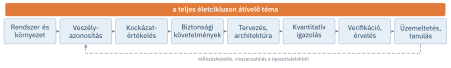
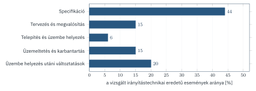
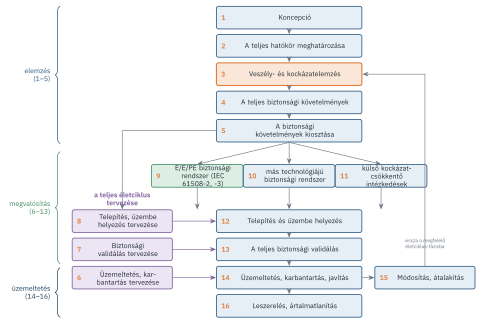
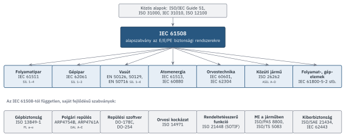
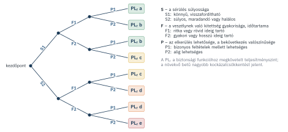

# A biztonsági életciklus és a szabványok rendszere {#sec-eletciklus}

{width=100%}

A biztonság nem egyetlen tervezési döntés eredménye, hanem egy teljes életcikluson át tartó, dokumentált tevékenységsorozaté, a koncepciótól a leszerelésig. Ez a fejezet azt mutatja be, hogyan írják le ezt az életciklust a funkcionális biztonsági szabványok. Először azt vizsgáljuk meg, miért van szükség életciklus-szemléletre. Ezután részletesen tárgyaljuk az IEC 61508 alapszabványt és a biztonsági integritási szint (SIL) fogalmát, majd áttekintjük az ágazati szabványokat (folyamatipar, közúti jármű, gépipar, vasút, repülés, orvostechnika) és integritási szintjeiket. A fejezet végén a funkcionális biztonság menedzsmentjéről és a jogszabályi háttérről lesz szó.

::: {.cel}
A fejezet végére képes leszel

- megindokolni az életciklus-szemlélet szükségességét a baleseti okok életciklus-fázisok szerinti megoszlásával;
- leírni az IEC 61508 felépítését és biztonsági életciklusának szakaszait;
- a SIL-t az alacsony és a nagy igénybevételű üzemmódban értelmezni, és ismertetni a SIL teljesítésének három pillérét;
- az ISO 26262 szerint ASIL-t meghatározni a súlyosság, a kitettség és az irányíthatóság alapján;
- az ISO 13849-1 kockázati gráfjával meghatározni a szükséges teljesítményszintet (PL~r~);
- összevetni és helyesen értelmezni a különböző ágazati integritási szinteket (SIL, ASIL, PL, DAL).
:::

## Miért életciklus? {#sec-miert-eletciklus}

Az egyesült királysági munkavédelmi hatóság (HSE) az *Out of Control* című tanulmányában 34 olyan balesetet és súlyos eseményt elemzett, amelyekben irányítástechnikai rendszerek meghibásodása játszott szerepet [@hse2003]. Az eredmény a szakma számára meglepő volt ([-@fig-hiba-okok]. ábra): az okok közel fele (44%) a specifikációban keletkezett, további 15% a tervezésben és megvalósításban, és csak a kisebbik rész köthető az üzemeltetéshez. Feltűnő a „üzembe helyezés utáni változtatások” 20%-os aránya is.

{#fig-hiba-okok width=86%}

A tanulság kettős. Először: a balesetek okainak jelentős része már a tervezés során beépül a rendszerbe, ezért a biztonságot a fejlesztés legelején kell kezdeni. Másodszor: a rendszer biztonsága az üzemeltetés során, a karbantartásokkal és a módosításokkal romolhat, ezért a biztonsági tevékenységnek a leszerelésig tartania kell. Az életciklus-modell mindkét felismerést rendszerbe foglalja: előírja, hogy mely tevékenységeket kell elvégezni, milyen sorrendben, és milyen dokumentációval igazolni.

## Az IEC 61508 alapszabvány {#sec-iec61508}

Az IEC 61508 *Villamos/elektronikus/programozható elektronikus biztonsági rendszerek funkcionális biztonsága* című szabványsorozat [@iec61508] a funkcionális biztonság alapszabványa (*basic safety publication*). Első kiadása 1998–2000-ben, második kiadása 2010-ben jelent meg. A harmadik kiadás 2026-ban a végső szavazási szakaszban van, a fő részek hivatalos megjelenése 2027-re várható. A szabvány két célt szolgál: közvetlenül alkalmazható olyan rendszerekre, amelyekre nincs ágazati szabvány, és keretet ad az ágazati szabványoknak (IEC 61511, IEC 62061, EN 50129, ISO 26262 stb.).

A szabvány hét részből áll:

| Rész | Tartalom | Jelleg |
|:--|:--|:--|
| IEC 61508-1 | Általános követelmények (életciklus, menedzsment, dokumentáció) | normatív |
| IEC 61508-2 | Az E/E/PE biztonsági rendszerek hardverkövetelményei | normatív |
| IEC 61508-3 | Szoftverkövetelmények | normatív |
| IEC 61508-4 | Fogalommeghatározások és rövidítések | normatív |
| IEC 61508-5 | Példák a SIL meghatározására | tájékoztató |
| IEC 61508-6 | Útmutató a 2. és 3. rész alkalmazásához (többek között PFD- és PFH-képletek) | tájékoztató |
| IEC 61508-7 | Technikák és intézkedések áttekintése | tájékoztató |

: Az IEC 61508 részei {#tbl-iec61508-reszek}

### A biztonsági életciklus {#sec-biztonsagi-eletciklus}

A szabvány központi eleme a 16 fázisú teljes biztonsági életciklus ([-@fig-iec61508-eletciklus]. ábra). Minden fázisnak meghatározott célja, bemenete, kimenete és ellenőrzési követelménye van.

{#fig-iec61508-eletciklus width=100%}

A fázisok három csoportba sorolhatók.

**Elemzés (1–5. fázis).** Az első két fázis az irányított berendezés és környezetének megértése, valamint az elemzés hatókörének rögzítése. A harmadik fázis, a veszély- és kockázatelemzés, a módszertan kulcsa: itt kell feltárni azokat a meghibásodási lehetőségeket, amelyek balesethez vezethetnek, a normál üzemben, az indításnál, a leállításnál, a karbantartásnál és az előrelátható rendellenes használatnál is. A negyedik fázis a teljes biztonsági követelményeket fogalmazza meg (milyen biztonsági funkciókra van szükség), az ötödik ezeket kiosztja az egyes védelmi rétegekre, és meghatározza a biztonsági funkciók szükséges integritási szintjét. A ReaktorVéd esetében ez az a pont, ahol a hűtés kiesésének veszélyéhez a „gyorszáró szelepek zárása” biztonsági funkció és a SIL 2 követelmény rendelődik ([-@sec-szukseges-csokkentes]. szakasz).

**Megvalósítás (6–13. fázis).** A 6–8. fázis az életciklus későbbi szakaszainak tervezését jelenti: hogyan fogják a rendszert üzemeltetni és karbantartani (milyen gyakran kell a proof tesztet elvégezni), hogyan validálják a biztonsági funkciókat, és hogyan telepítik és helyezik üzembe a rendszert. Ezek a tervek a megvalósítással párhuzamosan készülnek, mert a tervezési döntéseket befolyásolják. A 9. fázis az E/E/PE biztonsági rendszer megvalósítása; erre vonatkozik a szabvány 2. (hardver) és 3. (szoftver) része, saját, részletes életciklussal. A 10. fázis a más technológiájú (például mechanikus vagy hidraulikus) biztonsági rendszereket, a 11. a külső kockázatcsökkentő intézkedéseket (például a gyorsasági korlátozást, a védőtöltést vagy a mentési tervet) fedi le. A 12–13. fázis a telepítés, az üzembe helyezés és a teljes biztonsági validálás.

**Üzemeltetés (14–16. fázis).** A 14. fázis az üzemeltetés, a karbantartás és a javítás; ide tartoznak a proof tesztek és a meghibásodások nyilvántartása. A 15. fázis a módosításokat kezeli: minden változtatás hatását elemezni kell, és vissza kell térni ahhoz az életciklus-fázishoz, amelyet a módosítás érint. A 16. fázis a leszerelés és az ártalmatlanítás, amelynek saját veszélyei vannak (maradék anyagok, akkumulátorok, nyomás alatti részek).

Az életciklus-séma legfontosabb szerepe az, hogy **útmutatóként és ellenőrző listaként** szolgáljon. Felhívja a figyelmet a kockázatkezeléshez kötődő feladatokra, és biztosítja, hogy egy elemzési vagy tervezési lépés csak indokolt és dokumentált esetben maradhasson el.

## A biztonsági integritási szint (SIL) {#sec-sil-fogalom}

A biztonsági integritás annak valószínűsége, hogy egy biztonsági rendszer a megkövetelt biztonsági funkciót meghatározott körülmények között, meghatározott időtartam alatt kielégítően végrehajtja. A biztonsági integritási szint (*safety integrity level*, SIL) ennek négy diszkrét fokozata, a SIL 1-től (legkisebb) a SIL 4-ig (legnagyobb).

### Üzemmódok: alacsony és nagy igénybevétel {#sec-uzemmodok}

A SIL számszerű célértéke attól függ, milyen gyakran kell a biztonsági funkciónak működnie.

::: {.fogalom title="Alacsony igénybevételű és nagy igénybevételű vagy folyamatos üzemmód"}
- **Alacsony igénybevételű üzemmód** (*low demand mode*): a biztonsági funkciót csak igény esetén kell végrehajtani, és az igények gyakorisága nem nagyobb évi egynél. A mérőszám a **működési igénykori átlagos meghibásodási valószínűség** (*average probability of dangerous failure on demand*, PFD~avg~).
- **Nagy igénybevételű üzemmód** (*high demand mode*): az igények gyakorisága évi egynél nagyobb. **Folyamatos üzemmód** (*continuous mode*): a biztonsági funkció a normál működés része. Mindkét esetben a mérőszám a **veszélyes meghibásodás átlagos gyakorisága** óránként (*average frequency of dangerous failure per hour*, PFH).
:::

::: {.hiba title="Az üzemmód régi meghatározása"}
Az IEC 61508 első kiadása az alacsony igénybevételű üzemmódot úgy definiálta, hogy az igénygyakoriság nem nagyobb évi egynél *és* nem nagyobb a proof tesztek gyakoriságának kétszeresénél. Ezt a megfogalmazást a 2014-es jegyzet is átvette. A 2010-es második kiadás a proof tesztre vonatkozó feltételt elhagyta; ma egyedül az évi egy igény a határ.
:::

| SIL | PFD~avg~ (alacsony igénybevétel) | RRF | PFH [h^-1^] (nagy igénybevétel, folyamatos) |
|:--:|:--:|:--:|:--:|
| 4 | $10^{-5} \le PFD < 10^{-4}$ | $10\,000 < RRF \le 100\,000$ | $10^{-9} \le PFH < 10^{-8}$ |
| 3 | $10^{-4} \le PFD < 10^{-3}$ | $1\,000 < RRF \le 10\,000$ | $10^{-8} \le PFH < 10^{-7}$ |
| 2 | $10^{-3} \le PFD < 10^{-2}$ | $100 < RRF \le 1\,000$ | $10^{-7} \le PFH < 10^{-6}$ |
| 1 | $10^{-2} \le PFD < 10^{-1}$ | $10 < RRF \le 100$ | $10^{-6} \le PFH < 10^{-5}$ |

: A SIL célértékei az IEC 61508 szerint {#tbl-sil}

A két mérőszám dimenziója különbözik: a PFD~avg~ valószínűség (dimenzió nélküli), a PFH gyakoriság (1/óra). Az alacsony igénybevételű funkció által hagyott maradó kockázat gyakorisága az igénygyakoriság és a PFD szorzata ($F = F_{\mathrm{igény}} \cdot PFD_{\mathrm{avg}}$), a nagy igénybevételű funkcióé közvetlenül a PFH. A közlekedésben és az energiatermelésben a súlyos következményű veszélyekre jellemzően SIL 3 vagy SIL 4 követelményt támasztanak.

### A SIL teljesítésének három pillére {#sec-sil-pillerek}

Egy biztonsági funkció akkor teljesíti az előírt SIL-t, ha három, egymástól független feltétel egyszerre teljesül:

1. **Kvantitatív célérték a véletlenszerű hardvermeghibásodásokra.** A funkció PFD~avg~- vagy PFH-értéke a megfelelő tartományba esik. Ennek számítását a [-@sec-sil]. fejezet tárgyalja.
2. **Architekturális korlátok.** A hardver hibatűrése (*hardware fault tolerance*, HFT: hány meghibásodást visel el a funkció elvesztése nélkül) és a biztonságos meghibásodási hányad (*safe failure fraction*, SFF) együtt korlátozza az elérhető legnagyobb SIL-t. A korlátok célja, hogy a SIL ne csak kedvező (gyakran optimista) adatokon nyugvó számításból következzen.
3. **Szisztematikus képesség** (*systematic capability*, SC 1–4). A szisztematikus hibák elkerülésére és kezelésére alkalmazott fejlesztési módszerek, technikák és ellenőrzések szigorúsága. A szabvány fejlesztési, verifikációs és dokumentációs követelményei SIL-szintenként szigorodnak.

A harmadik pillér különösen fontos, mert a szoftverre csak ez alkalmazható. A szisztematikus hibák nem számszerűsíthetők meghibásodási rátával, ezért ellenük a fejlesztési folyamat minőségével kell védekezni ([-@sec-szoftver]. fejezet).

### A SIL meghatározásának módszerei {#sec-sil-meghatarozas}

A szükséges SIL-t a kockázatértékelésből kell levezetni. Az IEC 61508-5 és az IEC 61511-3 több módszert mutat be:

- **kvantitatív módszer:** a tolerálható gyakoriságból és a többi védelmi réteg hatásából számított szükséges PFD ([-@eq-rrf]. egyenlet);
- **rétegzett védelem elemzése (LOPA):** félkvantitatív, nagyságrendi becsléseken alapuló módszer, a folyamatiparban a legelterjedtebb ([-@sec-esemenyfa]. fejezet);
- **kockázati gráf:** kvalitatív döntési fa a következmény súlyossága, a kitettség, az elkerülés lehetősége és az igény valószínűsége alapján. Gyors, de kalibrálni kell, és hajlamos a túl- vagy alulbecslésre;
- **kalibrált kockázati mátrix:** a [-@sec-kockazati-matrix]. szakaszban tárgyalt mátrix, a cellákhoz SIL-t rendelve.

::: {.hiba title="A SIL nem a rendszer, hanem a funkció tulajdonsága"}
Gyakori, de pontatlan szóhasználat: „SIL 2-es érzékelő”, „SIL 3-as PLC”. A SIL egy *biztonsági funkcióhoz* rendelt követelmény. Egy eszközről csak annyi mondható, hogy egy adott SIL-ig *alkalmas* (*SIL capable*) egy funkcióban való felhasználásra, meghatározott feltételekkel (architektúra, proof teszt, felhasználási előírások). Egy SIL 3-ig tanúsított logikai egységből egycsatornás, rosszul karbantartott érzékelőkkel csak alacsonyabb integritású funkció építhető.
:::

## Ágazati szabványok {#sec-agazati-szabvanyok}

Az IEC 61508 általános keretét az egyes iparágak a saját sajátosságaikhoz igazították ([-@fig-szabvanycsalad]. ábra). Néhány fontos terület saját, az IEC 61508-tól független hagyománnyal rendelkezik, de fogalmaik egymásba fordíthatók.

{#fig-szabvanycsalad width=100%}

### Folyamatipar: IEC 61511 {#sec-iec61511}

Az IEC 61511 [@iec61511] a folyamatipari biztonsági műszerezett rendszerekre (SIS) vonatkozik. A szabvány a végfelhasználónak és a rendszerintegrátornak szól, nem az eszközgyártónak: az eszközöknek vagy az IEC 61508 szerint tanúsítottnak, vagy „használatban bizonyítottnak” (*prior use*) kell lenniük. A szabvány saját életciklust ír elő, és a hardver hibatűrésére egyszerűsített követelményt ad: SIL 1-hez és alacsony igénybevételű SIL 2-höz HFT = 0, nagy igénybevételű SIL 2-höz és SIL 3-hoz HFT = 1, SIL 4-hez HFT = 2. A SIL 4 a folyamatiparban rendkívül ritka; a szabvány azt javasolja, hogy ilyen igény esetén inkább a folyamatot kell újratervezni.

::: {.eset eset="A" title="ReaktorVéd: az IEC 61511 életciklusa"}
A ReaktorVéd biztonsági funkciója az IEC 61511 hatálya alá tartozik. A projekt dokumentumai: a HAZOP-jelentés ([-@sec-veszelyazonositas]. fejezet), a LOPA-jelentés a SIL-kiosztással ([-@sec-esemenyfa]. fejezet), a biztonsági követelményspecifikáció (*safety requirements specification*, SRS), a SIL-igazoló számítás ([-@sec-sil]. fejezet), a validálási terv, valamint az üzemeltetési és karbantartási terv a proof tesztek gyakoriságával és módjával. A specifikáció a funkció minden lényeges jellemzőjét rögzíti: a kioldási határértéket (95 °C), a válaszidőt (10 s), a biztonságos állapotot (mindkét gyorszáró szelep zárva), a SIL-t (2), a proof teszt gyakoriságát (évente), és a téves leállítások megengedett gyakoriságát.
:::

### Közúti járművek: ISO 26262 {#sec-iso26262}

Az ISO 26262 [@iso26262] a sorozatgyártású közúti járművek E/E rendszereinek funkcionális biztonsági szabványa. Első kiadása 2011-ben, második, a teherautókra, buszokra és motorkerékpárokra is kiterjesztett kiadása 2018-ban jelent meg. A harmadik kiadás (2026-ban DIS, azaz nemzetközi szabványtervezet szakaszban) a gépi tanulás, az agilis fejlesztés és a hibatűrő (*fail-operational*) architektúrák kérdéseivel bővül. Az IEC 61508-hoz képest a legfontosabb különbségek:

- **Tömeggyártás:** a biztonságot a fejlesztés során kell igazolni, a példányonkénti validálás nem lehetséges. Az IEC 61508 inkább egyedi vagy kis sorozatú rendszerekre (például egy vegyi üzem védelmi rendszerére) gondol, ahol a telepített rendszert validálják.
- **Biztonságosra tervezett termék:** a járműben a szabályozó és a biztonsági funkciók gyakran nem választhatók szét (a fékrendszer egyszerre végzi a normál fékezést és a biztonsági funkciót), szemben az IEC 61508 „irányított berendezés + független védelmi rendszer” modelljével.
- **A közlekedési helyzet egésze:** a kockázatértékelés a vezetőt, a többi közlekedőt és a helyzet irányíthatóságát is figyelembe veszi.
- **Biztonsági kultúra:** a szabvány kiemelten foglalkozik a biztonsági menedzsmenttel és -kultúrával, mert a nagy komplexitású rendszerekben a balesetek inkább a szervezet működéséből fakadnak.

**Az ASIL meghatározása.** A veszélyelemzés és kockázatbecslés (*hazard analysis and risk assessment*, HARA) során minden veszélyes eseményt (egy meghibásodás és egy működési helyzet kombinációját) három paraméterrel jellemeznek ([-@tbl-sec]. táblázat): a sérülés **súlyossága** (S0–S3), a működési helyzetnek való **kitettség** valószínűsége (E0–E4) és a vezető vagy más érintettek számára a helyzet **irányíthatósága** (C0–C3).

| Paraméter | 0 | 1 | 2 | 3 | 4 |
|:--|:--|:--|:--|:--|:--|
| S – súlyosság | nincs sérülés | könnyű, közepes sérülés | súlyos, életveszélyes (túlélés valószínű) | életveszélyes (túlélés bizonytalan), halálos | – |
| E – kitettség | elképzelhetetlen | nagyon kis valószínűség | kis valószínűség | közepes valószínűség | nagy valószínűség |
| C – irányíthatóság | általában irányítható | egyszerűen irányítható | általában irányítható | nehezen vagy nem irányítható | – |

: Az ISO 26262 HARA-paraméterei (rövidített megfogalmazás) {#tbl-sec}

Az autóipari biztonsági integritási szint (*automotive safety integrity level*, ASIL) a három paraméterből egy táblázat alapján adódik ([-@tbl-asil]. táblázat). Ha bármelyik paraméter 0 értékű, nincs ASIL-besorolás; az eredmény QM (*quality management*) is lehet, ami azt jelenti, hogy elég a szokásos minőségirányítási folyamat.

| | | C1 | C2 | C3 |
|:--|:--|:--:|:--:|:--:|
| **S1** | E1 | QM | QM | QM |
| | E2 | QM | QM | QM |
| | E3 | QM | QM | A |
| | E4 | QM | A | B |
| **S2** | E1 | QM | QM | QM |
| | E2 | QM | QM | A |
| | E3 | QM | A | B |
| | E4 | A | B | C |
| **S3** | E1 | QM | QM | A |
| | E2 | QM | A | B |
| | E3 | A | B | C |
| | E4 | B | C | D |

: Az ASIL meghatározása az ISO 26262-3 szerint {#tbl-asil}

A táblázatnak egyszerű szerkezete van: ha a paraméterek indexét összeadjuk ($s+e+c$), akkor 10 esetén ASIL D, 9 esetén C, 8 esetén B, 7 esetén A, ennél kisebb összegnél QM adódik. Ez az összefüggés jól megjegyezhető, de a szabvány a táblázatot tekinti mérvadónak.

A HARA eredménye a **biztonsági célok** (*safety goals*) listája. Minden biztonsági cél egy veszélyes esemény megelőzésére vagy hatásának csökkentésére vonatkozó legfelső szintű követelmény, a hozzá tartozó ASIL-lel. A biztonsági célokból vezetik le a funkcionális, majd a technikai biztonsági koncepciót.

Az ISO 26262 lehetővé teszi az **ASIL-dekompozíciót**: egy magas ASIL-ű követelmény két, egymástól kellően független elemre bontható, alacsonyabb ASIL-lel (például ASIL D = ASIL C(D) + ASIL A(D), vagy ASIL B(D) + ASIL B(D)). A zárójeles betű jelzi az eredeti ASIL-t, amelyhez a függetlenség igazolása kötődik. A dekompozíció csak a szisztematikus képességre vonatkozó követelményeket enyhíti; a hardvermetrikákat továbbra is az eredeti ASIL szerint kell teljesíteni.

**Hardvermetrikák.** A véletlenszerű hardvermeghibásodásokra az ISO 26262-5 három mérőszámot ír elő ([-@tbl-asil-metrikak]. táblázat): az egypontos hibák metrikáját (*single-point fault metric*, SPFM), a latens hibák metrikáját (*latent fault metric*, LFM) és a véletlenszerű hardvermeghibásodásokból eredő biztonsági cél megsértésének valószínűségi metrikáját (*probabilistic metric for random hardware failures*, PMHF).

| | ASIL B | ASIL C | ASIL D |
|:--|:--:|:--:|:--:|
| SPFM | $\ge 90\%$ | $\ge 97\%$ | $\ge 99\%$ |
| LFM | $\ge 60\%$ | $\ge 80\%$ | $\ge 90\%$ |
| PMHF [h^-1^] | $< 10^{-7}$ | $< 10^{-7}$ | $< 10^{-8}$ |

: Az ISO 26262-5 hardvermetrikáinak célértékei {#tbl-asil-metrikak}

::: {.hiba title="Az ASIL nem valószínűségi kategória"}
A 2014-es jegyzet egy ábrája minden ASIL-szinthez óránkénti meghibásodási valószínűséget rendelt (ASIL A-hoz is), és egyértelmű SIL–ASIL-megfeleltetést sugallt. Mindkettő félrevezető. Az ASIL a HARA kvalitatív paramétereiből adódik, és elsősorban a fejlesztési folyamat szigorúságát határozza meg. Valószínűségi célérték (PMHF) csak az ASIL B, C és D szinthez tartozik, és az is csak a véletlenszerű hardvermeghibásodásokra. A SIL és az ASIL közötti megfeleltetést egyik szabvány sem definiálja; a szakirodalomban közölt összevetések tájékoztató jellegűek.
:::

::: {.eset eset="B" title="VészFék: egy HARA-sor"}
A VészFék egyik veszélyes eseménye: *indokolatlan teljes erejű fékezés autópályán, nagy sebességnél, követő jármű jelenlétében*. A csapat besorolása és indoklása:

- **S3:** a hátulról ráfutó jármű nagy sebességkülönbségnél életveszélyes sérülést okozhat;
- **E4:** az autópályás haladás követő járművel a jármű üzemidejének jelentős része;
- **C3:** a követő jármű vezetője számára a hirtelen, váratlan teljes fékezés nehezen kezelhető, a VészFék vezetője pedig nem tudja „visszavenni” a fékezést.

Az eredmény ASIL D. A biztonsági cél: „A VészFék nem kezdeményezhet indokolatlan, $X$ m/s²-nél nagyobb lassulású fékezést $v > 60$ km/h sebességnél.” A konkrét határértékeket járműteszteken alapuló irányíthatósági vizsgálatok adják. Egy másik veszélyes esemény, a *kismértékű, rövid indokolatlan fékezés városi forgalomban*, jóval alacsonyabb besorolást kap (például S1, E4, C1 → QM), ami jól mutatja, hogy az ASIL a veszélyes eseményhez, nem a funkcióhoz kötődik.
:::

### Gépbiztonság: ISO 13849-1 és IEC 62061 {#sec-iso13849}

A gépek biztonsági irányítórendszereire két szabvány alkalmazható. Az **IEC 62061** [@iec62061] az IEC 61508 gépipari változata, SIL 1–3 szintekkel. Az **ISO 13849-1** [@iso13849] saját hagyományú, és a teljesítményszint (*performance level*, PL) fogalmát használja, öt fokozattal (a–e). A PL a nagy igénybevételű üzemmód PFH-tartományaival definiált ([-@tbl-pl]. táblázat), és öt tényező együtteséből adódik: a **kategória** (B, 1, 2, 3, 4, amely az architektúrát és a hibákkal szembeni viselkedést írja le), a csatornánkénti veszélyes meghibásodásig eltelt átlagos idő (MTTF~D~), az átlagos diagnosztikai lefedettség (DC~avg~), a közös okú meghibásodások elleni intézkedések és a szisztematikus képesség.

| PL | PFH [h^-1^] | megközelítőleg megfelelő SIL (IEC 62061) |
|:--:|:--:|:--:|
| a | $10^{-5} \le PFH < 10^{-4}$ | – |
| b | $3\cdot10^{-6} \le PFH < 10^{-5}$ | 1 |
| c | $10^{-6} \le PFH < 3\cdot10^{-6}$ | 1 |
| d | $10^{-7} \le PFH < 10^{-6}$ | 2 |
| e | $10^{-8} \le PFH < 10^{-7}$ | 3 |

: Az ISO 13849-1 teljesítményszintjei {#tbl-pl}

A szükséges teljesítményszintet (PL~r~) az ISO 13849-1 kockázati gráfja adja ([-@fig-iso13849-graf]. ábra). A gráf három paramétere: a sérülés **súlyossága** (S1: könnyű, S2: súlyos), a veszélynek való **kitettség gyakorisága és időtartama** (F1: ritka, F2: gyakori), valamint az **elkerülés lehetősége**, illetve a veszélyes esemény bekövetkezésének valószínűsége (P1: lehetséges, P2: alig lehetséges).

{#fig-iso13849-graf width=100%}

::: {.eset eset="C" title="KoboCella: a sebesség- és távolságfelügyelet PL~r~-je"}
A KoboCella egyik biztonsági funkciója: „Ha a lézerszkenner a robot 1,2 m-es körzetében személyt érzékel, a robot sebessége legfeljebb 250 mm/s lehet; 0,5 m-en belül a robot biztonságosan megáll.” A funkció meghibásodása esetén a robot teljes sebességgel ütközhet a szerelővel.

- **S2:** a teljes sebességű ütközés fejmagasságban súlyos sérülést okozhat;
- **F2:** a szerelő a műszak nagy részében a robot munkaterében dolgozik;
- **P2:** a robot gyors mozgása miatt a szerelő nem tud kitérni.

Az eredmény **PL~r~ = e**. Ez nagyon szigorú követelmény (3-as vagy 4-es kategóriájú architektúra, nagy diagnosztikai lefedettség). A tervezők ezért megvizsgálják, hogy a robot maximális sebességének és tömegének csökkentésével (inherensen biztonságos tervezés) elérhető-e, hogy a teljes sebességű ütközés se okozzon súlyos sérülést (S1). Ebben az esetben a követelmény PL~r~ = c-re csökkenne. A [-@sec-stpa]. fejezetben ugyanezt a funkciót rendszerelméleti szemlélettel is megvizsgáljuk.
:::

### Vasút, repülés, orvostechnika {#sec-egyeb-agazatok}

**Vasút.** A vasúti alkalmazásokra a CENELEC-szabványok vonatkoznak: az EN 50126 [@en50126] a megbízhatóság, rendelkezésre állás, karbantarthatóság és biztonság (RAMS) általános folyamatát, az EN 50129 [@en50129] a biztonsági elektronikus jelzőrendszereket, az EN 50716 [@en50716] pedig 2023 óta a vasúti szoftverfejlesztést szabályozza; ez utóbbi az EN 50128 és az EN 50657 helyébe lépett. A vasút négy SIL-szintet használ, amelyekhez a tolerálható veszélyességi ráta (*tolerable hazard rate*, THR) tartományai tartoznak. A RAMS-szemlélet erőssége, hogy a biztonság mellett a rendelkezésre állást és a karbantarthatóságot is egységes keretben kezeli.

**Polgári repülés.** A repülésben az ARP4754B (a repülőgépek és rendszereik fejlesztése) és az ARP4761A (a biztonságértékelési folyamat) a meghatározó, mindkettő 2023 decemberi kiadású [@arp4754b; @arp4761a]. A biztonságértékelés a funkcionális veszélyelemzéssel (*functional hazard assessment*, FHA) kezdődik, amely a meghibásodási állapotokat következményük szerint sorolja be (katasztrofális, veszélyes, jelentős, csekély, nincs hatás). Ezekhez a megengedett valószínűségek tartoznak repült óránként: katasztrofális állapotra $10^{-9}$, veszélyesre $10^{-7}$, jelentősre $10^{-5}$. Ezt követi az előzetes és a végleges rendszerbiztonsági értékelés (PSSA, SSA). A fejlesztési biztosítottsági szint (*development assurance level*, DAL A–E) a szoftverre (DO-178C [@do178c]) és az elektronikus hardverre (DO-254) vonatkozó fejlesztési szigort határozza meg, hasonlóan a SIL szisztematikus pilléréhez.

**Orvostechnika.** Az orvostechnikai eszközök kockázatkezelésének szabványa az ISO 14971 [@iso14971], a szoftver életciklus-folyamatoké az IEC 62304 [@iec62304], amely a szoftvert a lehetséges kár súlyossága szerint A, B és C biztonsági osztályba sorolja.

### Az integritási szintek összevetése {#sec-integritas-osszevetes}

A különböző ágazatok integritási szintjei hasonló logikát követnek, de nem egyenértékűek ([-@tbl-integritas]. táblázat). A meghatározásuk módja (kvantitatív célérték, kvalitatív kockázati paraméterek, következményosztály), az általuk szabályozott tevékenységek köre és a mögöttük álló feltevések eltérnek.

| Ágazat | Szabvány | Integritási szint | Meghatározás alapja | Valószínűségi célérték |
|:--|:--|:--|:--|:--|
| általános, folyamatipar | IEC 61508, 61511 | SIL 1–4 | szükséges kockázatcsökkentés | PFD~avg~ vagy PFH tartomány |
| közúti jármű | ISO 26262 | ASIL A–D | S, E, C (HARA) | PMHF csak B–D-re |
| gépipar | ISO 13849-1 | PL a–e | S, F, P kockázati gráf | PFH tartomány |
| vasút | EN 50126, 50129 | SIL 1–4 | THR | THR tartomány |
| repülés | ARP4754B, DO-178C | DAL A–E | FHA következményosztály | a meghibásodási állapotra, repült óránként |
| orvostechnika | IEC 62304 | A, B, C osztály | a lehetséges kár súlyossága | nincs |

: Az ágazati integritási szintek összevetése. A szintek nem cserélhetők fel egymással. {#tbl-integritas}

Egy komponens tanúsítása az egyik ágazat szintjére nem jelenti automatikusan a megfelelést egy másik ágazatban. Az összevetés hasznos a gondolkodásmódok közötti átjáráshoz és a beszállítói lánc kommunikációjához, de a megfelelést mindig az adott ágazat szabványa szerint kell igazolni.

## A funkcionális biztonság menedzsmentje {#sec-fsm}

A szabványok nem csak a műszaki megoldásra, hanem a szervezetre és a folyamatokra is követelményeket támasztanak. A **funkcionális biztonság menedzsmentje** (*functional safety management*, FSM) magában foglalja:

- a **felelősségek** és a **kompetenciák** rögzítését: ki felel az egyes életciklus-fázisokért, és milyen képzettséggel, tapasztalattal rendelkezik;
- a **biztonsági tervet**, amely leírja az elvégzendő tevékenységeket, a módszereket, a dokumentációt és az ütemezést;
- a **megerősítő intézkedéseket** (*confirmation measures*): a verifikációt, a funkcionális biztonsági felülvizsgálatot (*audit*) és a funkcionális biztonsági értékelést (*assessment*), amelyeket az integritási szinttel növekvő függetlenségű személynek, részlegnek vagy szervezetnek kell végeznie;
- a **konfigurációkezelést** és a **változáskezelést** (*management of change*, MoC), amely biztosítja, hogy minden módosítás hatását elemezzék;
- a **tapasztalatok gyűjtését**: a meghibásodások, a téves leállítások és a majdnem balesetek nyilvántartását és elemzését.

A biztonsági kultúra nem mérhető közvetlenül, de a menedzsment-követelmények sokat elárulnak róla. A [-@tbl-kultura]. táblázat az ISO 26262 nyomán összefoglalja a jó és a nem elfogadható biztonsági kultúra jellemzőit.

| Nem elfogadható biztonsági kultúra | Megfelelő biztonsági kultúra |
|:--|:--|
| A felelősség nem követhető nyomon. | A folyamat biztosítja a biztonsági döntések nyomon követhetőségét. |
| A költség és a határidő elsőbbséget élvez a biztonsággal és a minőséggel szemben. | A funkcionális biztonság a legmagasabb prioritású szempont. |
| Reaktív hozzáállás: széles körű tesztelés a fejlesztés végén, a vezetés csak probléma esetén avatkozik be. | Megelőző hozzáállás: a biztonsági és minőségi kérdéseket a lehető legkorábban felismerik és megoldják. |
| Nincsenek rendszeres fejlesztési ciklusok. | A folyamatos fejlesztés minden folyamat része. |
| A biztonsági aggályt felvető munkatársat problémásnak tekintik. | A biztonsági aggályok felvetését ösztönzik és jutalmazzák. |

: A biztonsági kultúra jellemzői az ISO 26262 nyomán {#tbl-kultura}

## A jogszabályi háttér {#sec-jogszabalyok}

A szabványok önkéntesek, de a jogszabályok gyakran rájuk hivatkoznak: az uniós termékszabályozásban a harmonizált szabványok alkalmazása a megfelelőség vélelmét adja. A biztonságkritikus rendszerek szempontjából a legfontosabb uniós jogszabályok 2026 végén:

- **Gépekről szóló rendelet**, (EU) 2023/1230 [@eu2023machinery]: a gépi irányelvet váltja fel, 2027. január 20-tól alkalmazandó. Kiemelten foglalkozik az önfejlődő (gépi tanulást alkalmazó) biztonsági funkciókkal és a kiberbiztonsági szempontokkal.
- **Mesterséges intelligenciáról szóló rendelet**, (EU) 2024/1689 [@eu2024ai]: a nagy kockázatú MI-rendszerekre vonatkozó kötelezettségeket a 2026-ban elfogadott módosítás (*digital omnibus*) elhalasztotta. Az önálló, III. melléklet szerinti nagy kockázatú rendszerekre 2027. december 2-től, a szabályozott termékekbe (például gépekbe, járművekbe, orvostechnikai eszközökbe) beépített MI-rendszerekre 2028. augusztus 2-től alkalmazandók.
- **Kiberrezilienciáról szóló rendelet**, (EU) 2024/2847 [@eu2024cra]: a digitális elemeket tartalmazó termékek kiberbiztonsági követelményei; fő kötelezettségei 2027 végétől alkalmazandók.
- **Seveso III. irányelv**, 2012/18/EU [@eu2012seveso]: a veszélyes anyagokkal kapcsolatos súlyos balesetek megelőzése, a folyamatipari létesítmények biztonsági jelentésének és kockázatértékelésének kerete.
- A közúti járműveknél az ENSZ EGB előírásai (például a fékrendszerekre vonatkozó 13. számú, a kiberbiztonsági 155. számú [@unr155] és az automatizált sávtartó rendszerekről szóló 157. számú [@unr157]) a típusjóváhagyás feltételei.

::: {.osszefoglalo}
- A baleseti okok jelentős része a specifikációban és a tervezésben keletkezik, egy másik része az üzemeltetés és a módosítások során; ezért a biztonsági tevékenységnek a teljes életciklust le kell fednie.
- Az IEC 61508 16 fázisú biztonsági életciklusa elemzés, megvalósítás és üzemeltetés szakaszokra tagolódik, és ellenőrző listaként is szolgál.
- A SIL egy biztonsági funkció követelménye: alacsony igénybevételnél PFD~avg~-, nagy igénybevételnél PFH-tartomány. Teljesítéséhez a kvantitatív célérték, az architekturális korlátok és a szisztematikus képesség együtt szükséges.
- Az ISO 26262-ben az ASIL a súlyosság, a kitettség és az irányíthatóság alapján adódik; nem valószínűségi kategória, bár B–D szinten PMHF-célérték tartozik hozzá.
- Az ISO 13849-1 PL-szintjei PFH-tartományokkal definiáltak, a szükséges szintet kockázati gráf adja.
- Az ágazati integritási szintek hasonló logikájúak, de nem egyenértékűek.
- A funkcionális biztonság menedzsmentje (felelősség, kompetencia, független értékelés, változáskezelés) a műszaki megoldással egyenrangú követelmény.
:::

::: {.onell}
1. Egy biztonsági funkció igénygyakorisága évi 3. Melyik üzemmódba tartozik, és milyen mérőszámmal kell jellemezni az integritását?
2. Mi a SIL teljesítésének három pillére? Melyik alkalmazható a szoftverre, és miért csak az?
3. Határozd meg az ASIL-t: S2, E3, C3! És S3, E2, C2 esetén?
4. A KoboCella egy másik funkciójánál S1, F2, P1 adódik. Mekkora a PL~r~?
5. Miért nem lehet egy ISO 26262 szerinti ASIL D-s komponenst automatikusan SIL 3-as funkcióba beépíteni egy folyamatipari védelmi rendszerben?

::: {.megoldas}
1. Nagy igénybevételű üzemmódba (évi egynél több igény), mérőszáma a PFH (veszélyes meghibásodás átlagos gyakorisága óránként).
2. A kvantitatív célérték a véletlenszerű hardvermeghibásodásokra, az architekturális korlátok (HFT, SFF) és a szisztematikus képesség. A szoftverre csak a szisztematikus képesség alkalmazható, mert a szoftverhibák szisztematikusak: nincs véletlenszerű meghibásodási rátájuk, ezért sem PFD-vel, sem hardvermetrikákkal nem jellemezhetők.
3. S2, E3, C3: a táblázat szerint ASIL B (az indexösszeg $2+3+3=8$). S3, E2, C2: ASIL A ($3+2+2=7$).
4. A gráfban S1 → F2 → P1 ágon PL~r~ = b.
5. Mert a két szabvány más feltevésekre épül (tömeggyártás, a járműre jellemző környezet és üzemmód, eltérő hardvermetrikák és architektúra-követelmények), és nincs közöttük hivatalos megfeleltetés. A komponens felhasználhatóságát az IEC 61511/61508 szerint kell igazolni (például a szükséges meghibásodási adatokkal, a proof teszt módjával és a szisztematikus képesség igazolásával).
:::
:::

::: {.forras}
- Smith, D. J., Simpson, K. G. L. (2020): *The Safety Critical Systems Handbook.* 5. kiadás, Butterworth-Heinemann – az IEC 61508 és az ágazati szabványok gyakorlati értelmezése [@smith2020].
- Health and Safety Executive (2003): *Out of Control.* HSG238 – az irányítástechnikai eredetű balesetek okainak elemzése [@hse2003].
- Rausand, M. (2014): *Reliability of Safety-Critical Systems.* Wiley, 1–3. fejezet [@rausand2014].
:::
