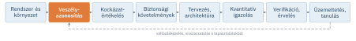
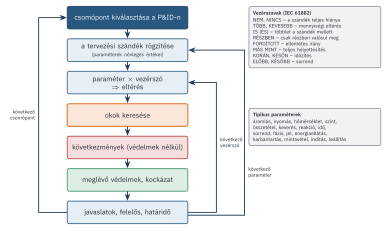
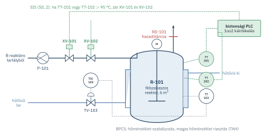

# Veszélyazonosítás: a veszélylistáktól a HAZOP-ig {#sec-veszelyazonositas}

{width=100%}

A kockázatértékelés csak annyira lehet jó, amennyire a veszélyazonosítás teljes. Egy fel nem tárt veszély semmilyen kockázati számításban nem jelenik meg, és ellene nem épül védelem. A veszélyazonosítás ezért a biztonsági életciklus legkritikusabb, egyben legkevésbé „algoritmizálható” lépése: módszeresség, csapatmunka és szakmai tapasztalat kell hozzá. Ez a fejezet a veszélyazonosítás általános elveivel kezdődik, majd bemutatja az előzetes módszereket (veszélylisták, előzetes veszélyelemzés, „Mi van, ha?” elemzés), részletesen tárgyalja a folyamatipar alapmódszerét, a HAZOP-ot, végül a funkcióalapú módszereket (FHA, HARA). Az FMEA és az STPA külön fejezetet kap.

::: {.cel}
A fejezet végére képes leszel

- megindokolni, miért nem bizonyítható a veszélyazonosítás teljessége, és mivel növelhető;
- előzetes veszélyelemzést készíteni ellenőrzőlisták és energiaforrás-szemlélet alapján;
- megtervezni és levezetni egy HAZOP-ülést: csomópontok, tervezési szándék, vezérszavak, eltérések, okok, következmények, védelmek, javaslatok;
- funkcionális veszélyelemzést (FHA) és ISO 26262 szerinti HARA-t végezni egy egyszerű járműfunkcióra;
- az életciklus fázisához és a rendszer jellegéhez illő módszert választani.
:::

## A veszélyazonosítás elvei {#sec-veszelyazonositas-elvek}

A veszélyazonosítás célja a rendszer összes ésszerűen előrelátható veszélyének, veszélyes helyzetének és veszélyes eseményének feltárása, a normál üzemben, az indításnál és leállításnál, a karbantartásnál, a meghibásodások után, valamint az előrelátható helytelen használat esetén is. Néhány alapelv:

- **A teljesség nem bizonyítható, csak valószínűsíthető.** Nincs olyan módszer, amely garantálná, hogy minden veszélyt megtaláltunk. A teljesség valószínűségét több, eltérő nézőpontú módszer együttes alkalmazása növeli: egy alkatrész-orientált (FMEA), egy folyamat-orientált (HAZOP) és egy funkció- vagy irányítás-orientált (FHA, STPA) módszer más-más veszélyeket talál meg.
- **Csapatmunka.** A veszélyazonosítás multidiszciplináris tevékenység. A tervező ismeri a szándékot, az üzemeltető a valóságos működést, a karbantartó a tipikus meghibásodásokat, a biztonsági szakember a módszert. Az egyedül dolgozó elemző a saját vakfoltjait reprodukálja.
- **Strukturált kreativitás.** A jó módszer egyszerre ad keretet (minden csomópontot, minden paramétert megvizsgálunk) és ösztönöz a „mi lenne, ha” típusú gondolkodásra.
- **Dokumentáltság.** A veszélyazonosítás eredménye a **veszélynapló** (*hazard log*): a feltárt veszélyek, okaik, következményeik, a védelmek és a javaslatok élő nyilvántartása, amelyet a teljes életcikluson át vezetni kell.
- **Időzítés.** A veszélyazonosítást a lehető legkorábban el kell kezdeni, amikor a tervet még olcsón lehet változtatni, és a tervezés előrehaladtával egyre részletesebb módszerekkel meg kell ismételni.

## Előzetes módszerek {#sec-elozetes-modszerek}

### Veszélylisták és energiaforrás-szemlélet {#sec-veszelylistak}

A legegyszerűbb, mégis nélkülözhetetlen eszköz az **ellenőrzőlista**: a korábbi tapasztalatokat összegző lista a lehetséges veszélyfajtákról. Az ISO 12100 B melléklete például a gépek jellemző veszélyeit sorolja fel (mechanikai, villamos, termikus, zaj, rezgés, sugárzás, anyagok, ergonómia, környezet) [@iso12100]. A Haddon-féle energia–gát szemlélet ([-@sec-energia-gat]. szakasz) szerint minden veszély mögött valamilyen energiaforrás áll. Ezért jó kiindulópont a rendszerben tárolt vagy átalakított energiák számbavétele: helyzeti, mozgási, nyomás-, hő-, vegyi, villamos és sugárzási energia.

Az ellenőrzőlista ereje a gyorsaságban és abban rejlik, hogy a korábbi tapasztalatok nem vesznek el. Gyengesége, hogy csak azt találja meg, ami a listán szerepel: új technológiánál, szokatlan kölcsönhatásoknál vak.

### Előzetes veszélyelemzés (PHA) {#sec-pha}

Az előzetes veszélyelemzés (*preliminary hazard analysis*, PHA) a koncepciós fázis módszere, amikor a tervnek még csak a fő elemei ismertek. A MIL-STD-882E [@milstd882e] rendszerbiztonsági szabvány a veszélylista (*preliminary hazard list*, PHL) összeállításával kezdi, majd minden veszélyhez meghatározza a lehetséges okokat, a következményeket, egy előzetes kockázati besorolást (általában kockázati mátrixszal), és a szükséges intézkedéseket vagy további elemzéseket. A PHA eredménye mutatja meg, hol kell később részletes elemzést (HAZOP, FMEA, hibafa) végezni.

::: {.eset eset="C" title="KoboCella: előzetes veszélyelemzés (részlet)"}
| Veszély | Veszélyes helyzet | Lehetséges következmény | Előzetes kockázat | Intézkedés, további elemzés |
|:--|:--|:--|:--|:--|
| a robotkar mozgási energiája | a szerelő a közös munkatérben | ütközés, fejsérülés | nem tolerálható | sebesség- és távolságfelügyelet (PL~r~ meghatározás), STPA |
| szorítóerő a megfogónál | kéz a megfogó közelében | ujj becsípődése | nem tolerálható | erő- és teljesítménykorlátozás, ISO/TS 15066 határértékek |
| leeső munkadarab | a robot a szerelő fölött mozgat | ütés, zúzódás | tolerálható ALARP mellett | pályatervezési korlátozás, megfogófigyelés |
| sűrített levegő | tömlőszakadás | szem- és bőrsérülés | tolerálható ALARP mellett | tömlőrögzítés, nyomáscsökkentés |
| szoftverfrissítés | a frissítés után más a robot viselkedése | váratlan mozgás | nem tolerálható | változáskezelés, validálás frissítés után |
| ismétlődő mozdulatok | a szerelő a robot ütemét követi | mozgásszervi panasz | tolerálható ALARP mellett | ergonómiai vizsgálat, ütemezés |

: A KoboCella előzetes veszélyelemzésének részlete {#tbl-pha-kobocella}

A táblázat utolsó előtti sora jól mutatja, hogy a veszélyazonosítás nem csak a hardverre vonatkozik: a szoftver módosítása, a szervezeti folyamatok és az ember–gép együttműködés is veszélyforrás.
:::

### „Mi van, ha?” elemzés {#sec-what-if}

A „Mi van, ha?” elemzés (*what-if analysis*) strukturált ötletgyűjtés: a csapat a rendszer egyes részeire vagy műveleteire vonatkozóan „Mi van, ha…?” kérdéseket tesz fel („Mi van, ha a hűtővízszivattyú leáll?”, „Mi van, ha a kezelő rossz adagot tölt be?”), és megvizsgálja a következményeket és a meglévő védelmeket. Strukturáltabb változata a SWIFT (*structured what-if technique*), amely előre definiált kérdéskategóriákat (emberi hiba, berendezés-meghibásodás, közművek kiesése, külső hatások, időzítés stb.) használ. A módszer rugalmas és gyors, ezért jól használható változtatások (*management of change*) hatásának előzetes vizsgálatára, de alapossága nagyban függ a csapat tapasztalatától.

## HAZOP: veszély- és üzemeltethetőségi vizsgálat {#sec-hazop}

A HAZOP (*hazard and operability study*) módszert az 1960-as években az Imperial Chemical Industries (ICI) vegyipari vállalatnál fejlesztették ki, és mára a folyamatipar legelterjedtebb veszélyazonosítási módszere lett. Alkalmazási útmutatója az IEC 61882 [@iec61882]. A név a módszer kettős célját mutatja: a biztonsági veszélyek mellett az üzemeltethetőségi problémákat (amelyek nem veszélyesek, de rontják a hatékonyságot vagy a minőséget) is feltárja.

### Az alapgondolat {#sec-hazop-alapgondolat}

A HAZOP alapgondolata, hogy a veszélyek a **tervezési szándéktól való eltérésekből** fakadnak. A módszer ezért a terv minden részét (csomópontját) végigveszi, rögzíti a tervezési szándékot (milyen áramlást, nyomást, hőmérsékletet vár a tervező), majd **vezérszavak** (*guide words*) segítségével rendszeresen előállítja a lehetséges eltéréseket. A vezérszó és a folyamatparaméter kombinációja egy eltérés: „NINCS + áramlás” = nincs áramlás; „TÖBB + hőmérséklet” = túl magas hőmérséklet; „FORDÍTOTT + áramlás” = visszaáramlás. Minden értelmes eltérésnél a csapat megkeresi a lehetséges okokat és a következményeket, rögzíti a meglévő védelmeket, és ha szükséges, javaslatot tesz.

### A vizsgálat menete {#sec-hazop-menet}

A HAZOP-vizsgálat lépéseit a [-@fig-hazop]. ábra mutatja.

{#fig-hazop width=92%}

1. **Előkészítés.** A vizsgálat hatókörének és céljainak rögzítése, a csapat összeállítása, a dokumentáció (csővezeték- és műszerezési rajz, azaz P&ID, folyamatleírás, üzemeltetési utasítások, anyagbiztonsági adatlapok) összegyűjtése, a csomópontok kijelölése.
2. **Csomópontonkénti vizsgálat.** Minden csomópontra (például egy vezetékszakasz vagy egy tartály a hozzá tartozó berendezésekkel) a tervezési szándék rögzítése, majd a paraméterek és a vezérszavak végigvétele.
3. **Okok és következmények.** Minden értelmes eltérés okainak felsorolása (berendezés-meghibásodás, emberi hiba, külső hatás), majd a következmények vizsgálata *a védelmek figyelmen kívül hagyásával*. Ez fontos: a következményt először úgy kell felmérni, mintha a védelmek nem működnének, mert csak így látszik, mennyit kell a védelmeknek teljesíteniük.
4. **Védelmek és kockázat.** A meglévő védelmek rögzítése (szabályozás, riasztás, biztonsági funkció, biztonsági szelep), és sok vállalatnál egy előzetes kockázati besorolás (kockázati mátrixszal).
5. **Javaslatok.** Ha a kockázat nem tolerálható vagy bizonytalan, javaslat további védelemre, tervmódosításra vagy részletesebb elemzésre (például LOPA-ra), felelőssel és határidővel.

A **csapat** jellemzően 5–8 főből áll: független, a módszerben jártas vezető, jegyzőkönyvvezető, folyamatmérnök, irányítástechnikus, üzemeltetési szakember (lehetőleg tapasztalt kezelő), karbantartási szakember és szükség szerint vegyész, gépész vagy biztonsági szakember. A vezető feladata, hogy a csapat a módszert következetesen alkalmazza, de ne veszítse el a kreativitását, és hogy a megbeszélés ne csússzon át tervezési vitába. A HAZOP a problémák *azonosítására* szolgál; a megoldásukat a javaslatokban rögzített felelősök utólag dolgozzák ki.

### Kidolgozott HAZOP a ReaktorVéd esetre {#sec-hazop-reaktorved}

A ReaktorVéd egyszerűsített folyamatábráját a [-@fig-reaktorved]. ábra mutatja. A B reaktánst a P-101 szivattyú adagolja a reaktorba két sorba kötött gyorszáró szelepen (XV-101, XV-102) át. A reakcióhőt a köpenyben áramló hűtővíz vonja el; a hőmérsékletet a TIC-103 szabályozó tartja az alapjelen a TV-103 szelep állításával. A független biztonsági rendszer két hőmérséklet-távadóval (TT-101, TT-102) figyeli a reaktort, és bármelyik határérték-túllépésekor mindkét gyorszáró szelepet zárja. A reaktoron hasadótárcsa (RD-101) is van.

{#fig-reaktorved width=100%}

A [-@tbl-hazop-reaktorved]. táblázat a „reaktor hűtőköre” csomópont HAZOP-jegyzőkönyvének részlete. A tervezési szándék: a hűtővíz 15–25 °C-os belépő hőmérséklettel, legalább 12 m³/h térfogatárammal áramlik a köpenyen át, és a reaktor hőmérsékletét az exoterm fázisban 70 ± 3 °C-on tartja.

| Eltérés | Lehetséges okok | Következmények (védelmek nélkül) | Meglévő védelmek | Javaslat |
|:--|:--|:--|:--|:--|
| NINCS hűtővízáramlás | hűtővízszivattyú leállása; áramszünet; TV-103 zárt helyzetben beragad; elzárt kézi szelep | a hőmérséklet megfut, a nyomás a tervezési érték fölé nő, a reaktor felhasadhat, mérgező kibocsátás, halálos sérülés | TAH-103 riasztás és kezelői beavatkozás; SIS: TT-101/102, XV-101/102; RD-101 | LOPA a forgatókönyvre (SIL-meghatározás); a hasadótárcsa méretezésének ellenőrzése kétfázisú áramlásra |
| KEVESEBB hűtővízáramlás | szennyezett hőcserélő felület; részben zárt szelep; szivattyúkopás | lassabb hőmérséklet-emelkedés, a fenti következmény késleltetve | TIC-103 szabályozás; TAH-103 | a köpeny tisztítási gyakoriságának felülvizsgálata; áramlásmérés a hűtőkörbe |
| TÖBB hűtővízáramlás | TV-103 nyitott helyzetben beragad | a reakció lelassul, a reaktáns felhalmozódik; később hirtelen beinduló reakció | TAL alacsony hőmérséklet riasztás | **reteszelés: az adagolás tiltása, ha a hőmérséklet 60 °C alatt van** (a felhalmozódás megakadályozása) |
| MAGASABB belépő hőmérséklet | a hűtőtorony túlterhelt, nyári csúcs | csökkenő hűtési kapacitás, hőmérséklet-emelkedés | TIC-103; TAH-103 | a hűtési kapacitás igazolása 30 °C-os belépő hőmérsékletre |
| FORDÍTOTT áramlás | csőcsere utáni hibás bekötés | a köpeny nem hűt, lásd NINCS áramlás | üzembe helyezési ellenőrzés | üzembe helyezési ellenőrzőlista kiegészítése |
| MÁS MINT víz a köpenyben | termékszivárgás a köpenybe (repedés) | a reakcióelegy a hűtővízbe jut, környezetszennyezés | – | vezetőképesség-mérés a visszatérő hűtővízben |

: A ReaktorVéd HAZOP-jegyzőkönyvének részlete: a reaktor hűtőköre {#tbl-hazop-reaktorved}

A jegyzőkönyv két fontos tanulságot hordoz. Az első sor az a súlyos forgatókönyv, amelyre a biztonsági funkciót tervezik; a javaslat szerint a szükséges integritást LOPA-val kell meghatározni ([-@sec-esemenyfa]. fejezet). A harmadik sor kevésbé nyilvánvaló, de klasszikus vegyipari veszélyre mutat rá: ha a túlhűtés miatt a reakció nem indul be, a folyamatosan adagolt reaktáns felhalmozódik, és később egyszerre, hatalmas hőfejlődéssel reagálhat el. Ilyen „rejtett” veszélyek feltárásában a HAZOP vezérszavas rendszeressége különösen erős.

::: {.hiba title="A következményt a védelmek figyelembevételével becsülik"}
Gyakori hiba, hogy a HAZOP-csapat a következmény oszlopba azt írja, ami a védelmek *működése* mellett történik („a SIS leállítja az adagolást, nincs következmény”). Így a következmény súlyossága nem látszik, és nem derül ki, mennyit kell a védelmeknek teljesíteniük. A helyes eljárás: a következményt a védelmek nélkül kell felmérni, a védelmeket külön oszlopban rögzíteni, és a kockázatot ezek együttes figyelembevételével értékelni.
:::

### HAZOP-változatok {#sec-hazop-valtozatok}

A HAZOP gondolata, vagyis a szándéktól való eltérések rendszeres előállítása vezérszavakkal, a folyamatiparon túl is alkalmazható:

- **Eljárási HAZOP:** üzemeltetési eljárások (indítás, leállítás, tisztítás) lépéseinek vizsgálata. A paraméterek itt a műveletek, a vezérszavak például KIMARAD, KORÁN, KÉSŐN, MÁS SORRENDBEN.
- **CHAZOP** (*computer HAZOP*) és **szoftver-HAZOP:** irányítórendszerek és szoftverek vizsgálata. A paraméterek az adatfolyamok, jelek és állapotok, a vezérszavak például NINCS, TÖBB, KEVESEBB, KORÁN, KÉSŐN, ROSSZ ÉRTÉK.
- **Ember–gép HAZOP:** a kezelő és a rendszer közötti információcserék és beavatkozások vizsgálata.

### A HAZOP erősségei és korlátai {#sec-hazop-korlatai}

**Erősségei:** rendszeres, a csomópontok és vezérszavak teljes körű bejárása kevés veszélyt hagy rejtve; a multidiszciplináris csapat sokféle tudást mozgósít; az üzemeltethetőségi problémákat is feltárja; jól dokumentálható, és közvetlenül illeszkedik a LOPA-hoz.

**Korlátai:** időigényes (egy közepes üzem HAZOP-ja több hét lehet); erősen függ a vezető és a csapat tapasztalatától; elsősorban egyes eltérésekre és azok közvetlen hatásaira koncentrál, a több egyidejű hiba kombinációit és a csomópontok közötti távoli kölcsönhatásokat kevésbé tárja fel; a komplex irányítási és szoftveres kölcsönhatásokban kevésbé erős, mint az STPA. A HAZOP a P&ID-k elkészülte után végezhető érdemben, tehát a koncepciós fázisban még nem alkalmazható.

## Funkcióalapú veszélyelemzés {#sec-funkcioalapu}

### Funkcionális veszélyelemzés (FHA) {#sec-fha}

A funkcionális veszélyelemzés (*functional hazard assessment*, FHA) a repülésben kialakult módszer, az ARP4761A biztonságértékelési folyamatának első lépése [@arp4761a]. Kiindulópontja nem a fizikai terv, hanem a **funkciók listája**, ezért már a koncepciós fázisban elvégezhető. Minden funkcióra megvizsgálja a lehetséges **meghibásodási állapotokat** (*failure conditions*): a funkció elvesztését, a téves vagy indokolatlan működését, a részleges vagy késleltetett működését. Mindegyiket a következménye szerint osztályozza (katasztrofális, veszélyes, jelentős, csekély, nincs hatás), és meghatározza a megengedett valószínűséget és a fejlesztési biztosítottsági szintet.

::: {.eset eset="B" title="VészFék: funkcionális veszélyelemzés"}
| Funkció | Meghibásodási állapot | Működési helyzet | Hatás | Besorolás |
|:--|:--|:--|:--|:--|
| akadály észlelése és vészfékezés | elmarad a fékezés valós akadály esetén | városi forgalom, gyalogos az úttesten | gyalogos elütése, ha a vezető sem reagál | súlyos (a vezető a felelős, a funkció kiegészítő) |
| akadály észlelése és vészfékezés | indokolatlan teljes fékezés | autópálya, követő jármű | ráfutásos baleset nagy sebességkülönbséggel | katasztrofális |
| akadály észlelése és vészfékezés | késve induló fékezés | bármely | csökkenő ütközéscsökkentő hatás | jelentős |
| figyelmeztetés a vezetőnek | téves figyelmeztetés | bármely | a vezető megzavarása, bizalomvesztés, a funkció kikapcsolása | csekély–jelentős |

: A VészFék funkcionális veszélyelemzésének részlete {#tbl-fha-veszfek}

Az elemzés legfontosabb tanulsága, hogy ugyanannak a funkciónak két ellentétes meghibásodási állapota (elmaradó és indokolatlan működés) más-más súlyosságú. Ezért a tervezésnek más-más eszközökkel kell kezelnie őket: az indokolatlan fékezés ellen a funkcionális biztonság eszközei (redundáns érzékelés, plauzibilitásvizsgálat), az elmaradó fékezés ellen a teljesítőképesség növelése és a SOTIF szemlélete ([-@sec-uj-kihivasok]. fejezet) segít.
:::

### Veszélyelemzés és kockázatbecslés (HARA) {#sec-hara}

Az ISO 26262 szerinti HARA a jármű funkciói (az *item*) szintjén dolgozik [@iso26262]. Lépései:

1. **Az item definíciója:** a funkció, határai, interfészei, a feltételezett működési környezet.
2. **Működési helyzetek elemzése:** a releváns közlekedési helyzetek, üzemmódok és környezeti feltételek katalógusa (autópálya, város, parkolás, csúszós út, éjszaka stb.).
3. **Veszélyazonosítás:** a funkció meghibásodási viselkedéseinek (elvesztés, indokolatlan működés, hibás működés) és a működési helyzeteknek a kombinációi adják a veszélyes eseményeket. Az azonosításhoz FHA, HAZOP-szerű vezérszavak és tapasztalati listák használhatók.
4. **Osztályozás:** minden veszélyes eseményre S, E és C besorolás és az ASIL ([-@sec-iso26262]. szakasz).
5. **Biztonsági célok:** az azonos ASIL-ű vagy összefüggő veszélyes eseményekre biztonsági célok megfogalmazása.

A HARA-ban különös figyelmet érdemelnek azok a meghibásodások, amelyek egyszerre több funkciót érintenek vagy sokféle veszélyes helyzetet okozhatnak (közös okú, kaszkád hibák, például a tápellátás hibája). Az egyes veszélyes eseményeket egymástól függetlenül kell értékelni; a „legrosszabb eset” egyetlen besorolása elfedheti a különbségeket.

## A módszerek kiválasztása {#sec-modszervalasztas}

A [-@tbl-modszervalasztas]. táblázat összefoglalja a veszélyazonosítási módszerek jellemzőit és tipikus alkalmazási helyüket az életciklusban.

| Módszer | Életciklus-fázis | Nézőpont | Fő erőssége | Fő korlátja |
|:--|:--|:--|:--|:--|
| ellenőrzőlista | minden fázis | tapasztalat | gyors, a tudás nem vész el | csak az ismert veszélyeket találja meg |
| PHA | koncepció | veszélyforrás | korai, irányt mutat | durva felbontás |
| „Mi van, ha?”, SWIFT | koncepció, változtatások | ötletgyűjtés | rugalmas, gyors | a csapattól erősen függ |
| HAZOP | részletes tervezés (P&ID) | folyamateltérés | rendszeres, teljes körű | időigényes, egyhibás szemlélet |
| FMEA, FMECA | részletes tervezés | alkatrész-meghibásodás | alulról felfelé teljes | a kölcsönhatásokat és a kombinációkat gyengén kezeli |
| FHA, HARA | koncepció | funkció | korai, független a megvalósítástól | a megvalósítás részleteit nem látja |
| STPA | koncepciótól | irányítás, kölcsönhatás | specifikációs és ember–automatizálás hibák | új, kevésbé szabványosított |

: A veszélyazonosítási módszerek összevetése {#tbl-modszervalasztas}

A gyakorlatban a módszerek egymásra épülnek: a koncepciós fázis PHA- vagy FHA-elemzése kijelöli a kritikus területeket, ahol a részletes tervezés során HAZOP és FMEA következik; a komplex irányítási kölcsönhatásokat STPA tárja fel; a súlyos forgatókönyveket pedig a III. rész kvantitatív módszerei számszerűsítik.

::: {.prompt title="Nagy nyelvi modell mint HAZOP-segítő"}
A nagy nyelvi modellek hasznosak lehetnek a vezérszavas ötletgyűjtés kiegészítésére, de nem helyettesítik a szakértői csapatot, és állításaikat mindig ellenőrizni kell. Egy lehetséges prompt:

*„Egy félszakaszos keverős reaktor hűtőkörének HAZOP-vizsgálatát végezzük. A tervezési szándék: hűtővíz 15–25 °C-on, legalább 12 m³/h, a reaktor 70 ± 3 °C-on tart egy exoterm reakciót. Az IEC 61882 vezérszavai közül vedd sorra a NINCS, TÖBB, KEVESEBB, FORDÍTOTT és MÁS MINT szót az áramlás és a hőmérséklet paraméterre. Minden eltérésnél sorolj fel lehetséges okokat (berendezés, ember, közmű, külső hatás) és következményeket a védelmek figyelmen kívül hagyásával. Jelöld meg, mely állításaid bizonytalanok vagy ellenőrzést igényelnek, és ne találj ki konkrét számadatokat.”*

A modell válaszát a csapat a saját jegyzőkönyvével veti össze: a modell gyakran felvet a csapat által nem gondolt okokat, de téves vagy irreleváns javaslatokat is tesz.
:::

::: {.labor}
A gyakorlati útmutató 3. laborjában HAZOP-jegyzőkönyvet készítesz a ReaktorVéd adagolóköréhez (a B reaktáns csomópontjához), majd a súlyos forgatókönyveket átadod a 9. labor LOPA-alkalmazásának.
:::

::: {.osszefoglalo}
- A veszélyazonosítás teljessége nem bizonyítható; a valószínűségét eltérő nézőpontú módszerek, multidiszciplináris csapat és korai, ismételt elemzés növeli.
- Az ellenőrzőlisták és az energiaforrás-szemlélet gyors kiindulópontot adnak; a PHA a koncepciós fázis módszere.
- A HAZOP a tervezési szándéktól való eltéréseket vezérszavak és paraméterek kombinációival állítja elő; a következményeket a védelmek nélkül kell felmérni.
- Az FHA és a HARA funkcióalapú módszerek, ezért a koncepciós fázisban is alkalmazhatók; ugyanannak a funkciónak az elmaradó és az indokolatlan működése eltérő súlyosságú lehet.
- A módszerek kiegészítik egymást; eredményük a teljes életcikluson át vezetett veszélynapló.
:::

::: {.onell}
1. Miért kell a HAZOP-ban a következményeket a védelmek figyelmen kívül hagyásával felmérni?
2. Állíts elő eltéréseket a „KÉSŐN” és a „MÁS SORRENDBEN” vezérszóval egy olyan eljárási lépésre, amely szerint „a kezelő a hűtés bekapcsolása után kezdi az adagolást”! Melyik a veszélyes?
3. Miért alkalmazható az FHA a koncepciós fázisban, a HAZOP pedig nem?
4. A ReaktorVéd HAZOP-jában a TÖBB hűtővízáramlás eltérés veszélyes következményt is okozhat. Mi ez, és milyen védelmet javasolt a csapat?

::: {.megoldas}
1. Mert csak így derül ki a forgatókönyv valódi súlyossága és az, hogy mekkora kockázatcsökkentést kell a védelmeknek teljesíteniük. Ha a következményt a védelmek működésével becsüljük, a védelmek integritását nem lehet megalapozottan meghatározni, és egy hibás védelem rejtve marad.
2. KÉSŐN: a kezelő késve kezdi az adagolást; ez legfeljebb termelési veszteség. MÁS SORRENDBEN: a kezelő a hűtés bekapcsolása *előtt* kezdi az adagolást; ez veszélyes, mert a reakció hűtés nélkül indulhat be. Javaslat: reteszelés, amely csak igazolt hűtővízáramlás mellett engedi az adagolást.
3. Az FHA a funkciók listájából indul, amely már a koncepcióban ismert. A HAZOP a részletes tervből (P&ID, csomópontok, tervezési paraméterek) dolgozik, amely csak a részletes tervezésben áll rendelkezésre.
4. A túlhűtés miatt a reakció nem indul be, a folyamatosan adagolt reaktáns felhalmozódik, és később egyszerre, nagy hőfejlődéssel reagálhat el. A javasolt védelem az adagolás reteszelése, ha a reaktor hőmérséklete egy alsó határ (60 °C) alatt van.
:::
:::

::: {.forras}
- IEC 61882:2016 – a HAZOP alkalmazási útmutatója, példákkal [@iec61882].
- Kletz, T. A. *HAZOP and HAZAN* (több kiadás, IChemE) – a HAZOP klasszikus gyakorlati bevezetője.
- SAE ARP4761A (2023) – az FHA és a teljes repülési biztonságértékelési folyamat [@arp4761a].
- MIL-STD-882E (2012) – a rendszerbiztonsági feladatok (PHL, PHA, SSHA, SHA) leírása [@milstd882e].
:::
