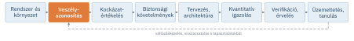
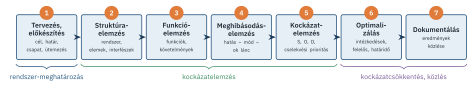
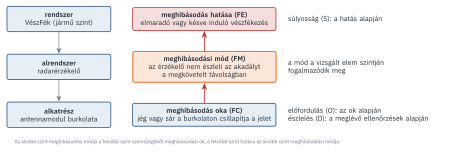
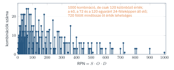
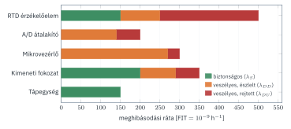

# FMEA, FMECA és FMEDA {#sec-fmea}

{width=100%}

A hibamód- és hatáselemzés (*failure mode and effects analysis*, FMEA) a megbízhatósági és biztonsági mérnökség talán legismertebb módszere. Az 1940-es évek végén az amerikai hadiiparban született, az Apollo-programban terjedt el, az 1970-es évektől az autóiparban vált alapmódszerré, ma pedig szinte minden iparágban használják. Az FMEA alulról felfelé halad: minden alkatrészről vagy folyamatlépésről megkérdezi, hogyan hibásodhat meg, és mi lesz ennek a hatása. Ebben a fejezetben megismerjük a módszer mai, harmonizált formáját (AIAG–VDA, 2019), a kockázat-prioritási szám (RPN) korlátait és a helyébe lépő cselekvési prioritást (AP), a kritikusságelemzést (FMECA), végül a biztonsági funkciók számára kulcsfontosságú változatot, az FMEDA-t, amely a meghibásodási rátákat biztonságos és veszélyes, észlelt és rejtett részekre bontja.

::: {.cel}
A fejezet végére képes leszel

- elmagyarázni az FMEA alapgondolatát, típusait és helyét az életciklusban;
- végigvezetni egy FMEA-t az AIAG–VDA hét lépésén, a meghibásodási lánc (hatás–mód–ok) helyes megfogalmazásával;
- értékelni a súlyosságot, az előfordulást és az észlelést, és kritikusan értelmezni az RPN-t;
- megindokolni, miért lépett az RPN helyébe a cselekvési prioritás;
- FMECA-kritikusságot számolni;
- FMEDA-t készíteni egy egyszerű eszközre, és kiszámolni a diagnosztikai lefedettséget és a biztonságos meghibásodási hányadot.
:::

## Az FMEA alapgondolata {#sec-fmea-alapgondolat}

Az FMEA tervező, fejlesztő és dokumentációs módszer, amellyel módszeresen azonosíthatók az egyes alkatrészek vagy folyamatlépések meghibásodási módjainak következményei, és amellyel a termékek és folyamatok minősége és megbízhatósága folyamatosan fejleszthető. A módszer **induktív**: a „Mi történik, ha ez az elem így hibásodik meg?” kérdésből indul ki. Jellemzői:

- **alulról felfelé halad:** az alkatrész vagy folyamatlépés meghibásodási módjából kiindulva követi a hatásokat a magasabb rendszerszintekig (szemben a hibafával, amely a csúcseseménytől halad lefelé, [-@sec-hibafa]. fejezet);
- **egyszeres hibákat vizsgál:** minden meghibásodási módot a többitől függetlennek tekint; a hibák kombinációit nem elemzi;
- **elvi lehetőségeket vizsgál:** érdektelen, hogy a meghibásodás előfordult-e már, vagy csak elvileg lehetséges;
- **megelőző szemléletű:** a hangsúly a meghibásodások megelőzésén és a terv vagy folyamat javításán van, nem a már bekövetkezett hibák utólagos elemzésén.

Az FMEA sikerének egyik legfontosabb feltétele, hogy **soha véget nem érő folyamat** legyen: élő dokumentum, amelyet a tervezés előrehaladtával, a változtatásokkal, az új tapasztalatokkal folyamatosan frissíteni kell.

Az FMEA-ra több szabvány és kézikönyv vonatkozik: az általános IEC 60812:2018 [@iec60812], az autóipari AIAG–VDA *FMEA Handbook* (2019) [@aiagvda2019], amely az amerikai AIAG és a német VDA korábban eltérő módszertanát egyesítette, valamint a SAE J1739 (2021).

### Az FMEA típusai {#sec-fmea-tipusai}

- **Tervezési FMEA** (*design FMEA*, DFMEA): a termék konstrukciójának elemzése, a tervezésből eredő hibalehetőségek feltárása, még a gyártás megkezdése előtt.
- **Folyamat-FMEA** (*process FMEA*, PFMEA): a gyártási és szerelési folyamat elemzése, a gyártás során fellépő hibalehetőségek feltárása. A tervezési FMEA-ra épül, és figyelembe veszi a technológiát, az ellenőrzési lépéseket és a logisztikát.
- **Felügyeleti és rendszerválasz-FMEA** (*FMEA for monitoring and system response*, FMEA-MSR): az AIAG–VDA kézikönyv kiegészítő módszere, amely azt vizsgálja, hogy az üzem közbeni diagnosztika észleli-e a meghibásodást, és a rendszer biztonságos állapotba kerül-e. Közvetlen kapcsolatot teremt a funkcionális biztonsággal.

Az elemzés szintje szerint **rendszer-**, **alrendszer-** és **alkatrész-FMEA**-t különböztetünk meg. A határok meghúzása a csapat döntése; a lényeg, hogy a különböző szintek elemzései összekapcsolhatók legyenek: az alrendszer meghibásodási hatása a rendszer szintjén meghibásodási mód.

### Mikor kell FMEA-t készíteni vagy frissíteni? {#sec-fmea-mikor}

- **Új termék, technológia vagy gyártási folyamat:** az FMEA a teljes termékre vagy folyamatra kiterjed.
- **Meglévő termék vagy folyamat módosítása:** a korábbi FMEA-t a változás hatására kell kiterjeszteni.
- **Meglévő termék vagy folyamat új alkalmazása vagy környezete:** a megváltozott felhasználásra, helyszínre vagy környezetre kell összpontosítani.
- **Terepen jelentkező problémák, reklamációk:** az új meghibásodási módokat és okokat be kell építeni.

## Az FMEA hét lépése {#sec-fmea-lepesei}

Az AIAG–VDA kézikönyv az FMEA-t hét lépésre bontja ([-@fig-fmea-lepesek]. ábra). A lépések a korábbi gyakorlat legjobb elemeit egyesítik, és a struktúra- és funkcióelemzés előtérbe helyezésével sokat javítanak az elemzés következetességén.

{#fig-fmea-lepesek width=100%}

1. **Tervezés és előkészítés.** Az elemzés céljának, hatókörének és határainak rögzítése, a csapat összeállítása, az ütemezés és az eszközök kiválasztása. A csapat multidiszciplináris: tervező, gyártástechnológus, minőségügyi, megbízhatósági és szükség szerint biztonsági szakember. Ezen a tudásigényen múlik az FMEA értéke: a módszer forgatókönyvszerű segítséget ad, de nem helyettesíti a szakmai ismereteket.
2. **Struktúraelemzés.** A rendszer felbontása hierarchikus szerkezetre (rendszer, alrendszer, alkatrész vagy folyamat, folyamatlépés, munkaelem) és az interfészek azonosítása.
3. **Funkcióelemzés.** Minden szerkezeti elemhez hozzárendeljük a funkcióit és a velük szemben támasztott követelményeket, lehetőleg mérhető formában (hőmérséklet-tartomány, nyomás, élettartam). Ha egy elemnek több funkciója van, mindegyiket fel kell sorolni.
4. **Meghibásodáselemzés.** Minden funkcióhoz megfogalmazzuk a **meghibásodási láncot**: a meghibásodási módot (*failure mode*, FM), annak hatását (*failure effect*, FE) a magasabb szinten és okát (*failure cause*, FC) az alacsonyabb szinten ([-@fig-fmea-lanc]. ábra).
5. **Kockázatelemzés.** A meglévő megelőző és észlelő intézkedések rögzítése, a súlyosság (S), az előfordulás (O) és az észlelés (D) értékelése, majd a cselekvési prioritás (AP) meghatározása.
6. **Optimalizálás.** Intézkedések meghatározása a kockázat csökkentésére, felelőssel és határidővel; a bevezetés után az értékelés megismétlése.
7. **Dokumentálás.** Az eredmények összefoglalása és közlése az érintettekkel.

{#fig-fmea-lanc width=96%}

A meghibásodási lánc helyes megfogalmazása az FMEA minőségének kulcsa. Néhány szabály:

- A **meghibásodási mód** fizikai, műszaki fogalmakkal írja le, *hogyan* nem teljesíti az elem a funkcióját („a tömítés nem zár 3 bar fölött”), nem pedig a felhasználó által érzékelt tünetet.
- A **hatást** úgy kell megfogalmazni, ahogyan a vevő (akár belső vevő, akár végfelhasználó) érzékeli. Ha a meghibásodás a biztonságot vagy a jogszabályi megfelelést érinti, azt egyértelműen jelezni kell.
- Az **ok** a meghibásodási mód kiváltója: tervezési gyengeség (rossz anyagválasztás, alulméretezés), gyártási eltérés vagy környezeti hatás. Minden módhoz az összes ésszerűen lehetséges okot fel kell sorolni, mert a hatékony intézkedések az okokra irányulnak.
- A különleges körülmények között fellépő módokat (alacsony vagy magas hőmérséklet, por, nedvesség, gyakoribb használat, nehéz terep) is figyelembe kell venni.

## Az értékelés: súlyosság, előfordulás, észlelés {#sec-sod}

Az FMEA kockázatértékelése három, egyenként 1-től 10-ig terjedő skálán történik:

- **Súlyosság** (*severity*, S): a legsúlyosabb hatás súlyossága. Csak a terv megváltoztatásával csökkenthető.
- **Előfordulás** (*occurrence*, O): annak valószínűsége, hogy az ok bekövetkezik és meghibásodást okoz, a meglévő megelőző intézkedések figyelembevételével.
- **Észlelés** (*detection*, D): annak a valószínűsége, hogy a meglévő észlelő intézkedések (tesztek, vizsgálatok, ellenőrzések) *nem* szűrik ki az okot vagy a meghibásodási módot, mielőtt a termék a vevőhöz kerül. A magas érték rossz észlelést jelent.

A [-@tbl-sod-skala]. táblázat egy általános, a 2014-es jegyzet táblázatait továbbfejlesztő skálát mutat. Az iparági kézikönyvek részletesebb, iparágspecifikus skálákat adnak; a lényeg, hogy a csapat egy skálát következetesen alkalmazzon az egész elemzésben.

| Érték | Súlyosság (S) | Előfordulás (O) | Észlelés (D) |
|:--:|:--|:--|:--|
| 9–10 | a felhasználóra veszélyes, sérti a jogszabályokat; 10: figyelmeztetés nélkül | a meghibásodás szinte biztos; nincs megelőzés | nincs ellenőrzés, vagy az nem képes észlelni |
| 7–8 | a termék nem működik, vagy alapfunkciója sérül | gyakori; a megelőzés gyenge | gyenge esélyű ellenőrzés (szemrevételezés, kis minta) |
| 4–6 | észrevehető, zavaró, de a termék alapvetően működik | alkalmi; a megelőzés részben hatékony | közepes esélyű, például statisztikai ellenőrzés |
| 2–3 | a felhasználó valószínűleg érzékeli, de alig zavarja | ritka; hatékony megelőzés | jó esélyű, bevált vizsgálati módszer |
| 1 | a felhasználó nem érzékeli | a megelőzés kizárja (például hibabiztos tervezés) | az ok vagy a mód biztosan észlelhető, illetve fizikailag kizárt |

: Általános S–O–D értékelési skála {#tbl-sod-skala}

Az ellenőrzési intézkedéseket két oszlopban érdemes rögzíteni: a **megelőző** intézkedések (például tervezési irányelvek, méretezési számítások) az előfordulást, az **észlelő** intézkedések (tesztek, mérések) az észlelést befolyásolják. Mindig a megelőzés az előnyösebb megoldás.

### A kockázat-prioritási szám és korlátai {#sec-rpn}

A hagyományos FMEA a három pontszám szorzatát, a kockázat-prioritási számot (*risk priority number*, RPN) használta a meghibásodási módok rangsorolására:

$$
RPN = S \cdot O \cdot D, \qquad 1 \le RPN \le 1000 .
$$ {#eq-rpn}

Az RPN egyszerű és népszerű, de módszertanilag súlyos hibái vannak:

1. **Sorrendi skálák szorzása.** Az S, O és D sorrendi (ordinális) skálák: a 8-as súlyosság nem „kétszer olyan súlyos”, mint a 4-es. Az ilyen számok szorzatának nincs mennyiségi jelentése.
2. **Egyenlő súlyozás.** Az RPN a súlyosságot, az előfordulást és az észlelést egyenrangúnak tekinti. Egy halálos következményű, ritka meghibásodás ($S=10$, $O=2$, $D=2$; $RPN=40$) így alacsonyabb prioritást kap, mint egy zavaró, de ártalmatlan, gyakoribb hiba ($S=4$, $O=5$, $D=5$; $RPN=100$).
3. **Egyenetlen és nem egyértelmű eloszlás.** Az 1000 lehetséges kombinációból csak 120 különböző RPN-érték adódik ([-@fig-rpn]. ábra). Ugyanaz az érték nagyon különböző kockázatokat takarhat: a 120-as érték például 24-féle $(S,O,D)$ kombinációból áll elő.
4. **Önkényes küszöbök.** A gyakorlatban elterjedt küszöbértékek (például „$RPN < 40$ elfogadható, $RPN > 100$ beavatkozás szükséges”, ahogy a 2014-es jegyzet is közölte) semmilyen szabványban nem szerepelnek, és a fenti okok miatt nem is lehet őket megalapozni. Ráadásul arra ösztönöznek, hogy a csapat a pontszámokat „lefelé kerekítse”.

{#fig-rpn width=96%}

### A cselekvési prioritás {#sec-ap}

Az AIAG–VDA kézikönyv ezért az RPN helyett a **cselekvési prioritást** (*action priority*, AP) vezette be. Az AP egy táblázat, amely minden $(S,O,D)$ kombinációhoz három prioritási szint egyikét rendeli: **magas** (H, intézkedés szükséges, vagy dokumentáltan meg kell indokolni, miért elegendők a meglévők), **közepes** (M, intézkedést kell mérlegelni) vagy **alacsony** (L, intézkedés lehetséges). Az AP alapelve, hogy a súlyosság a legfontosabb, utána az előfordulás következik, és csak végül az észlelés. Egy nagy súlyosságú meghibásodásnál tehát jó észlelés mellett is magas lehet a prioritás, mert a megelőzés fontosabb a kiszűrésnél.

A hivatalos AP-táblázat a kézikönyvben található. A [-@tbl-ap-egyszerusitett]. táblázat egy saját, egyszerűsített szabályt mutat, amely csak a táblázat *logikáját* szemlélteti.

| Prioritás | Egyszerűsített szabály (szemléltetés) |
|:--|:--|
| magas (H) | $S \ge 9$ és ($O \ge 4$ vagy $D \ge 7$); vagy $7 \le S \le 8$ és $O \ge 6$ |
| közepes (M) | $S \ge 7$, ha nem magas; vagy $4 \le S \le 6$ és $O \ge 6$ |
| alacsony (L) | minden egyéb eset |

: A cselekvési prioritás logikája egyszerűsített szabállyal. Ez nem az AIAG–VDA kézikönyv táblázata. {#tbl-ap-egyszerusitett}

A szakmai gyakorlat ettől függetlenül is egyértelmű: ha egy meghibásodás súlyossága 9 vagy 10 (a felhasználóra veszélyes vagy jogszabálysértő), akkor az RPN-től és az AP-től függetlenül célzott intézkedést kell meghatározni a következmény elkerülésére, az ok megszüntetésével, csökkentésével vagy ellenőrzésével. A javító intézkedések sorrendje: először a súlyosság (csak tervmódosítással), majd az előfordulás, végül az észlelés javítása.

::: {.eset eset="B" title="VészFék: tervezési FMEA a radarérzékelőre (részlet)"}
| Funkció | Meghibásodási mód | Hatás (jármű) | S | Ok | Megelőzés / észlelés | O | D | RPN | AP* |
|:--|:--|:--|:--:|:--|:--|:--:|:--:|:--:|:--:|
| akadály észlelése 0,5–150 m-en | nem észleli az akadályt a megkövetelt távolságban | elmaradó vészfékezés | 8 | jég vagy sár a burkolaton | fűtött burkolat / vakulásdiagnosztika a jelszint alapján | 4 | 4 | 128 | M |
| akadály észlelése | téves (szellem-) célpontot jelez | indokolatlan erős fékezés | 10 | többutas visszaverődés fém szerkezetekről | célpontkövetési algoritmus / szimulációs teszt kevés esettel | 4 | 6 | 240 | H |
| akadály távolságának mérése | a mért távolság eltolódik | késve induló fékezés | 7 | az oszcillátor hőmérsékleti driftje | hőkompenzáció / hőkamrás teszt | 3 | 3 | 63 | M |
| adatküldés a fékvezérlőnek | az adat késve érkezik | késve induló fékezés | 7 | CAN-busz túlterhelés | ütemezésanalízis / időzítésfigyelés | 2 | 2 | 28 | M |

: A VészFék radarérzékelőjének tervezési FMEA-részlete. *Az AP a [-@tbl-ap-egyszerusitett]. táblázat egyszerűsített szabálya szerint. {#tbl-dfmea-veszfek}

A második sor magas prioritású: a téves célpont indokolatlan fékezést okozhat, amelynek súlyossága a HARA szerint a legmagasabb ([-@sec-iso26262]. szakasz). A csapat intézkedései: a radar és a kamera jeleinek összevetése a fékezés előtt (szenzorfúzió plauzibilitásvizsgálattal), valamint a valós forgalmi felvételeken alapuló szimulációs tesztkészlet bővítése. Az intézkedések után $O=2$ és $D=3$ (RPN = 60). A súlyosság nem változik, mert az csak a funkció koncepciójának módosításával csökkenthető.

Érdemes megfigyelni, hogy az első sor RPN-je (128) nagyobb, mint a negyediké (28), de kisebb, mint a másodiké (240). Ez a sorrend itt egybeesik az AP-vel; a fenti „halálos, de ritka” példa viszont mutatja, hogy ez nem mindig van így.
:::

## Kritikusságelemzés (FMECA) {#sec-fmeca}

A hibamód-, hatás- és kritikusságelemzés (*failure mode, effects and criticality analysis*, FMECA) az FMEA kiterjesztése, amely a meghibásodási módokat **kritikusságuk** szerint rangsorolja: aszerint, hogy mekkora valószínűséggel és milyen súlyos kárt okozhatnak. A klasszikus, a MIL-STD-1629A szabványból eredő mennyiségi változatban egy meghibásodási mód kritikussága:

$$
C_m = \lambda_p \cdot \alpha \cdot \beta \cdot t ,
$$ {#eq-fmeca}

ahol $\lambda_p$ az alkatrész meghibásodási rátája, $\alpha$ a meghibásodási módarány (a meghibásodások mekkora hányada ebben a módban következik be), $\beta$ annak a feltételes valószínűsége, hogy a mód a vizsgált hatást okozza, $t$ pedig a működési idő. Egy alkatrész kritikussága a súlyos hatású módjainak kritikusságösszege. Az eredmény egy **kritikussági mátrixban** ábrázolható (súlyossági kategória a kritikusság függvényében), amely a kockázati mátrix rokona.

::: {.pelda title="Egy gyorszáró szelep kritikussága"}
A ReaktorVéd XV-101 szelepének veszélyes meghibásodási rátája $\lambda_p = 2{,}5\cdot 10^{-6}\,\text{h}^{-1}$. A veszélyes meghibásodások 70%-a „nem zár” (beragadás), 30%-a „lassan zár” módban következik be. Ha nem zár, a biztonsági funkció biztosan elvész ($\beta = 1$); ha lassan zár, a válaszidő-követelmény az esetek felében sérül ($\beta = 0{,}5$). Egy év ($t = 8760$ h) működésre:

$$
C_{\text{nem zár}} = 2{,}5\cdot 10^{-6} \cdot 0{,}7 \cdot 1 \cdot 8760 = 1{,}53\cdot 10^{-2}, \qquad
C_{\text{lassan zár}} = 2{,}5\cdot 10^{-6} \cdot 0{,}3 \cdot 0{,}5 \cdot 8760 = 3{,}3\cdot 10^{-3}.
$$

A beragadás kritikussága közel ötszöröse a lassú zárásénak, így a megelőző intézkedéseknek (például a részleges löketvizsgálatnak, [-@sec-sil]. fejezet) elsősorban erre kell irányulniuk.
:::

A kritikusságelemzéssel megtalálhatók azok a rendszerelemek, amelyekre a tervezés és az üzemeltetés során külön figyelmet kell fordítani. Az FMEA és az FMECA eljárását az IEC 60812 részletesen bemutatja.

## FMEDA: a biztonsági funkciók FMEA-ja {#sec-fmeda}

A hibamód-, hatás- és diagnosztikaelemzés (*failure modes, effects and diagnostic analysis*, FMEDA) az FMEA kvantitatív változata, amelyet a biztonsági funkciókban felhasznált eszközökre dolgoztak ki. Célja, hogy az eszköz meghibásodási rátáját a [-@sec-biztonsagos-veszelyes]. szakaszban bevezetett négy részre bontsa ($\lambda_{SD}$, $\lambda_{SU}$, $\lambda_{DD}$, $\lambda_{DU}$). Ezek az értékek a PFD-számítás ([-@sec-sil]. fejezet) és az architekturális korlátok közvetlen bemenetei. Az eszközgyártók tanúsítványaiban szereplő adatok tipikusan FMEDA-ból származnak.

Az FMEDA lépései:

1. az eszköz felbontása alkatrészekre vagy funkcionális blokkokra;
2. minden alkatrész meghibásodási rátájának és meghibásodási módjainak meghatározása (alkatrész-adatbázisokból, például az IEC 61709 vagy a SN 29500 szerint, vagy terepi adatokból);
3. minden módról annak eldöntése, hogy a biztonsági funkció szempontjából **biztonságos** vagy **veszélyes**;
4. annak eldöntése, hogy a beépített **diagnosztika** (önteszt, tartománytúllépés-figyelés, visszaolvasás, figyelőáramkör) észleli-e, és milyen lefedettséggel;
5. a részráták összegzése és a mérőszámok számítása.

A két legfontosabb mérőszám a **diagnosztikai lefedettség** és a **biztonságos meghibásodási hányad** (*safe failure fraction*, SFF):

$$
DC = \frac{\sum \lambda_{DD}}{\sum \lambda_{DD} + \sum \lambda_{DU}}, \qquad
SFF = \frac{\sum \lambda_{S} + \sum \lambda_{DD}}{\sum \lambda_{S} + \sum \lambda_{D}} .
$$ {#eq-dc-sff}

Az SFF azt fejezi ki, hogy a meghibásodások mekkora hányada *nem* veszélyes és rejtett: vagy biztonságos, vagy a diagnosztika észleli. Az IEC 61508 architekturális korlátai ([-@sec-sil]. fejezet) az SFF-től és a hardver hibatűrésétől függően korlátozzák az elérhető SIL-t.

::: {.eset eset="A" title="ReaktorVéd: a TT-101 hőmérséklet-távadó FMEDA-ja"}
A TT-101 egy ellenállás-hőmérős (RTD) távadó 4–20 mA-es kimenettel. A biztonsági funkció szempontjából a *magas* hőmérséklet jelzése a lényeg: az a meghibásodás veszélyes, amely miatt a távadó a valósnál *alacsonyabb* értéket mutat, és így a kioldás elmarad. Az a meghibásodás, amely magasabb értéket vagy tartományon kívüli jelet ad, kioldást okoz, tehát biztonságos. A logika a NAMUR NE 43 ajánlás szerinti tartományon kívüli jelet (3,6 mA alatt vagy 21 mA fölött) hibaként kezeli, és kiold.

| Blokk | Meghibásodási mód | λ [FIT] | Következmény | Diagnosztika | λ~S~ | λ~DD~ | λ~DU~ |
|:--|:--|--:|:--|:--|--:|--:|--:|
| RTD érzékelőelem | szakadás | 150 | felső tartományon kívüli jel | szakadásfigyelés | 150 | 0 | 0 |
| | rövidzár | 100 | alacsony érték | ellenálláshatár-figyelés | 0 | 100 | 0 |
| | lassú drift lefelé | 250 | alacsony érték | nincs | 0 | 0 | 250 |
| A/D átalakító | befagyott vagy hibás érték | 200 | hibás érték | referencia-összevetés (70%) | 0 | 140 | 60 |
| mikrovezérlő | programfutási hiba | 300 | befagyott kimenet | figyelőáramkör, RAM/ROM-teszt (90%) | 0 | 270 | 30 |
| kimeneti fokozat | áram a felső határon | 200 | kioldás | – | 200 | 0 | 0 |
| | áram beragad közbenső értéken | 150 | befagyott érték | áram-visszaolvasás (60%) | 0 | 90 | 60 |
| tápegység | kiesés | 150 | 0 mA, tartományon kívüli jel | a logika kiold | 150 | 0 | 0 |
| **összesen** | | **1500** | | | **500** | **600** | **400** |

: A TT-101 távadó egyszerűsített FMEDA-ja (1 FIT $=10^{-9}\,\text{h}^{-1}$) {#tbl-fmeda-tt101}

Az eredmények ([-@fig-fmeda]. ábra):

$$
\lambda_D = 600 + 400 = 1000~\text{FIT} = 1{,}0\cdot10^{-6}\,\text{h}^{-1}, \qquad DC = \frac{600}{1000} = 60\%, \qquad SFF = \frac{500 + 600}{1500} = 73{,}3\%.
$$

A $\lambda_{DU} = 4\cdot 10^{-7}\,\text{h}^{-1}$ és a $\lambda_{DD} = 6\cdot 10^{-7}\,\text{h}^{-1}$ érték a [-@sec-sil]. fejezet PFD-számításának bemenete. A legnagyobb rejtett veszélyes hozzájárulás az érzékelőelem lassú driftje (250 FIT). Ezt a diagnosztika nem fedi fel, de a két távadó jelének összevetése (eltérésfigyelés a biztonsági logikában) felfedné. Ez jó példája annak, hogyan javíthatja egy architektúraszintű döntés az eszközszintű mérőszámokat.
:::

{#fig-fmeda width=90%}

::: {.hiba title="Az FMEDA eredménye a felhasználástól is függ"}
Ugyanaz a meghibásodási mód az egyik alkalmazásban biztonságos, a másikban veszélyes lehet. A TT-101 felső tartományon kívüli jele magas hőmérsékletű kioldásnál biztonságos, de egy *alacsony* hőmérsékletű védelemnél (például fagyásvédelem) veszélyes. Ugyanígy a „0 mA” jel csak akkor biztonságos, ha a logika valóban kiold rá, és nem csak riaszt. Egy tanúsítvány FMEDA-adatai tehát mindig a tanúsítványban rögzített feltételek (*safety manual*) mellett érvényesek.
:::

## Az FMEA a gyakorlatban {#sec-fmea-gyakorlat}

### Utógondozás {#sec-fmea-utogondozas}

A javító intézkedések bevezetésének és nyomon követésének fontosságát nem lehet túlhangsúlyozni. A bármilyen alaposan elkészített FMEA is csak kis értéket képvisel, ha nem követik intézkedések. Az FMEA-ért felelős személy feladata, hogy meggyőződjön az intézkedések bevezetéséről és hatásosságáról, például a műszaki rajzok, folyamatleírások és munkautasítások átnézésével, a gyártásellenőrzési terv (*control plan*) felülvizsgálatával. Az FMEA élő dokumentum: a tervezési koncepció idején el kell kezdeni, a fejlesztés során folyamatosan frissíteni kell, és a gyártási eszközök kiadása előtt teljessé kell tenni.

### Szoftver-FMEA {#sec-szoftver-fmea}

Az FMEA szoftverre is alkalmazható, de másképp, mint a hardverre. A szoftverelemek (függvények, modulok, adatok) meghibásodási módjai: hibás érték, hiányzó vagy késve érkező kimenet, váratlan végrehajtás, hibás állapotátmenet, adatsérülés. A szoftver-FMEA nem a szoftver megbízhatóságát számszerűsíti (erre nem alkalmas, mert a szoftverhibák szisztematikusak), hanem azt vizsgálja, milyen hatása van egy szoftverhibának a rendszerre, és vannak-e ellene védelmek. Különösen hasznos olyan rendszerekben, ahol a hardvervédelem minimális, és a szoftver feladata a hardverhibák kezelése is ([-@sec-szoftver]. fejezet).

### Erősségek és korlátok {#sec-fmea-korlatai}

**Előnyök:** következetes módszer; „válságmenedzsment” helyett kockázatkezelés; számszerűsített (bár sorrendi) kockázat; dokumentált tapasztalatok; célzott ok–hatás elemzés; a gyenge pontok és a javító intézkedések rendszeres feltárása.

**Hátrányok:** nagy időigény; szubjektív kockázatbecslés; a költségek és a haszon nehezen becsülhetők; jelentős utógondozást igényel; a többszörös meghibásodásokat, a közös okú hibákat és a komponensek közötti dinamikus kölcsönhatásokat nem kezeli. Az FMEA ott vált be leginkább, ahol a veszély mechanikai berendezésekből vagy villamos meghibásodásokból ered, és kevésbé a folyamatok dinamikájából. Ez utóbbira a HAZOP, a komplex irányítási kölcsönhatásokra az STPA alkalmasabb.

Az FMEA és a hibafa egymás kiegészítői: az FMEA alulról felfelé feltárja az egyes meghibásodási módokat, a hibafa felülről lefelé a kombinációikat. A gyakorlatban az FMEA eredménye gyakran a hibafa alapeseményeinek forrása.

::: {.labor}
A gyakorlati útmutató 4. laborjában egy böngészős FMEA-munkalappal dolgozol, amely ugyanarra a táblázatra egyszerre számol RPN-t és cselekvési prioritást, és megjelöli azokat a sorokat, ahol a két rangsor ellentmond egymásnak. A hozzá tartozó notebook az FMEDA-mérőszámokat számolja, és megmutatja, hogyan változik a DC és az SFF a diagnosztika fejlesztésével.
:::

::: {.osszefoglalo}
- Az FMEA induktív, alulról felfelé haladó módszer, amely az egyes meghibásodási módok hatásait tárja fel; egyszeres, egymástól független hibákat vizsgál.
- Az AIAG–VDA hét lépése: tervezés, struktúraelemzés, funkcióelemzés, meghibásodáselemzés (hatás–mód–ok lánc), kockázatelemzés, optimalizálás, dokumentálás.
- Az RPN sorrendi skálák szorzata; egyenlő súlyozása, nem egyértelmű eloszlása és önkényes küszöbei miatt a rangsorolásra kevéssé alkalmas. Helyét a súlyosságot előtérbe helyező cselekvési prioritás vette át.
- A 9–10-es súlyosságú meghibásodásokra a prioritási számtól függetlenül célzott intézkedés szükséges.
- Az FMECA a meghibásodási módokat kritikusságuk ($C_m = \lambda_p \alpha \beta t$) szerint rangsorolja.
- Az FMEDA a meghibásodási rátát biztonságos és veszélyes, észlelt és rejtett részekre bontja; eredménye a DC és az SFF, a PFD-számítás és az architekturális korlátok bemenete.
:::

::: {.onell}
1. Mi a különbség a meghibásodási mód és a meghibásodás hatása között? Adj példát egy villamos motor tekercsszigetelésére!
2. Két meghibásodási mód: (a) $S=9$, $O=3$, $D=3$; (b) $S=3$, $O=6$, $D=6$. Számold ki az RPN-t! Melyiket rangsorolja előbbre az RPN, és melyiket kellene?
3. Egy eszköz meghibásodási rátái: $\lambda_S = 300$ FIT, $\lambda_{DD} = 450$ FIT, $\lambda_{DU} = 250$ FIT. Mekkora a DC és az SFF?
4. Miért függ az FMEDA eredménye attól, hogy milyen biztonsági funkcióban használjuk az eszközt?

::: {.megoldas}
1. A meghibásodási mód az, *ahogyan* az elem nem teljesíti a funkcióját (például a tekercsszigetelés átüt, testzárlat alakul ki). A hatás az, amit a magasabb szinten vagy a felhasználó érzékel (a motor leáll, kiold a védelem, a hajtott berendezés megáll). Az ok a módot kiváltó jelenség (például túlmelegedés miatti szigetelésöregedés).
2. (a) $RPN = 81$, (b) $RPN = 108$. Az RPN a (b)-t rangsorolja előbbre, holott az (a) súlyossága 9 (a felhasználóra veszélyes), így annak kellene magasabb prioritást kapnia; a cselekvési prioritás logikája szerint is az (a) a fontosabb.
3. $DC = 450/(450+250) = 64{,}3\%$; $SFF = (300+450)/(300+450+250) = 75\%$.
4. Mert a meghibásodási mód biztonságos vagy veszélyes jellege a biztonsági funkció irányától függ (magas vagy alacsony határérték, energiával vagy energiamentesítéssel működő kioldás), és a diagnosztika hatása is attól függ, hogy a logika hogyan reagál a hibajelzésre (kiold vagy csak riaszt).
:::
:::

::: {.forras}
- AIAG, VDA (2019): *Failure Mode and Effects Analysis – FMEA Handbook* – a harmonizált autóipari módszertan, az AP-táblázatokkal [@aiagvda2019].
- IEC 60812:2018 – az FMEA és FMECA általános szabványa [@iec60812].
- Rausand, M. (2014): *Reliability of Safety-Critical Systems*, 7–8. fejezet – az FMEDA és a meghibásodási ráták felosztása [@rausand2014].
:::
