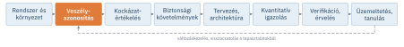
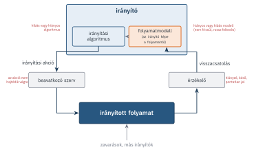
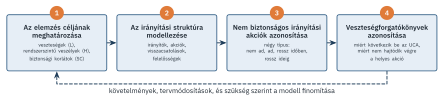
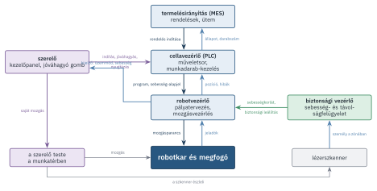

# Rendszerelméleti veszélyelemzés: STAMP és STPA {#sec-stpa}

{width=100%}

Az FMEA és a hibafa alapfeltevése, hogy a balesetek alkatrészhibákból vagy azok kombinációiból fakadnak. A szoftverintenzív, automatizált, emberrel együttműködő rendszerekben azonban egyre gyakoribbak azok a balesetek, amelyekben egyetlen alkatrész sem hibásodik meg. A baleset a komponensek nem biztonságos kölcsönhatásából, hibás követelményekből vagy az ember és az automatizálás félreértéséből fakad. Az [-@sec-balesetek]. fejezetben bemutatott Mars Polar Lander, a Boeing 737 MAX vagy az Uber-baleset is ilyen. Erre a kihívásra adott választ Nancy Leveson STAMP-modellje és az erre épülő veszélyelemzési módszer, az STPA. Ez a fejezet a módszert a KoboCella kollaboratív robotcelláján vezeti végig.

::: {.cel}
A fejezet végére képes leszel

- elmagyarázni, miért nem elegendőek az alkatrészhiba-alapú módszerek a szoftverintenzív és ember–automatizálás rendszerekben;
- leírni a STAMP fogalmait: biztonsági korlát, hierarchikus irányítási struktúra, folyamatmodell, visszacsatolás;
- végigvezetni az STPA négy lépését: veszteségek és veszélyek meghatározása, irányítási struktúra modellezése, nem biztonságos irányítási akciók azonosítása, veszteségforgatókönyvek feltárása;
- az STPA eredményeiből biztonsági követelményeket levezetni;
- összevetni az STPA-t a hagyományos módszerekkel, és tudni, mikor melyiket érdemes alkalmazni.
:::

## Miért kell új módszer? {#sec-miert-stpa}

A hagyományos veszélyelemzési módszerek (FMEA, hibafa, HAZOP) az 1950–1970-es évek elektromechanikus rendszereire születtek. Ezekben a baleset tipikusan valóban egy vagy több alkatrész meghibásodásából fakadt, és a komponensek közötti kölcsönhatások viszonylag egyszerűek, átláthatók voltak. A mai rendszerekben három dolog változott meg [@leveson2011]:

1. **A szoftver nem hibásodik meg, mégis okozhat balesetet.** A szoftver pontosan azt teszi, amit a kód előír. Ha a követelmény hibás vagy hiányos (nem gondolt egy működési helyzetre), a szoftver „helyesen” fog veszélyes dolgot tenni. A szoftverhiba-arány fogalmának nincs értelme, és a „meghibásodás” helyett a „nem biztonságos viselkedés” a helyes kategória.
2. **A komponensek kölcsönhatása bonyolulttá vált.** Egy modern jármű vagy gyártócella tucatnyi irányító egységből áll, amelyek hálózaton kommunikálnak. A veszély nem egy komponensben, hanem a kölcsönhatásban rejlik: két, külön-külön helyesen működő funkció együtt nem biztonságos.
3. **Az ember szerepe megváltozott.** Az ember már nem közvetlen kezelő, hanem felügyelő, aki az automatizálás állapotát értelmezi, és szükség esetén beavatkozik. A tipikus hiba nem a „rossz gomb megnyomása”, hanem az, hogy az ember másnak hiszi a rendszer állapotát, mint amilyen (üzemmód-tévesztés), vagy nem érti, mit csinál az automatizálás.

Az alkatrészhiba-alapú módszerek ezeket a jelenségeket rosszul kezelik. Az FMEA-ban a szoftvernek nincs meghibásodási módja abban az értelemben, ahogy egy szelepnek; a hibafa alapeseményei között nem szerepel az, hogy „a követelmény nem vette figyelembe a lábak kinyitásakor keletkező rezgést”.

## A STAMP modell {#sec-stamp}

A STAMP (*Systems-Theoretic Accident Model and Processes*) a rendszerelméletre és az irányításelméletre épül [@leveson2011]. Három alapfogalma van.

**Biztonsági korlátok.** A biztonság a rendszer emergens tulajdonsága: nem az egyes komponensekben, hanem a komponensek viselkedését korlátozó szabályokban jelenik meg. A biztonsági korlát (*safety constraint*) olyan feltétel, amelynek teljesülnie kell ahhoz, hogy a rendszer ne kerüljön veszélyes állapotba („a robot sebessége 250 mm/s alatt legyen, ha ember van a közelében”).

**Hierarchikus irányítási struktúra.** A biztonsági korlátokat irányítók érvényesítik, amelyek hierarchiába rendeződnek: a jogalkotótól és a hatóságtól a vállalatvezetésen, a mérnöki szervezeten és a kezelőn át az automatikus irányítókig. Minden szint irányítja az alatta lévőt (követelményekkel, utasításokkal, irányító parancsokkal), és visszajelzést kap tőle (jelentésekkel, mérésekkel).

**Folyamatmodell.** Minden irányító, ember és gép egyaránt, a döntéseit a saját **folyamatmodellje** alapján hozza: az irányított folyamat állapotáról alkotott képe alapján ([-@fig-iranyitasi-hurok]. ábra). Egy emberi kezelő folyamatmodellje a mentális modellje, egy szoftveré a belső változói. A balesetek jelentős része abból fakad, hogy a folyamatmodell eltér a valóságtól: a Therac-25 szoftvere más beállítást „hitt”, mint ami valójában volt; a 737 MAX MCAS-funkciója a hibás érzékelőjel miatt túl nagynak „hitte” az állásszöget; az Uber szoftvere a gyalogost minden átsorolásnál új objektumnak „hitte”.

{#fig-iranyitasi-hurok width=92%}

A STAMP szerint a baleset oka mindig az, hogy egy biztonsági korlát nem érvényesült. Ennek lehetséges okai az irányítási hurok elemeihez köthetők: az irányító nem ad ki szükséges parancsot, vagy nem biztonságos parancsot ad; a parancsot rosszkor vagy rossz ideig adja; a parancs nem hajtódik végre; a visszacsatolás hiányzik, késik vagy hibás, és ezért a folyamatmodell téves.

## Az STPA lépései {#sec-stpa-lepesek}

Az STPA (*System-Theoretic Process Analysis*) a STAMP-ra épülő veszélyelemzési módszer. Részletes leírása az MIT kutatóinak *STPA Handbook* című, ingyenesen elérhető kézikönyvében található [@leveson2018]. A módszer négy lépésből áll ([-@fig-stpa-lepesek]. ábra).

{#fig-stpa-lepesek width=100%}

### 1. lépés: az elemzés céljának meghatározása {#sec-stpa-1}

Az első lépés meghatározza, mit akarunk megelőzni.

- **Veszteségek** (*losses*, L): az érintettek számára elfogadhatatlan kimenetelek, például emberi sérülés vagy halál, környezeti kár, a küldetés vagy a termelés elvesztése, a hírnév sérülése.
- **Rendszerszintű veszélyek** (*system-level hazards*, H): olyan rendszerállapotok vagy feltételek, amelyek a környezet legrosszabb esetű körülményeivel együtt veszteséghez vezetnek. Fontos, hogy a veszély a *rendszer* állapota legyen (amit a tervező befolyásolni tud), ne a környezeté, és ne egy alkatrész meghibásodása. A „robotkar meghibásodik” nem rendszerszintű veszély, a „a robotkar a szerelőhöz közel a biztonságos határnál nagyobb sebességgel mozog” az.
- **Rendszerszintű biztonsági korlátok** (*system-level constraints*, SC): a veszélyek fordítottjai, vagyis azok a feltételek, amelyeknek teljesülniük kell a veszélyek megelőzéséhez, illetve a veszteség csökkentéséhez, ha a veszély mégis bekövetkezik.

Minden veszélyhez hozzárendeljük, mely veszteség(ek)hez vezethet, így a nyomon követhetőség a teljes elemzésen át biztosított.

### 2. lépés: az irányítási struktúra modellezése {#sec-stpa-2}

A második lépés a rendszer **irányítási struktúrájának** felrajzolása: az irányítók (emberek, szervezetek, automatikus egységek), az általuk kiadott irányítási akciók és az általuk kapott visszacsatolások. A modell nem fizikai rajz és nem adatfolyam-diagram, hanem funkcionális: azt mutatja meg, *ki mit irányít, és mit tud* az irányított folyamatról. Minden irányítóhoz rögzítjük a felelősségeit (melyik biztonsági korlát érvényesítéséért felel) és a folyamatmodelljének fontos változóit.

### 3. lépés: nem biztonságos irányítási akciók {#sec-stpa-3}

A harmadik lépés minden irányítási akcióra megvizsgálja, milyen körülmények között lehet **nem biztonságos** (*unsafe control action*, UCA). Az STPA négy típust különböztet meg:

1. az akció **elmaradása** veszélyhez vezet (*not providing causes hazard*);
2. az akció **kiadása** veszélyhez vezet (*providing causes hazard*);
3. az akció **túl korán, túl későn vagy rossz sorrendben** érkezik (*too early, too late, out of order*);
4. az akció **túl korán áll le vagy túl sokáig tart** (folyamatos akcióknál; *stopped too soon, applied too long*).

Minden UCA-t a **kontextusával** együtt kell megfogalmazni: egy akció önmagában ritkán veszélyes, csak bizonyos helyzetben. A jó UCA-megfogalmazás öt eleme: az irányító, az akció típusa, maga az akció, a kontextus és a hivatkozás a veszélyre. Például: „*A biztonsági vezérlő nem* aktiválja *a sebességkorlátozást*, amikor *személy tartózkodik a figyelt zónában* [H1].”

### 4. lépés: veszteségforgatókönyvek {#sec-stpa-4}

A negyedik lépés azt vizsgálja, *miért* következhet be egy UCA, illetve miért nem hajtódhat végre egy helyes akció. Két forgatókönyv-típus van:

- **(a) Miért adja ki az irányító a nem biztonságos akciót?** Az irányítási algoritmus hibás vagy hiányos; a folyamatmodell téves (az irányító rosszul ismeri a folyamat állapotát), mert a visszacsatolás hiányzik, késik, pontatlan, vagy rosszul értelmezik; az irányító más irányítóktól ellentmondó parancsokat kap.
- **(b) Miért nem hajtódik végre a helyes akció, vagy miért nem éri el a hatását?** A beavatkozó szerv hibás vagy lassú; az irányított folyamat másképp viselkedik, mint feltételezték; zavarás vagy más irányító akciója hatástalanítja.

A forgatókönyvekből közvetlenül adódnak a **követelmények és tervezési döntések**: redundáns vagy diverz visszacsatolás, a folyamatmodell érvényességének ellenőrzése, üzemmódjelzés, reteszelés, a kezelői felület módosítása, szervezeti eljárások.

## Kidolgozott STPA a KoboCella esetre {#sec-stpa-kobocella}

### Veszteségek, veszélyek, korlátok {#sec-stpa-kobocella-1}

A KoboCella STPA-jának első lépése a [-@tbl-stpa-lhc]. táblázatban látható.

| Azonosító | Megfogalmazás | Kapcsolat |
|:--|:--|:--|
| L1 | a szerelő sérülése | – |
| L2 | a berendezés vagy a munkadarab károsodása | – |
| L3 | a termelés kiesése | – |
| H1 | a robotkar a szerelőhöz közel a biztonságos határnál nagyobb sebességgel mozog | L1 |
| H2 | a robot a szerelő testére a biomechanikai határértéknél nagyobb erőt vagy nyomást fejt ki | L1 |
| H3 | a robot a megfogott munkadarabot ellenőrizetlenül elengedi a szerelő fölött | L1, L2 |
| H4 | a cella indokolatlanul leáll, vagy nem indítható újra | L3 |
| SC1 | a robotkar sebessége nem haladhatja meg a szerelőtől mért távolsághoz tartozó biztonságos határt | H1 |
| SC2 | a robot által kifejtett erő és nyomás nem haladhatja meg az ISO/TS 15066 szerinti határértékeket | H2 |
| SC3 | a megfogó csak akkor nyithat, ha a munkadarab a lerakóhelyen van | H3 |
| SC4 | a biztonsági funkciók nem okozhatnak a termelést aránytalanul zavaró téves leállást | H4 |

: A KoboCella STPA-jának veszteségei, rendszerszintű veszélyei és biztonsági korlátai {#tbl-stpa-lhc}

Érdemes észrevenni a H4–SC4 párt. Az STPA nem csak a biztonságot vizsgálja, hanem a termelékenységgel való konfliktust is láthatóvá teszi. A túl gyakori téves leállás a [-@sec-rasmussen]. szakaszban leírt sodródás klasszikus kiváltója: a kezelők elkezdik áthidalni a „kényelmetlen” védelmet.

### Az irányítási struktúra {#sec-stpa-kobocella-2}

A KoboCella irányítási struktúráját a [-@fig-kobocella-struktura]. ábra mutatja. A termelésirányító rendszer (MES) adja ki a rendeléseket a cellavezérlőnek; a cellavezérlő (PLC) futtatja a műveletsort, és sebesség-alapjelet ad a robotvezérlőnek; a robotvezérlő tervezi a pályát és vezérli a robotkart. A biztonsági vezérlő a lézerszkenner jelei alapján felügyeli a szerelő és a robot távolságát, és sebességkorlátozást vagy biztonsági leállítást kényszerít a robotvezérlőre. A szerelő a kezelőpanelen indítja, jóváhagyja és nyugtázza a műveleteket, és saját testével is része az irányított folyamatnak.

{#fig-kobocella-struktura width=100%}

A modell egy fontos részletét már a felrajzolás során észrevette a csapat: a szerelő az üzemmódot (kollaboratív vagy nem kollaboratív) és a pillanatnyi sebességkorlátot csak a kezelőpanel egy kis kijelzőjén látja, amelyre munka közben nem néz rá. A folyamatmodellje ezért elavulhat.

### Nem biztonságos irányítási akciók {#sec-stpa-kobocella-3}

A [-@tbl-uca-kobocella]. táblázat két irányítási akcióra mutatja az UCA-elemzést: a biztonsági vezérlő „sebességkorlátozás aktiválása” és a szerelő „a következő lépés jóváhagyása” akciójára.

| Akció | Nem adja ki | Kiadja | Rossz időben vagy sorrendben | Rossz ideig |
|:--|:--|:--|:--|:--|
| **biztonsági vezérlő: sebességkorlátozás** | UCA-1: nem korlátoz, amikor személy van a figyelt zónában [H1] | UCA-2: korlátoz, amikor nincs személy a zónában (téves leállás) [H4] | UCA-3: a korlátozás azután lép életbe, hogy a szerelő már a robot pályáján van [H1] | UCA-4: a korlátozást feloldja, mielőtt a személy elhagyta a zónát [H1] |
| **szerelő: jóváhagyás** | (nem veszélyes; a cella vár) | UCA-5: jóváhagyja a következő lépést, amikor a keze még a megfogó közelében van [H2] | UCA-6: a lerakás előtt hagyja jóvá a megfogó nyitását [H3] | – |

: A KoboCella két irányítási akciójának UCA-elemzése {#tbl-uca-kobocella}

### Veszteségforgatókönyvek és követelmények {#sec-stpa-kobocella-4}

Az UCA-1-hez (a sebességkorlátozás elmarad, pedig személy van a zónában) a csapat a következő forgatókönyveket tárta fel:

- **F-1 (téves folyamatmodell, takarás):** a szerelő a nagy munkadarab mögött áll, a lézerszkenner nem látja, a biztonsági vezérlő ezért úgy „tudja”, hogy a zóna üres. → *Követelmény:* a szkenner elhelyezését úgy kell megtervezni, hogy a munkadarab semmilyen pozícióban ne takarja a szerelő lehetséges helyzeteit; ennek igazolására takarási elemzés (szimuláció) szükséges.
- **F-2 (téves folyamatmodell, konfiguráció):** a karbantartás során a szkenner zónakonfigurációját módosították (a figyelt zónát kisebbre állították a téves leállások miatt), és ezt senki nem ellenőrizte. → *Követelmény:* a biztonsági konfiguráció módosítása csak jelszóval, naplózva és ellenőrzés után lehetséges; a konfiguráció ellenőrzőösszegét a biztonsági vezérlő minden indításkor ellenőrzi.
- **F-3 (a beavatkozás nem hat):** a biztonsági vezérlő kiadja a korlátozást, de a robotvezérlő egy szoftverfrissítés után a korlátozást csak a következő mozgásszakasztól alkalmazza. → *Követelmény:* a sebességkorlátozás végrehajtását a biztonsági vezérlőnek független sebességméréssel kell ellenőriznie, és eltérés esetén biztonságos leállítást kell kezdeményeznie; minden robotvezérlő-frissítés után a biztonsági funkciót validálni kell.
- **F-4 (visszacsatolás késése):** a szkenner válaszideje és a robot fékútja együtt nagyobb, mint amennyit a zónaméret megenged. → *Követelmény:* a védőtávolságot a robot legrosszabb esetű fékútjával és a teljes válaszidővel kell méretezni (lásd a gyakorlati útmutató feladatát).

Az UCA-5-höz (a szerelő a keze veszélyes helyzetében hagyja jóvá a következő lépést) a forgatókönyv egészen más jellegű: a szerelő folyamatmodellje téves (azt hiszi, hogy a robot kollaboratív üzemmódban, erőkorlátozással mozog, holott egy speciális műveletnél nem kollaboratív üzemmódban van). → *Követelmény:* az üzemmódot a munkaterületen jól látható módon kell jelezni (például színes fénysávval a roboton); a nem kollaboratív üzemmódban a jóváhagyás csak kétkezes vezérlővel lehetséges.

Ezek a forgatókönyvek jól mutatják az STPA erejét. Az F-2 (karbantartási konfigurációmódosítás), az F-3 (szoftverfrissítés utáni viselkedésváltozás) és az UCA-5 (üzemmód-tévesztés) egyike sem alkatrész-meghibásodás, ezért egy hagyományos FMEA-ban vagy hibafában nehezen jelenne meg. Mindhárom a valós ipari balesetek tipikus mintázata.

::: {.eset eset="B" title="VészFék: az STPA gyors alkalmazása"}
A VészFék fékezési parancsának UCA-elemzése:

- *nem adja ki:* nem kezdeményez fékezést, amikor akadály van a pályán, és az ütközés elkerülhetetlen [H: frontális ütközés];
- *kiadja:* fékezést kezdeményez, amikor nincs valós akadály [H: ráfutásos baleset];
- *túl későn:* a fékezés akkor kezdődik, amikor az ütközés már nem csökkenthető számottevően;
- *túl korán áll le:* a fékezés megszakad, amikor a szoftver az akadályt átsorolja (például gyalogosból „ismeretlen objektummá”).

Az utolsó UCA egyik forgatókönyve közvetlenül megfelel az Uber-baleset jelentésében leírt mechanizmusnak: az osztályozás ingadozása miatt a rendszer mozgáselőzménye minden átsorolásnál elveszett ([-@sec-hat-baleset]. szakasz). A levezetett követelmény: az objektum követését és a fékezési döntést az osztályozástól függetlenül, a pálya és a mozgás alapján is meg kell hozni.
:::

## Az STPA helye a módszerek között {#sec-stpa-hely}

Az STPA nem váltja ki a hagyományos módszereket, hanem kiegészíti őket. A [-@tbl-stpa-osszevetes]. táblázat a fő különbségeket foglalja össze.

| Szempont | FMEA, hibafa | HAZOP | STPA |
|:--|:--|:--|:--|
| baleseti modell | alkatrészhiba, hibalánc | eltérés a tervezési szándéktól | nem érvényesülő biztonsági korlát |
| kiindulópont | alkatrészek vagy csúcsesemény | P&ID csomópontok | veszteségek, irányítási struktúra |
| szoftver, követelményhibák | gyengén | közepesen (CHAZOP) | erősen |
| ember és automatizálás | gyengén | közepesen | erősen (folyamatmodell) |
| kvantitatív eredmény | igen (valószínűség, gyakoriság) | nem (félkvantitatív kiegészítéssel) | nem |
| alkalmazhatóság | részletes tervezés | részletes tervezés | a koncepciótól kezdve |

: Az STPA és a hagyományos módszerek összevetése {#tbl-stpa-osszevetes}

Az STPA különösen akkor ajánlott, ha a rendszer szoftverintenzív, sok irányítóból áll, ember és automatizálás együttműködésén alapul, vagy új, kevéssé ismert technológiát alkalmaz. Mivel a koncepciós fázisban is elvégezhető (a részletes terv ismerete nélkül), korán befolyásolhatja az architektúrát. A kvantitatív igazoláshoz (PFD, PMHF) viszont továbbra is a III. rész módszerei kellenek: az STPA megmondja, *mit* kell biztosítani, a hibafa és a Markov-modell pedig azt, hogy *mennyire megbízhatóan* sikerült.

A módszernek több változata és kiterjesztése is van. A **CAST** (*Causal Analysis based on STAMP*) a STAMP-ra épülő balesetvizsgálati módszer; az **STPA-Sec** a kiberbiztonsági veszélyek elemzésére alkalmazza ugyanezt a szemléletet. Az autóiparban a SAE J3187 ajánlott gyakorlat (2022) írja le az STPA alkalmazását, és a rendeltetésszerű funkció biztonságát szabályozó ISO 21448 is a lehetséges módszerek között említi.

::: {.hiba title="Az STPA mint ellenőrzőlista"}
Az STPA-t néha táblázatkitöltési gyakorlatként alkalmazzák: minden akcióhoz mechanikusan beírnak négy UCA-t, és a forgatókönyveket elhagyják. Így a módszer legértékesebb része, a negyedik lépés vész el, ahol a valódi okok és a tervezési követelmények születnek. Az UCA-k csak a „mit”, a forgatókönyvek a „miért” kérdésére felelnek, és csak a „miért”-ből lesz tervmódosítás.
:::

### Erősségek és korlátok {#sec-stpa-korlatai}

**Erősségek:** a specifikációs és követelményhibákat, a komponensek közötti kölcsönhatásokat, a szoftver és az ember szerepét egységes keretben kezeli; a koncepciós fázisban is alkalmazható; közvetlenül tervezési követelményeket ad; a szervezeti és szabályozási szinteket is elemzi.

**Korlátok:** a módszer viszonylag új, a szabványosítása és az iparági gyakorlata még formálódik; nagy rendszereknél az irányítási struktúra és a forgatókönyvek száma gyorsan nő; az eredmény minősége, akárcsak a HAZOP-nál, a csapat tudásán múlik; nem ad számszerű kockázati mérőszámot.

::: {.labor}
A gyakorlati útmutató 5. laborjában egy böngészős STPA-munkalappal dolgozol: felrajzolod egy egyszerű rendszer irányítási struktúráját, kitöltöd az UCA-táblázatot, és minden UCA-hoz legalább két forgatókönyvet és egy követelményt rendelsz. A feladat a VészFék és a KoboCella közül választható.
:::

::: {.osszefoglalo}
- A szoftverintenzív és ember–automatizálás rendszerekben a balesetek gyakran meghibásodás nélkül, nem biztonságos kölcsönhatásokból és hibás követelményekből fakadnak.
- A STAMP szerint a biztonság emergens tulajdonság, amelyet a hierarchikus irányítási struktúra a biztonsági korlátok érvényesítésével tart fenn; a balesetek oka a nem érvényesülő korlát.
- Az irányítók a folyamatmodelljük alapján döntenek; a téves folyamatmodell a balesetek gyakori oka.
- Az STPA négy lépése: veszteségek, veszélyek és korlátok; irányítási struktúra; nem biztonságos irányítási akciók (négy típus, kontextussal); veszteségforgatókönyvek és követelmények.
- Az STPA kiegészíti a hagyományos módszereket; korán alkalmazható, de nem ad kvantitatív eredményt.
:::

::: {.onell}
1. Miért nem rendszerszintű veszély az, hogy „a lézerszkenner meghibásodik”? Fogalmazd meg helyesen a mögötte álló veszélyt!
2. Sorold fel az UCA négy típusát, és adj mindegyikre példát egy lift ajtajának „ajtó nyitása” akciójára!
3. Mi a folyamatmodell, és miért fontos a STAMP-ban? Mutasd be egy példán, hogyan vezethet baleshez a téves folyamatmodell!
4. Melyik STPA-lépés adja a tervezési követelményeket, és miért?

::: {.megoldas}
1. Mert alkatrészhiba, nem a rendszer állapota; ráadásul a szkenner meghibásodása nem feltétlenül vezet veszélyhez (lehet biztonságos meghibásodás is). A helyes veszély: „a robotkar a szerelőhöz közel a biztonságos határnál nagyobb sebességgel mozog”. A szkenner meghibásodása ennek egy lehetséges oka a negyedik lépés forgatókönyveiben.
2. *Nem adja ki:* nem nyitja az ajtót, amikor a fülke a szinten áll, és tűz miatt menekülni kell. *Kiadja:* kinyitja az ajtót, amikor a fülke nincs a szinten. *Rossz időben:* túl korán nyit, amikor a fülke még mozog. *Rossz ideig:* túl korán zárja, amikor valaki még az ajtóban áll.
3. A folyamatmodell az irányító képe az irányított folyamat állapotáról (embernél a mentális modell, szoftvernél a belső változók). Az irányító ez alapján dönt, ezért ha a modell eltér a valóságtól, helyes algoritmus mellett is nem biztonságos döntést hoz. Példa: a 737 MAX MCAS-funkciója egyetlen hibás állásszög-érzékelő jele alapján túl nagynak „hitte” az állásszöget, és ismételten lefelé trimmelte a gépet.
4. A negyedik lépés (veszteségforgatókönyvek), mert ez tárja fel, *miért* következhet be egy nem biztonságos akció, illetve miért nem hajtódik végre a helyes akció. A konkrét okokra (takarás, konfigurációmódosítás, késleltetés, üzemmód-tévesztés) adható tervezési válasz.
:::
:::

::: {.forras}
- Leveson, N. G. (2011): *Engineering a Safer World.* MIT Press – a STAMP és az STPA elméleti alapjai, nyílt hozzáféréssel [@leveson2011].
- Leveson, N. G., Thomas, J. P. (2018): *STPA Handbook* – lépésenkénti útmutató sok példával, ingyenesen letölthető [@leveson2018].
- ISO/TS 15066:2016 – a kollaboratív robotok biomechanikai határértékei [@isots15066].
:::
