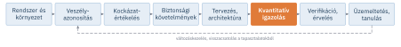
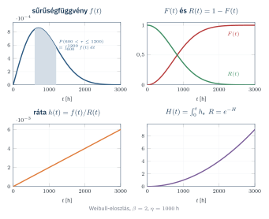
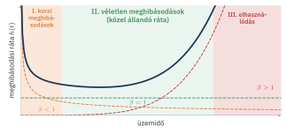
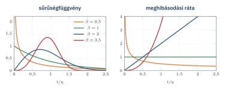
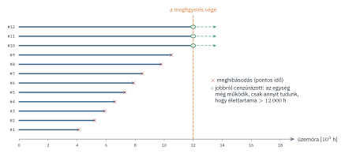
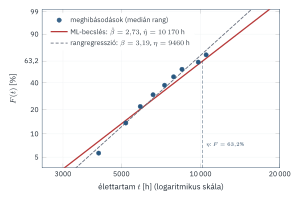

# Megbízhatóság-elmélet és élettartam-adatok {#sec-megbizhatosag}

{width=100%}

A III. rész a biztonság számszerűsítésének eszközeit tárgyalja. Ennek alapja a megbízhatóság-elmélet: annak matematikai leírása, hogyan hibásodnak meg az alkatrészek az idő függvényében. Ebben a fejezetben az élettartamot valószínűségi változóként kezeljük, levezetjük a megbízhatósági függvényt, a meghibásodási rátát és az átlagos élettartamot, majd megismerjük a gyakorlatban legfontosabb eloszlásokat (exponenciális, Weibull, lognormális). A fejezet második fele azt mutatja meg, hogyan becsülhetők ezek a jellemzők valós, gyakran hiányos (cenzúrázott) adatokból, és milyen bizonytalansággal. A következő fejezetek (blokkdiagram, hibafa, Markov-modell, PFD-számítás) mind erre az alapra épülnek. A valószínűségszámítási előismereteket az [-@sec-valoszinuseg]. függelék foglalja össze.

::: {.cel}
A fejezet végére képes leszel

- definiálni és egymásból levezetni az $F(t)$, $R(t)$, $f(t)$, $h(t)$ és $H(t)$ függvényeket, valamint az MTTF-et;
- értelmezni a kádgörbét és a meghibásodási ráta időbeli alakjának következményeit a karbantartásra;
- alkalmazni az exponenciális, a Weibull- és a lognormális eloszlást, és ismerni a feltevéseiket;
- megkülönböztetni az MTTF, MTBF, MTTR és MTTFF fogalmát, és kiszámolni a rendelkezésre állást;
- meghibásodási rátát becsülni terepi adatokból konfidenciakorláttal, és Weibull-eloszlást illeszteni cenzúrázott adatokra.
:::

## Az élettartam mint valószínűségi változó {#sec-elettartam}

Tekintsünk egy nem helyreállítható elemet, amely a $t=0$ időpontban kezd működni, és az első meghibásodásáig működik. A meghibásodásig eltelt idő, a **hibamentes működési idő** $\tau$ egy nemnegatív, folytonos valószínűségi változó. Előre nem tudjuk megmondani, egy adott példány mikor hibásodik meg, de a sok azonos példányból álló populáció viselkedése statisztikailag jól leírható.

::: {.fogalom title="Az élettartam jellemző függvényei"}
- **Eloszlásfüggvény** (meghibásodási valószínűség): $F(t) = P(\tau \le t)$, annak valószínűsége, hogy az elem $t$ időpontig meghibásodik.
- **Megbízhatósági függvény** (túlélési függvény): $R(t) = P(\tau > t) = 1 - F(t)$, annak valószínűsége, hogy az elem $t$ időpontig hibamentesen működik.
- **Sűrűségfüggvény:** $f(t) = \dfrac{\mathrm{d}F(t)}{\mathrm{d}t} = -\dfrac{\mathrm{d}R(t)}{\mathrm{d}t}$.
:::

Az IEC 61508 a meghibásodási valószínűséget PF-fel (*probability of failure*) jelöli, a magyar szabványok $Q(t)$-vel; ebben a könyvben az $F(t)$ jelölést használjuk. A sűrűségfüggvény segítségével bármely időintervallumba eső meghibásodás valószínűsége kiszámítható:

$$
P(a < \tau \le b) = \int_a^b f(t)\,\mathrm{d}t = F(b) - F(a) = R(a) - R(b) .
$$ {#eq-intervallum}

A függvények lefutását a [-@fig-elettartam]. ábra mutatja egy Weibull-eloszlású elem példáján. Az $R(t)$ 1-ről indul és monoton csökken nullához; az $F(t)$ ennek tükörképe.

{#fig-elettartam width=94%}

### Az átlagos élettartam {#sec-mttf}

A hibamentes működési idő várható értéke az **átlagos élettartam** (*mean time to failure*, MTTF):

$$
\text{MTTF} = E[\tau] = \int_0^\infty t\, f(t)\,\mathrm{d}t .
$$ {#eq-mttf-def}

Mivel $f(t) = -R'(t)$, parciális integrálással egy sokszor kényelmesebb alakot kapunk:

$$
\text{MTTF} = \int_0^\infty t\,\bigl(-R'(t)\bigr)\,\mathrm{d}t = \bigl[-t\,R(t)\bigr]_0^\infty + \int_0^\infty R(t)\,\mathrm{d}t = \int_0^\infty R(t)\,\mathrm{d}t ,
$$ {#eq-mttf}

mivel véges várható érték esetén $t\,R(t) \to 0$, ha $t \to \infty$. Az MTTF tehát a megbízhatósági görbe alatti terület.

### A meghibásodási ráta {#sec-meghibasodasi-rata}

A megbízhatóság-elmélet talán legfontosabb fogalma a **meghibásodási ráta** (*failure rate, hazard rate*). Kérdés: ha egy elem $t$ időpontig hibamentesen működött, mekkora a valószínűsége, hogy a következő $\Delta t$ időben meghibásodik? A feltételes valószínűség definíciója szerint, ha $A$ a $(t, t+\Delta t]$ intervallumban bekövetkező meghibásodás, $B$ pedig a $t$ időpontig tartó hibamentes működés eseménye:

$$
P(A \mid B) = \frac{P(A \cap B)}{P(B)} = \frac{P(t < \tau \le t+\Delta t)}{P(\tau > t)} = \frac{R(t) - R(t+\Delta t)}{R(t)} .
$$ {#eq-felteteles}

Ezt az időtartammal osztva és $\Delta t \to 0$ határátmenetet képezve kapjuk a meghibásodási rátát:

$$
h(t) = \lim_{\Delta t \to 0} \frac{R(t) - R(t+\Delta t)}{\Delta t \, R(t)} = \frac{-R'(t)}{R(t)} = \frac{f(t)}{R(t)} .
$$ {#eq-rata}

A $h(t)\,\Delta t$ szorzat tehát közelítőleg annak a valószínűsége, hogy egy *addig működő* elem a következő rövid $\Delta t$ időben meghibásodik. A sűrűségfüggvénytől az különbözteti meg, hogy feltételes: $f(t)\,\Delta t$ az eredeti populációhoz, $h(t)\,\Delta t$ a még működő példányokhoz viszonyít.

A [-@eq-rata]. egyenlet egy egyszerű differenciálegyenlet $R(t)$-re: $R'(t) = -h(t)\,R(t)$, $R(0)=1$. Megoldása

$$
R(t) = \exp\!\left( -\int_0^t h(u)\,\mathrm{d}u \right) = e^{-H(t)} ,
$$ {#eq-r-h}

ahol $H(t)$ a **kumulált meghibásodási ráta**. Ez az összefüggés azt mutatja, hogy a meghibásodási ráta egyértelműen meghatározza az élettartam eloszlását: elegendő $h(t)$ alakját ismerni.

## A kádgörbe {#sec-kadgorbe}

Sok alkatrész-populáció meghibásodási rátája az élettartam során a [-@fig-kadgorbe]. ábrán látható „kádgörbe” alakot követi.

{#fig-kadgorbe width=92%}

- **I. Korai meghibásodások szakasza** (csökkenő ráta). A gyártási hibás, gyenge példányok gyorsan kiesnek, így a ráta csökken. Tipikus okok: nem megfelelő minőségszabályozás vagy gyártási eljárás, gyenge minőségű anyag, szerelési hibák, nem megfelelő hibakeresés, rossz kezelés vagy csomagolás. Ellenszer: beégetés (*burn-in*), környezeti igénybevételi szűrés, szigorú átvételi vizsgálat.
- **II. Véletlen meghibásodások szakasza** (közel állandó ráta). A meghibásodások véletlenszerű, külső igénybevételek (túlterhelés, feszültségtüske, ütés) következményei, amelyek az elem korától függetlenek. Ez a hasznos élettartam szakasza; a biztonsági számítások többsége erre vonatkozik.
- **III. Elhasználódás szakasza** (növekvő ráta). Visszafordíthatatlan fizikai és kémiai folyamatok (kopás, fáradás, korrózió, öregedés) miatt a ráta nő. Tipikus okok: elégtelen karbantartás, súrlódás okozta kopás, anyagfáradás, korrózió, rossz felülvizsgálati gyakorlat. Ellenszer: megelőző csere a ráta meredek növekedése előtt.

A kádgörbe szemléletes modell, de nem minden alkatrészre érvényes. Az elektronikus alkatrészek többségénél a III. szakasz jóval a hasznos élettartam után kezdődne, a II. szakasz dominál. A mechanikus alkatrészeknél (csapágyak, tömítések, szelepek) viszont gyakran nincs valódi állandó szakasz, az elhasználódás már korán megjelenik. A szoftverre a kádgörbe egyáltalán nem értelmezhető, mert a szoftver nem öregszik ([-@sec-szoftver]. fejezet).

A meghibásodási ráta alakja meghatározza a karbantartási stratégiát. **Megelőző csere csak növekvő meghibásodási ráta esetén** csökkenti a meghibásodások számát. Állandó ráta mellett a csere hatástalan (az új elem ugyanakkora eséllyel hibásodik meg, mint a régi), csökkenő ráta mellett pedig kifejezetten káros, mert friss, nagyobb kockázatú példányt tesz a jól bejáratott helyére.

## Élettartam-eloszlások {#sec-eloszlasok}

### Az exponenciális eloszlás {#sec-exponencialis}

Ha a meghibásodási ráta állandó, $h(t) = \lambda$, akkor a [-@eq-r-h]. egyenletből

$$
R(t) = e^{-\lambda t}, \qquad F(t) = 1 - e^{-\lambda t}, \qquad f(t) = \lambda e^{-\lambda t}, \qquad t \ge 0 .
$$ {#eq-exponencialis}

Az átlagos élettartam és a szórásnégyzet:

$$
\text{MTTF} = \int_0^\infty e^{-\lambda t}\,\mathrm{d}t = \frac{1}{\lambda}, \qquad D^2(\tau) = \frac{1}{\lambda^2} .
$$ {#eq-exp-mttf}

A meghibásodási ráta tehát az átlagos élettartam reciproka. Érdemes megjegyezni, hogy $R(\text{MTTF}) = e^{-1} \approx 0{,}368$: az elemek csaknem kétharmada meghibásodik az átlagos élettartam eléréséig.

Az exponenciális eloszlás legfontosabb tulajdonsága az **emlékezetnélküliség**:

$$
P(\tau > t + s \mid \tau > t) = \frac{e^{-\lambda (t+s)}}{e^{-\lambda t}} = e^{-\lambda s} = P(\tau > s) .
$$ {#eq-emlekezetnelkuli}

Egy $t$ ideig hibátlanul működött elem további élettartama ugyanolyan eloszlású, mint egy újé: az elem „nem öregszik”. Ez a II. szakasz véletlen meghibásodásainak értelmezése. A tulajdonság kényelmes (a számítások egyszerűvé válnak, és a Markov-modellek erre épülnek), de alkalmazása mindig feltevés, amelyet ellenőrizni kell.

Az exponenciális eloszlás az elektronikai iparban szokásos FIT-egységgel is kifejezhető: 1 FIT egy meghibásodás $10^9$ óránként. A TT-101 távadó $\lambda_D = 1000$ FIT veszélyes meghibásodási rátája ([-@sec-fmeda]. szakasz) tehát $10^{-6}\,\text{h}^{-1}$, ami átlagosan 114 évenként egy veszélyes meghibásodást jelent egy példányra. Ez nem jelenti azt, hogy egy távadó 114 évig működik (az elhasználódás jóval korábban jelentkezik), hanem azt, hogy egy nagy populációban a hasznos élettartam alatt ilyen gyakorisággal jelentkeznek véletlen meghibásodások.

### A Weibull-eloszlás {#sec-weibull}

A megbízhatósági gyakorlatban, különösen a mechanikus alkatrészek és a karbantartás-tervezés terén, a leggyakrabban alkalmazott eloszlás a Waloddi Weibull svéd mérnökről elnevezett eloszlás [@weibull1951]:

$$
F(t) = 1 - \exp\!\left[ -\left( \frac{t}{\eta} \right)^{\beta} \right], \qquad h(t) = \frac{\beta}{\eta}\left( \frac{t}{\eta} \right)^{\beta-1}, \qquad t \ge 0,
$$ {#eq-weibull}

ahol $\eta > 0$ a **skálaparaméter** (karakterisztikus élettartam: $F(\eta) = 1 - e^{-1} \approx 63{,}2\%$), $\beta > 0$ az **alakparaméter**. A 2014-es jegyzet az $F(t) = 1 - e^{-a t^b}$ alakot használta; a kettő megfeleltetése $b = \beta$, $a = \eta^{-\beta}$.

A meghibásodási ráta hatványfüggvény ([-@fig-weibull-alakok]. ábra): $\beta < 1$ esetén monoton csökkenő (korai meghibásodások), $\beta = 1$ esetén állandó (exponenciális eloszlás), $\beta > 1$ esetén monoton növekvő (elhasználódás). A Weibull-eloszlás így a kádgörbe mindhárom szakaszát leírja; $\beta \approx 3{,}5$ körül alakja a normális eloszláshoz hasonló.

{#fig-weibull-alakok width=96%}

Az átlagos élettartam és a szórásnégyzet az Euler-féle gammafüggvénnyel ($\Gamma$) fejezhető ki:

$$
\text{MTTF} = \eta\,\Gamma\!\left(1 + \frac{1}{\beta}\right), \qquad
D^2(\tau) = \eta^2 \left[ \Gamma\!\left(1 + \frac{2}{\beta}\right) - \Gamma^2\!\left(1 + \frac{1}{\beta}\right) \right].
$$ {#eq-weibull-mttf}

A gyakorlatban hasznos a $B_p$ élettartam: az az idő, amely alatt a populáció $p$ százaléka meghibásodik. Weibull-eloszlásnál $B_p = \eta\,[-\ln(1-p/100)]^{1/\beta}$. A csapágyiparban például a $B_{10}$ élettartam a szokásos méretezési jellemző.

### További eloszlások {#sec-tovabbi-eloszlasok}

- A **lognormális eloszlás** ($\ln \tau$ normális eloszlású) jól írja le a javítási időket és bizonyos fáradásos, repedésterjedéses meghibásodásokat. Meghibásodási rátája először nő, majd csökken.
- A **normális eloszlás** a kifejezetten elhasználódásos meghibásodásokra (például kopó alkatrészek) alkalmazható, ha a szórás kicsi az átlaghoz képest.
- A **gammaeloszlás** egy olyan rendszer élettartamát írja le, amely $k$ egymást követő, exponenciális eloszlású „sokk” után hibásodik meg (például hidegtartalékos rendszerek, [-@sec-rbd]. fejezet).

| Eloszlás | $h(t)$ alakja | Tipikus alkalmazás |
|:--|:--|:--|
| exponenciális | állandó | elektronika a hasznos élettartamban; biztonsági számítások alapfeltevése |
| Weibull, $\beta<1$ | csökkenő | korai meghibásodások, gyártási hibák |
| Weibull, $\beta>1$ | növekvő | kopás, fáradás, öregedés; karbantartás-tervezés |
| lognormális | nő, majd csökken | javítási idők, repedésterjedés |
| normális | gyorsan növekvő | erősen elhasználódásos alkatrészek |
| gamma | $k>1$ esetén növekvő | hidegtartalékos rendszerek |

: A fontosabb élettartam-eloszlások {#tbl-eloszlasok}

## Javítható rendszerek jellemzői {#sec-javithato}

A javítható (helyreállítható) rendszerek meghibásodás után javítással újra üzembe állnak. Élettörténetük működési és javítási szakaszok váltakozása. Ennek jellemzésére a következő, gyakran összekevert mennyiségek szolgálnak:

- **MTTF** (*mean time to failure*): az átlagos hibamentes működési idő (javítható rendszernél: két meghibásodás között, ha a javítás „újszerű” állapotot állít helyre);
- **MTTFF** (*mean time to first failure*): az első meghibásodásig eltelt átlagos idő; redundáns rendszereknél eltérhet az MTTF-től;
- **MTTR** (*mean time to restoration/repair*): az átlagos helyreállítási idő, amely magában foglalja a hiba észlelését, a hibakeresést, az alkatrész beszerzését, a javítást és az újraindítást;
- **MTBF** (*mean time between failures*): két egymást követő meghibásodás közötti átlagos idő, a javítással együtt: $\text{MTBF} = \text{MTTF} + \text{MTTR}$.

A gyakorlatban, különösen az alkatrész-adatlapokon, az MTBF-et gyakran az MTTF szinonimájaként használják, mert a javítási idő elhanyagolható az üzemidőhöz képest. Mindig érdemes ellenőrizni, melyik definíciót alkalmazzák.

A meghibásodási és helyreállítási lépésekből álló folyamat egyik alapvető jellemzője a **készenléti tényező** vagy **rendelkezésre állás**: annak valószínűsége, hogy a rendszer egy tetszőleges, kellően késői időpontban működik. Ha a működési idők átlaga $T_1 = \text{MTTF}$, a helyreállítási idők átlaga $T_2 = \text{MTTR}$, akkor a stacionárius rendelkezésre állás

$$
A = \frac{\text{MTTF}}{\text{MTTF} + \text{MTTR}} .
$$ {#eq-rendelkezesre-allas}

Ezt a [-@sec-markov]. fejezetben Markov-modellből is levezetjük. Fontos ismét hangsúlyozni: a megbízhatóság a $t$ időpontig *folyamatosan* helyes működést, a rendelkezésre állás a $t$ *időpontban* helyes működést fejezi ki.

## Megbízhatósági adatok és becslésük {#sec-adatbecsles}

### Adatforrások {#sec-adatforrasok}

A megbízhatósági számítások bemenő adatai három fő forrásból származnak:

- **Alkatrész-adatbázisok és -kézikönyvek:** például a Siemens SN 29500, az IEC 61709 (az alkatrészek referenciakörülményei és a terhelésfüggés modelljei), a francia FIDES-módszertan, a folyamatipari OREDA-kézikönyv (offshore berendezések terepi adatai) vagy a SINTEF PDS adatkézikönyve. A régi amerikai katonai kézikönyvet (MIL-HDBK-217F) ma is idézik, de elavultsága miatt erősen kritizálják: a modern alkatrészekre gyakran nagyságrendekkel pesszimistább becslést ad.
- **Gyártói adatok:** tanúsítványok, FMEDA-jelentések, gyorsított élettartam-vizsgálatok eredményei.
- **Terepi adatok:** a saját üzem karbantartási és meghibásodási nyilvántartása. Ezek a legrelevánsabbak, de gyakran hiányosak (nem rögzítik a meghibásodási módot, az üzemidőt vagy a környezetet), és a populáció kicsi.

Az adatok bizonytalansága nagy: ugyanarra az alkatrésztípusra a különböző források gyakran egy nagyságrendnyi eltérést adnak. Ezért a jó gyakorlat az adatforrás dokumentálása, a konzervatív (felső korlát) értékek használata és az érzékenységvizsgálat.

### A meghibásodási ráta becslése terepi adatokból {#sec-lambda-becsles}

Állandó meghibásodási rátát feltételezve, ha egy populáció összesen $T$ üzemórát teljesített, és ezalatt $r$ meghibásodás történt, a meghibásodási ráta maximum likelihood (ML) becslése

$$
\hat{\lambda} = \frac{r}{T} .
$$ {#eq-lambda-ml}

A pontbecslés önmagában félrevezető lehet, ha kevés a meghibásodás. Időre csonkított megfigyelés esetén (a megfigyelés egy előre rögzített időpontig tart) a $\lambda$ egyoldalú, $1-\alpha$ szintű felső konfidenciakorlátja a khi-négyzet eloszlással fejezhető ki [@rausand2020]:

$$
\lambda_{U} = \frac{\chi^2_{1-\alpha}(2r+2)}{2T} ,
$$ {#eq-lambda-felso}

ahol $\chi^2_{1-\alpha}(\nu)$ a $\nu$ szabadsági fokú khi-négyzet eloszlás $1-\alpha$ kvantilise. Ha egyáltalán nem volt meghibásodás ($r = 0$), a felső korlát $\lambda_U = -\ln\alpha / T$; 95%-os szinten ez $\approx 3/T$ („a hármas szabály”).

::: {.eset eset="A" title="ReaktorVéd: a távadók terepi adatai"}
Az üzemeltető vállalat több telephelyén 250 azonos típusú hőmérséklet-távadó működik biztonsági funkcióban. Négy év alatt a proof tesztek három veszélyes, rejtett meghibásodást tártak fel (mindhárom az érzékelőelem lefelé irányuló driftje volt). Az összesített üzemidő $T = 250 \cdot 4 \cdot 8760 = 8{,}76 \cdot 10^6$ óra.

$$
\hat{\lambda}_{DU} = \frac{3}{8{,}76 \cdot 10^6} = 3{,}4\cdot 10^{-7}\,\text{h}^{-1} .
$$

A 70%-os felső konfidenciakorlát (az IEC 61508 a terepi adatokon alapuló, úgynevezett 2H útvonalon legalább 70%-os konfidenciaszintet ír elő) $\chi^2_{0{,}7}(8) = 9{,}52$ felhasználásával

$$
\lambda_{DU,U} = \frac{9{,}52}{2 \cdot 8{,}76\cdot 10^6} = 5{,}4\cdot 10^{-7}\,\text{h}^{-1},
$$

a 90%-os felső korlát $7{,}6\cdot 10^{-7}\,\text{h}^{-1}$. A gyártói FMEDA $4\cdot 10^{-7}\,\text{h}^{-1}$ értéke ([-@sec-fmeda]. szakasz) a terepi pontbecslés és a 70%-os korlát közé esik, tehát a terepi tapasztalat alátámasztja. Ha a terepi adat jóval kedvezőtlenebb lett volna, a SIL-igazolást a terepi értékkel kellett volna újraszámolni.
:::

### Cenzúrázott adatok {#sec-cenzura}

Az élettartam-vizsgálatok és a terepi megfigyelések ritkán érnek véget úgy, hogy minden példány meghibásodott. Gyakori, hogy néhány egység a megfigyelés végén még működik, vagy más okból (például megelőző csere miatt) kikerül a megfigyelésből. Ezeknek az egységeknek nem ismerjük az élettartamát, csak azt, hogy *nagyobb* egy bizonyos értéknél. Az ilyen adatot **jobbról cenzúrázottnak** nevezzük ([-@fig-cenzura]. ábra).

{#fig-cenzura width=92%}

A cenzúrázott adatok elhagyása vagy meghibásodásként kezelése egyaránt súlyos torzítást okoz: az előbbi a legjobb egységeket hagyja ki (az élettartamot alulbecsüli), az utóbbi meghibásodást tételez fel ott, ahol nem volt. A helyes kezeléshez két módszercsalád áll rendelkezésre:

- **Nemparaméteres becslés:** a Kaplan–Meier-becslő [@kaplan1958] a megbízhatósági függvényt lépcsős függvénnyel becsli, minden meghibásodási időpontban a még megfigyelés alatt álló egységek számával korrigálva: $\hat{R}(t) = \prod_{t_i \le t} \left(1 - d_i/n_i\right)$, ahol $d_i$ a $t_i$ időpontbeli meghibásodások, $n_i$ az ekkor még kockázatnak kitett egységek száma.
- **Paraméteres becslés:** egy feltételezett eloszlás (például Weibull) paramétereit a maximum likelihood módszerrel becsüljük, amelyben a meghibásodott egységek a sűrűségfüggvénnyel, a cenzúrázottak a megbízhatósági függvénnyel járulnak hozzá a likelihoodhoz:

$$
L(\beta, \eta) = \prod_{i \in \text{meghib.}} f(t_i;\beta,\eta) \; \prod_{j \in \text{cenz.}} R(t_j;\beta,\eta) .
$$ {#eq-likelihood}

::: {.eset eset="C" title="KoboCella: a robothajtások csapágyainak élettartama"}
A KoboCella típusú robotok egyik hajtásának csapágyairól egy flottafigyelő rendszer 12 adatot gyűjtött ([-@fig-cenzura]. ábra): kilenc csapágy 4100 és 10 500 üzemóra között meghibásodott, három 12 000 óránál még működött. A Weibull-likelihood numerikus maximalizálása (lásd a gyakorlati útmutató notebookját) a következő becslést adja:

$$
\hat{\beta} = 2{,}73, \qquad \hat{\eta} = 10\,170~\text{h}, \qquad \widehat{\text{MTTF}} = \hat{\eta}\,\Gamma(1 + 1/\hat{\beta}) \approx 9050~\text{h} .
$$

Az alakparaméter egyértelműen 1 fölött van, tehát elhasználódásos meghibásodásról van szó, és a megelőző csere értelmes stratégia. A $B_{10}$ élettartam $\hat{\eta}\,(-\ln 0{,}9)^{1/\hat{\beta}} \approx 4460$ óra: ennyi idő alatt a csapágyak 10%-a hibásodik meg. Egy 6000 órát már teljesített csapágy további 2000 órás túlélési valószínűsége

$$
R(8000 \mid 6000) = \frac{R(8000)}{R(6000)} \approx 0{,}75 ,
$$

szemben egy új csapágy $R(2000) \approx 0{,}99$ értékével. Az exponenciális eloszlás emlékezetnélkülisége itt egyértelműen nem teljesül.

A becslés grafikus ellenőrzésére a **Weibull-papír** szolgál ([-@fig-weibull-papir]. ábra): az $x = \ln t$, $y = \ln[-\ln(1-F)]$ koordinátarendszerben a Weibull-eloszlás egyenes, amelynek meredeksége $\beta$. A pontok a medián rangok (Benard-közelítés: $F_i \approx (i - 0{,}3)/(n + 0{,}4)$) alapján kerülnek az ábrára. A rangregresszió ($\beta = 3{,}19$) és az ML-becslés ($\beta = 2{,}73$) eltérése jól mutatja, hogy kis mintánál a módszerválasztás érdemben befolyásolja az eredményt. Cenzúrázott adatoknál a likelihood módszer az elméletileg megalapozottabb [@meeker1998; @abernethy2006].
:::

{#fig-weibull-papir width=80%}

::: {.hiba title="Az MTBF mint garantált élettartam"}
Gyakori félreértés, hogy egy „100 000 órás MTBF-ű” eszköz 100 000 órát (11 évet) működik. Az MTBF egy *populáció* átlagos jellemzője a hasznos élettartam alatt, állandó meghibásodási rátát feltételezve. Exponenciális eloszlásnál az eszközök 63%-a meghibásodik az MTBF eltelte előtt, és az elhasználódás (amelyet az MTBF nem tartalmaz) a valóságban jóval korábban jelentkezhet. Egy 5 éves tervezett élettartamú eszköznél az MTBF csak arról tájékoztat, hogy e 5 év alatt egy nagy populációban mekkora gyakorisággal várhatók véletlen meghibásodások.
:::

::: {.labor}
A gyakorlati útmutató 6. laborjában egy interaktív alkalmazással vizsgálhatod az exponenciális, a Weibull- és a lognormális eloszlás függvényeit, és csúszkákkal figyelheted meg, hogyan változik a kádgörbe. A hozzá tartozó Colab-notebook a fejezet két esetét (terepi $\lambda$-becslés, Weibull-illesztés cenzúrázott adatokra) számolja végig, és bootstrap-módszerrel konfidenciaintervallumot is ad a Weibull-paraméterekre.
:::

::: {.osszefoglalo}
- Az élettartam valószínűségi változó; jellemző függvényei az $F(t)$, $R(t)=1-F(t)$, $f(t)$, valamint a feltételes meghibásodási ráta $h(t)=f(t)/R(t)$. Az $R(t) = \exp(-\int_0^t h)$ összefüggés miatt a ráta egyértelműen meghatározza az eloszlást.
- Az átlagos élettartam a megbízhatósági görbe alatti terület: $\text{MTTF} = \int_0^\infty R(t)\,\mathrm{d}t$.
- A kádgörbe három szakasza: korai (csökkenő), véletlen (állandó) és elhasználódásos (növekvő) meghibásodások. Megelőző csere csak növekvő ráta esetén hasznos.
- Az exponenciális eloszlás emlékezetnélküli, $\text{MTTF}=1/\lambda$; a Weibull-eloszlás alakparamétere a kádgörbe mindhárom szakaszát leírja.
- Javítható rendszereknél $A = \text{MTTF}/(\text{MTTF} + \text{MTTR})$; az MTBF nem garantált élettartam.
- A terepi adatokból becsült ráta mellé konfidenciakorlátot kell adni; a cenzúrázott adatokat a likelihoodban a megbízhatósági függvénnyel kell figyelembe venni.
:::

::: {.onell}
1. Mutasd meg, hogy exponenciális eloszlásnál a meghibásodási ráta állandó!
2. Egy elem élettartama exponenciális, $\lambda = 2\cdot10^{-5}\,\text{h}^{-1}$. Mekkora a valószínűsége, hogy egy év (8760 h) alatt meghibásodik? Mekkora az MTTF?
3. Egy Weibull-eloszlású alkatrésznél $\beta = 0{,}7$. Érdemes-e megelőzően cserélni? Miért?
4. Egy 40 eszközből álló populáció 5 év alatt egyetlen meghibásodást sem produkált. Adj 95%-os felső korlátot a meghibásodási rátára!
5. Miért torzít, ha a cenzúrázott egységeket egyszerűen elhagyjuk az elemzésből?

::: {.megoldas}
1. $h(t) = f(t)/R(t) = \lambda e^{-\lambda t} / e^{-\lambda t} = \lambda$.
2. $F(8760) = 1 - e^{-2\cdot10^{-5}\cdot 8760} = 1 - e^{-0{,}1752} \approx 0{,}161$, azaz 16,1%. $\text{MTTF} = 1/\lambda = 50\,000$ óra.
3. Nem érdemes. $\beta < 1$ csökkenő meghibásodási rátát jelent (korai meghibásodások): az új alkatrész nagyobb eséllyel hibásodik meg, mint a már bejáratott. A megelőző csere növelné a meghibásodások számát; helyette a beégetés vagy a gyártási minőség javítása segít.
4. $T = 40 \cdot 5 \cdot 8760 = 1{,}752\cdot10^6$ óra, $\lambda_U = -\ln 0{,}05 / T \approx 3{,}0/1{,}752\cdot10^6 \approx 1{,}7\cdot10^{-6}\,\text{h}^{-1}$.
5. Mert a cenzúrázott egységek éppen a hosszabb élettartamúak (a megfigyelés végéig kitartottak). Elhagyásuk a mintát a rövidebb élettartamok felé torzítja, így az átlagos élettartamot alulbecsüljük, a meghibásodási rátát túlbecsüljük.
:::
:::

::: {.forras}
- Rausand, M., Barros, A., Høyland, A. (2020): *System Reliability Theory.* 3. kiadás, Wiley – a megbízhatóság-elmélet átfogó tankönyve [@rausand2020].
- Meeker, W. Q., Escobar, L. A. (1998): *Statistical Methods for Reliability Data.* Wiley – az élettartam-adatok statisztikai elemzésének alapműve [@meeker1998].
- Modarres, M., Kaminskiy, M., Krivtsov, V. (2016): *Reliability Engineering and Risk Analysis.* 3. kiadás, CRC Press [@modarres2016].
:::
