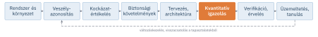
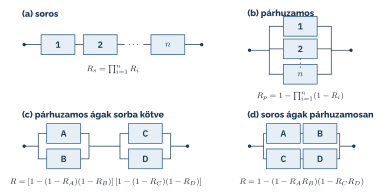
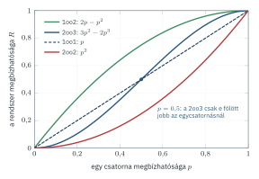
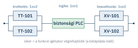
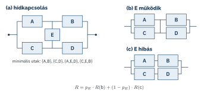
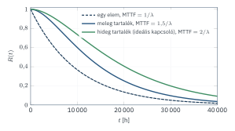

# Rendszermegbízhatóság: blokkdiagramok és k-ból-n rendszerek {#sec-rbd}

{width=100%}

Az előző fejezet egyetlen elem élettartamát írta le. A valódi rendszerek sok elemből állnak, és a rendszer megbízhatósága attól függ, hogyan kapcsolódnak egymáshoz az elemek *a működés logikája szerint*. A megbízhatósági blokkdiagram (*reliability block diagram*, RBD) ennek a logikának a legszemléletesebb leírása. Ebben a fejezetben megismerjük a blokkdiagram és a struktúrafüggvény fogalmát, a soros és párhuzamos rendszerek összefüggéseit, a redundáns rendszerek legfontosabb családját, a k-ból-n (koon) rendszereket, a nem soros-párhuzamos rendszerek kezelését, a hideg és meleg tartalékolást, végül a bizonytalan komponensadatok hatását a rendszer megbízhatóságára.

::: {.cel}
A fejezet végére képes leszel

- megbízhatósági blokkdiagramot és struktúrafüggvényt felírni egy rendszerre;
- kiszámolni soros, párhuzamos és ezekből összetett rendszerek megbízhatóságát és MTTF-jét;
- a k-ból-n rendszerek megbízhatóságát binomiális modellel számolni, és értelmezni a biztonsági rendszerek 1oo2, 2oo2 és 2oo3 architektúráit;
- nem soros-párhuzamos rendszereket állapotfelsorolással, dekompozícióval és minimális utakkal kezelni;
- összevetni a meleg és a hideg tartalékolást;
- a komponensadatok bizonytalanságát intervallumbecsléssel és Monte Carlo-szimulációval a rendszer szintjére vinni.
:::

## A megbízhatósági blokkdiagram {#sec-rbd-alapok}

A megbízhatósági blokkdiagram a rendszer *helyes működésének* grafikus, logikai modellje (IEC 61078 [@iec61078]). Minden blokk egy elemet vagy funkciót jelöl, amely vagy működik, vagy nem. A diagramnak egy bemenete és egy kimenete van; a rendszer akkor működik, ha a bemenettől a kimenetig van olyan útvonal, amelynek minden blokkja működik.

Az RBD szemléletes, de három fontos feltevésre épül:

1. **Két állapot:** minden elem vagy működik, vagy meghibásodott; a részleges működés vagy a degradáció nem ábrázolható.
2. **Függetlenség:** az elemek meghibásodásai egymástól függetlenek, és egy elem meghibásodása nem változtatja meg a többi elem megbízhatósági jellemzőit. A közös okú meghibásodásokat külön kell modellezni ([-@sec-hibafa]. és [-@sec-sil]. fejezet).
3. **Statikus logika:** a meghibásodások sorrendje nem számít. A sorrendfüggő viselkedés (például a tartalék csak a fő elem kiesése után indul) Markov-modellt igényel ([-@sec-markov]. fejezet).

::: {.hiba title="A blokkdiagram nem kapcsolási rajz"}
A megbízhatósági blokkdiagram a *logikai* kapcsolatot ábrázolja, nem a fizikait. Két, villamosan párhuzamosan kötött ellenállás megbízhatósági szempontból soros lehet (ha bármelyik szakadása a funkció elvesztését okozza), és két sorba kötött szelep megbízhatósági szempontból párhuzamos lehet (ha bármelyik zárása elég az áramlás megszüntetéséhez). Ráadásul ugyanannak a rendszernek más-más blokkdiagramja lehet különböző funkciókra vagy meghibásodási módokra: a sorba kötött szelepek a „zárás” funkcióra párhuzamosak, a „nyitás” funkcióra sorosak.
:::

### A struktúrafüggvény {#sec-strukturafuggveny}

A blokkdiagram matematikai megfelelője a **struktúrafüggvény**. Jelölje $x_i$ az $i$-edik elem állapotát ($x_i = 1$, ha működik, $x_i = 0$, ha nem), és $\phi(\mathbf{x})$ a rendszer állapotát. Soros és párhuzamos rendszerre:

$$
\phi_{\text{soros}}(\mathbf{x}) = \prod_{i=1}^{n} x_i , \qquad
\phi_{\text{párh.}}(\mathbf{x}) = 1 - \prod_{i=1}^{n} (1 - x_i) .
$$ {#eq-struktura}

Ha az elemek függetlenek, és az $i$-edik elem megbízhatósága $p_i = P(x_i = 1)$, akkor a rendszer megbízhatósága a struktúrafüggvény várható értéke: $R = E[\phi(\mathbf{x})]$. A gyakorlatban értelmes rendszerek **koherensek**: minden elem számít (van olyan állapot, amelyben az elem állapota dönti el a rendszerét), és egy elem javulása nem ronthatja a rendszert.

## Soros és párhuzamos rendszerek {#sec-soros-parhuzamos}

A [-@fig-rbd-alapok]. ábra az alapvető struktúrákat és megbízhatóságukat mutatja.

{#fig-rbd-alapok width=100%}

A **soros rendszer** akkor működik, ha minden eleme működik; megbízhatósága az elemek megbízhatóságának szorzata, ezért az elemek számának növelésével csökken. A **párhuzamos rendszer** akkor hibásodik meg, ha minden eleme meghibásodott; meghibásodási valószínűsége az elemek meghibásodási valószínűségeinek szorzata, ezért az elemek számával nő a megbízhatósága.

### Exponenciális elemekből álló rendszerek {#sec-exp-rendszerek}

Ha az elemek élettartama exponenciális, a soros rendszer élettartama is exponenciális, a ráták összegével:

$$
R_s(t) = \prod_{i=1}^n e^{-\lambda_i t} = e^{-\left(\sum_i \lambda_i\right) t}, \qquad \text{MTTF}_s = \frac{1}{\sum_i \lambda_i} .
$$ {#eq-soros-exp}

Ez a „ráták összeadása” az alkatrészszámláláson alapuló megbízhatósági előrejelzés (*parts count*) alapja: egy elektronikai modul meghibásodási rátája közelítőleg az alkatrészei rátáinak összege.

A párhuzamos rendszer élettartama már nem exponenciális. $n$ azonos, $\lambda$ rátájú elem esetén

$$
R_p(t) = 1 - \left(1 - e^{-\lambda t}\right)^n , \qquad \text{MTTF}_p = \frac{1}{\lambda} \sum_{k=1}^{n} \frac{1}{k} .
$$ {#eq-parhuzamos-exp}

Két elemre $\text{MTTF}_p = 1{,}5/\lambda$, háromra $1{,}83/\lambda$. A redundancia tehát az MTTF-et csak mérsékelten növeli; a valódi előnye a megbízhatóság növekedése a küldetés elején, amikor $\lambda t \ll 1$: ekkor $1 - R_p \approx (\lambda t)^n$, vagyis a meghibásodási valószínűség az egycsatornás érték $n$-edik hatványára csökken.

### Összetett rendszerek {#sec-osszetett}

A soros és párhuzamos részekből összetett rendszert lépésenként egyszerűsítjük: kiszámoljuk a legegyszerűbb soros vagy párhuzamos részek megbízhatóságát, ezeket egy-egy blokkal helyettesítjük, és addig folytatjuk, amíg egyetlen blokk marad.

::: {.pelda title="Soros-párhuzamos rendszer"}
Egy rendszer akkor működik, ha az $R_3 = 0{,}95$ megbízhatóságú elem mellett az $R_1 = 0{,}8$ és az $R_2 = 0{,}9$ megbízhatóságú elemek közül legalább az egyik működik. A párhuzamos rész megbízhatósága $1 - 0{,}2 \cdot 0{,}1 = 0{,}98$, a rendszeré

$$
R = 0{,}95 \cdot 0{,}98 = 0{,}931 .
$$

Ugyanez az eredmény az **állapotfelsorolással** (igazságtáblával) is megkapható: a 2³ = 8 lehetséges állapotból azokat választjuk ki, amelyekben a rendszer működik, és összegezzük a valószínűségüket.

| $x_1$ | $x_2$ | $x_3$ | rendszer | állapot valószínűsége |
|:--:|:--:|:--:|:--:|--:|
| 1 | 0 | 1 | működik | $0{,}8\cdot 0{,}1\cdot 0{,}95 = 0{,}076$ |
| 0 | 1 | 1 | működik | $0{,}2\cdot 0{,}9\cdot 0{,}95 = 0{,}171$ |
| 1 | 1 | 1 | működik | $0{,}8\cdot 0{,}9\cdot 0{,}95 = 0{,}684$ |
| | | | **összesen** | **0,931** |

: Állapotfelsorolás: a rendszer működő állapotai {#tbl-allapotfelsorolas}

Az állapotfelsorolás minden kétállapotú, független elemekből álló rendszerre alkalmazható, de $n$ elemnél $2^n$ állapotot kell megvizsgálni, ezért nagy rendszerekre csak számítógéppel használható.
:::

## k-ból-n rendszerek {#sec-koon}

A redundáns rendszerek legfontosabb családja a **k-ból-n rendszer** (*k-out-of-n*, koon): $n$ azonos funkciójú csatornából legalább $k$-nak működnie kell a rendszer működéséhez. A soros rendszer az n-ből-n, a párhuzamos az 1-ből-n speciális esete. Ha a csatornák függetlenek és azonos $p$ megbízhatóságúak, a működő csatornák száma binomiális eloszlású, és

$$
R_{k\text{oo}n} = \sum_{j=k}^{n} \binom{n}{j} p^j (1-p)^{n-j} .
$$ {#eq-koon}

A leggyakoribb esetek:

$$
R_{1\text{oo}2} = 2p - p^2, \qquad R_{2\text{oo}2} = p^2, \qquad R_{2\text{oo}3} = 3p^2 - 2p^3 .
$$ {#eq-koon-esetek}

A [-@fig-koon]. ábra ezeket hasonlítja össze. Egy meglepő tanulság: a 2oo3 rendszer csak akkor jobb az egycsatornásnál, ha $p > 0{,}5$. Hosszú időre nézve (amikor $p$ kicsi) rosszabb is lehet. Exponenciális csatornáknál a 2oo3 rendszer átlagos élettartama $\text{MTTF}_{2\text{oo}3} = 5/(6\lambda)$, *kisebb*, mint egyetlen csatornáé. A 2oo3 előnye tehát nem a hosszú élettartam, hanem az, hogy rövid (például a proof tesztek közötti) időtartamra nagy megbízhatóságot ad, és közben a téves működésekkel szemben is tűrőképes.

{#fig-koon width=82%}

::: {.kitekintes title="Mit jelent a „hibakombinációk száma”?"}
A 2014-es jegyzet a redundáns rendszereket a lehetséges hibakombinációk leszámlálásával tárgyalta (hányféleképpen hibásodhat meg egy 1oo3 rendszer úgy, hogy még működik). A leszámlálás jó kombinatorikai gyakorlat, de önmagában nem ad megbízhatóságot: a kombinációk valószínűsége különböző, és a rendszer megbízhatóságához éppen a valószínűségekkel súlyozott összeg kell. Ezt adja a binomiális modell ([-@eq-koon]. egyenlet), a kombinációk száma pedig a binomiális együtthatókban jelenik meg.
:::

### Szavazó architektúrák a biztonsági rendszerekben {#sec-szavazo}

A biztonsági rendszerekben a koon jelölés jelentése sajátos: az **MooN** architektúra azt jelenti, hogy $N$ csatornából legalább $M$-nek kell *jeleznie* (kioldást kérnie) ahhoz, hogy a biztonsági funkció végrehajtódjon. Egy biztonsági rendszer kétféleképpen hibázhat ([-@sec-biztonsagos-veszelyes]. szakasz): **veszélyesen** (igénykor nem old ki) és **biztonságosan** (igény nélkül kiold, azaz téves leállást okoz). A szavazási logika a kettő között egyensúlyoz ([-@tbl-szavazo]. táblázat).

| Architektúra | A funkció végrehajtásához | Ennyi veszélyes hibát tűr (HFT) | Ennyi téves kioldást tűr | Jellemző |
|:--|:--|:--:|:--:|:--|
| 1oo1 | az egyetlen csatorna jelez | 0 | 0 | egyszerű, nincs redundancia |
| 1oo2 | bármelyik csatorna jelez | 1 | 0 | biztonságos, de kétszeres téves kioldási gyakoriság |
| 2oo2 | mindkét csatorna jelez | 0 | 1 | kevés téves kioldás, de rosszabb biztonság |
| 2oo3 | legalább két csatorna jelez | 1 | 1 | egyensúly a biztonság és a rendelkezésre állás között |
| 1oo3 | bármelyik csatorna jelez | 2 | 0 | nagyon nagy biztonság, sok téves kioldás |

: A szavazó architektúrák tulajdonságai a biztonsági rendszerekben {#tbl-szavazo}

A folyamatiparban az érzékelőknél és a beavatkozóknál az 1oo2 és a 2oo3 a leggyakoribb. Az 1oo2 a biztonság szempontjából kiváló, de mivel bármelyik csatorna téves jele leállítást okoz, a téves leállások gyakorisága kétszeres. Ahol a téves leállás költséges vagy maga is veszélyes (például egy nagy erőmű vagy egy kényes vegyi folyamat leállítása), ott a 2oo3 terjedt el.

::: {.eset eset="A" title="ReaktorVéd: a biztonsági funkció blokkdiagramja"}
A ReaktorVéd biztonsági funkciója akkor sikeres, ha igénykor a betáplálás leáll ([-@fig-reaktorved-rbd]. ábra). Ehhez legalább egy hőmérséklet-távadónak jeleznie kell (1oo2), a biztonsági PLC-nek működnie kell (1oo1), és legalább az egyik gyorszáró szelepnek zárnia kell (1oo2, mert a két szelep sorba van kötve a vezetéken).

{#fig-reaktorved-rbd width=92%}

Ha a blokkokat az igénykori meghibásodási valószínűségükkel ($q = 1 - p$) jellemezzük, a funkció meghibásodási valószínűsége független elemekkel

$$
q_{\text{SIF}} \approx q_{TT}^2 + q_{L} + q_{V}^2 ,
$$

ahol a kis tagok szorzatait elhanyagoltuk. A távadókra $q_{TT} = 1{,}76\cdot 10^{-3}$, a logikára $q_L = 5\cdot10^{-5}$, a szelepekre $q_V = 1{,}10\cdot10^{-2}$ (ezek az egycsatornás átlagos PFD-értékek, [-@sec-sil]. fejezet) adódik:

$$
q_{\text{SIF}} \approx 3{,}1\cdot 10^{-6} + 5\cdot 10^{-5} + 1{,}2\cdot 10^{-4} = 1{,}7\cdot 10^{-4} .
$$

Ez az eredmény *túlságosan optimista*, két okból. A blokkdiagram feltételezi, hogy a két szelep és a két távadó egymástól függetlenül hibásodik meg, holott közös okú meghibásodásaik is lehetnek. Továbbá az átlagos meghibásodási valószínűségek szorzata nem azonos a szorzat időátlagával, ha a csatornákat egyszerre tesztelik. A [-@sec-sil]. fejezet mindkét hatást figyelembe veszi, és nagyjából nyolcszor nagyobb értéket kap ($1{,}37\cdot10^{-3}$). A blokkdiagram tehát jó a struktúra megértésére, de a biztonsági funkciók igazolásához önmagában nem elegendő.
:::

## Nem soros-párhuzamos rendszerek {#sec-nem-sp}

Nem minden rendszer bontható soros és párhuzamos részekre. A klasszikus példa a **hídkapcsolás** ([-@fig-hid]. ábra): az E elem összeköti a két ágat, így az A–E–D és a C–E–B útvonal is lehetséges. Az E meghibásodása nem teszi lehetetlenné a működést, de megváltoztatja a lehetséges utakat. A 2014-es jegyzet egy hasonló, „nem valódi párhuzamos” elrendezést mutatott be. Az ilyen rendszerek három módszerrel kezelhetők.

{#fig-hid width=100%}

**Állapotfelsorolás.** Mind a $2^5 = 32$ állapotot megvizsgáljuk; egyszerű, de nagy rendszereknél kezelhetetlen.

**Dekompozíció (feltételes valószínűség).** Kiválasztunk egy kulcselemet (itt E-t), és a teljes valószínűség tételét alkalmazzuk:

$$
R = p_E \cdot R(\text{rendszer} \mid E \text{ működik}) + (1 - p_E) \cdot R(\text{rendszer} \mid E \text{ hibás}) .
$$ {#eq-dekompozicio}

Ha E működik, a rendszer két párhuzamos pár soros kapcsolása: $[1-(1-p_A)(1-p_C)]\,[1-(1-p_B)(1-p_D)]$. Ha E hibás, két soros ág párhuzamos kapcsolása: $1-(1-p_A p_B)(1-p_C p_D)$. Ezt a lépést Shannon-kifejtésnek is nevezik; a hibafák bináris döntési diagramjai ([-@sec-hibafa]. fejezet) ugyanerre épülnek.

::: {.pelda title="A hídkapcsolás megbízhatósága"}
Ha minden elem megbízhatósága $p = 0{,}9$:

$$
R(\text{E működik}) = (1 - 0{,}1^2)^2 = 0{,}9801, \qquad R(\text{E hibás}) = 1 - (1 - 0{,}81)^2 = 0{,}9639,
$$

$$
R = 0{,}9 \cdot 0{,}9801 + 0{,}1 \cdot 0{,}9639 = 0{,}97848 .
$$

Azonos elemekre a zárt alak $R = 2p^2 + 2p^3 - 5p^4 + 2p^5$, amely ugyanezt adja.
:::

**Minimális utak és vágatok.** Egy **út** (*path set*) olyan elemhalmaz, amelynek működése biztosítja a rendszer működését; **minimális**, ha egyetlen eleme sem hagyható el. Egy **vágat** (*cut set*) olyan elemhalmaz, amelynek meghibásodása a rendszer meghibásodását okozza; **minimális**, ha egyetlen eleme sem hagyható el. A híd minimális útjai: {A,B}, {C,D}, {A,E,D}, {C,E,B}; minimális vágatai: {A,C}, {B,D}, {A,E,D}, {C,E,B}. A rendszer megbízhatósága a minimális utak uniójának valószínűsége, amely a szita-formulával (inklúzió–exklúzió) pontosan, korlátokkal közelítőleg számolható. A minimális vágatok a hibafa-elemzés központi fogalmai; a [-@sec-hibafa]. fejezet részletesen tárgyalja őket.

## Meleg és hideg tartalékolás {#sec-tartalekolas}

A párhuzamos redundancia kétféleképpen valósítható meg:

- **Meleg (aktív) tartalék:** a tartalék elem folyamatosan működik a fő elemmel együtt, így ugyanúgy öregszik és hibásodhat meg. Ez a párhuzamos rendszer.
- **Hideg (passzív) tartalék:** a tartalék elem kikapcsolt állapotban vár, és csak a fő elem kiesésekor kapcsolódik be. Közben (ideális esetben) nem hibásodik meg.

Két azonos, $\lambda$ rátájú elemből álló hidegtartalékos rendszer ideális (hibátlan) átkapcsolóval addig működik, amíg mindkét elem egymás után meg nem hibásodik; élettartama a két exponenciális élettartam összege, azaz gamma- (Erlang-) eloszlású:

$$
R_{\text{hideg}}(t) = e^{-\lambda t}(1 + \lambda t), \qquad \text{MTTF}_{\text{hideg}} = \frac{2}{\lambda} .
$$ {#eq-hideg-tartalek}

Ez jobb, mint a meleg tartalék $1{,}5/\lambda$ értéke ([-@fig-tartalek]. ábra). A valóságban azonban az átkapcsoló maga is meghibásodhat, a hideg tartalék a várakozás alatt is öregedhet (például a szigetelés vagy a kenőanyag), és a bekapcsoláskor nem indul el (*failure to start*). Ezek a hatások a hideg tartalék előnyét gyakran eltüntetik. Pontos modellezésükre a Markov-modell alkalmas ([-@sec-markov]. fejezet).

{#fig-tartalek width=84%}

::: {.eset eset="C" title="KoboCella: kétcsatornás biztonsági funkció"}
A KoboCella sebességfelügyeletét a PL~r~ = e követelmény miatt kétcsatornás architektúrával kell megvalósítani (az ISO 13849-1 szerinti 4-es kategória): két független sebességmérés és két független lekapcsolási út, amelyek bármelyike megállítja a robotot (1oo2). Blokkdiagram-szempontból ez a „biztonságos megállítás” funkcióra párhuzamos, a „termelés folytatása” funkcióra viszont soros. Bármelyik csatorna téves jelzése leállítja a cellát, ezért a tervezőknek a téves leállások gyakoriságát is ellenőrizniük kell (H4 veszély, [-@sec-stpa-kobocella]. szakasz).
:::

## Bizonytalan komponensadatok {#sec-bizonytalan-adatok}

A komponensek megbízhatósága ritkán ismert pontosan. A 2014-es jegyzet egy szemléletes példán mutatta be, hogyan vihető át a bizonytalanság a rendszer szintjére **intervallumbecsléssel**: minden elemre alsó és felső korlátot adunk, és mivel a koherens rendszerek megbízhatósága minden elemben monoton nő, a rendszer alsó korlátját az alsó, a felső korlátját a felső komponenskorlátokból számoljuk.

::: {.pelda title="Intervallumbecslés és Monte Carlo-szimuláció"}
Egy rendszer két alrendszerből áll. Az $S_2$ az $S_1$ tartaléka (a kettő párhuzamos). $S_1$-ben három komponens (A, B, C) közül legalább egynek működnie kell (párhuzamos), $S_2$-ben mindhárom komponensnek (D, E, F) működnie kell (soros). A komponensek megbízhatósága tízéves terepi adatokból tartományként ismert:

| Komponens | A | B | C | D | E | F |
|:--|:--:|:--:|:--:|:--:|:--:|:--:|
| alsó korlát | 0,70 | 0,80 | 0,60 | 0,98 | 0,96 | 0,98 |
| felső korlát | 0,72 | 0,84 | 0,62 | 0,99 | 0,97 | 0,99 |

: A komponensek megbízhatósági tartományai {#tbl-intervallum}

Alsó korlátok: $S_1 = 1 - 0{,}30\cdot0{,}20\cdot0{,}40 = 0{,}976$, $S_2 = 0{,}98\cdot0{,}96\cdot0{,}98 = 0{,}922$, a rendszer $1-(1-0{,}976)(1-0{,}922) = 0{,}9981$. Felső korlátok: $S_1 = 0{,}983$, $S_2 = 0{,}951$, a rendszer $0{,}9992$. A rendszer megbízhatósága tehát a $[0{,}998;\ 0{,}999]$ intervallumba esik.

Az intervallumbecslés konzervatív, mert feltételezi, hogy minden komponens egyszerre a legrosszabb (vagy legjobb) értéket veszi fel. A **Monte Carlo-szimuláció** reálisabb képet ad: minden komponens megbízhatóságát a tartományán belül véletlenszerűen (például egyenletes eloszlással) választjuk, kiszámoljuk a rendszer megbízhatóságát, és ezt sokszor megismételjük. 200 000 ismétlés után a rendszer megbízhatóságának átlaga 0,99870, az 5%-os és 95%-os kvantilise 0,99848 és 0,99891. Ez az intervallum jóval szűkebb, mint a konzervatív korlátok által adott, mert a szélsőértékek egyidejű bekövetkezése valószínűtlen.
:::

A Monte Carlo-módszer előnye, hogy tetszőleges bonyolultságú rendszerre és tetszőleges bemeneti eloszlásra alkalmazható; hátránya, hogy a bemeneti eloszlások megválasztása maga is bizonytalan, és a ritka események vizsgálatához sok ismétlés kell.

## Erősségek és korlátok {#sec-rbd-korlatai}

**Előnyök:** a megbízhatósági blokkdiagram lehetővé teszi a tervezési koncepciók korai összevetését; könnyebben áttekinthető, mint a legtöbb más logikai modell; az elemek elrendezése tükrözheti a rendszerbeli szerepüket; könnyen átalakítható hibafává és eseményfává ([-@sec-esemenyfa]. fejezet).

**Korlátok:** a rendszert részeire kell bontani, és minden rész megbízhatóságát meg kell becsülni, ami nagy rendszereknél erőforrásigényes; a komponensadatok gyakran hiányosak, szubjektívek és eltérő konfidenciájúak; nem minden rendszer modellezhető soros-párhuzamos struktúrával; a függetlenségi és a kétállapotú feltevés sokszor sérül; a sorrendfüggő és javítható viselkedés nem ábrázolható.

::: {.labor}
A gyakorlati útmutató 7. laborjában egy böngészős blokkdiagram-szerkesztővel építhetsz soros, párhuzamos és k-ból-n struktúrákat, és megnézheted, hogyan változik a rendszer megbízhatósága és MTTF-je az idő függvényében. A hozzá tartozó Colab-notebook a hídkapcsolást állapotfelsorolással, dekompozícióval és Monte Carlo-szimulációval is kiszámolja, és megmutatja a közös okú meghibásodások hatását az 1oo2 struktúrára.
:::

::: {.osszefoglalo}
- A blokkdiagram a helyes működés logikai modellje; feltevései a kétállapotú elemek, a függetlenség és a statikus logika. A blokkdiagram nem kapcsolási rajz.
- Soros rendszerben a megbízhatóságok, párhuzamos rendszerben a meghibásodási valószínűségek szorzódnak; exponenciális elemeknél a soros rendszer rátája a ráták összege.
- A k-ból-n rendszer megbízhatósága binomiális összeg; a 2oo3 csak $p > 0{,}5$ fölött jobb az egycsatornásnál, és MTTF-je kisebb.
- A biztonsági rendszerek szavazó architektúrái a veszélyes és a biztonságos meghibásodásokkal szembeni tűrés között egyensúlyoznak.
- A nem soros-párhuzamos rendszerek állapotfelsorolással, dekompozícióval vagy minimális utakkal és vágatokkal kezelhetők.
- A hideg tartalék elvben jobb a melegnél, de az átkapcsoló és az indulási hibák ezt az előnyt csökkentik.
- A komponensadatok bizonytalansága intervallumbecsléssel (konzervatív) vagy Monte Carlo-szimulációval (reálisabb) vihető át a rendszer szintjére.
:::

::: {.onell}
1. Egy soros rendszer 50 elemből áll, mindegyik megbízhatósága 0,999. Mekkora a rendszer megbízhatósága? Mennyi kellene egy elemé ahhoz, hogy a rendszeré 0,99 legyen?
2. Két azonos, $\lambda = 10^{-4}\,\text{h}^{-1}$ rátájú elem párhuzamosan van kötve. Mekkora a rendszer MTTF-je, és mekkora a megbízhatósága 1000 óra után?
3. Számold ki egy 2oo3 rendszer megbízhatóságát $p = 0{,}95$ mellett! Hasonlítsd össze az 1oo2 és az 1oo1 rendszerrel!
4. Miért mondjuk, hogy a sorba kötött két gyorszáró szelep megbízhatósági szempontból párhuzamos? Mikor lenne soros?
5. Miért ad szűkebb intervallumot a Monte Carlo-szimuláció, mint a korlátokon alapuló intervallumbecslés?

::: {.megoldas}
1. $R = 0{,}999^{50} \approx 0{,}951$. A célhoz $p^{50} = 0{,}99$, azaz $p = 0{,}99^{1/50} \approx 0{,}9998$.
2. $\text{MTTF} = 1{,}5/\lambda = 15\,000$ óra. $R(1000) = 1 - (1 - e^{-0{,}1})^2 = 1 - 0{,}0952^2 \approx 0{,}9909$.
3. $R_{2\text{oo}3} = 3\cdot0{,}9025 - 2\cdot0{,}857 = 0{,}99275$; $R_{1\text{oo}2} = 1 - 0{,}05^2 = 0{,}9975$; $R_{1\text{oo}1} = 0{,}95$. A 2oo3 sokkal jobb az egycsatornásnál, de valamivel rosszabb az 1oo2-nél (cserébe tűri a téves jelzéseket).
4. A „zárás” (az áramlás megszüntetése) funkcióra bármelyik szelep zárása elegendő, ezért párhuzamosak. A „nyitás” (az áramlás biztosítása) funkcióra mindkét szelepnek nyitva kell lennie, ezért erre a funkcióra sorosak; ez a téves leállások szempontjából fontos.
5. Mert a korlátokon alapuló becslés feltételezi, hogy minden komponens egyszerre a szélsőértékén van, ami nagyon valószínűtlen. A Monte Carlo-szimuláció a komponensek egyidejű, egymástól független ingadozását veszi figyelembe, így a rendszer megbízhatóságának valószínű tartományát adja.
:::
:::

::: {.forras}
- Rausand, M., Barros, A., Høyland, A. (2020): *System Reliability Theory*, 4–6. fejezet – struktúrafüggvények, koherens rendszerek, k-ból-n rendszerek [@rausand2020].
- IEC 61078:2016 – a megbízhatósági blokkdiagramok szabványa [@iec61078].
- Trivedi, K. S., Bobbio, A. (2017): *Reliability and Availability Engineering.* Cambridge University Press [@trivedi2017].
:::
