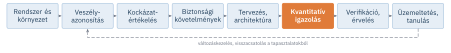
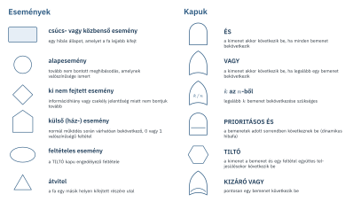
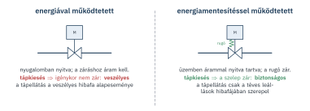
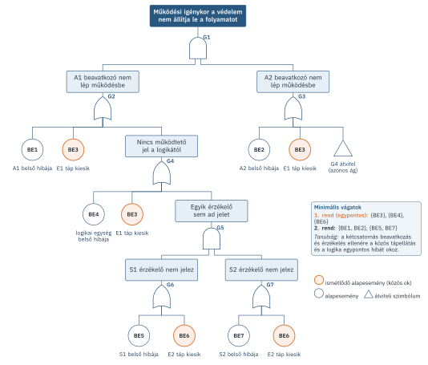
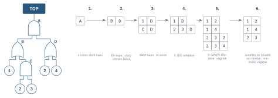
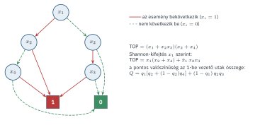
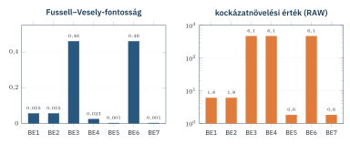
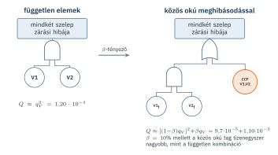
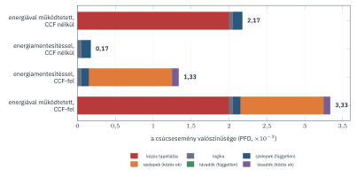

# Hibafa-elemzés {#sec-hibafa}

{width=100%}

A blokkdiagram a helyes működés útjait írja le. A biztonsági elemzésben gyakran a fordított kérdés a természetesebb: *milyen meghibásodás-kombinációk vezetnek egy adott nemkívánatos eseményhez?* A hibafa-elemzés (*fault tree analysis*, FTA) erre a kérdésre ad szisztematikus, grafikus és matematikailag pontos választ. A hibafa egy kiválasztott csúcseseményből indul ki, és logikai kapukon keresztül, lépésről lépésre bontja le azokat az okokat, amelyek együtt vagy külön-külön előidézhetik. Ebben a fejezetben megismerjük a hibafa szimbólumait és szerkesztési szabályait, a minimális vágatok meghatározását, a csúcsesemény valószínűségének kiszámítását, a fontossági mértékeket, a közös okú meghibásodások modellezését és a bizonytalanság kezelését. A ReaktorVéd példáján azt is látni fogjuk, hogy egy hibafa hogyan vezet közvetlenül jobb tervezési döntéshez.

::: {.cel}
A fejezet végére képes leszel

- egy nemkívánatos csúcseseményhez szabályosan felépíteni a hibafát;
- a minimális vágatokat a MOCUS-eljárással meghatározni, és értelmezni az egypontos hibákat;
- az alapesemények valószínűségét a meghibásodás jellegének megfelelő modellel megadni;
- a csúcsesemény valószínűségét ritkaesemény-közelítéssel, felső korláttal és bináris döntési diagrammal kiszámolni;
- a Birnbaum-, a Fussell–Vesely-, a kockázatnövelési és a kockázatcsökkentési mértéket kiszámolni és a tervezésben felhasználni;
- a közös okú meghibásodásokat β-tényezős modellel beépíteni a hibafába;
- az eredmény bizonytalanságát Monte Carlo-szimulációval becsülni, és felismerni a hibafa korlátait.
:::

## A hibafa lényege és helye a biztonsági elemzésben {#sec-fta-lenyeg}

A hibafa-elemzést 1961–62-ben H. A. Watson dolgozta ki a Bell Telephone Laboratories-nál, az amerikai légierő Minuteman interkontinentális rakétáinak indítóirányító rendszeréhez. A módszert a Boeing fejlesztette tovább és vitte át a repülőgép-tervezésbe, a nukleáris ipar pedig az 1970-es évek valószínűségi biztonsági elemzéseiben tette általánossá [@ericson1999]. Az Egyesült Államok Nukleáris Szabályozó Hatóságának 1981-es *Fault Tree Handbook*-ja (NUREG-0492) máig a szakterület alapműve [@vesely1981], amelyet a NASA 2002-ben űrtechnikai alkalmazásokkal bővített ki [@stamatelatos2002]. A módszer nemzetközi szabványa az IEC 61025 [@iec61025].

A hibafa **deduktív, felülről lefelé haladó** módszer: egy meghatározott rendszerszintű eseményből indul, és az okai felé halad. Ebben különbözik az FMEA-tól, amely **induktív**: az egyes elemek meghibásodási módjaiból indul, és azok következményeit követi a rendszer szintjéig ([-@sec-fmea]. fejezet). A két módszer kiegészíti egymást. Az FMEA jó abban, hogy semmilyen meghibásodási mód ne maradjon ki, a hibafa pedig abban, hogy a *kombinációkat*, a többszörös meghibásodásokat és a közös okokat feltárja. Ezért a szabványok sokszor mindkettőt előírják. Az ISO 26262 például a hardvertervezés biztonsági elemzésére ASIL C és D esetén mind az induktív, mind a deduktív elemzést erősen ajánlja [@iso26262], a repülésben az ARP4761A a hibafát a rendszerbiztonsági értékelés egyik alapeszközeként kezeli [@arp4761a], a folyamatiparban pedig a biztonsági funkciók PFD-értékének ellenőrzésére is használják ([-@sec-sil]. fejezet).

A hibafa egyszerre három dolgot ad:

1. **Megértést:** a fa felépítése közben a csapat végiggondolja, hogyan működik és hogyan hibásodhat meg a rendszer. Sok gyenge pont már a szerkesztés közben kiderül, számítás nélkül.
2. **Kvalitatív eredményt:** a minimális vágatok megmutatják, mely meghibásodás-kombinációk okozzák a csúcseseményt, és melyek az egypontos hibák.
3. **Kvantitatív eredményt:** ha az alapesemények valószínűsége ismert, kiszámolható a csúcsesemény valószínűsége és az egyes események hozzájárulása.

::: {.fogalom title="Hibafa"}
A **hibafa** egy kiválasztott nemkívánatos rendszerállapot (a **csúcsesemény**) és az azt előidéző események közötti logikai kapcsolatok grafikus modellje. Az eseményeket logikai kapuk kötik össze; a fa levelei az **alapesemények**, amelyeket tovább már nem bontunk, és amelyekre valószínűségi adat áll rendelkezésre.
:::

## Szimbólumok és szerkesztési szabályok {#sec-fta-szerkesztes}

A hibafa jelölésrendszere szabványos ([-@fig-hibafa-szimbolumok]. ábra). A leggyakoribb kapu az **ÉS** (a kimeneti esemény akkor következik be, ha minden bemenet bekövetkezik) és a **VAGY** (elég egyetlen bemenet). A **k az n-ből** kapu a szavazó architektúrák tömör leírása. A **TILTÓ** kapu egy feltételhez köti a továbbterjedést (például: a szivárgásból csak akkor lesz tűz, ha gyújtóforrás is van). A **PRIORITÁSOS ÉS** a sorrendfüggő viselkedést jelöli, és már a dinamikus hibafákhoz tartozik ([-@sec-dinamikus-hibafa]. szakasz). A **házesemény** biztosan bekövetkező vagy biztosan be nem következő feltétel; segítségével egyetlen fában több üzemállapot vagy tervváltozat írható le úgy, hogy a megfelelő házeseményt 0-ra vagy 1-re állítjuk.

{#fig-hibafa-szimbolumok width=100%}

### A szerkesztés lépései {#sec-fta-lepesek}

A hibafa-elemzés folyamata hat lépésből áll:

1. **A rendszer és a határok meghatározása:** mi tartozik a vizsgált rendszerhez, milyen üzemállapotra és milyen külső feltételekre (például tápellátás, környezet, kezelői beavatkozás) vonatkozik az elemzés, és milyen részletezettségig bontunk.
2. **A csúcsesemény pontos megfogalmazása:** *mi* történik, *hol* és *mikor*. A „a védelem meghibásodik” túl tág; a „működési igény esetén a védelem nem állítja le a betáplálást 30 másodpercen belül” már elemezhető. A csúcseseményt rendszerint a veszélyelemzés ([-@sec-veszelyazonositas]. fejezet) jelöli ki.
3. **A fa felépítése:** a csúcseseménytől lefelé, minden szinten a *közvetlen, szükséges és elégséges okokat* keresve.
4. **Kvalitatív elemzés:** a minimális vágatok meghatározása és értelmezése.
5. **Kvantitatív elemzés:** a csúcsesemény valószínűsége, a fontossági mértékek és a bizonytalanság.
6. **Értelmezés és dokumentálás:** a következtetések, a feltevések és a javasolt intézkedések rögzítése.

### A szerkesztés szabályai {#sec-fta-szabalyok}

A NUREG-0492 néhány egyszerű szabályt fogalmazott meg, amelyek betartása a jó hibafák titka [@vesely1981]:

- **Az eseményt hibaként fogalmazzuk meg:** minden eseménydobozba azt írjuk, *mi* a hiba és *mikor* következik be („a szelep nem zár igénykor”, nem pedig „szelep”).
- **Elemhiba vagy rendszerhiba?** Ha az eseményt egyetlen elem meghibásodása okozhatja, **elemállapot-hiba**: alá rendszerint egy VAGY-kapu kerül a három lehetséges okkal (*primer hiba*: az elem a tervezési határain belül hibásodik meg; *szekunder hiba*: a határain kívüli igénybevétel, például túlfeszültség vagy túlmelegedés teszi tönkre; *vezérlési hiba*: az elem hibátlan, de rossz időben vagy rossz jelet kap). Ha nem, **rendszerállapot-hiba**, amelyet tovább kell bontani a közvetlen okai szerint.
- **Nincs csoda:** ha egy elem normális működése továbbviszi a hibát, feltételezzük, hogy normálisan működik. Nem számolunk azzal, hogy egy másik hiba „véletlenül” megállítja a folyamatot.
- **Teljes kapu:** egy kapu minden bemenetét definiáljuk, mielőtt bármelyiket tovább bontanánk. Így a fa szintenként épül, és nem vész el egyetlen ág sem.
- **Nincs kapu–kapu kapcsolat:** a kapuk bemenetei mindig megnevezett események, nem közvetlenül másik kapuk. A kapu alatti eseménydoboz kényszerít arra, hogy kimondjuk, mi történik azon a ponton.

Ezekhez a gyakorlat néhány tanácsot ad: gondolkodjunk *kis lépésekben* (minden szinten csak a közvetlen okot keressük, ne ugorjunk az alapeseményekhez); ugyanazt az eseményt mindenütt ugyanazzal a névvel és azonosítóval jelöljük, mert csak így ismerhetők fel az ismétlődő események; és rögzítsük a feltevéseket (például hogy a tápellátás a fa határán kívül van-e).

::: {.eset eset="A" title="ReaktorVéd: a biztonsági funkció hibafája"}
A ReaktorVéd biztonsági funkciójának csúcseseménye: *„működési igény esetén a védelem nem állítja le a folyamatot”*. Az első változatban a két gyorszáró szelep **energiával működtetett**: nyugalomban nyitva van, és a zárásához a mágnesszelepnek áramot kell kapnia ([-@fig-kioldas-elvek]. ábra, bal oldal). A szelepeket és a logikát az E1, a két hőmérséklet-távadót az E2 tápegység látja el.

{#fig-kioldas-elvek width=88%}

A hibafa ([-@fig-reaktorved-hibafa]. ábra) csúcsa alatt ÉS-kapu áll: a funkció csak akkor marad el, ha *mindkét* szelep nem zár (G1). Egy szelep nem zár, ha belső hibája van, ha nincs tápellátása, vagy ha nem kap működtető jelet a logikától (G2, G3; a G4 ágat a G3 alatt átviteli szimbólum jelöli, mert ugyanaz, mint a G2 alatt). A működtető jel elmarad, ha a logika hibás, ha nincs tápellátása, vagy ha egyik érzékelő sem jelez (G5). Egy érzékelő nem jelez, ha belső hibája van, vagy ha az E2 tápegység kiesik (G6, G7).

{#fig-reaktorved-hibafa width=100%}

A fa első ránézésre megnyugtató: a csúcs alatt ÉS-kapu áll, és az érzékelőket is redundánsan kötöttük be. Az ismétlődő események azonban megtörik ezt a redundanciát. A BE3 (az E1 tápegység kiesése) egyszerre mindkét szelepet megbénítja, a BE6 (az E2 kiesése) egyszerre mindkét érzékelőt. A következő szakasz ezt pontosan is megmutatja.
:::

## Kvalitatív elemzés: minimális vágatok {#sec-minimalis-vagatok}

::: {.fogalom title="Vágat és minimális vágat"}
**Vágat** az alapesemények olyan halmaza, amelyek együttes bekövetkezése előidézi a csúcseseményt. **Minimális vágat** az a vágat, amelyből egyetlen eseményt sem hagyhatunk el úgy, hogy vágat maradjon. A minimális vágat **rendje** az elemeinek száma. A duális fogalom az **út**: az alapesemények olyan halmaza, amelyek közül egyik sem következik be, és ez biztosítja, hogy a csúcsesemény se következzen be.
:::

A minimális vágatok a hibafa Boole-algebrai kifejezésének **diszjunktív normálformáját** adják: a csúcsesemény a minimális vágatok VAGY-kapcsolata, minden vágat pedig az elemeinek ÉS-kapcsolata,

$$
\mathrm{TOP} = K_1 \cup K_2 \cup \dots \cup K_m, \qquad K_j = \bigcap_{i \in K_j} B_i .
$$ {#eq-mcs}

A minimális vágatok listája a hibafa legfontosabb kvalitatív eredménye. Az **elsőrendű** vágatok az **egypontos hibák**: egyetlen esemény elég a csúcseseményhez. Biztonsági rendszerben ezek a legsúlyosabb gyenge pontok. A magasabb rendű vágatoknál azt érdemes vizsgálni, hogy az elemeik **ki vannak-e téve közös oknak**: ha egy másodrendű vágat két eleme ugyanabban a helyiségben van, ugyanazt a tápot használja, ugyanaz a csapat tartja karban, vagy ugyanabból a gyártási sorozatból való, akkor a valóságban inkább elsőrendűként viselkedhet ([-@sec-ccf-hibafa]. szakasz).

### A MOCUS-eljárás {#sec-mocus}

Kis fáknál a minimális vágatok Boole-algebrai átalakítással is megkaphatók, nagyobb fáknál azonban szisztematikus eljárás kell. A klasszikus módszer a Fussell és Vesely által 1972-ben javasolt **MOCUS** (*method for obtaining cut sets*) [@fussell1972; @rausand2020]. Az eljárás egy mátrixot épít, és felülről lefelé helyettesíti a kapukat a bemeneteikkel ([-@fig-mocus-lepesek]. ábra):

1. Írjuk a csúcs alatti kapu jelét a mátrix első sorába.
2. Egy **ÉS-kaput** a bemeneteivel helyettesítünk *ugyanabban a sorban*, egymás mellett (a sor bővül).
3. Egy **VAGY-kaput** úgy helyettesítünk, hogy a sort annyiszor másoljuk, ahány bemenete van, és mindegyik másolatba egy-egy bemenet kerül (a mátrix új sorokkal bővül).
4. Addig folytatjuk, amíg a mátrixban csak alapesemények maradnak. Minden sor egy vágat.
5. Minden sorból töröljük az ismétlődő eseményeket ($A \cap A = A$), majd töröljük azokat a sorokat, amelyek egy másik sort tartalmaznak ($A \cup (A \cap B) = A$). A megmaradó sorok a minimális vágatok.

{#fig-mocus-lepesek width=100%}

A példafa kifejezése $\mathrm{TOP} = (x_1 + x_2 x_3)(x_2 + x_4)$; a MOCUS-eljárás négy logikai vágatot ad: $\{1,2\}$, $\{1,4\}$, $\{2,3\}$ és $\{2,3,4\}$. Az utolsó tartalmazza a $\{2,3\}$ vágatot, ezért nem minimális. A minimális vágatok tehát $\{1,2\}$, $\{1,4\}$ és $\{2,3\}$. Érdemes megfigyelni, hogy a 2-es esemény két ágban is szerepel. Ha ezt nem vennénk észre, és a két ágat függetlennek tekintenénk, hibás eredményt kapnánk: az ismétlődő események miatt a hibafa kapunként, alulról felfelé nem számolható ki helyesen.

::: {.eset eset="A" title="ReaktorVéd: a minimális vágatok"}
A [-@fig-reaktorved-hibafa]. ábra hibafájára a MOCUS-eljárás öt minimális vágatot ad:

- **elsőrendű (egypontos) vágatok:** $\{\mathrm{BE3}\}$ (az E1 tápegység kiesése), $\{\mathrm{BE4}\}$ (a logika hibája), $\{\mathrm{BE6}\}$ (az E2 tápegység kiesése);
- **másodrendű vágatok:** $\{\mathrm{BE1}, \mathrm{BE2}\}$ (mindkét szelep belső hibája), $\{\mathrm{BE5}, \mathrm{BE7}\}$ (mindkét távadó belső hibája).

A kétcsatornás beavatkozás és érzékelés ellenére tehát három egypontos hiba van. A logika egycsatornás, ezt tudatosan vállaltuk (a biztonsági PLC belső diagnosztikája nagyon jó). A két tápegység viszont *rejtett* egypontos hiba: a blokkdiagramon ([-@fig-reaktorved-rbd]. ábra) nem is látszott, mert a blokkdiagram csak a funkció elemeit ábrázolta, a közös támogató rendszereket nem. Ez a hibafa egyik legnagyobb értéke: a közös függőségeket (tápellátás, sűrített levegő, hűtés, kommunikáció, szoftver) a fa szerkesztése szinte kikényszeríti.
:::

### Bináris döntési diagramok {#sec-bdd}

A minimális vágatok száma nagy fáknál robbanásszerűen nőhet: egy nukleáris erőmű valószínűségi biztonsági elemzésében milliónyi vágat is előfordul, ezért a gyakorlatban csak egy valószínűségi küszöb fölötti vágatokat tartják meg. A pontos megoldás modern eszköze a **bináris döntési diagram** (*binary decision diagram*, BDD), amelyet Bryant vezetett be a logikai áramkörök ellenőrzésére [@bryant1986], és Rauzy alkalmazott először a hibafa-elemzésben [@rauzy1993].

A BDD a Boole-függvény **Shannon-kifejtésén** alapul: egy kiválasztott $x$ változó szerint

$$
f = x \cdot f|_{x=1} + \bar{x} \cdot f|_{x=0} .
$$ {#eq-shannon}

Ha a változókat rögzített sorrendben egymás után kifejtjük, és az azonos részfüggvényeket összevonjuk, egy irányított, körmentes gráfot kapunk, amelynek minden csúcsa egy változó, két kimenő éle pedig a változó 1, illetve 0 értékéhez tartozik ([-@fig-bdd-pelda]. ábra). A gráf 1-es levelébe vezető utak *diszjunkt* eseményeket írnak le, ezért valószínűségeik egyszerűen összeadhatók, és a csúcsesemény **pontos** valószínűségét adják, közelítés nélkül.

{#fig-bdd-pelda width=88%}

A BDD mérete erősen függ a változók sorrendjétől; jó sorrenddel a legtöbb gyakorlati hibafa kezelhető méretű diagramot ad, rossz sorrenddel viszont a diagram exponenciálisan nagy lehet [@bryant1986; @ruijters2015]. A modern hibafa-eszközök ezért heurisztikákkal választják meg a sorrendet. A BDD-ből a minimális vágatok is előállíthatók, így a két megközelítés jól kiegészíti egymást.

## Kvantitatív elemzés {#sec-fta-kvantitativ}

### Az alapesemények valószínűsége {#sec-alapesemeny-modellek}

A csúcsesemény valószínűségének kiszámításához minden alapeseményhez valószínűséget kell rendelni. Az, hogy melyik modell a helyes, a meghibásodás jellegétől és a karbantartási stratégiától függ ([-@tbl-alapesemeny-modellek]. táblázat; a megbízhatósági alapfogalmakat a [-@sec-megbizhatosag]. fejezet tárgyalta).

| Az alapesemény jellege | Modell | Közelítés kis értékekre |
|:--|:--|:--|
| igénykori meghibásodás (például egy relé nem húz meg) | rögzített $q$ | – |
| nem javítható elem, $t$ üzemidő után | $q(t) = 1 - e^{-\lambda t}$ | $\lambda t$ |
| azonnal feltárt, javítható meghibásodás | $Q = \dfrac{\lambda\,\text{MTTR}}{1 + \lambda\,\text{MTTR}}$ | $\lambda\,\text{MTTR}$ |
| rejtett meghibásodás, $T_1$ időközű próbával | $\bar{q} = 1 - \dfrac{1 - e^{-\lambda T_1}}{\lambda T_1}$ | $\lambda T_1/2$ |

: Az alapesemények szokásos valószínűségi modelljei {#tbl-alapesemeny-modellek}

A biztonsági rendszerekben a legfontosabb az utolsó sor: a nyugalmi állapotban lévő védelem meghibásodása rejtve marad, amíg egy próba vagy egy valódi igény fel nem fedi. Az átlagos meghibásodási valószínűség ilyenkor a próbaidőköz felével arányos. Ha a hibát a próba után még javítani is kell, az MTTR is hozzáadódik: $\bar{q} \approx \lambda(T_1/2 + \text{MTTR})$.

::: {.eset eset="A" title="ReaktorVéd: az alapesemények adatai"}
A próbaidőköz $T_1 = 8760$ óra (évente egy próba), a javítási idő $\text{MTTR} = 8$ óra. A szelepeknek nincs diagnosztikájuk, a rejtett veszélyes meghibásodási ráta $\lambda_{DU} = 2{,}5\cdot10^{-6}\,\text{h}^{-1}$, így $q_{\mathrm{BE1}} = q_{\mathrm{BE2}} = 2{,}5\cdot10^{-6}\cdot(4380 + 8) = 1{,}097\cdot10^{-2}$. A távadók diagnosztizált veszélyes hibáira a logika kiold, ezért csak a fel nem fedett rész számít: $q_{\mathrm{BE5}} = q_{\mathrm{BE7}} = 4\cdot10^{-7}\cdot 4380 = 1{,}752\cdot10^{-3}$. A logika átlagos meghibásodási valószínűsége $q_{\mathrm{BE4}} = 5\cdot10^{-5}$, a tápegységeké igénykor $q_{\mathrm{BE3}} = q_{\mathrm{BE6}} = 10^{-3}$.
:::

### A kapuk és a csúcsesemény valószínűsége {#sec-csucs-valoszinuseg}

Független bemenetek esetén az ÉS-kapu kimenetének valószínűsége a bemenetek valószínűségeinek szorzata, a VAGY-kapué a komplementerek szorzatának komplementere:

$$
Q_{\text{ÉS}} = \prod_{i=1}^{n} q_i , \qquad
Q_{\text{VAGY}} = 1 - \prod_{i=1}^{n} (1 - q_i) \approx \sum_{i=1}^{n} q_i .
$$ {#eq-kapuk}

Ezek a képletek csak akkor alkalmazhatók kapuról kapura, alulról felfelé, ha a fában nincsenek ismétlődő események. Általános esetben a minimális vágatokból számolunk. A $K_j$ vágat valószínűsége független alapeseményekkel $Q(K_j) = \prod_{i \in K_j} q_i$, a csúcsesemény valószínűségére pedig három közelítés terjedt el:

$$
Q_{\text{ritka}} = \sum_{j=1}^{m} Q(K_j) \;\geq\; Q_{\text{MCUB}} = 1 - \prod_{j=1}^{m}\bigl(1 - Q(K_j)\bigr) \;\geq\; Q_{\text{pontos}} .
$$ {#eq-ritkaesemeny}

A **ritkaesemény-közelítés** egyszerűen összeadja a vágatok valószínűségét; koherens fára mindig felső korlát, és kis valószínűségeknél nagyon pontos. A **minimálisvágat-felsőkorlát** (*minimal cut set upper bound*, MCUB) úgy számol, mintha a vágatok függetlenek volnának; ez is felső korlát, és pontosabb. A **pontos** érték a szita-formulával (a vágatok összes metszetének előjeles összegével) vagy bináris döntési diagrammal adódik [@rausand2020]. A MOCUS-példánál ($q_1 = 0{,}01$, $q_2 = 0{,}02$, $q_3 = 0{,}05$, $q_4 = 0{,}1$) a három érték 0,00220, 0,00220 és 0,00217: a különbség kevesebb, mint 1,5%.

::: {.hiba title="Gyakoriság és valószínűség nem keverhető"}
A hibafa alapeseményei *valószínűségek* (dimenzió nélküli számok). Ha a csúcsesemény gyakoriság (például „tűz évente”), akkor legfeljebb egyetlen bemenet lehet gyakoriság, a többinek feltételes valószínűségnek kell lennie: $f_{\mathrm{TOP}} = f_{\text{kezdő}} \cdot q_1 \cdot q_2 \cdots$. Két gyakoriság szorzata (1/év²) értelmetlen. Ez a hiba meglepően gyakori a gyakorlatban; a kezdő esemény gyakoriságának és a feltételes valószínűségeknek a szétválasztása az eseményfa természetes logikája ([-@sec-esemenyfa]. fejezet).
:::

::: {.eset eset="A" title="ReaktorVéd: a csúcsesemény valószínűsége"}
A vágatok valószínűsége és hozzájárulása a [-@tbl-reaktorved-mcs]. táblázatban látható.

| Minimális vágat | Valószínűség | Hozzájárulás |
|:--|--:|--:|
| $\{\mathrm{BE3}\}$ – az E1 tápegység kiesése | $1{,}000\cdot10^{-3}$ | 46,0% |
| $\{\mathrm{BE6}\}$ – az E2 tápegység kiesése | $1{,}000\cdot10^{-3}$ | 46,0% |
| $\{\mathrm{BE1}, \mathrm{BE2}\}$ – mindkét szelep | $1{,}203\cdot10^{-4}$ | 5,5% |
| $\{\mathrm{BE4}\}$ – a logika | $5{,}000\cdot10^{-5}$ | 2,3% |
| $\{\mathrm{BE5}, \mathrm{BE7}\}$ – mindkét távadó | $3{,}070\cdot10^{-6}$ | 0,1% |
| **csúcsesemény (ritkaesemény-közelítés)** | $\mathbf{2{,}173\cdot10^{-3}}$ | 100% |

: A ReaktorVéd energiával működtetett változatának minimális vágatai {#tbl-reaktorved-mcs}

A ritkaesemény-közelítés $2{,}1734\cdot10^{-3}$, a felső korlát és a pontos érték egyaránt $2{,}1721\cdot10^{-3}$. Az eredmény egyértelmű: a kockázat 92%-át a két tápegység adja, a gondosan megtervezett szelep- és távadó-redundancia szinte nem is számít. A biztonsági funkció így a SIL 2 tartományban marad ($10^{-3} \le \text{PFD} < 10^{-2}$), és nem teljesíti a LOPA által megkövetelt $\text{PFD} \le 2\cdot10^{-3}$ célt ([-@sec-szukseges-csokkentes]. szakasz).
:::

::: {.kitekintes title="Az átlagok szorzata nem a szorzat átlaga"}
A rejtett meghibásodású, együtt tesztelt redundáns elemeknél a kapuképletek csalóka eredményt adnak. Két, egyszerre tesztelt szelep együttes meghibásodási valószínűsége a próba után nulláról indul, és $(\lambda t)^2$ szerint nő. Ennek időátlaga $\lambda^2 T_1^2/3$, nem pedig az egyedi átlagok szorzata, $(\lambda T_1/2)^2 = \lambda^2 T_1^2/4$. Az eltérés 4/3-szoros: a ReaktorVéd szelepeire $1{,}60\cdot10^{-4}$ a helyes érték az $1{,}20\cdot10^{-4}$ helyett. A hibafa-eszközök többsége az alapeseményekhez átlagos valószínűséget rendel, ezért ezt a hatást külön kell kezelni. Az IEC 61508-6 képletei ([-@sec-sil]. fejezet) és a Markov-modellek ([-@sec-markov]. fejezet) helyesen veszik figyelembe [@iec61508; @rausand2014].
:::

## Fontossági mértékek {#sec-fontossagi-mertekek}

A csúcsesemény valószínűsége egyetlen szám. A tervezőnek azonban arra van szüksége, hogy *hol* érdemes beavatkoznia. Erre szolgálnak a **fontossági mértékek**, amelyek az egyes alapesemények szerepét számszerűsítik [@borst2001; @rausand2020]. Jelölje $Q$ a csúcsesemény valószínűségét, $Q(q_i = 1)$ azt az értéket, amikor az $i$-edik esemény biztosan bekövetkezik, $Q(q_i = 0)$ pedig azt, amikor biztosan nem.

- **Birnbaum-fontosság** [@birnbaum1969]: $I^{B}_i = \partial Q / \partial q_i = Q(q_i = 1) - Q(q_i = 0)$. Annak a valószínűsége, hogy a rendszer olyan állapotban van, amelyben az $i$-edik esemény *kritikus*, vagyis az ő bekövetkezése dönti el a csúcseseményt. Az esemény saját valószínűségétől nem függ.
- **Fussell–Vesely-fontosság** [@fussell1975]: $I^{FV}_i = Q(\text{az } i \text{-t tartalmazó vágatok}) / Q$. A csúcsesemény valószínűségének az a hányada, amelyhez az $i$-edik esemény hozzájárul. Ez a „hova folyik a kockázat” kérdésre felel.
- **Kockázatnövelési érték** (*risk achievement worth*, RAW): $\text{RAW}_i = Q(q_i = 1)/Q$. Hányszorosára nő a kockázat, ha az elem biztosan meghibásodott (például karbantartás miatt kiiktatták). A *megtartandó* teljesítmény mértéke.
- **Kockázatcsökkentési érték** (*risk reduction worth*, RRW): $\text{RRW}_i = Q/Q(q_i = 0)$. Hányadára csökkenne a kockázat, ha az elem tökéletes volna. A *fejlesztési* lehetőség felső korlátja.

::: {.eset eset="A" title="ReaktorVéd: a fontossági mértékek"}
A [-@tbl-fontossag]. táblázat és a [-@fig-fontossagi-mertekek]. ábra a ReaktorVéd energiával működtetett változatának fontossági mértékeit mutatja.

| Esemény | Birnbaum | Fussell–Vesely | RAW | RRW |
|:--|--:|--:|--:|--:|
| BE1, BE2 – szelep belső hibája | $1{,}10\cdot10^{-2}$ | 0,055 | 6,0 | 1,06 |
| BE3, BE6 – tápegység kiesése | 0,999 | 0,460 | 460 | 1,85 |
| BE4 – logika | 0,998 | 0,023 | 460 | 1,02 |
| BE5, BE7 – távadó belső hibája | $1{,}75\cdot10^{-3}$ | 0,001 | 1,8 | 1,00 |

: A ReaktorVéd energiával működtetett változatának fontossági mértékei {#tbl-fontossag}

{#fig-fontossagi-mertekek width=100%}

A számok három tanulságot hordoznak. Először: a tápegységek Fussell–Vesely-fontossága 0,46, RRW-je 1,85, vagyis egyetlen tápegység tökéletessé tétele majdnem felére csökkentené a kockázatot. Másodszor: a logika és a tápegységek RAW-értéke 460, vagyis ha bármelyikük kiesik, a funkció biztosan nem működik; ezeket tehát karbantartás alatt sem szabad pótlólagos védelem nélkül kiiktatni. Harmadszor: a szelep Birnbaum-fontossága pontosan a *másik* szelep meghibásodási valószínűsége, mert egy szelep csak akkor kritikus, ha a másik már nem zár. A szelepek fejlesztése ezért ebben a változatban alig hozna eredményt.
:::

## Közös okú meghibásodások a hibafában {#sec-ccf-hibafa}

A redundancia csak akkor hatékony, ha a csatornák egymástól függetlenül hibásodnak meg. A valóságban a redundáns elemek gyakran ugyanazt a környezeti igénybevételt kapják, ugyanabból a gyártási sorozatból származnak, ugyanaz a csapat tartja karban őket, és ugyanaz a tervezési hiba lehet bennük. A **közös okú meghibásodás** (*common cause failure*, CCF) több elem egyidejű vagy közel egyidejű meghibásodása egyetlen közös ok miatt [@mosleh1988]. A ReaktorVéd tápegységei a CCF *explicit* esetét mutatták: a közös függőséget a fában külön eseményként ábrázoltuk. A rejtett, nem modellezett közös okokat paraméteres modellekkel kezeljük.

A legegyszerűbb a **β-tényezős modell**: az elem meghibásodási rátáját egy független és egy közös okú részre bontjuk,

$$
\lambda = \lambda_{\text{f}} + \lambda_{\text{CCF}}, \qquad \lambda_{\text{CCF}} = \beta\lambda, \qquad \lambda_{\text{f}} = (1-\beta)\lambda ,
$$ {#eq-beta}

ahol a közös okú rész a csoport *minden* elemét egyszerre éri. A hibafában ezt úgy építjük be, hogy minden elem eseményét egy VAGY-kapura cseréljük, amelynek egyik bemenete az elem független meghibásodása, a másik a csoport közös okú eseménye ([-@fig-ccf-hibafa]. ábra). A közös okú esemény így ismétlődő eseményként minden érintett ágban megjelenik, és a minimális vágatok között elsőrendű vágatként tűnik fel.

{#fig-ccf-hibafa width=100%}

A β értékét az IEC 61508-6 D melléklete egy pontozásos eljárással adja meg, amely a szétválasztást, a diverzitást, a tervezési érettséget, az elemzéseket, a karbantartási eljárásokat, a képzést és a környezeti feltételeket értékeli; az eredmény a logikai egységekre 0,5–5%, az érzékelőkre és a beavatkozókra 1–10% [@iec61508]. A finomabb modellek (az α-tényezős modell vagy a PDS-módszer $C_{MooN}$-tényezői) a különböző rendű közös okú eseményeket is megkülönböztetik, ami 2oo3 és nagyobb redundanciánál fontos [@mosleh1988; @hauge2013].

::: {.eset eset="A" title="ReaktorVéd: a hibabiztos változat"}
A fontossági mértékek alapján a tervezőcsapat két változtatást hajt végre: a szelepeket **energiamentesítéssel működtetett** (hibabiztos) kivitelre cseréli, amelyeket üzemben áram tart nyitva, és tápkiesésnél a rugó zárja ([-@fig-kioldas-elvek]. ábra, jobb oldal); a távadókat pedig áramhurkos, „élő nulla” jelzésű kivitelben köti be, így a táp- vagy vezetékhiba kioldást okoz. A tápegységek ezzel kikerülnek a veszélyes hibafából: kiesésük téves leállást okoz, és a téves leállások hibafájában jelennek meg.

Ha a közös okú meghibásodásokat figyelmen kívül hagyjuk, az új hibafa csúcseseménye $1{,}73\cdot10^{-4}$, ugyanannyi, mint a blokkdiagram eredménye ([-@sec-rbd]. fejezet). Ez azonban túl szép, hogy igaz legyen. A szelepekre $\beta = 10\%$, a távadókra $\beta = 5\%$ értéket feltételezve a β-tényezős hibafa öt minimális vágatot ad: a szelepek közös okú hibája ($1{,}097\cdot10^{-3}$), a szelepek független hibáinak párja ($9{,}75\cdot10^{-5}$), a távadók közös okú hibája ($8{,}76\cdot10^{-5}$), a logika ($5{,}0\cdot10^{-5}$) és a távadók független hibáinak párja ($2{,}77\cdot10^{-6}$). A csúcsesemény $1{,}335\cdot10^{-3}$.

{#fig-hibafa-valtozatok width=100%}

A [-@fig-hibafa-valtozatok]. ábra négy változatot vet össze. Ha az eredeti, energiával működtetett változatban is figyelembe vesszük a közös okokat, a csúcsesemény $3{,}33\cdot10^{-3}$, vagyis a hibabiztos átalakítás valójában két és félszeres javulást hozott, nem tizenkétszerest. A következő lépés már nem a tápellátásról szól: a kockázatot most a szelepek közös okú meghibásodása uralja. Ezt a [-@sec-sil]. fejezet részleges löketpróbával (*partial stroke testing*) csökkenti. A hibafa eredménye ($1{,}335\cdot10^{-3}$) jól egyezik az IEC 61508-6 képleteivel kapott $1{,}37\cdot10^{-3}$ értékkel; a kis eltérés a független páros meghibásodások időátlagolásából (a 4/3-os tényezőből) adódik.
:::

## Bizonytalanság és érzékenység {#sec-fta-bizonytalansag}

A csúcsesemény valószínűsége pontosan annyira megbízható, amennyire az alapesemények adatai. Az alapadatok forrásai (gyártói adatok, adatbázisok, üzemi tapasztalat, szakértői becslés) gyakran egy nagyságrendnyi vagy még nagyobb bizonytalanságot hordoznak ([-@sec-megbizhatosag]. fejezet). A hibafa-elemzésnek ezért három kiegészítő vizsgálata van.

**Érzékenységvizsgálat:** egy paramétert (például a próbaidőközt) változtatunk, és figyeljük a csúcsesemény változását. A ReaktorVéd energiával működtetett változatában a próbaidőköz felezése ($T_1 = 4380$ óra) a csúcseseményt csak $2{,}173\cdot10^{-3}$-ról $2{,}081\cdot10^{-3}$-ra, alig 4%-kal csökkenti, mert a próba a tápegységek hibáin nem segít. A hibabiztos, közös okokat is figyelembe vevő változatban ugyanez a lépés $1{,}335\cdot10^{-3}$-ról $6{,}68\cdot10^{-4}$-re, a felére csökkenti a csúcseseményt. Ugyanaz az intézkedés tehát az egyik tervben hatástalan, a másikban hatékony; ezt csak a teljes modell mutatja meg.

**Bizonytalanságterjedés:** az alapesemények valószínűségét eloszlással írjuk le, és Monte Carlo-szimulációval kiszámoljuk a csúcsesemény eloszlását. A valószínűségi biztonsági elemzésekben elterjedt a **lognormális eloszlás**, amelyet a mediánnal és a **hibatényezővel** (*error factor*, EF) adunk meg: $\text{EF} = q_{95}/q_{50} = q_{50}/q_{05}$, így a 90%-os intervallum $[q_{50}/\text{EF},\; q_{50}\cdot\text{EF}]$ [@modarres2016]. Ha a szakértő csak egy tartományt ad meg (például „0,01 és 0,1 között”), lognormális feltevés mellett a természetes középérték a mértani közép ($\sqrt{0{,}01\cdot0{,}1} = 0{,}0316$), nem a számtani (0,055).

**A modell bizonytalansága:** a legnehezebb kérdés az, hogy a fa teljes-e, és helyesek-e a feltevései (függetlenség, kétállapotú elemek, a határok). Erre nincs képlet; a független átvizsgálás, a tapasztalt elemzők és az üzemi tapasztalattal való összevetés segít.

::: {.pelda title="Monte Carlo-bizonytalanságelemzés a ReaktorVéd hibafáján"}
Tegyük fel, hogy az energiával működtetett változat minden alapeseményének valószínűsége lognormális eloszlású, mediánja a pontbecslés, hibatényezője $\text{EF} = 3$ (azaz $\sigma = \ln 3/1{,}645 = 0{,}668$). Kétszázezer mintából a csúcsesemény eloszlása:

- medián: $2{,}47\cdot10^{-3}$, átlag: $2{,}75\cdot10^{-3}$;
- 90%-os intervallum: $1{,}20\cdot10^{-3}$ és $5{,}28\cdot10^{-3}$ között.

Két dolog figyelemre méltó. Az átlag nagyobb a pontbecslésnél ($2{,}17\cdot10^{-3}$), mert a lognormális eloszlás jobbra ferde: ha a pontbecsléseket mediánként értelmezzük, a csúcsesemény várható értéke magasabb a pontbecslésből számolt értéknél. Másrészt már a medián is meghaladja a LOPA által megkövetelt $2\cdot10^{-3}$-os célt, a 95%-os percentilis pedig annak két és félszerese. A bizonytalanság figyelembevétele tehát még erősebben alátámasztja, hogy ez a változat nem fogadható el.
:::

## A sikerfa és a hibafa kapcsolata {#sec-sikerfa}

Minden hibafának van **duális** párja, a sikerfa, amely a csúcsesemény *be nem következését* írja le. A sikerfát úgy kapjuk, hogy minden eseményt a komplementerére cserélünk, az ÉS-kapukat VAGY-kapura és fordítva (De Morgan-azonosságok). A sikerfa minimális vágatai a hibafa **minimális útjai**: azok az elemhalmazok, amelyek hibátlan működése garantálja a funkciót. A ReaktorVéd hibabiztos változatában (közös okok nélkül) egy minimális út például: {TT1 működik, logika működik, V1 zár}. A minimális utak pontosan a megbízhatósági blokkdiagram útjai, vagyis a hibafa, a sikerfa és a blokkdiagram ugyanannak a struktúrafüggvénynek három nézete ([-@sec-strukturafuggveny]. szakasz). A hibafa előnye, hogy a meghibásodások *okait* is ábrázolja (tápellátás, vezérlési hibák, közös okok), és nem csak a funkció elemeit.

## Dinamikus hibafák {#sec-dinamikus-hibafa}

A klasszikus (statikus) hibafa nem tud különbséget tenni aközött, hogy két esemény milyen sorrendben következik be. Sok rendszerben azonban éppen a sorrend számít: egy hideg tartalék csak akkor kapcsolódik be, ha a fő egység már kiesett; egy átkapcsoló csak akkor okoz bajt, ha *előbb* hibásodik meg, mint a fő egység; egy közös hálózati kapcsoló kiesése funkcionálisan magával rántja a tőle függő elemeket. Ezek kezelésére Dugan és munkatársai 1992-ben vezették be a **dinamikus hibafát** új kapukkal [@dugan1992]: prioritásos ÉS (PAND), tartalék (SPARE, hideg, meleg és forró tartalékkal), funkcionális függőség (FDEP) és kényszerített sorrend (SEQ).

A dinamikus hibafa már nem oldható meg Boole-algebrával: a dinamikus részfákat Markov-láncra ([-@sec-markov]. fejezet), stochasztikus Petri-hálóra vagy szimulációra kell visszavezetni, a statikus részeket pedig továbbra is BDD-vel lehet számolni [@ruijters2015]. A gyakorlatban érdemes a fát modulokra bontani, és csak ott használni dinamikus kapukat, ahol a sorrend valóban számít.

::: {.eset eset="B" title="VészFék: két csúcsesemény, ellentétes követelmények"}
A vészfékező asszisztensnek legalább két hibafára van szüksége ([-@sec-veszelyazonositas]. fejezet). Az egyik csúcsesemény az **indokolatlan erős fékezés** (amely hátulról ütközést okozhat), a másik a **fékezés elmaradása** veszélyes helyzetben. A két fa ellentétes irányba húz. Ha az érzékelést két független csatornára (radar és kamera) építjük, és bármelyik csatorna jelzésére fékezünk (1oo2), a fékezés elmaradásának fája két független csatorna egyidejű hibáját igényli, az indokolatlan fékezés fája viszont bármelyik csatorna téves jelzésétől bekövetkezik. Ha mindkét csatorna egyetértése kell (2oo2), a helyzet fordított. A két fa együttes elemzése mutatja meg, hogy a döntési logika és a csatornák diagnosztikája hogyan hangolható össze. Az ISO 26262 szerint ezek a hibafák a véletlen hardverhibák és a rendszerszintű hibák elemzésére valók; ha a fékezés azért marad el, mert a köd korlátozza az érzékelést, és semmi sem hibásodott meg, az a rendeltetésszerű funkció biztonságának (ISO 21448) tárgya ([-@sec-uj-kihivasok]. fejezet).
:::

## Erősségek és korlátok {#sec-fta-korlatai}

**Előnyök:** a hibafa egy konkrét, súlyos nemkívánatos eseményre összpontosít; feltárja a többszörös meghibásodásokat, a közös függőségeket és az egypontos hibákat; ötvözi a hardvert, a szoftvert, az emberi hibát és a külső eseményeket; szemléletes, ezért a tervezők és a döntéshozók közötti kommunikációt is segíti; kvantitatív eredménye a biztonsági követelmények igazolására is alkalmas; a fontossági mértékek pedig közvetlenül megmutatják, hol a leghatékonyabb a beavatkozás.

**Korlátok:** a hibafa csak azokat az okokat tartalmazza, amelyekre az elemzők gondoltak, ezért teljessége sosem garantált; minden csúcseseményhez külön fa kell; a statikus fa nem ábrázolja a sorrendet és az időbeli viselkedést; a kétállapotú elemek feltevése a fokozatos leromlást nem írja le; a függetlenségi feltevés sérülését (közös okok) külön kell modellezni; a kvantitatív eredmény érzékeny a gyakran bizonytalan alapadatokra; nagy rendszereknél a fa mérete és a vágatok száma kezelhetetlenné válhat. A komplex, szoftverintenzív rendszerekben, ahol a balesetek gyakran hibátlan elemek nem szándékolt kölcsönhatásából fakadnak, a hibafát rendszerelméleti módszerekkel (STPA, [-@sec-stpa]. fejezet) érdemes kiegészíteni.

::: {.labor}
A gyakorlati útmutató 8. laborjában egy böngészős hibafa-szerkesztővel építheted fel a ReaktorVéd hibafáját; az alkalmazás kiszámolja a minimális vágatokat, a csúcsesemény valószínűségét és a fontossági mértékeket, és a házeseményekkel válthatsz az energiával és az energiamentesítéssel működtetett változat között. A hozzá tartozó Colab-notebook a MOCUS-eljárást és a bináris döntési diagramot is lépésenként megvalósítja, és Monte Carlo-szimulációval elvégzi a bizonytalanságelemzést.
:::

::: {.osszefoglalo}
- A hibafa deduktív módszer: egy pontosan megfogalmazott csúcseseményből indul, és logikai kapukon át bontja le az okait az alapeseményekig.
- A jó hibafa szabályai: hibaként megfogalmazott események, elem- és rendszerhibák megkülönböztetése, „nincs csoda”, teljes kapuk, nincs kapu–kapu kapcsolat; az ismétlődő események következetes jelölése.
- A minimális vágatok a csúcsesemény diszjunktív normálformáját adják; az elsőrendű vágatok az egypontos hibák. A MOCUS-eljárás és a bináris döntési diagram a két fő megoldási módszer.
- Az alapesemények modellje a meghibásodás jellegétől függ; rejtett, időszakosan tesztelt meghibásodásnál az átlagos valószínűség $\lambda T_1/2$.
- A csúcsesemény valószínűsége ritkaesemény-közelítéssel, felső korláttal vagy pontosan (BDD) számolható; koherens fára a két közelítés felső korlát.
- A fontossági mértékek közül a Fussell–Vesely a kockázat megoszlását, a RAW a megtartandó, az RRW a fejleszthető teljesítményt mutatja.
- A közös okú meghibásodások β-tényezős modellel elsőrendű vágatként épülnek be; a redundáns rendszerekben gyakran ezek uralják az eredményt.
- A ReaktorVéd példája szerint a hibabiztos kialakítás megszüntette a tápegységek egypontos hibáját, a kockázatot ezután a szelepek közös okú meghibásodása uralja.
:::

::: {.onell}
1. Miért nem jó csúcsesemény az, hogy „a hűtőrendszer meghibásodik”? Fogalmazd meg pontosabban!
2. Egy hibafa csúcsa alatt ÉS-kapu áll, két bemenete $A + B$ és $A + C$. Melyek a minimális vágatok? Mekkora a csúcsesemény valószínűsége, ha $q_A = 10^{-3}$, $q_B = q_C = 10^{-2}$, és mekkora lenne, ha az $A$ ismétlődését figyelmen kívül hagynánk?
3. Egy alapesemény rejtett meghibásodás, $\lambda = 2\cdot10^{-6}\,\text{h}^{-1}$, a próbaidőköz fél év. Mekkora az átlagos meghibásodási valószínűsége? Hogyan változik, ha a javítás átlagosan 24 óráig tart?
4. Miért lehet egy alapesemény Birnbaum-fontossága nagy, a Fussell–Vesely-fontossága mégis kicsi? Mondj rá példát a ReaktorVéd hibafájából!
5. Két redundáns szivattyú meghibásodási valószínűsége igénykor egyenként $q = 0{,}02$, és $\beta = 5\%$. Számold ki az együttes meghibásodás valószínűségét a közös okok figyelembevételével és anélkül!
6. Miért nő a ReaktorVéd energiával működtetett változatában alig a biztonság, ha a próbaidőközt felezzük?

::: {.megoldas}
1. Nem mondja meg, mit jelent a meghibásodás, hol és mikor következik be. Pontosabban: „normál üzemben a reaktor hőelvonása 10 percen belül a tervezett érték 50%-a alá csökken”, vagy „igény esetén a tartalékhűtés 60 másodpercen belül nem indul el”.
2. $\mathrm{TOP} = (A + B)(A + C) = A + AC + AB + BC = A + BC$. A minimális vágatok: $\{A\}$ és $\{B, C\}$. $Q \approx 10^{-3} + 10^{-4} = 1{,}1\cdot10^{-3}$. Ha az $A$ ismétlődését figyelmen kívül hagynánk, és a két VAGY-kaput függetlennek tekintenénk: $(1{,}1\cdot10^{-2})^2 \approx 1{,}21\cdot10^{-4}$, ami majdnem egy nagyságrenddel alábecsülné a kockázatot.
3. $\bar{q} \approx \lambda T_1/2 = 2\cdot10^{-6}\cdot 4380/2 = 4{,}38\cdot10^{-3}$. A javítással $\bar{q} \approx \lambda(T_1/2 + \text{MTTR}) = 2\cdot10^{-6}\cdot(2190 + 24) = 4{,}43\cdot10^{-3}$; a hatás csekély.
4. A Birnbaum-fontosság azt méri, mennyire kritikus az elem, *ha* meghibásodik; a saját valószínűségétől nem függ. A Fussell–Vesely-fontosság a tényleges hozzájárulást méri, amelyben az elem valószínűsége is benne van. A logika (BE4) Birnbaum-fontossága 0,998 (bekövetkezése szinte biztosan csúcseseményt okoz), de mivel nagyon megbízható ($q = 5\cdot10^{-5}$), Fussell–Vesely-fontossága csak 0,023.
5. Közös okok nélkül $q^2 = 4\cdot10^{-4}$. A β-tényezős modellel $[(1-\beta)q]^2 + \beta q = (0{,}019)^2 + 0{,}001 = 3{,}61\cdot10^{-4} + 10^{-3} = 1{,}36\cdot10^{-3}$, vagyis több mint háromszoros.
6. Mert a kockázat 92%-át a tápegységek igénykori kiesése adja, amelyre a próbaidőköz nem hat. A próba csak a szelepek és a távadók rejtett hibáit fedi fel, azok pedig együtt is csak a kockázat kis részét adják. Előbb a domináns vágatokat kell megszüntetni.
:::
:::

::: {.forras}
- Vesely, W. E. et al. (1981): *Fault Tree Handbook* (NUREG-0492). U.S. NRC – a szerkesztési szabályok és a klasszikus elmélet alapműve [@vesely1981].
- Stamatelatos, M. et al. (2002): *Fault Tree Handbook with Aerospace Applications.* NASA – korszerű, gyakorlati kézikönyv, dinamikus kapukkal [@stamatelatos2002].
- IEC 61025:2006 – a hibafa-elemzés nemzetközi szabványa [@iec61025].
- Rausand, M., Barros, A., Høyland, A. (2020): *System Reliability Theory*, 4. és 6. fejezet – hibafák, minimális vágatok, fontossági mértékek [@rausand2020].
- Ruijters, E., Stoelinga, M. (2015): Fault tree analysis: A survey of the state-of-the-art. *Computer Science Review* – a statikus és dinamikus hibafák modern módszereinek áttekintése [@ruijters2015].
- Mosleh, A. et al. (1988): *Procedures for Treating Common Cause Failures in Safety and Reliability Studies* (NUREG/CR-4780) [@mosleh1988].
:::
