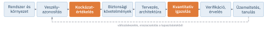
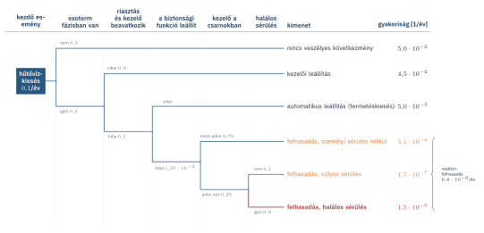
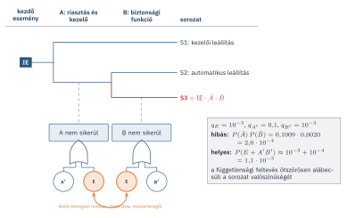
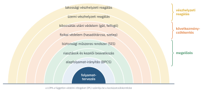
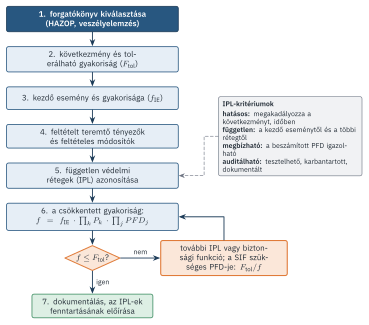
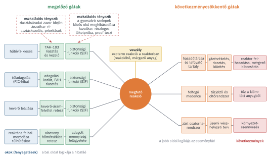

# Eseményfa, rétegzett védelem és csokornyakkendő-modell {#sec-esemenyfa}

{width=100%}

A hibafa egyetlen nemkívánatos esemény okait bontja le. A biztonsági elemzés másik fele a *következményeké*: ha a nemkívánatos esemény bekövetkezett, milyen kimenetekhez vezethet, és ezeket mely védelmek akadályozzák meg vagy enyhítik? Erre a kérdésre az eseményfa felel, amely egy kezdő eseményből kiindulva, a védelmek sikerén vagy kudarcán elágazva írja le a lehetséges eseménysorozatokat. A folyamatiparban az eseményfa egyszerűsített, félkvantitatív változata, a rétegzett védelem elemzése (LOPA) lett a biztonsági funkciók integritási követelményének meghatározására a legelterjedtebb módszer. A csokornyakkendő-modell pedig a hibafa és az eseményfa logikáját egyetlen, szemléletes képbe foglalja. A fejezet végén azt is áttekintjük, hogyan kapcsolódnak egymáshoz az eddig megismert modellek.

::: {.cel}
A fejezet végére képes leszel

- egy kezdő eseményhez eseményfát szerkeszteni, és kiszámolni a kimenetek gyakoriságát;
- felismerni és kezelni az eseményfa ágai közötti függőségeket, és az eseményfát hibafákkal összekapcsolni;
- LOPA-elemzést végezni: azonosítani a független védelmi rétegeket, és meghatározni egy biztonsági funkció szükséges PFD-jét és SIL-jét;
- csokornyakkendő-diagramot készíteni a megelőző és a következménycsökkentő gátakkal és az eszkalációs tényezőkkel;
- kiválasztani egy elemzési kérdéshez a megfelelő modellt (blokkdiagram, hibafa, eseményfa, csokornyakkendő, Markov-modell).
:::

## Az eseményfa {#sec-esemenyfa-alapok}

Az eseményfa-elemzés (*event tree analysis*, ETA) **induktív, előre haladó** módszer: egy **kezdő eseményből** (*initiating event*) indul, és időrendben végigköveti, hogy az egymást követő biztonsági funkciók, gátak vagy feltételek sikere vagy kudarca milyen **eseménysorozatokhoz** és **kimenetekhez** vezet. A módszer a nukleáris ipar 1975-ös reaktorbiztonsági tanulmányában (WASH-1400) vált a valószínűségi biztonsági elemzés alappillérévé, ahol a kezdő eseményekből kiinduló eseményfák ágaihoz a biztonsági rendszerek hibafái kapcsolódtak [@nrc1975]. Nemzetközi szabványa az IEC 62502 [@iec62502].

Az eseményfa szerkesztésének lépései [@iec62502; @rausand2020]:

1. **A kezdő esemény meghatározása:** egy olyan esemény, amely a védelmek közbelépése nélkül nemkívánatos következményhez vezetne (például hűtésvesztés, csőtörés, egy személy belépése a robot munkaterébe). A kezdő eseményeket a veszélyelemzés (HAZOP, FMEA) adja ([-@sec-veszelyazonositas]. fejezet); gyakoriságukat évenkénti előfordulásban adjuk meg.
2. **A biztonsági funkciók és feltételek azonosítása:** azok a gátak (automatikus védelmek, kezelői beavatkozás, passzív eszközök) és feltételek (például gyújtóforrás jelenléte, emberek jelenléte), amelyek befolyásolják a kimenetet. Ezek alkotják az eseményfa **fejléceit**, *időrendi sorrendben*.
3. **A fa felépítése:** minden fejlécnél két ág (siker és kudarc, vagy igen és nem); megállapodás szerint a felső ág a kedvező. Ha egy funkció kudarca után a további fejlécek már nem befolyásolják a kimenetet, az ág nem ágazik tovább.
4. **A kimenetek leírása és besorolása:** minden ág végén egy kimenet (például biztonságos leállás, termeléskiesés, kibocsátás, halálos sérülés).
5. **Számszerűsítés:** egy eseménysorozat gyakorisága a kezdő esemény gyakoriságának és az ágak *feltételes* valószínűségeinek szorzata,

$$
f_{\text{sorozat}} = f_{\mathrm{IE}} \cdot \prod_{k} P(\text{ág}_k \mid \text{az előző ágak}) .
$$ {#eq-esemenyfa}

6. **Értékelés:** a kimenetek gyakoriságának összevetése a kockázati kritériumokkal ([-@sec-kockazatertekeles]. fejezet), az azonos kimenetek gyakoriságának összegzése, és a domináns sorozatok azonosítása.

::: {.eset eset="A" title="ReaktorVéd: a hűtésvesztés eseményfája"}
A kezdő esemény a hűtővíz kiesése, évi $0{,}1$ gyakorisággal ([-@fig-esemenyfa-reaktorved]. ábra). Az első fejléc egy *feltétel*: az esetek felében a reaktor nem az exoterm fázisban van, ilyenkor a hűtés kiesése nem veszélyes. A második fejléc a magashőmérséklet-riasztás és a kezelői beavatkozás (a kezelő leállítja az adagolást és elindítja a tartalék hűtővízszivattyút), amely tíz esetből egyszer nem sikerül. A harmadik a biztonsági funkció, amelynek igénykori meghibásodási valószínűsége a [-@sec-sil]. fejezet szerint $1{,}37\cdot10^{-3}$. A hasadótárcsát (RD-101) ebben a változatban nem számítjuk be védelemként, mert a HAZOP szerint méretezése kétfázisú áramlásra nem igazolt ([-@sec-veszelyazonositas]. fejezet). Ha a biztonsági funkció is kudarcot vall, a reaktor felhasadhat; a következmény attól függ, tartózkodik-e kezelő a reaktorcsarnokban (az idő 25%-ában), és ha igen, a sérülés az esetek 90%-ában halálos.

{#fig-esemenyfa-reaktorved width=100%}

A reaktorfelhasadás gyakorisága $0{,}1 \cdot 0{,}5 \cdot 0{,}1 \cdot 1{,}37\cdot10^{-3} = 6{,}8\cdot10^{-6}$ évente, a halálos sérülésé $6{,}8\cdot10^{-6} \cdot 0{,}25 \cdot 0{,}9 = 1{,}5\cdot10^{-6}$ évente. Ezek az értékek szerepeltek a [-@sec-kockazatertekeles]. fejezet egyéni kockázati számításában ([-@tbl-irpa-pelda]. táblázat). Az eseményfa a gyakoribb, de kevésbé súlyos kimeneteket is megmutatja: az automatikus leállítás évi $5\cdot10^{-3}$ gyakorisága például a termelési veszteség és a biztonsági funkció igénygyakoriságának becsléséhez kell.
:::

### Függőségek az ágak között {#sec-esemenyfa-fuggoseg}

Az [-@eq-esemenyfa]. egyenletben a valószínűségek *feltételesek*. Ha a fejlécek egymástól függetlenek, a feltételes valószínűség egyszerűen a funkció saját meghibásodási valószínűsége. A valóságban azonban a fejlécek gyakran közös támogató rendszerekre épülnek (tápellátás, műszerlevegő, hűtés, közös érzékelő vagy közös szoftver), és ilyenkor a függetlenségi feltevés súlyos alábecsléshez vezet.

A helyes megoldás az, hogy minden fejléchez hibafát készítünk, és az eseménysorozat valószínűségét az *összekapcsolt* hibafák minimális vágataiból számoljuk ([-@fig-esemenyfa-hibafa-csatolas]. ábra). A nukleáris gyakorlatban ezt a megközelítést „kis eseményfa, nagy hibafa” néven ismerik: az eseményfa csak a fő funkciókat tartalmazza, a függőségeket pedig a hibafák közös alapeseményei hordozzák [@nrc1975; @rausand2020]. A másik lehetőség, a „nagy eseményfa, kis hibafa”, a támogató rendszereket külön fejlécekként veszi fel, és a további ágakat ezek állapotától függően számolja.

{#fig-esemenyfa-hibafa-csatolas width=92%}

A jelenség ugyanaz, amellyel a [-@sec-hibafa]. fejezetben a ReaktorVéd tápegységeinél találkoztunk: a redundancia csak annyit ér, amennyire a rétegek függetlenek. Ezért a rétegzett védelem elemzésének egyik legfontosabb követelménye a rétegek függetlenségének igazolása.

::: {.eset eset="C" title="KoboCella: eseményfa gyakori igény mellett"}
A kollaboratív robotcellában a kezdő esemény az, hogy a szerelő a robot gyors mozgása közben belép a közös munkatérbe. Ez műszakonként akár többször is megtörténik, ezért a kezdő esemény gyakorisága évente több száz vagy ezer is lehet. Az első fejléc a sebesség- és távolságfelügyelet (a lézerszkenner érzékeli a szerelőt, és a robot lelassít), a második az erő- és teljesítménykorlátozás (ha mégis ütközés történik, az erő az ISO/TS 15066 szerinti biomechanikai határérték alatt marad) [@isots15066]. A kimenetek: nincs érintkezés; érintkezés megengedett erővel; érintkezés nagy sebességgel (sérülés).

Az eseményfa logikája ugyanaz, mint a ReaktorVédnél, de a számok természete más. Ha a kezdő esemény évente ezerszer fordul elő, egy $10^{-3}$-as igénykori meghibásodási valószínűségű védelem évente egyszer hibázna. Ilyen gyakori igénynél a védelem **nagy igénybevételű** vagy **folyamatos üzemmódban** működik, és a mérvadó jellemző a veszélyes meghibásodás *gyakorisága* (PFH, óránként), nem az igénykori valószínűség ([-@sec-sil]. fejezet). A gépbiztonságban ezért a teljesítményszintet (PL) és a SIL-t is óránkénti meghibásodási gyakorisággal adják meg [@iso13849; @iec62061].
:::

## Rétegzett védelem elemzése (LOPA) {#sec-lopa}

A folyamatiparban a veszélyes forgatókönyveket több, egymástól független védelmi réteg óvja ([-@fig-vedelmi-retegek]. ábra). A legbelső réteg maga a folyamattervezés (az inherens biztonság), ezt követi az alapfolyamat-irányító rendszer (BPCS), a riasztások és a kezelői beavatkozás, a biztonsági műszeres rendszer (SIS), a fizikai védelmek (biztonsági szelep, hasadótárcsa), a kibocsátás utáni védelmek (gátak, felfogó medence), végül az üzemi és a lakossági vészhelyzeti reagálás [@iec61511; @ccps2001]. A rétegek a megelőzés, a következménycsökkentés és a vészhelyzeti reagálás három csoportjába sorolhatók, ami az energia–gát modell ([-@sec-energia-gat]. szakasz) és a Reason-féle svájcisajt-modell ([-@sec-balesetek]. fejezet) mérnöki megfelelője.

{#fig-vedelmi-retegek width=92%}

A **rétegzett védelem elemzése** (*layer of protection analysis*, LOPA) a CCPS 2001-es kézikönyvével vált általánossá [@ccps2001], és az IEC 61511-3 F melléklete a SIL-meghatározás egyik elfogadott módszereként ismerteti [@iec61511]. A LOPA lényegében egyetlen ágra szűkített, nagyságrendi becslésekkel dolgozó eseményfa: egy kezdő eseménytől egyetlen súlyos következményig követi a forgatókönyvet, és csak azt kérdezi, hogy a független védelmi rétegek együtt elegendő kockázatcsökkentést adnak-e. Félkvantitatív módszer: a számok nagyságrendi pontosságúak, de a következtetései ellenőrizhetők és következetesek, ami a kockázati mátrixokhoz képest nagy előny ([-@sec-kockazati-matrix]. szakasz).

A LOPA lépéseit a [-@fig-lopa-lepesek]. ábra foglalja össze. A forgatókönyvet rendszerint a HAZOP adja. A tolerálható gyakoriságot a vállalat kockázati kritériumai határozzák meg a következmény súlyossága szerint. A kezdő esemény gyakoriságát és a védelmi rétegek PFD-jét a vállalati vagy iparági táblázatokból veszik ([-@tbl-lopa-ertekek]. táblázat). A **feltételt teremtő tényezők** (*enabling conditions*) annak a valószínűségét adják meg, hogy a rendszer a veszélyes állapotban van (például a reaktor exoterm fázisban), a **feltételes módosítók** (*conditional modifiers*) pedig a következmény bekövetkezésének feltételeit (gyújtás valószínűsége, emberek jelenléte, halálos kimenetel valószínűsége) [@ccps2015].

{#fig-lopa-lepesek width=88%}

### Független védelmi rétegek {#sec-ipl}

A LOPA kulcsfogalma a **független védelmi réteg** (*independent protection layer*, IPL). Egy eszköz, rendszer vagy intézkedés csak akkor számít IPL-nek, ha négy feltételt teljesít [@ccps2001; @ccps2015]:

- **hatásos:** önmagában képes megakadályozni a vizsgált következményt, és elég gyorsan működik ahhoz, hogy a folyamat még a veszélyes állapot előtt megálljon;
- **független:** működése nem függ a kezdő eseménytől és a forgatókönyvben beszámított többi IPL-től (nincs közös érzékelő, logika, beavatkozó, tápellátás vagy közös emberi hibaforrás);
- **megbízható:** a beszámított PFD a tervezés, a tesztelés és a tapasztalat alapján igazolható;
- **auditálható:** rendszeresen tesztelik és karbantartják, és ez dokumentált.

A kezelői beavatkozás csak akkor IPL, ha a riasztás független a kezdő eseménytől, a kezelőnek elegendő ideje van (jellemzően legalább tíz perc) a felismerésre, a döntésre és a beavatkozásra, és a teendőt írásos utasítás rögzíti, amelyet rendszeresen gyakorolnak [@ccps2015]. Az IEC 61511 azt is kiköti, hogy a BPCS-nek beszámított kockázatcsökkentés legfeljebb tízszeres lehet, ha a BPCS nincs a funkcionális biztonsági szabványok szerint tervezve [@iec61511]. A puszta eljárások, a képzés és a felügyelet önmagukban nem IPL-ek; fontosak, de hatásuk nem számszerűsíthető úgy, mint egy fizikai rétegé.

| Kezdő esemény | Jellemző gyakoriság [1/év] |
|:--|--:|
| BPCS szabályozókör meghibásodása | $10^{-1}$ |
| hűtővíz kiesése | $10^{-1}$ |
| szivattyú tömítésének meghibásodása | $10^{-1}$–$10^{-2}$ |
| kezelői hiba rutinfeladatnál (alkalmanként) | $10^{-1}$–$10^{-3}$ |
| nyomástartó edény katasztrofális meghibásodása | $10^{-5}$–$10^{-7}$ |
| **Független védelmi réteg** | **Jellemző PFD** |
| BPCS szabályozókör (ha nem a kezdő esemény része) | $10^{-1}$ |
| riasztás és kezelői beavatkozás (legalább 10 perc) | $10^{-1}$ |
| biztonsági szelep, hasadótárcsa (megfelelő méretezéssel) | $10^{-2}$ |
| felfogó gát, felfogó medence | $10^{-2}$ |
| biztonsági funkció (SIL 1 / SIL 2 / SIL 3) | $10^{-1}$ / $10^{-2}$ / $10^{-3}$ |

: Jellemző LOPA-értékek a CCPS-irodalom nyomán; a vállalatok saját, igazolt értékeket használnak [@ccps2001; @ccps2015] {#tbl-lopa-ertekek}

::: {.eset eset="A" title="ReaktorVéd: LOPA és SIL-kiosztás"}
A [-@sec-kockazatertekeles]. fejezet becslését most a LOPA formájában rögzítjük ([-@tbl-lopa-reaktorved]. táblázat).

| LOPA-elem | Leírás | Érték |
|:--|:--|--:|
| következmény | megfutó reakció, a reaktor felhasadása, halálos sérülés lehetősége | – |
| tolerálható gyakoriság | vállalati kritérium halálos kimenetelű forgatókönyvre | $10^{-5}$/év |
| kezdő esemény | a hűtővíz kiesése (szivattyúleállás, áramszünet, beragadt szelep) | $0{,}1$/év |
| feltételt teremtő tényező | a reaktor exoterm fázisban van | $0{,}5$ |
| feltételes módosítók | nem alkalmazzuk (vállalati szabály) | 1 |
| IPL 1 | TAH-103 riasztás és kezelői beavatkozás (a felfutás legalább 20 perc) | $0{,}1$ |
| nem IPL | TIC-103 hőmérséklet-szabályozás: a kezdő esemény egyik oka | – |
| nem IPL | RD-101 hasadótárcsa: kétfázisú méretezése nem igazolt | – |
| csökkentett gyakoriság SIF nélkül | $0{,}1 \cdot 0{,}5 \cdot 0{,}1$ | $5\cdot10^{-3}$/év |
| **szükséges SIF** | $\text{PFD} \le 10^{-5}/(5\cdot10^{-3})$, $\text{RRF} \ge 500$ | **SIL 2** |

: A ReaktorVéd hűtésvesztési forgatókönyvének LOPA-táblázata {#tbl-lopa-reaktorved}

A TAH-103 riasztás ugyanannak a BPCS-nek a része, mint a TIC-103 szabályozás. Beszámítható, mert a forgatókönyv kezdő eseményei között a riasztás eszközei (a TT-103 távadó és a kijelzés) nem szerepelnek; a BPCS vezérlőjének meghibásodását a csapat külön forgatókönyvként vizsgálja. Ez a mérlegelés jellemző a LOPA-ra: a függetlenséget minden forgatókönyvnél újra kell igazolni.

A táblázat egyben a biztonsági követelményspecifikáció kiindulópontja: a biztonsági funkciónak SIL 2 szinten, de a tartomány szigorúbb felében, $\text{PFD} \le 2\cdot10^{-3}$ értékkel kell működnie. A [-@sec-sil]. fejezet ellenőrzi, hogy a tervezett architektúra ezt teljesíti-e.
:::

::: {.hiba title="A feltételes módosítók óvatos használata"}
Ha a ReaktorVéd-forgatókönyvben a kezelő jelenlétét (0,25) és a halálos kimenetelt (0,9) is beszámítanánk, a csökkentett gyakoriság $1{,}1\cdot10^{-3}$/év lenne, és a biztonsági funkcióra csak $\text{PFD} \le 8{,}9\cdot10^{-3}$ követelmény jutna. A SIL ugyan most is 2 maradna, de a követelmény négy és félszer enyhébb. A tartózkodási valószínűségek nehezen ellenőrizhetők és könnyen változnak (például egy indítás vagy egy karbantartás idején sokkal többen vannak a csarnokban), ezért sok vállalat nem engedi a feltételes módosítók használatát, vagy csak szigorú feltételekkel [@ccps2015]. Ugyanígy tilos ugyanazt a hatást kétszer beszámítani: ha a tolerálható gyakoriság már egy halálos kimenetelre vonatkozik, a halálos kimenetel valószínűségét nem szabad ismét szorzóként alkalmazni, ha pedig a forgatókönyvre, akkor éppen fordítva.
:::

::: {.kitekintes title="Buncefield LOPA-szemmel"}
Az [-@sec-balesetek]. fejezetben bemutatott 2005-ös Buncefield-balesetben egy benzintartály túltöltését két, egymástól függetlennek tekintett réteg sem akadályozta meg. A tartály automatikus szintmérője az éjszaka folyamán beragadt (a vizsgálat szerint korábban is többször előfordult ilyen), a túltöltés elleni független szintkapcsoló pedig azért nem működött, mert a próbakarját működő helyzetben rögzítő lakatot nem szerelték fel; ennek szükségességét a gyártó nem közölte egyértelműen sem a telepítővel és a karbantartóval, sem az üzemeltetővel [@buncefield2008].

LOPA-szemmel mindkét hiba *rejtett* volt, és mindkettő az auditálhatóság követelményét sértette. A szintmérő ismétlődő beragadása nem vezetett a hiba okának feltárásához, a szintkapcsoló működésképtelenségét pedig éppen a tesztelési szerkezet hiányos ismerete okozta. A tanulság: egy réteg csak akkor ér annyit, amennyit beszámítunk, ha a tesztelése valóban feltárja a rejtett hibáit, és a karbantartás nem teremt közös hibaforrást. A vizsgálóbizottság ajánlásai nyomán a tárolótartályok túltöltés elleni védelmét a funkcionális biztonsági szabványok szerint kell tervezni és igazolni [@buncefield2008].
:::

### A LOPA erősségei és korlátai {#sec-lopa-korlatai}

A LOPA egyszerű, gyors, és a HAZOP eredményeire közvetlenül építhető; következetesebb, mint a kockázati gráf vagy a kalibrálatlan kockázati mátrix; a független védelmi rétegek kritériumai pedig rákényszerítik a csapatot, hogy minden beszámított védelmet kritikusan vizsgáljon meg. Korlátai abból fakadnak, hogy egyszerűsítés: forgatókönyvenként egyetlen kezdő eseményt és egyetlen következményt vizsgál; a táblázatos értékek nagyságrendi pontosságúak; a rétegek közötti finomabb függőségeket és a közös okú meghibásodásokat nem modellezi; és ha ugyanaz a védelem sok forgatókönyvben szerepel, a teljes kockázat összegzése külön feladat. Ha a LOPA határesetet ad, vagy a forgatókönyv bonyolult, részletes eseményfa- és hibafa-elemzés szükséges [@ccps2001; @ccps2015].

## A csokornyakkendő-modell {#sec-csokornyakkendo}

A **csokornyakkendő-diagram** (*bow-tie*) egyetlen ábrán mutatja meg egy nemkívánatos esemény okait, következményeit és az ezek közé épített gátakat ([-@fig-csokornyakkendo-reaktorved]. ábra). A módszer a vegyiparban jelent meg az 1970-es évek végén, és az 1990-es évektől az olaj- és gázipar, majd a légi közlekedés és az egészségügy is átvette [@ccps2018]. A diagram középpontjában a **csúcsesemény** áll: az a pillanat, amikor a veszély feletti uralom elvész (például „megfutó reakció”, „a jármű elhagyja a sávját”). Fölötte a **veszély**, a kár forrása ([-@sec-fogalmak]. fejezet). Bal oldalon az **okok** (fenyegetések), jobb oldalon a **következmények** láthatók. Az okok és a csúcsesemény közé a **megelőző gátak**, a csúcsesemény és a következmények közé a **következménycsökkentő gátak** kerülnek. Az **eszkalációs tényezők** (*escalation factors*) azok a körülmények, amelyek egy gátat gyengítenek vagy hatástalanná tesznek; ezek ellen további intézkedések védenek.

{#fig-csokornyakkendo-reaktorved width=100%}

A diagram bal oldala logikailag egy hibafa, amelynek csúcsa alatt VAGY-kapu áll (bármelyik ok elég), és minden ok alatt ÉS-kapu (az oknak és az összes gátjának kudarca együtt szükséges). A jobb oldal logikailag egy eseményfa, amelynek fejlécei a következménycsökkentő gátak. A csokornyakkendő tehát nem új matematikai modell, hanem a két meglévő szemléletes, *kommunikációs* összekapcsolása. Ebben rejlik az ereje és a korlátja is: a vezetők, a kezelők és a karbantartók számára érthető, megmutatja, melyik gát melyik veszély ellen véd, és mire kell a karbantartásnak, a képzésnek és az ellenőrzésnek figyelnie. A számszerű kockázatot viszont csak akkor adja meg, ha a két oldalt valódi hibafává és eseményfává alakítjuk.

A jó csokornyakkendő-diagram néhány szabálya [@ccps2018]:

- A **gát** teljes, önállóan hatásos védelem. Egy aktív gát három elemből áll: érzékel, dönt és beavatkozik (például távadó, logika és szelep); ha ezek bármelyike hiányzik, nem gát, hanem egy gát része.
- A **tevékenységek** (képzés, karbantartás, eljárások) nem gátak; ezek a gátak fenntartását szolgálják, és az eszkalációs tényezők kezeléseként jelennek meg.
- Minden oknak legyen legalább egy, de lehetőleg több független gátja, és a gátak legyenek függetlenek az októl és egymástól.
- Ha ugyanaz a gát több ok ellen is véd (a ReaktorVéd biztonsági funkciója három ok ellen), annak kudarca több utat is megnyit; az ilyen gátak különös figyelmet érdemelnek.

A csokornyakkendő-diagram a **gátak állapotának nyomon követésére** is alkalmas. Ha minden gáthoz teljesítménymutatót rendelünk (tesztelési lefedettség, elmaradt karbantartások, kiiktatások ideje), a diagram a működő üzem kockázatának élő térképévé válik. Ezt a gondolatot a biztonsági érvelés ([-@sec-biztonsagi-erveles]. fejezet) általánosítja.

## A modellek kapcsolata és választása {#sec-modellek-kapcsolata}

Az eddigi fejezetek öt logikai modellt mutattak be. Ezek nem versenytársai, hanem különböző nézőpontjai ugyanannak a rendszernek ([-@tbl-modellek]. táblázat).

| Modell | Irány | Fő kérdés | Erőssége | Korlátja |
|:--|:--|:--|:--|:--|
| megbízhatósági blokkdiagram | a működés útjai | mikor működik a funkció? | szemléletes, gyors | függetlenség, statikus |
| hibafa | deduktív, okok felé | mi okozza a csúcseseményt? | kombinációk, közös okok | egy csúcsesemény, statikus |
| eseményfa | induktív, következmények felé | mi lesz a kezdő esemény után? | időrend, kimenetek | ágak közti függőségek |
| csokornyakkendő | okok és következmények | mely gátak védenek? | kommunikáció, gátkezelés | önmagában nem kvantitatív |
| Markov-modell | állapotok és átmenetek | hogyan változik a rendszer időben? | javítás, sorrend, tesztelés | állapotrobbanás |

: Az elemzési modellek összevetése {#tbl-modellek}

A modellek egymásba alakíthatók. A blokkdiagram soros kapcsolata a hibafában VAGY-kapu, a párhuzamos kapcsolata ÉS-kapu (a meghibásodások szintjén), a hibafa minimális útjai pedig a blokkdiagram útjai ([-@sec-sikerfa]. szakasz). Az eseményfa minden eseménysorozata egy hibafa csúcseseményeként írható fel: a kezdő esemény és a kudarcot vallott fejlécek hibafáinak ÉS-kapcsolata. A csokornyakkendő bal oldala hibafa, jobb oldala eseményfa. A sorrendfüggő, javítható vagy időben változó viselkedés ott kezdődik, ahol a statikus logikai modellek véget érnek; ezt a [-@sec-markov]. fejezet Markov-modelljei írják le.

A gyakorlati választás a kérdéstől függ. A tervezés korai szakaszában, a koncepciók összevetésére a blokkdiagram a leggyorsabb. Egy súlyos csúcsesemény okainak mélyreható feltárására és a biztonsági funkciók igazolására a hibafa a megfelelő. A forgatókönyvek kimeneteinek és gyakoriságainak meghatározására az eseményfa, a SIL-kiosztásra a LOPA, a vezetőkkel és a kezelőkkel való kommunikációra és a gátak üzemeltetés közbeni követésére a csokornyakkendő. A teljes kép sokszor csak a modellek együttes használatával áll össze.

::: {.labor}
A gyakorlati útmutató 9. laborjában egy böngészős eseményfa- és LOPA-alkalmazással elemezheted a ReaktorVéd forgatókönyveit: a kezdő esemény, a feltételek és a független védelmi rétegek változtatásával azonnal látod a kimenetek gyakoriságát és a biztonsági funkció szükséges SIL-jét. Az alkalmazás figyelmeztet, ha egy védelmet a függetlenségi kritériumok sérülése miatt nem lehet beszámítani.
:::

::: {.osszefoglalo}
- Az eseményfa induktív módszer: egy kezdő eseménytől, a védelmek sikerén és kudarcán elágazva, időrendben követi az eseménysorozatokat; egy sorozat gyakorisága a kezdő esemény gyakoriságának és a feltételes valószínűségeknek a szorzata.
- Az ágak közötti függőségeket (közös támogató rendszerek) a fejlécekhez kapcsolt hibafákkal kell kezelni; a függetlenségi feltevés nagyságrendi alábecsléshez vezethet.
- A LOPA egyetlen ágra szűkített, nagyságrendi eseményfa; a független védelmi rétegek (hatásos, független, megbízható, auditálható) kockázatcsökkentését veti össze a tolerálható gyakorisággal, és ebből adja a biztonsági funkció szükséges SIL-jét.
- A feltételes módosítókat óvatosan kell használni, és egyetlen hatás sem számítható be kétszer.
- A csokornyakkendő-diagram egy nemkívánatos esemény okait, következményeit, megelőző és következménycsökkentő gátait, valamint az eszkalációs tényezőket mutatja; bal oldala hibafa, jobb oldala eseményfa.
- A blokkdiagram, a hibafa, az eseményfa, a csokornyakkendő és a Markov-modell ugyanannak a rendszernek különböző nézetei, és egymásba alakíthatók.
:::

::: {.onell}
1. Egy éghető folyadék szivárgásának gyakorisága évi $10^{-2}$. Azonnali gyújtás valószínűsége 0,1; késleltetett gyújtásé (ha nincs azonnali) 0,3. Rajzold fel az eseményfát, és számold ki a jet tűz (azonnali gyújtás), a gőzfelhő-robbanás (késleltetett gyújtás) és a gyújtás nélküli kibocsátás gyakoriságát!
2. Miért nem számítható be független védelmi rétegként a BPCS szabályozókör, ha a kezdő esemény éppen ennek a körnek a meghibásodása?
3. Tegyük fel, hogy a ReaktorVéd hasadótárcsájának kétfázisú méretezését igazolták, és a tárcsa $\text{PFD} = 10^{-2}$ független védelmi rétegként beszámítható. Mekkora PFD-t kell ekkor teljesítenie a biztonsági funkciónak? Szükség van-e egyáltalán SIL-besorolású funkcióra?
4. Mi a különbség a gát és a tevékenység között a csokornyakkendő-diagramon? Hova kerül a „kezelők képzése”?
5. Két fejléc közös tápellátásra épül. A tápellátás kiesésének valószínűsége $10^{-3}$, a fejlécek egyéb okú meghibásodásáé $10^{-2}$ és $10^{-2}$. Mekkora a két fejléc együttes kudarcának valószínűsége? Mekkora lenne a függetlenségi feltevéssel?

::: {.megoldas}
1. Jet tűz: $10^{-2}\cdot 0{,}1 = 10^{-3}$/év. Késleltetett gyújtás: $10^{-2}\cdot 0{,}9 \cdot 0{,}3 = 2{,}7\cdot10^{-3}$/év. Gyújtás nélküli kibocsátás: $10^{-2}\cdot 0{,}9 \cdot 0{,}7 = 6{,}3\cdot10^{-3}$/év. Ellenőrzés: a három összege $10^{-2}$.
2. Mert nem független a kezdő eseménytől: ha a szabályozókör meghibásodott, ugyanaz a kör nem védhet a meghibásodása következményei ellen. Csak egy másik, független érzékelővel, logikával és beavatkozóval rendelkező kör lehet IPL.
3. A csökkentett gyakoriság SIF nélkül $5\cdot10^{-3}\cdot 10^{-2} = 5\cdot10^{-5}$/év, a szükséges $\text{PFD} \le 10^{-5}/(5\cdot10^{-5}) = 0{,}2$, $\text{RRF} \ge 5$. Ez a SIL 1 tartományánál ($\text{PFD} < 10^{-1}$) is enyhébb, így SIL-besorolású funkció nem feltétlenül szükséges; a kockázatcsökkentés azonban ekkor a hasadótárcsán és a lefúvató rendszeren múlik, amelynek méretezését, karbantartását és tesztelését szigorúan kell kezelni. A döntésnél azt is mérlegelni kell, hogy a hasadótárcsa a mérgező anyagot a lefúvató rendszerbe engedi, tehát a következmény más, de nem feltétlenül elhanyagolható.
4. A gát önállóan hatásos védelem (érzékel, dönt, beavatkozik), a tevékenység a gát fenntartását szolgálja, de önmagában nem állítja meg az eseménysort. A kezelők képzése tevékenység: az eszkalációs tényezők kezelései között jelenik meg (például a „riasztásáradat” eszkalációs tényező kezeléseként a kezelői gát mellett).
5. Közös táppal: $P \approx 10^{-3} + 10^{-2}\cdot10^{-2} = 1{,}1\cdot10^{-3}$. Függetlenséggel: $(1{,}1\cdot10^{-2})^2 \approx 1{,}2\cdot10^{-4}$, ami majdnem egy nagyságrenddel kisebb.
:::
:::

::: {.forras}
- Center for Chemical Process Safety (2001): *Layer of Protection Analysis: Simplified Process Risk Assessment.* AIChE – a LOPA alapműve [@ccps2001].
- Center for Chemical Process Safety (2015): *Guidelines for Initiating Events and Independent Protection Layers in Layer of Protection Analysis.* AIChE–Wiley [@ccps2015].
- CCPS – Energy Institute (2018): *Bow Ties in Risk Management: A Concept Book for Process Safety.* AIChE–Wiley [@ccps2018].
- IEC 62502:2010 – az eseményfa-elemzés szabványa [@iec62502]; IEC 61511-3:2016 – a SIL-meghatározás módszerei, köztük a LOPA [@iec61511].
- Rausand, M. (2020): *System Reliability Theory*, 4. fejezet – eseményfák és a modellek kapcsolata [@rausand2020].
:::
