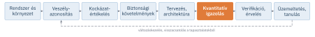
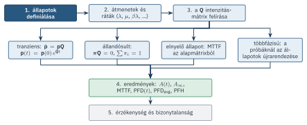
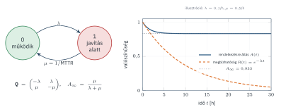
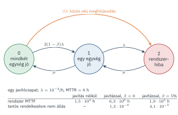
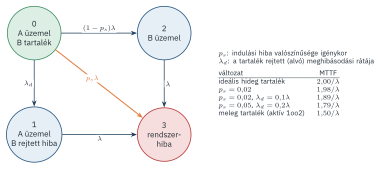

# Markov-modellek és rendelkezésre állás {#sec-markov}

{width=100%}

A blokkdiagram és a hibafa statikus modellek: azt írják le, *mely* meghibásodás-kombinációk okoznak bajt, de azt nem, hogy *mikor* és *milyen sorrendben*. Sok fontos kérdésre így nem adnak választ. Mekkora egy javítható rendszer rendelkezésre állása? Mennyit ér, ha a redundáns egység meghibásodása után gyorsan javítunk? Mennyire rontja a hideg tartalék előnyét az indulási hiba? Hogyan alakul egy rejtett hibákra hajlamos védelem meghibásodási valószínűsége a próbák között, és mi történik, ha a próba nem fedi fel az összes hibát? Ezekre a kérdésekre a Markov-modellek felelnek. Ebben a fejezetben megismerjük a folytonos idejű Markov-láncok alapjait, a rendelkezésre állás fogalmait, a javítható és a tartalékolt rendszerek modelljeit, végül a biztonsági rendszerek periodikus tesztelésének leírására szolgáló többfázisú Markov-modelleket.

::: {.cel}
A fejezet végére képes leszel

- egy rendszer viselkedését állapotokkal és átmeneti rátákkal leírni, és felírni az intenzitásmátrixot;
- kiszámolni egy javítható rendszer pillanatnyi és tartós rendelkezésre állását, valamint az átlagos meghibásodásig eltelt időt;
- Markov-modellel értékelni a javítás, a közös okú meghibásodás, az indulási hiba és a rejtett tartalékhiba hatását;
- periodikusan tesztelt biztonsági rendszerek PFD-jét többfázisú Markov-modellel számolni, és értelmezni a nem tökéletes proof teszt hatását;
- felismerni a Markov-modellek korlátait, és tudni, mikor van szükség szimulációra vagy más modellre.
:::

## Miért van szükség Markov-modellekre? {#sec-markov-miert}

A statikus logikai modellek három feltevésre épülnek: az elemek két állapotúak, egymástól függetlenek, és a meghibásodások sorrendje nem számít ([-@sec-rbd]. fejezet). A valódi rendszerekben ezek a feltevések gyakran sérülnek:

- **Javítás:** a meghibásodott elemet javítják, és a rendszer visszatér a működő állapotba. A rendszer állapota ilyenkor időben ide-oda vált.
- **Sorrend:** a hideg tartalék csak a fő egység kiesése után indul; egy átkapcsoló hibája csak akkor számít, ha a fő egység előtt következik be.
- **Állapotfüggő igénybevétel:** ha egy kétcsatornás rendszer egyik csatornája kiesik, a másikra nagyobb terhelés jut, és nagyobb rátával hibásodhat meg.
- **Tesztelés:** a rejtett hibák csak a próbák időpontjaiban derülnek ki, így a rendszer állapota a próbák ütemében változik.

A Markov-modell ezeket közvetlenül ábrázolja. A rendszer lehetséges állapotait csomópontok, az állapotok közötti átmeneteket pedig rátákkal címkézett nyilak jelölik. A Markov-modelleket az IEC 61165 szabványosítja [@iec61165], és az IEC 61508-6 a biztonsági funkciók PFD- és PFH-értékének számítására is elfogadott módszerként ismerteti [@iec61508].

## A folytonos idejű Markov-lánc {#sec-markov-lanc}

A rendszer állapotát egy $X(t)$ valószínűségi változó írja le, amely véges sok érték valamelyikét veszi fel. A **Markov-tulajdonság** szerint a jövőbeli viselkedés csak a jelenlegi állapottól függ, attól nem, hogyan jutott a rendszer ide:

$$
P\bigl(X(t+s) = j \mid X(t) = i,\; X(u),\, u < t\bigr) = P\bigl(X(t+s) = j \mid X(t) = i\bigr) .
$$ {#eq-markov-tulajdonsag}

Ha az átmeneti valószínűségek az időben nem változnak (**homogén** lánc), minden állapotban az ott töltött idő exponenciális eloszlású, és az $i$ állapotból a $j$ állapotba vezető átmenetet egy állandó $q_{ij}$ ráta jellemzi. Ez az exponenciális élettartam-modell ([-@sec-megbizhatosag]. fejezet) természetes kiterjesztése: az emlékezetnélküliség az élettartamok, a Markov-tulajdonság a rendszerállapotok szintjén ugyanazt jelenti. A rátákból alkotott mátrix az **intenzitásmátrix** (generátormátrix) $\mathbf{Q}$: főátlón kívüli elemei az átmeneti ráták, főátlójában pedig $q_{ii} = -\sum_{j \ne i} q_{ij}$ áll, így minden sor összege nulla.

Az állapotvalószínűségek $\mathbf{p}(t) = [p_0(t), p_1(t), \dots]$ sorvektorára a **Kolmogorov-egyenletek** érvényesek:

$$
\frac{d\mathbf{p}(t)}{dt} = \mathbf{p}(t)\,\mathbf{Q}, \qquad \mathbf{p}(t) = \mathbf{p}(0)\,e^{\mathbf{Q}t} .
$$ {#eq-kolmogorov}

Három kérdéstípusra szokás választ keresni ([-@fig-markov-lepesek]. ábra):

- **tranziens viselkedés:** az állapotvalószínűségek időfüggése, például a rendelkezésre állás $A(t)$ vagy a meghibásodási valószínűség $\text{PFD}(t)$;
- **tartós (állandósult) viselkedés:** hosszú idő után az állapotvalószínűségek egy $\boldsymbol{\pi}$ határeloszláshoz tartanak, amely a $\boldsymbol{\pi}\mathbf{Q} = \mathbf{0}$, $\sum_i \pi_i = 1$ lineáris egyenletrendszer megoldása;
- **első elérési idő:** ha a rendszerhiba állapotából nincs visszaút (**elnyelő állapot**), az odáig eltelt idő várható értéke a rendszer MTTF-je. Ha $\mathbf{Q}_T$ a nem elnyelő állapotokra szűkített mátrix, az $\mathbf{N} = -\mathbf{Q}_T^{-1}$ **alapmátrix** $(i,j)$ eleme a $j$ állapotban töltött várható idő az $i$ állapotból indulva, így az MTTF az $\mathbf{N}$ kezdőállapothoz tartozó sorának összege.

{#fig-markov-lepesek width=100%}

## A rendelkezésre állás {#sec-rendelkezesre-allas}

A javítható rendszerek legfontosabb jellemzője a **rendelkezésre állás** (*availability*): annak képessége, hogy a rendszer adott időpontban vagy időtartam alatt el tudja látni a funkcióját, feltéve, hogy a szükséges külső erőforrások rendelkezésre állnak [@iec60050]. Három változatát különböztetjük meg:

- **pillanatnyi rendelkezésre állás** $A(t)$: annak valószínűsége, hogy a rendszer a $t$ időpontban működőképes;
- **átlagos rendelkezésre állás** egy $[0, T]$ időszakra: $\bar{A}(T) = \frac{1}{T}\int_0^T A(t)\,dt$, a működőképes idő várható aránya;
- **tartós rendelkezésre állás** $A_\infty = \lim_{t\to\infty} A(t)$.

A rendelkezésre állás nem azonos a megbízhatósággal. A megbízhatóság $R(t)$ annak valószínűsége, hogy a rendszer $[0,t]$ alatt *egyszer sem* hibásodik meg; a rendelkezésre állás megengedi, hogy közben meghibásodjon és megjavítsák. Ezért mindig $A(t) \ge R(t)$. A rendelkezésre nem állás $U = 1 - A$ gyakran szemléletesebb: évi állásidőként (órában) is kifejezhető.

A gyakorlatban a javítási idő összetevői is számítanak. A **belső** (*inherent*) rendelkezésre állás csak a tényleges javítási időt veszi figyelembe; az **üzemi** (*operational*) rendelkezésre állás a hiba felismerésének, a szakember kiérkezésének, az alkatrész beszerzésének és az adminisztrációnak az idejét is [@rausand2020]. Egy biztonsági rendszer PFD-számításánál az MTTR-be mindezt bele kell érteni, ameddig a biztonsági funkció nem áll rendelkezésre.

### Egyetlen javítható elem {#sec-ket-allapot}

A legegyszerűbb Markov-modellnek két állapota van: a 0 állapotban az elem működik, az 1 állapotban javítják ([-@fig-markov-ket-allapot]. ábra). A meghibásodási ráta $\lambda$, a javítási ráta $\mu = 1/\text{MTTR}$. A Kolmogorov-egyenletek megoldása $p_0(0) = 1$ kezdőfeltétellel

$$
A(t) = \frac{\mu}{\lambda + \mu} + \frac{\lambda}{\lambda + \mu}\, e^{-(\lambda + \mu)t}, \qquad
A_\infty = \frac{\mu}{\lambda + \mu} = \frac{\text{MTTF}}{\text{MTTF} + \text{MTTR}} .
$$ {#eq-ket-allapot}

A rendelkezésre állás exponenciálisan, $1/(\lambda+\mu)$ időállandóval áll be a tartós értékére. Mivel a javítás általában sokkal gyorsabb a meghibásodásnál ($\mu \gg \lambda$), ez az időállandó közel az MTTR, vagyis a tartós állapot gyorsan beáll. Kis $\lambda\,\text{MTTR}$ szorzatnál a rendelkezésre nem állás $U_\infty \approx \lambda\,\text{MTTR}$. A $\text{MTBF} = \text{MTTF} + \text{MTTR}$ a két egymást követő meghibásodás közötti átlagos idő.

{#fig-markov-ket-allapot width=100%}

::: {.pelda title="Egy szivattyú rendelkezésre állása"}
Egy hűtővízszivattyú meghibásodási rátája $\lambda = 10^{-4}\,\text{h}^{-1}$ (MTTF = 10 000 óra), az átlagos javítási idő 8 óra. A tartós rendelkezésre állás $A_\infty = 0{,}125/(0{,}125 + 0{,}0001) = 0{,}99920$, a rendelkezésre nem állás $U_\infty = 7{,}99\cdot10^{-4}$, alig kevesebb, mint a $\lambda\,\text{MTTR} = 8\cdot10^{-4}$ közelítés. Az évi átlagos állásidő $7{,}99\cdot10^{-4}\cdot 8760 \approx 7$ óra. Az időállandó $1/(\lambda + \mu) \approx 8$ óra, tehát a tartós érték egy-két nap alatt beáll.
:::

## Redundáns, javítható rendszerek {#sec-markov-redundancia}

Két azonos, párhuzamosan működő egység (1oo2) Markov-modelljének három állapota van: mindkét egység jó, egy egység jó, a rendszer meghibásodott ([-@fig-markov-1oo2]. ábra). Egy javítócsapat esetén a 0 állapotból $2\lambda$ rátával jutunk az 1 állapotba, onnan $\lambda$ rátával a rendszerhibába, a javítás pedig mindkét lépést $\mu$ rátával fordítja vissza. A közös okú meghibásodást a β-tényezős modell ([-@sec-ccf-hibafa]. szakasz) szerint egy közvetlen, $\beta\lambda$ rátájú átmenet írja le a 0 állapotból a rendszerhibába; ilyenkor a független meghibásodás rátája $2(1-\beta)\lambda$.

{#fig-markov-1oo2 width=88%}

Ha a 2 állapotot elnyelőnek tekintjük, az alapmátrixból a rendszer MTTF-je $\beta = 0$ esetén

$$
\text{MTTF}_{1\text{oo}2} = \frac{3\lambda + \mu}{2\lambda^2} .
$$ {#eq-mttf-1oo2-javitas}

Javítás nélkül ($\mu = 0$) ez a [-@sec-rbd]. fejezetből ismert $1{,}5/\lambda$, javítással viszont nagyságrendekkel nagyobb lehet. A szivattyú adataival ($\lambda = 10^{-4}\,\text{h}^{-1}$, $\text{MTTR} = 8$ óra) a két szivattyúból álló rendszer MTTF-je javítás nélkül 15 000 óra, javítással $6{,}3\cdot10^{6}$ óra, azaz több mint hétszáz év. A redundancia igazi ereje tehát a *gyors javításban* rejlik: a rendszer csak akkor hibásodik meg, ha a második egység éppen a javítás néhány órája alatt esik ki.

A közös okú meghibásodás ezt az előnyt drámaian csökkenti. Már $\beta = 5\%$ mellett is az MTTF $1{,}9\cdot10^{5}$ órára (22 év) esik, harmincketted részére, a tartós rendelkezésre nem állás pedig $1{,}3\cdot10^{-6}$-ról $4{,}1\cdot10^{-5}$-re nő. A magyarázat egyszerű: a független kettős meghibásodás rátája körülbelül $2\lambda^2\,\text{MTTR} = 1{,}6\cdot10^{-7}\,\text{h}^{-1}$, a közös okúé $\beta\lambda = 5\cdot10^{-6}\,\text{h}^{-1}$, harmincszor nagyobb. A javítható redundáns rendszerekben a közös okú meghibásodás szinte mindig uralja a rendszerhibát.

::: {.kitekintes title="Egy vagy két javítócsapat?"}
A modell azt is megmutatja, mennyit ér egy második javítócsapat. Ha a rendszerhiba állapotában két csapat egyszerre javít, a 2 állapotból az 1 állapotba $2\mu$ rátával lehet visszajutni. Ez a tartós rendelkezésre nem állást felére csökkenti, az MTTF-et viszont nem változtatja, mert az MTTF az első rendszerhibáig tart. A rendelkezésre állás és a megbízhatóság tehát különböző intézkedésekre érzékeny, és a kérdés megfogalmazásától függ, melyik a mérvadó.
:::

### A hideg tartalék valósághű modellje {#sec-markov-tartalek}

A [-@sec-tartalekolas]. szakasz szerint az ideális hideg tartalék MTTF-je $2/\lambda$, jobb, mint a melegé ($1{,}5/\lambda$). A valóságban azonban a tartalék a bekapcsoláskor nem mindig indul el, és a várakozás alatt is meghibásodhat úgy, hogy ez csak az igénykor derül ki. A [-@fig-markov-hideg-tartalek]. ábra Markov-modellje mindkét hatást tartalmazza: a $p_s$ indulási hiba közvetlenül a rendszerhibába vezet, a $\lambda_d$ alvó (rejtett) meghibásodás pedig egy olyan állapotba, amelyben a fő egység még működik, de már nincs mögötte tartalék.

{#fig-markov-hideg-tartalek width=100%}

Két százalékos indulási hiba alig csökkenti az MTTF-et ($1{,}98/\lambda$), de ha a tartalék a várakozás alatt a fő egység rátájának tizedével hibásodik meg, az MTTF már $1{,}89/\lambda$, öt százalék indulási hibával és ötödnyi alvó rátával pedig $1{,}79/\lambda$. A hideg tartalék előnye a melegével szemben így a felére olvad. Ha a tartalékot rendszeresen kipróbálják, a rejtett hibák időben kiderülnek; ennek modellezésére szolgálnak a következő szakasz többfázisú modelljei.

## Biztonsági rendszerek: rejtett hibák és periodikus tesztelés {#sec-markov-teszteles}

A biztonsági rendszerek nagy része nyugalmi állapotban van, és csak igénykor kell működnie. Veszélyes meghibásodásaik egy része a diagnosztika révén azonnal kiderül (DD), más része rejtve marad (DU), amíg egy **proof teszt** vagy egy valódi igény fel nem fedi ([-@sec-fmeda]. szakasz). A rendszer állapota így két különböző időskálán változik: a meghibásodások folytonos időben, véletlenszerűen következnek be, a próbák viszont rögzített időpontokban, determinisztikusan történnek.

Ezt a **többfázisú Markov-modell** írja le. A próbák közötti szakaszban a rendszer egy közönséges Markov-láncként fejlődik, amelyben a DU-állapotokból nincs javítás. A próba pillanatában egy átrendezési mátrix a rejtett hibás állapotokat a javítás alatti vagy a hibátlan állapotba képezi le, és a következő szakasz ebből az eloszlásból indul. A $\text{PFD}(t)$ a veszélyes állapotok valószínűségeinek összege; jellegzetes **fűrészfog** alakú görbe, amely minden próba után nullára (vagy közel nullára) esik vissza, és a következő próbáig nő. A biztonsági funkció jellemzője ennek időátlaga, a $\text{PFD}_{\text{avg}}$ [@rausand2014; @iec61508].

::: {.eset eset="A" title="ReaktorVéd: a gyorszáró szelepek többfázisú Markov-modellje"}
A két gyorszáró szelep (1oo2, $\lambda_{DU} = 2{,}5\cdot10^{-6}\,\text{h}^{-1}$, $\beta = 10\%$, évenkénti proof teszt) három állapottal írható le: mindkét szelep jó; egy szelep rejtett hibás; mindkettő hibás (veszélyes). A 0 állapotból $2(1-\beta)\lambda_{DU}$ rátával jutunk az 1-be és $\beta\lambda_{DU}$ rátával a 2-be, az 1-ből $\lambda_{DU}$ rátával a 2-be. A próba a rendszert visszaállítja a 0 állapotba.

A Markov-modellből a $\text{PFD}(t)$ a próba előtti pillanatban $2{,}57\cdot10^{-3}$-ig nő, az időátlaga $1{,}22\cdot10^{-3}$. Az IEC 61508-6 egyszerűsített képletei ([-@sec-sil]. fejezet) $1{,}23\cdot10^{-3}$ értéket adnak; a különbség fél százalék alatti, és a képlet a biztonságos oldalon van. A Markov-modell előnye nem ebben az egyszerű esetben mutatkozik meg, hanem ott, ahol a képletek feltevései sérülnek: eltolt idejű próbák, nem tökéletes próba, a próba alatti kiiktatás, állapotfüggő javítás vagy több, egymástól függő alrendszer esetén.
:::

### A nem tökéletes proof teszt {#sec-nem-tokeletes-teszt}

A proof teszt ritkán fed fel minden rejtett hibát. Egy gyorszáró szelep éves próbája például ellenőrizheti, hogy a szelep zár-e, de azt nem feltétlenül, hogy a zárás a valódi üzemi nyomáskülönbség mellett is tömör-e. A próba **lefedettsége** (*proof test coverage*, PTC) a rejtett veszélyes meghibásodások azon hányada, amelyet a próba felfed. A fel nem fedett hibák csak egy alaposabb vizsgálatnál, például a $T_M$ időközű nagyjavításnál vagy cserénél derülnek ki. Az átlagos PFD egycsatornás elemre ekkor közelítőleg

$$
\text{PFD}_{\text{avg}} \approx \text{PTC}\cdot\lambda_{DU}\left(\frac{T_1}{2} + \text{MTTR}\right) + (1 - \text{PTC})\cdot\lambda_{DU}\,\frac{T_M}{2} .
$$ {#eq-ptc}

A második tag a nem tesztelt hibák „lassan halmozódó” hozzájárulása, amely a hosszú $T_M$ miatt már kis $1 - \text{PTC}$ mellett is jelentős lehet [@rausand2014; @iec61508].

{#fig-pfd-fureszfog width=100%}

A ReaktorVéd egycsatornás szelepére ($\lambda_{DU} = 2{,}5\cdot10^{-6}\,\text{h}^{-1}$, $T_1 = 1$ év, $T_M = 10$ év) a tökéletes próba mellett $\text{PFD}_{\text{avg}} = 1{,}10\cdot10^{-2}$, 90%-os lefedettség mellett $2{,}08\cdot10^{-2}$, 70%-os mellett $4{,}05\cdot10^{-2}$ ([-@fig-pfd-fureszfog]. ábra). Egy látszólag apró részlet, a próba módja, tehát akár négyszeresére is növelheti a PFD-t. Ezért az IEC 61511 megköveteli, hogy a proof teszt eljárásai írásban rögzítsék, mely meghibásodásokat fedik fel, és a PFD-számítás a tényleges lefedettséggel készüljön [@iec61511].

## Megoldási módszerek és korlátok {#sec-markov-korlatai}

Kis modellek (két-három állapot) zárt alakban is megoldhatók, mint az [-@eq-ket-allapot]. és az [-@eq-mttf-1oo2-javitas]. egyenlet. Nagyobb modelleknél numerikus módszereket használunk: a mátrixexponenciális függvény közvetlen számítását, az egyenletes randomizálást (*uniformization*) vagy a differenciálegyenlet-rendszer numerikus integrálását; a tartós eloszláshoz pedig egy lineáris egyenletrendszert oldunk meg [@trivedi2017].

A Markov-modellek fő korlátja az **állapotrobbanás**: $n$ kétállapotú elem $2^n$ állapotot ad, tíz elem már 1024-et, húsz elem több mint egymilliót. Ezt a szimmetriák kihasználásával (azonos elemek összevonása), a modell modulokra bontásával (a statikus részek hibafával, a dinamikus részek Markov-modellel), illetve a kis valószínűségű állapotok elhagyásával lehet kezelni. A második korlát az exponenciális tartózkodási idő feltevése. A determinisztikus időtartamok (például egy rögzített javítási idő vagy a periodikus próba) a többfázisú modellekkel, az általános eloszlások fázistípusú közelítéssel vagy szemi-Markov-modellekkel kezelhetők. A legbonyolultabb viselkedésekre (állapotfüggő stratégiák, korlátozott javítási erőforrások, öregedés) a sztochasztikus Petri-hálók és a Monte Carlo-szimuláció a rugalmasabb eszközök [@trivedi2017; @rausand2014].

::: {.eset eset="C" title="KoboCella: biztonság kontra rendelkezésre állás"}
A kollaboratív cellában a biztonsági funkciók nemcsak a sérüléseket előzik meg, hanem a termelést is befolyásolják. Ha a lézerszkenner minden belépéskor *biztonsági megállást* vált ki, és a szerelő óránként hatszor lép be, a robot pedig minden alkalommal 20 másodpercre áll meg, egy egyszerű kétállapotú modell szerint a rendelkezésre állás $1/(1 + 6\cdot 20/3600) = 0{,}968$, vagyis a műszakidő több mint 3%-a elvész. A sebesség- és távolságfelügyelet (*speed and separation monitoring*) ehelyett csak lassítja a robotot, amíg a szerelő a közelben van, így a veszteség kisebb [@isots15066]. A biztonsági funkciók téves vagy túl gyakori beavatkozása ráadásul arra ösztönözheti a dolgozókat, hogy megkerüljék a védelmet. A biztonság és a rendelkezésre állás együttes modellezése ezért a jó biztonsági tervezés része, nem pusztán gazdasági kérdés.
:::

::: {.labor}
A gyakorlati útmutató 10. laborjában egy böngészős Markov-szerkesztővel állapotgráfot rajzolhatsz, és az alkalmazás kiszámolja a pillanatnyi és a tartós rendelkezésre állást, valamint az MTTF-et. A hozzá tartozó Colab-notebook a javítható 1oo2 rendszert, a hideg tartalékot és a gyorszáró szelepek többfázisú modelljét valósítja meg, és megmutatja a nem tökéletes proof teszt hatását a PFD fűrészfog-görbéjére.
:::

::: {.osszefoglalo}
- A Markov-modell állapotokkal és átmeneti rátákkal írja le a rendszert; a homogén lánc az exponenciális élettartam-modell kiterjesztése a rendszer szintjére.
- Az állapotvalószínűségek a Kolmogorov-egyenletekből számolhatók; a tartós eloszlás a $\boldsymbol{\pi}\mathbf{Q} = \mathbf{0}$ egyenletrendszerből, az MTTF az elnyelő állapotos modell alapmátrixából adódik.
- A rendelkezésre állás megengedi a meghibásodást és a javítást, ezért mindig legalább akkora, mint a megbízhatóság; egyetlen elemre $A_\infty = \text{MTTF}/(\text{MTTF}+\text{MTTR})$, és $U_\infty \approx \lambda\,\text{MTTR}$.
- A javítható redundáns rendszerek MTTF-je nagyságrendekkel nagyobb a javítás nélkülinél, de a közös okú meghibásodás ezt az előnyt jelentősen csökkenti.
- A hideg tartalék előnyét az indulási hiba és a rejtett tartalékhiba nagyrészt eltüntetheti.
- A periodikusan tesztelt biztonsági rendszerek PFD-je fűrészfog alakú; a többfázisú Markov-modell pontosan leírja, és a nem tökéletes proof teszt hatását is megmutatja.
- A fő korlát az állapotrobbanás és az exponenciális tartózkodási idő feltevése; bonyolult esetekben Petri-hálók és Monte Carlo-szimuláció segít.
:::

::: {.onell}
1. Egy berendezés meghibásodási rátája $2\cdot10^{-4}\,\text{h}^{-1}$, az átlagos javítási idő 12 óra. Mekkora a tartós rendelkezésre állás és az évi állásidő?
2. Két azonos, javítható egység párhuzamosan működik, $\lambda = 10^{-3}\,\text{h}^{-1}$, $\mu = 0{,}1\,\text{h}^{-1}$, egy javítócsapat. Mekkora a rendszer MTTF-je javítással és javítás nélkül?
3. Miért nem változtat a második javítócsapat az 1oo2 rendszer MTTF-jén, ha a rendelkezésre állását javítja?
4. Egy szelep proof tesztjének lefedettsége 80%, $\lambda_{DU} = 2{,}5\cdot10^{-6}\,\text{h}^{-1}$, a próba évenkénti, a nagyjavítás tízévenkénti, az MTTR 8 óra. Mekkora az átlagos PFD? Melyik tag a nagyobb?
5. Hány állapota van egy olyan rendszer Markov-modelljének, amely hat, egymástól különböző, kétállapotú elemből áll? Miért kevesebb, ha az elemek azonosak?

::: {.megoldas}
1. $\lambda\,\text{MTTR} = 2{,}4\cdot10^{-3}$, $U_\infty = 2{,}4\cdot10^{-3}/1{,}0024 = 2{,}39\cdot10^{-3}$, $A_\infty = 0{,}99761$. Az évi állásidő $2{,}39\cdot10^{-3}\cdot 8760 \approx 21$ óra.
2. Javítással $\text{MTTF} = (3\cdot10^{-3} + 0{,}1)/(2\cdot10^{-6}) = 51\,500$ óra; javítás nélkül $1{,}5/\lambda = 1500$ óra.
3. Mert az MTTF az első rendszerhibáig eltelt idő; a második csapat csak akkor dolgozik, ha a rendszer már meghibásodott (mindkét egység rossz), tehát az első rendszerhiba időpontját nem befolyásolja. A rendelkezésre állásra viszont hat, mert rövidíti a rendszerhiba állapotában töltött időt.
4. $0{,}8\cdot 2{,}5\cdot10^{-6}\cdot(4380 + 8) + 0{,}2\cdot 2{,}5\cdot10^{-6}\cdot 43\,800 = 8{,}78\cdot10^{-3} + 2{,}19\cdot10^{-2} = 3{,}07\cdot10^{-2}$. A nem tesztelt hibák tagja a nagyobb, pedig csak a hibák ötödét adják: a tízéves nagyjavítási időköz miatt ezek tízszer tovább maradnak rejtve.
5. $2^6 = 64$ állapot. Azonos elemeknél nem kell tudni, *melyik* elem hibás, csak azt, *hány*; ez $n + 1 = 7$ állapotra csökkenti a modellt.
:::
:::

::: {.forras}
- Rausand, M. (2014): *Reliability of Safety-Critical Systems: Theory and Applications.* Wiley – a biztonsági rendszerek Markov-modelljei, a többfázisú modellek és a nem tökéletes proof teszt [@rausand2014].
- Trivedi, K. S., Bobbio, A. (2017): *Reliability and Availability Engineering.* Cambridge University Press – a Markov-láncok, a szemi-Markov-modellek és a Petri-hálók részletes tárgyalása [@trivedi2017].
- IEC 61165:2006 – a Markov-technikák alkalmazása a megbízhatósági elemzésben [@iec61165].
- Rausand, M., Barros, A., Høyland, A. (2020): *System Reliability Theory*, 11–12. fejezet [@rausand2020].
:::
