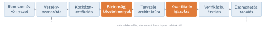
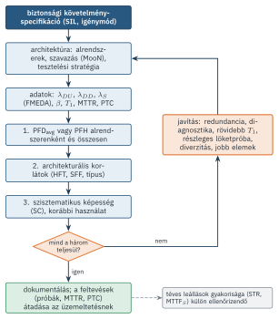
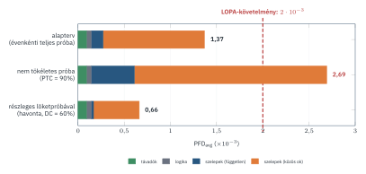
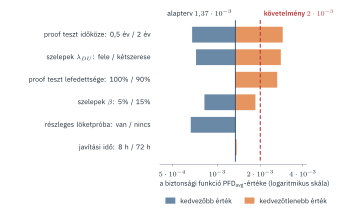

# A biztonsági integritás igazolása: PFD, PFH és SIL {#sec-sil}

{width=100%}

A kockázatelemzés és a LOPA megmondja, mekkora kockázatcsökkentést kell egy biztonsági funkciónak biztosítania ([-@sec-kockazatertekeles]. és [-@sec-esemenyfa]. fejezet). A tervezés ezután egy konkrét architektúrát javasol: érzékelőket, logikát, beavatkozókat, redundanciát és tesztelési stratégiát. Ez a fejezet arról szól, hogyan igazolható, hogy a tervezett funkció valóban teljesíti a követelményt. Az igazolásnak három pillére van ([-@sec-sil-pillerek]. szakasz): a véletlenszerű hardvermeghibásodások számszerű célértéke, az architekturális korlátok és a szisztematikus képesség. A fejezet a megbízhatósági, a hibafa- és a Markov-modellek eredményeit egyetlen gyakorlati eljárásba foglalja, és a ReaktorVéd példáján végigvezet egy teljes SIL-igazoláson, a téves leállásokat is beleértve.

::: {.cel}
A fejezet végére képes leszel

- a biztonsági funkció elemeinek meghibásodásait biztonságos, felfedett veszélyes és rejtett veszélyes kategóriákba sorolni, és kiszámolni a diagnosztikai lefedettséget és a biztonságos meghibásodási hányadot;
- az IEC 61508-6 egyszerűsített képleteivel kiszámolni az 1oo1, 1oo2 és 2oo3 alrendszerek PFD~avg~-értékét, valamint a nagy igénybevételű funkciók PFH-értékét;
- ellenőrizni az architekturális korlátokat az IEC 61508 és az IEC 61511 szerint, és értelmezni a szisztematikus képesség követelményét;
- érzékenységvizsgálattal azonosítani a PFD-t leginkább befolyásoló tényezőket, és értékelni a részleges löketpróba és a nem tökéletes proof teszt hatását;
- a biztonsági funkció téves leállási gyakoriságát is becsülni, és a biztonság és a rendelkezésre állás közötti egyensúlyt mérlegelni.
:::

## Az igazolás menete {#sec-sil-menet}

A SIL-igazolás nem egyetlen számítás, hanem egy ciklikus tervezési folyamat része ([-@fig-sil-igazolas-folyamat]. ábra). A kiindulópont a **biztonsági követelményspecifikáció** (SRS), amely rögzíti a funkciót, a SIL-t, az igénymódot, a válaszidőt, a biztonságos állapotot és a megengedett téves leállási gyakoriságot [@iec61511]. A tervezők egy architektúrát javasolnak, összegyűjtik az elemek meghibásodási adatait, majd a három pillér szerint ellenőrzik a tervet. Ha bármelyik nem teljesül, módosítanak (redundancia, jobb diagnosztika, rövidebb próbaidőköz, részleges löketpróba, diverzitás, más elemek), és újra ellenőriznek. A végén a számításban használt feltevések (a próbák gyakorisága és lefedettsége, a javítási idő, a kiiktatások szabályai) az üzemeltetési és karbantartási követelmények részévé válnak, hiszen az igazolás csak addig érvényes, amíg ezek teljesülnek.

{#fig-sil-igazolas-folyamat width=80%}

### Meghibásodási kategóriák {#sec-meghibasodasi-kategoriak}

A biztonsági funkció elemeinek meghibásodásait a funkcióra gyakorolt hatásuk szerint soroljuk be ([-@sec-biztonsagos-veszelyes]. szakasz, [-@sec-fmeda]. szakasz). A meghibásodási ráta

$$
\lambda = \lambda_S + \lambda_D, \qquad \lambda_D = \lambda_{DD} + \lambda_{DU},
$$ {#eq-lambda-bontas}

ahol $\lambda_S$ a **biztonságos** (a funkciót nem akadályozó, legfeljebb téves működést okozó), $\lambda_{DD}$ a **felfedett veszélyes** (a diagnosztika által rövid időn belül észlelt) és $\lambda_{DU}$ a **rejtett veszélyes** meghibásodások rátája. Két származtatott jellemző:

$$
\text{DC} = \frac{\lambda_{DD}}{\lambda_D}, \qquad
\text{SFF} = \frac{\lambda_S + \lambda_{DD}}{\lambda_S + \lambda_D} .
$$ {#eq-dc-sff}

A **diagnosztikai lefedettség** (DC) a veszélyes meghibásodások felfedett hányada, a **biztonságos meghibásodási hányad** (SFF) pedig azoknak a meghibásodásoknak az aránya, amelyek nem vezetnek rejtett veszélyes állapothoz [@iec61508]. A PFD szempontjából a $\lambda_{DU}$ a döntő: ezek a hibák csak a proof teszten vagy egy valódi igénynél derülnek ki.

A meghibásodási adatok forrásai a gyártók FMEDA-alapú tanúsítványai, az iparági adatbázisok és kézikönyvek (például a SINTEF PDS-módszerének adatai [@hauge2013]), valamint az üzem saját tapasztalati adatai. Mindegyiknek megvannak a maga feltevései: a tanúsítvány rendszerint ideális telepítést és környezetet feltételez, az adatbázisok sokféle alkalmazás átlagát adják, a saját adatok pedig kevés meghibásodásra épülnek. A [-@sec-megbizhatosag]. fejezetben láttuk, hogy kevés megfigyelésből a ráta felső konfidenciakorlátja akár másfél-kétszerese is lehet a pontbecslésnek. Az igazolásban mindig rögzíteni kell, melyik adatot honnan vettük, és miért tekintjük az adott alkalmazásban érvényesnek.

## A PFD~avg~ számítása {#sec-pfd-szamitas}

Alacsony igénybevételű funkcióknál (az igények gyakorisága legfeljebb évi egy, [-@sec-sil-fogalom]. szakasz) a mérőszám az igénykori meghibásodás átlagos valószínűsége, a PFD~avg~. A teljes funkció PFD~avg~-értéke az alrendszerek (érzékelők, logika, beavatkozók) értékének összege, hiszen bármelyik alrendszer kudarca a funkció kudarcát jelenti:

$$
\text{PFD}_{\text{SIF}} \approx \text{PFD}_{\text{érzékelők}} + \text{PFD}_{\text{logika}} + \text{PFD}_{\text{beavatkozók}} .
$$ {#eq-pfd-osszeg}

Az alrendszerek PFD~avg~-értékére az IEC 61508-6 B melléklete egyszerűsített képleteket ad [@iec61508]. Ezek a [-@sec-markov]. fejezet többfázisú Markov-modelljeinek közelítései, amelyek akkor pontosak, ha $\lambda T_1 \ll 1$, a csatornákat egyszerre tesztelik, és a próba tökéletes. Két **ekvivalens leállási időt** definiálnak: a csatornáét ($t_{CE}$) és a csoportét ($t_{GE}$),

$$
t_{CE} = \frac{\lambda_{DU}}{\lambda_D}\left(\frac{T_1}{2} + \text{MRT}\right) + \frac{\lambda_{DD}}{\lambda_D}\,\text{MTTR}, \qquad
t_{GE} = \frac{\lambda_{DU}}{\lambda_D}\left(\frac{T_1}{3} + \text{MRT}\right) + \frac{\lambda_{DD}}{\lambda_D}\,\text{MTTR},
$$ {#eq-tce-tge}

ahol $T_1$ a proof teszt időköze, MRT az átlagos javítási idő a rejtett hiba felfedése után, MTTR pedig a felfedett hiba helyreállításának átlagos ideje. (A következő példákban egyszerűségből mindkettőt MTTR-rel jelöljük.) A $T_1/3$ a [-@sec-hibafa]. fejezetben látott 4/3-os időátlagolási tényező forrása. A három legfontosabb architektúra képlete:

$$
\begin{aligned}
\text{PFD}_{1\text{oo}1} &= \lambda_D\, t_{CE}, \\
\text{PFD}_{1\text{oo}2} &= 2\bigl[(1-\beta_D)\lambda_{DD} + (1-\beta)\lambda_{DU}\bigr]^2 t_{CE}\, t_{GE} + \beta_D\lambda_{DD}\,\text{MTTR} + \beta\lambda_{DU}\left(\frac{T_1}{2} + \text{MRT}\right), \\
\text{PFD}_{2\text{oo}3} &= 6\bigl[(1-\beta_D)\lambda_{DD} + (1-\beta)\lambda_{DU}\bigr]^2 t_{CE}\, t_{GE} + \beta_D\lambda_{DD}\,\text{MTTR} + \beta\lambda_{DU}\left(\frac{T_1}{2} + \text{MRT}\right).
\end{aligned}
$$ {#eq-pfd-kepletek}

A redundáns képletek első tagja a független kettős meghibásodások, a második és a harmadik a felfedett, illetve a rejtett hibák közös okú hozzájárulása; $\beta$ és $\beta_D$ a rejtett, illetve a felfedett hibákra vonatkozó közös okú tényező ([-@sec-ccf-hibafa]. szakasz). A 2oo3 független tagjának 6-os szorzója abból adódik, hogy három csatornapárból bármelyik kettős meghibásodása elég a kudarchoz. Egy 2oo2 alrendszer egyszerűen két 1oo1 csatorna soros kapcsolata: $\text{PFD}_{2\text{oo}2} = 2\lambda_D t_{CE}$.

::: {.eset eset="A" title="ReaktorVéd: a PFD~avg~ számítása"}
A ReaktorVéd biztonsági funkciójának adatait a [-@tbl-reaktorved-adatok]. táblázat foglalja össze. A funkció hibabiztos kivitelű: a szelepek energiamentesítésre zárnak, a távadók élő nullás áramhurokkal csatlakoznak ([-@sec-ccf-hibafa]. szakasz).

| Alrendszer | Architektúra | $\lambda_{DU}$ [h^-1^] | $\lambda_{DD}$ [h^-1^] | $\lambda_S$ [h^-1^] | $\beta$ / $\beta_D$ | Típus |
|:--|:--:|--:|--:|--:|:--:|:--:|
| hőmérséklet-távadók (TT-101/102) | 1oo2 | $4\cdot10^{-7}$ | $6\cdot10^{-7}$ | $5\cdot10^{-7}$ | 5% / 2,5% | B |
| biztonsági PLC | 1oo1 (tanúsított) | – | – | – | – | SIL 3 |
| gyorszáró szelepek (XV-101/102) | 1oo2 | $2{,}5\cdot10^{-6}$ | 0 | – | 10% / – | A |

: A ReaktorVéd biztonsági funkciójának adatai ($T_1 = 8760$ h, MTTR = 8 h) {#tbl-reaktorved-adatok}

**Távadók.** $\lambda_D = 10^{-6}\,\text{h}^{-1}$, $\text{DC} = 60\%$. Az ekvivalens leállási idők $t_{CE} = 0{,}4\cdot 4388 + 0{,}6\cdot 8 = 1760$ óra és $t_{GE} = 0{,}4\cdot 2928 + 0{,}6\cdot 8 = 1176$ óra. A független tag $2\cdot(5{,}85\cdot10^{-7} + 3{,}8\cdot10^{-7})^2 \cdot 1760 \cdot 1176 = 3{,}86\cdot10^{-6}$, a közös okú tagok $0{,}025\cdot 6\cdot10^{-7}\cdot 8 + 0{,}05\cdot 4\cdot10^{-7}\cdot 4388 = 8{,}79\cdot10^{-5}$. Összesen $\text{PFD}_{\text{TT}} = 9{,}17\cdot10^{-5}$.

**Logika.** A tanúsított biztonsági PLC gyártói értéke $\text{PFD}_{\text{L}} = 5\cdot10^{-5}$ az adott próbaidőközre.

**Szelepek.** $\lambda_{DD} = 0$, így $t_{CE} = 4388$ óra, $t_{GE} = 2928$ óra. A független tag $2\cdot(2{,}25\cdot10^{-6})^2\cdot 4388\cdot 2928 = 1{,}30\cdot10^{-4}$, a közös okú tag $0{,}1\cdot 2{,}5\cdot10^{-6}\cdot 4388 = 1{,}097\cdot10^{-3}$. Összesen $\text{PFD}_{\text{V}} = 1{,}227\cdot10^{-3}$.

**A funkció.** $\text{PFD}_{\text{SIF}} = 9{,}17\cdot10^{-5} + 5\cdot10^{-5} + 1{,}227\cdot10^{-3} = 1{,}369\cdot10^{-3}$, azaz $\text{RRF} = 731$. A LOPA követelménye ($\text{PFD} \le 2\cdot10^{-3}$, $\text{RRF} \ge 500$) teljesül. A PFD 90%-át a szelepek adják, és ezen belül is a közös okú meghibásodás; a távadók és a logika együtt csak 10%-ot.

Az eredmény jól egyezik a hibafa ($1{,}335\cdot10^{-3}$, [-@sec-ccf-hibafa]. szakasz) és a többfázisú Markov-modell ($1{,}22\cdot10^{-3}$ a szelepekre, [-@sec-markov-teszteles]. szakasz) eredményével, és jóval nagyobb a blokkdiagram naiv becslésénél ($1{,}7\cdot10^{-4}$, [-@sec-rbd]. fejezet). A különbség oka a közös okú meghibásodás és a helyes időátlagolás; a blokkdiagram egyiket sem veszi figyelembe.
:::

::: {.hiba title="Gyakori hibák a PFD-számításban"}
- **$\lambda_D$ helyett $\lambda_{DU}$, vagy fordítva:** a felfedett hibák csak a javítási idő alatt rontják a PFD-t; ha a teljes $\lambda_D$-vel számolunk $T_1/2$-vel, nagyon pesszimista, ha a felfedett hibákat egyáltalán nem vesszük figyelembe, enyhén optimista az eredmény.
- **A közös okú meghibásodás elhagyása:** a redundáns alrendszerekben gyakran ez a domináns tag, ahogy a ReaktorVéd szelepeinél is.
- **Tökéletes proof teszt feltételezése:** a valóságos próbák ritkán fednek fel minden hibát ([-@sec-pst-ptc]. szakasz).
- **A gyártói PFD-érték átvétele a feltevések ellenőrzése nélkül:** a tanúsítvány egy adott próbaidőközre, javítási időre és környezetre érvényes.
- **A redundáns csatornák PFD-jének szorzása:** az átlagok szorzata nem a szorzat átlaga, és a közös okú tagot is elhagyja ([-@sec-hibafa]. fejezet).
- **„SIL 2-es eszköz”:** a SIL a biztonsági *funkció* tulajdonsága. Egy eszköz legfeljebb *alkalmas* egy adott SIL-ű funkcióban való használatra, a szisztematikus képessége és a hardveres jellemzői alapján.
:::

## Architekturális korlátok {#sec-architekturalis-korlatok}

A számított PFD önmagában nem elég, mert a meghibásodási adatok bizonytalanok, és a modell feltevései sérülhetnek. A szabványok ezért minimális **hardveres hibatűrést** (*hardware fault tolerance*, HFT) írnak elő: HFT = N azt jelenti, hogy N+1 hiba okozhatja a funkció elvesztését (egy 1oo2 alrendszer HFT-je 1, egy 2oo3-é szintén 1, egy 1oo3-é 2).

Az IEC 61508-2 két utat kínál [@iec61508]. Az **1H út** a biztonságos meghibásodási hányadhoz és az elem típusához köti a megengedett SIL-t ([-@tbl-route1h]. táblázat). Az **A típusú** elemek meghibásodási módjai jól ismertek, és viselkedésük hibás állapotban is teljesen meghatározható (például szelepek, relék, egyszerű analóg érzékelők); a **B típusú** elemek összetettek, jellemzően mikroprocesszorosak, és nem minden meghibásodási módjuk ismert (például okos távadók, PLC-k).

| SFF | A típus, HFT = 0 | HFT = 1 | HFT = 2 | B típus, HFT = 0 | HFT = 1 | HFT = 2 |
|:--|:--:|:--:|:--:|:--:|:--:|:--:|
| < 60% | SIL 1 | SIL 2 | SIL 3 | nem megengedett | SIL 1 | SIL 2 |
| 60% – < 90% | SIL 2 | SIL 3 | SIL 4 | SIL 1 | SIL 2 | SIL 3 |
| 90% – < 99% | SIL 3 | SIL 4 | SIL 4 | SIL 2 | SIL 3 | SIL 4 |
| ≥ 99% | SIL 3 | SIL 4 | SIL 4 | SIL 3 | SIL 4 | SIL 4 |

: Az elérhető legnagyobb SIL az IEC 61508-2 1H útja szerint {#tbl-route1h}

A **2H út** a tényleges üzemi tapasztalaton alapuló meghibásodási adatokra épít, és egyszerűbb HFT-követelményt támaszt: SIL 4-hez HFT = 2, SIL 3-hoz HFT = 1, SIL 2-höz nagy igénybevételnél HFT = 1, alacsony igénybevételnél HFT = 0, SIL 1-hez HFT = 0. Cserébe a meghibásodási rátákat legalább 70%-os konfidenciaszinten kell becsülni, és a célérték teljesülését is a bizonytalanság figyelembevételével kell igazolni [@iec61508]. A folyamatipari IEC 61511 2016-os kiadása ehhez hasonló, egyszerű táblázatot használ ([-@tbl-61511-hft]. táblázat), és az SFF-et elhagyta a követelmények közül [@iec61511].

| SIL | Igénymód | Minimális HFT |
|:--|:--|:--:|
| 1 | bármely | 0 |
| 2 | alacsony igénybevétel | 0 |
| 2 | nagy igénybevétel vagy folyamatos | 1 |
| 3 | bármely | 1 |
| 4 | bármely | 2 |

: A minimális hardveres hibatűrés az IEC 61511-1:2016 szerint {#tbl-61511-hft}

Az architekturális korlátok szerepe vitatott. Lundteigen és Rausand elemzése szerint a korlátok és a PFD-számítás nem mindig ugyanabba az irányba terelik a tervezőt, és az SFF ösztönözheti a biztonságos meghibásodások „felhizlalását” is, ami a valódi biztonságot nem javítja, a téves leállásokat viszont növeli [@lundteigen2009]. Ez is szerepet játszott abban, hogy az IEC 61511 új kiadása egyszerűbb, HFT-alapú követelményre tért át.

::: {.eset eset="A" title="ReaktorVéd: az architekturális korlátok ellenőrzése"}
A távadók SFF-je $(5 + 6)\cdot10^{-7}/(1{,}5\cdot10^{-6}) = 73\%$; B típusúak, HFT = 1, így az 1H út szerint SIL 2-ig alkalmazhatók. A szelepek A típusúak, diagnosztika nélkül az SFF-jük 60% alatt van, de HFT = 1 mellett SIL 2-ig alkalmazhatók. A biztonsági PLC tanúsítványa szerint SIL 3-ig alkalmas. A funkció tehát az IEC 61508 1H útja szerint teljesíti a SIL 2 architekturális követelményeit. Az IEC 61511 szerint SIL 2-höz alacsony igénybevételnél HFT = 0 is elég volna; a redundanciára itt a PFD-célérték miatt van szükség, nem az architekturális korlát miatt. Egycsatornás szelepekkel a funkció PFD-je $1{,}1\cdot10^{-2}$ fölött lenne, SIL 1 tartományban.
:::

## Szisztematikus képesség {#sec-szisztematikus-kepesseg}

A számszerű célérték és az architekturális korlátok a véletlenszerű hardvermeghibásodások ellen védenek. A szisztematikus hibák (specifikációs, tervezési, szoftver- és gyártási hibák) azonban nem írhatók le meghibásodási rátával ([-@sec-fogalmak]. fejezet). Ellenük a fejlesztési folyamat szigorúsága véd: az IEC 61508 minden SIL-hez meghatározott módszereket és technikákat ír elő a specifikációtól a validálásig. Egy elem **szisztematikus képessége** (*systematic capability*, SC 1–4) azt fejezi ki, hogy milyen SIL-ű funkcióban használható a szisztematikus integritás szempontjából [@iec61508].

A szisztematikus képesség háromféleképpen igazolható: az IEC 61508 szerinti fejlesztéssel (1S út), az üzemi tapasztalattal igazolt megbízhatósággal (*proven in use*, 2S út), illetve a korábban kifejlesztett szoftverek esetén a 3S úttal. A folyamatiparban az IEC 61511 a **korábbi használat** (*prior use*) fogalmát vezeti be: egy eszköz akkor választható, ha az üzemeltető hasonló alkalmazásban és környezetben szerzett, dokumentált tapasztalata igazolja az alkalmasságát [@iec61511]. Az alkalmazási szoftverre (a biztonsági PLC-ben futó logikára) az IEC 61511 saját életciklus-követelményeket támaszt; a szoftverek biztonságát a [-@sec-szoftver]. fejezet tárgyalja.

## Részleges löketpróba és nem tökéletes proof teszt {#sec-pst-ptc}

A gyorszáró szelepek éves proof tesztje a folyamat leállítását igényli, ezért a próbaidőköz nem rövidíthető tetszés szerint. A **részleges löketpróba** (*partial stroke testing*, PST) üzem közben, a szelepet csak részben (például 10–20%-ban) megmozdítva ellenőrzi, hogy a szelep nem ragadt-e be, és a működtető, a mágnesszelep és a rugó működik-e. A PST nem helyettesíti a teljes próbát, mert a zárás tömörségét és a teljes löketet nem ellenőrzi, de a rejtett hibák egy részét sokkal gyakrabban fedi fel [@rausand2014].

A PST hatása a [-@sec-nem-tokeletes-teszt]. szakasz gondolatmenetével számolható: a szelep rejtett hibáinak $\text{DC}_{\text{PST}}$ hányada a PST időközében, a többi a teljes próba időközében derül ki. Ennek fordítottja a **nem tökéletes proof teszt**: ha a teljes próba lefedettsége $\text{PTC} < 100\%$, a fel nem fedett hibák csak a nagyjavításkor derülnek ki.

::: {.eset eset="A" title="ReaktorVéd: mit tesz a próba minősége?"}
Ha a szelepek éves próbája csak a hibák 90%-át fedi fel (például mert a próba nem ellenőrzi a zárás tömörségét az üzemi nyomáskülönbség mellett), és a szelepeket tízévenként újítják fel, a funkció PFD-je $2{,}69\cdot10^{-3}$-ra nő ([-@fig-pfd-hozzajarulas]. ábra). Ez *nem teljesíti* a LOPA követelményét. Egy apró eljárási részlet tehát érvénytelenítheti a SIL-igazolást.

Ha viszont havonta részleges löketpróbát végeznek, amely a szelephibák 60%-át felfedi, a szelepek közös okú tagja $1{,}097\cdot10^{-3}$-ról $4{,}95\cdot10^{-4}$-re, a független tag $1{,}30\cdot10^{-4}$-ről $2{,}6\cdot10^{-5}$-re csökken. A funkció PFD-je $6{,}63\cdot10^{-4}$, $\text{RRF} = 1508$: kétszeres tartalék a követelményhez képest. A számításokat numerikus időátlagolással is ellenőriztük; az eltérés a képletektől 1–3%.

{#fig-pfd-hozzajarulas width=100%}

A PST lefedettségét azonban igazolni kell: függ a szelep és a működtető típusától, a meghibásodási módoktól és a próba kivitelezésétől. A 60% egy gondos FMEDA-val alátámasztandó feltevés, nem általános érték.
:::

## Érzékenységvizsgálat {#sec-sil-erzekenyseg}

A PFD-számítás bemenő adatai bizonytalanok, és a feltevések üzem közben változhatnak. Az érzékenységvizsgálat megmutatja, mely tényezők befolyásolják leginkább az eredményt, és ezzel azt is, mire kell az üzemeltetésnek a legjobban figyelnie. A ReaktorVéd tornádódiagramja ([-@fig-pfd-erzekenyseg]. ábra) szerint a legerősebb hatása a proof teszt időközének (fél és két év között $6{,}8\cdot10^{-4}$ és $2{,}95\cdot10^{-3}$ között változik a PFD), a szelepek rejtett meghibásodási rátájának, a próba lefedettségének és a szelepek közös okú tényezőjének van. A javítási idő hatása elhanyagolható: még 72 óra is csak 1,6%-kal növeli a PFD-t, mert a redundáns szelepeknél egyetlen hiba javítása alatt a másik szelep még véd.

{#fig-pfd-erzekenyseg width=92%}

A tanulság gyakorlati: a ReaktorVéd biztonsága a szelepeken múlik. A kétéves próbaidőköz, a kétszer rosszabb szelepadat vagy a 90%-os próbalefedettség egyaránt elég ahhoz, hogy a funkció ne teljesítse a követelményt. Az igazolásnak ezért a szelepek kiválasztására (üzemi tapasztalat, megfelelő típus), a közös okú hibák csökkentésére (különálló mágnesszelepek és tápellátás, eltérő gyártójú vagy típusú szelepek, eltolt karbantartás) és a próbaeljárás minőségére kell összpontosítania. A távadók és a logika ennél jóval kevésbé kritikusak.

## Téves leállások {#sec-teves-leallas}

A biztonsági funkció kétféleképpen hibázhat: veszélyesen és biztonságosan ([-@sec-szavazo]. szakasz). A biztonságos meghibásodások a folyamat **téves leállását** (*spurious trip*) okozzák. Ez nemcsak termelési veszteség: a leállások és az újraindítások maguk is veszélyes átmeneti állapotok, a gyakori téves leállás pedig arra ösztönözheti a kezelőket, hogy kiiktassák a védelmet. Az IEC 61511 ezért előírja, hogy a biztonsági követelményspecifikáció rögzítse a megengedett legnagyobb téves leállási gyakoriságot [@iec61511]. A jellemzők a **téves leállási gyakoriság** (*spurious trip rate*, STR) és annak reciproka, a téves leállásig eltelt átlagos idő (MTTF~S~).

Az 1oo2 alrendszer bármelyik csatornájának téves jelzésére leállít, ezért téves leállási gyakorisága $\text{STR}_{1\text{oo}2} \approx 2(\lambda_S + \lambda_{DD})$, ha a felfedett veszélyes hibákra is leállás a reakció. A 2oo3 alrendszer csak két csatorna egyidejű téves jelzésére állít le, ezért $\text{STR}_{2\text{oo}3} \approx 6(\lambda_S + \lambda_{DD})^2\,\text{MTTR}$, ami nagyságrendekkel kisebb.

::: {.eset eset="A" title="ReaktorVéd: a hibabiztos kialakítás ára"}
A hibabiztos átalakítás ([-@sec-ccf-hibafa]. szakasz) a tápegységek kiesését a veszélyes hibafából a téves leállások hibafájába helyezte át. A [-@tbl-teves-leallas]. táblázat a következő feltevésekkel számol: a távadók $\lambda_S + \lambda_{DD} = 1{,}1\cdot10^{-6}\,\text{h}^{-1}$, egy szelep téves zárása $10^{-6}\,\text{h}^{-1}$, a logika téves kimenete $10^{-6}\,\text{h}^{-1}$, egy tápegység kiesése $5\cdot10^{-6}\,\text{h}^{-1}$.

| Változat | STR [1/év] | MTTF~S~ [év] | Domináns tag |
|:--|--:|--:|:--|
| 1oo2 távadók, két egyszeres tápegység | 0,133 | 7,5 | tápegységek (66%) |
| 1oo2 távadók, redundáns tápellátás | 0,046 | 21,9 | szelepek, távadók, logika |
| 2oo3 távadók, redundáns tápellátás | 0,026 | 38,0 | szelepek, logika |

: A ReaktorVéd téves leállási gyakorisága különböző kialakítások mellett {#tbl-teves-leallas}

Az egyszeres tápegységekkel átlagosan hétévente egyszer állna le tévesen a reaktor; ennek kétharmadát a tápegységek okoznák. A redundáns (diódás VAGY-kapcsolású) tápellátás ezt a hozzájárulást gyakorlatilag megszünteti. A 2oo3 távadókkal a távadók téves leállásai is eltűnnek, a PFD pedig szinte változatlan ($9{,}94\cdot10^{-5}$ az 1oo2 $9{,}17\cdot10^{-5}$ értékéhez képest), mert mindkét esetben a közös okú tag dominál. Ugyanaz a probléma, a közös tápellátás, a [-@sec-hibafa]. fejezetben a biztonságot, itt a rendelkezésre állást veszélyeztette; a megoldás mindkét esetben a függőség felismerése és megszüntetése.
:::

## Nagy igénybevétel: a PFH számítása {#sec-pfh}

Ha a biztonsági funkció gyakran, évente többször működésbe lép, vagy folyamatosan működik (például egy gép biztonsági sebességfelügyelete vagy egy jármű kormányrendszerének felügyelete), a mérőszám a veszélyes meghibásodás átlagos gyakorisága, a PFH ([-@tbl-sil]. táblázat). Ilyenkor a rejtett hiba gyakorlatilag azonnal veszélyes eseményhez vezet, hiszen az igény hamarosan bekövetkezik. Egycsatornás alrendszerre $\text{PFH}_{1\text{oo}1} \approx \lambda_{DU}$, ha a felfedett hibákra a rendszer időben biztonságos állapotba kerül. Az 1oo2 alrendszer képlete az IEC 61508-6 szerint [@iec61508]

$$
\text{PFH}_{1\text{oo}2} = 2\bigl[(1-\beta_D)\lambda_{DD} + (1-\beta)\lambda_{DU}\bigr](1-\beta)\lambda_{DU}\,t_{CE} + \beta_D\lambda_{DD} + \beta\lambda_{DU} .
$$ {#eq-pfh-1oo2}

A gépiparban az ISO 13849-1 egyszerűsített eljárást is kínál, amely a kategóriából, a csatornánkénti MTTF~D~-ből és az átlagos diagnosztikai lefedettségből táblázatosan adja a PFH-t és a PL-t; a közös okú meghibásodás elleni intézkedéseket pedig egy pontozásos lista értékeli, amelyen a 2-es kategóriától felfelé legalább 65 pontot kell elérni [@iso13849].

::: {.eset eset="C" title="KoboCella: a biztonságos megállítás PFH-ja"}
A KoboCella biztonságos megállítási funkciója két független csatornán valósul meg (1oo2). Csatornánként $\lambda_D = 10^{-6}\,\text{h}^{-1}$ (MTTF~D~ ≈ 114 év), a diagnosztikai lefedettség 99%, így $\lambda_{DD} = 9{,}9\cdot10^{-7}$ és $\lambda_{DU} = 10^{-8}\,\text{h}^{-1}$; a közös okú tényezők $\beta = 2\%$, $\beta_D = 1\%$; a rejtett hibák csak a húszéves használati idő végén derülnének ki. Az [-@eq-pfh-1oo2]. egyenletből $\text{PFH} = 1{,}01\cdot10^{-8}\,\text{h}^{-1}$, amely teljesíti a PL~r~ = e követelményét ($\text{PFH} < 10^{-7}$, [-@tbl-pl]. táblázat).

A számításból egy meglepő tanulság is kiderül: a PFH szinte teljes egészében a $\beta_D\lambda_{DD}$ tagból adódik, vagyis a *felfedett* hibák közös okú hányadából. Nagy igénybevételnél a diagnosztika csak akkor véd, ha a hiba felismerése és a biztonságos állapot elérése gyorsabb, mint a következő igény; két csatorna egyidejű, közös okú meghibásodása pedig a diagnosztikai reakció előtt is veszélyes helyzetet teremthet. A gyors diagnosztikai reakció és a közös okú hibák elleni intézkedések (szétválasztás, diverzitás) ezért a nagy igénybevételű funkciókban különösen fontosak.
:::

::: {.eset eset="B" title="VészFék: hardvermetrikák az ISO 26262 szerint"}
A közúti járműveknél a véletlenszerű hardvermeghibásodásokat az ISO 26262-5 három metrikával értékeli ([-@tbl-asil-metrikak]. táblázat) [@iso26262]: az egypontos hibák metrikájával (SPFM), a látens hibák metrikájával (LFM) és a véletlenszerű hardvermeghibásodások miatti biztonsági célsértés valószínűségének metrikájával (PMHF), amely a PFH megfelelője. Tegyük fel, hogy a vészfékező vezérlőegység biztonságrelevánsnak minősülő elemeinek teljes meghibásodási rátája 500 FIT ($5\cdot10^{-7}\,\text{h}^{-1}$), ebből az egypontos és a diagnosztika által nem fedett maradó hibák rátája 3 FIT, a többpontos hibák közül a látensek (a diagnosztika és a vezető által sem észlelt hibák) rátája 20 FIT. Ekkor $\text{SPFM} = 1 - 3/500 = 99{,}4\%$ és $\text{LFM} = 1 - 20/(500 - 3) = 96{,}0\%$, ami teljesíti az ASIL D célértékeit (legalább 99%, illetve 90%). A PMHF-et az egypontos és maradó hibák 3 FIT-es rátája uralja, mert a látens kettős hibák járuléka (egy látens hiba és egy második hiba egyidejű fennállása) nagyságrendekkel kisebb; így a 10 FIT-es ASIL D célérték is teljesül. A gondolatmenet ugyanaz, mint az IEC 61508-ban: a felfedett és a rejtett hibák szétválasztása, és a rejtett hibák felfedési idejének korlátozása.
:::

::: {.labor}
A gyakorlati útmutató 11. laborjában egy böngészős PFD/SIL-kalkulátorral állíthatod össze a ReaktorVéd biztonsági funkcióját: az alrendszerek architektúrájának, meghibásodási adatainak, a próbaidőköznek, a közös okú tényezőknek, a részleges löketpróbának és a proof teszt lefedettségének változtatásával azonnal látod a PFD~avg~-t, az elérhető SIL-t, az architekturális korlátokat és a téves leállási gyakoriságot. A hozzá tartozó Colab-notebook a képleteket a többfázisú Markov-modellel és Monte Carlo-szimulációval is összeveti, és elkészíti a tornádódiagramot.
:::

::: {.osszefoglalo}
- A SIL-igazolás három pillére a számszerű célérték (PFD~avg~ vagy PFH), az architekturális korlátok és a szisztematikus képesség; a számítás feltevései az üzemeltetés követelményeivé válnak.
- A meghibásodások biztonságos, felfedett veszélyes és rejtett veszélyes kategóriákba sorolhatók; a PFD-t elsősorban a rejtett veszélyes hibák határozzák meg.
- Az IEC 61508-6 képletei a csatorna és a csoport ekvivalens leállási idején alapulnak; a redundáns alrendszerekben a közös okú tag gyakran domináns.
- A ReaktorVéd funkciója $\text{PFD} = 1{,}37\cdot10^{-3}$ értékkel teljesíti a $2\cdot10^{-3}$-os követelményt; a PFD 90%-át a szelepek adják.
- Az architekturális korlátok az IEC 61508 1H útja szerint az SFF-től, a típustól és a HFT-től, a 2H út és az IEC 61511 szerint csak a HFT-től függenek.
- A próba minősége döntő: a 90%-os próbalefedettség érvénytelenítheti, a részleges löketpróba megerősítheti az igazolást.
- A hibabiztos kialakítás a téves leállások gyakoriságát növeli; a redundáns tápellátás és a 2oo3 szavazás egyszerre őrzi meg a biztonságot és a rendelkezésre állást.
- Nagy igénybevételnél a PFH a mérőszám; a felfedett hibák közös okú hányada és a diagnosztikai reakció ideje ilyenkor különösen fontos.
:::

::: {.onell}
1. Egy távadó $\lambda_S = 3\cdot10^{-7}$, $\lambda_{DD} = 9\cdot10^{-7}$, $\lambda_{DU} = 3\cdot10^{-7}\,\text{h}^{-1}$. Mekkora a DC és az SFF? B típusú elemként HFT = 0 mellett milyen SIL-ig alkalmazható az 1H út szerint?
2. Számold ki egy 1oo1 szelep PFD~avg~-értékét $\lambda_{DU} = 2{,}5\cdot10^{-6}\,\text{h}^{-1}$, $T_1 = 2$ év és MTTR = 8 óra mellett! Milyen SIL-tartományba esik?
3. Miért csökkenti a PFD-t csak kis mértékben, ha a ReaktorVéd távadóit 2oo3 architektúrára cseréljük? Akkor miért érdemes mégis megfontolni?
4. A ReaktorVéd szelepeinek közös okú tényezője 10%. Milyen műszaki intézkedésekkel lehetne csökkenteni?
5. Miért érvénytelenítheti a SIL-igazolást, ha az üzemeltető a próbaidőközt egy évről kettőre növeli?

::: {.megoldas}
1. $\lambda_D = 1{,}2\cdot10^{-6}$, $\text{DC} = 9/12 = 75\%$; $\text{SFF} = (3 + 9)/15 = 80\%$. B típusú elemként, HFT = 0 mellett, 60–90% közötti SFF-fel az 1H út szerint SIL 1-ig alkalmazható.
2. $\text{PFD} = 2{,}5\cdot10^{-6}\cdot(8760 + 8) = 2{,}19\cdot10^{-2}$; SIL 1 tartomány ($10^{-2} \le \text{PFD} < 10^{-1}$).
3. Mert a távadók PFD-jét már 1oo2 esetén is a közös okú tag uralja ($8{,}8\cdot10^{-5}$), amelyen a 2oo3 nem változtat, és a funkció PFD-jének csak 7%-át adják a távadók. A 2oo3 előnye a téves leállások jelentős csökkentése, és hogy egy távadó karbantartása alatt is megmarad a hibatűrés (1oo2 üzemmódban).
4. Különálló mágnesszelepek és működtető levegőellátás, eltérő típusú vagy gyártójú szelepek (diverzitás), fizikai szétválasztás, eltolt időpontú karbantartás és tesztelés különböző személyekkel, a folyamatközeghez jobban illeszkedő anyagválasztás, valamint a részleges löketpróba, amely a közös okú hibák egy részét is korán felfedi.
5. Mert a PFD közel arányos a próbaidőközzel: két év mellett a funkció PFD-je $2{,}95\cdot10^{-3}$, ami meghaladja a $2\cdot10^{-3}$-os követelményt. A próbaidőköz az igazolás feltevése, tehát a változtatás előtt az igazolást meg kell ismételni (változáskezelés, [-@sec-eletciklus]. fejezet).
:::
:::

::: {.forras}
- IEC 61508-2 és -6:2010 – architekturális korlátok, a PFD- és PFH-képletek [@iec61508].
- IEC 61511-1:2016 – a folyamatipari biztonsági műszeres rendszerek követelményei, a HFT-táblázat és a téves leállások specifikálása [@iec61511].
- Rausand, M. (2014): *Reliability of Safety-Critical Systems: Theory and Applications.* Wiley – a PFD/PFH számítása, a részleges löketpróba és a nem tökéletes proof teszt [@rausand2014].
- Hauge, S. et al. (2013): *Reliability Prediction Method for Safety Instrumented Systems – PDS Method Handbook.* SINTEF [@hauge2013].
- Lundteigen, M. A., Rausand, M. (2009): Architectural constraints in IEC 61508: Do they have the intended effect? *Reliability Engineering & System Safety* [@lundteigen2009].
- Smith, D. J., Simpson, K. G. L. (2020): *The Safety Critical Systems Handbook*, 5. kiadás – gyakorlati útmutató a funkcionális biztonsági számításokhoz [@smith2020].
:::
