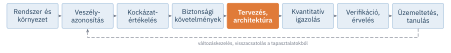
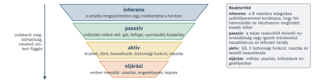
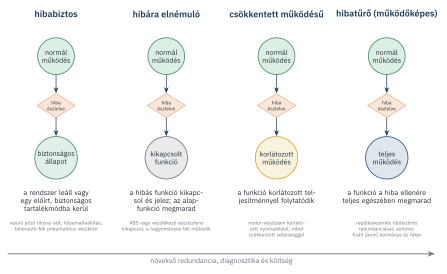
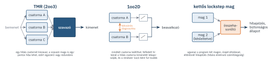
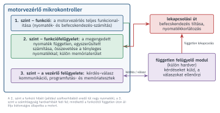
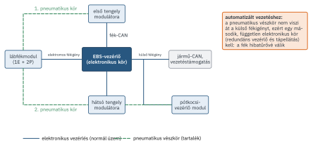

# Biztonságos architektúrák és tervezési elvek {#sec-architekturak}

{width=100%}

Az eddigi fejezetek azt mutatták meg, hogyan azonosítjuk a veszélyeket, és hogyan értékeljük egy adott terv kockázatát és megbízhatóságát. Ez a fejezet a tervezőé: milyen elvek és architektúrák vezetnek eleve biztonságos rendszerekhez? A sorrend nem mellékes. A leghatékonyabb a veszélyt magát megszüntetni vagy csökkenteni (inherens biztonság), ezt követik a működés nélkül védő passzív, majd az aktív védelmek. Az aktív védelmeknél azt kell eldönteni, mi történjen hiba esetén: álljon le a rendszer biztonságosan, kapcsoljon ki egy funkció, működjön tovább csökkentett teljesítménnyel, vagy maradjon teljesen működőképes. Ezek a döntések határozzák meg a redundancia, a diagnosztika és a közös okú hibák elleni védekezés szükséges mértékét. A fejezet a folyamatipari, a gépipari, a közúti és a repülési gyakorlat példáin, köztük a 2014-es jegyzetben bemutatott haszonjármű-fékrendszer korszerűsített elemzésén vezet végig.

::: {.cel}
A fejezet végére képes leszel

- alkalmazni a kockázatcsökkentő intézkedések hierarchiáját és az inherens biztonság elveit;
- megkülönböztetni a hibabiztos, a hibára elnémuló, a csökkentett működésű és a hibatűrő rendszereket, és egy adott funkcióhoz kiválasztani a szükséges hibaviselkedést;
- jellemezni a hardveres, információs, időbeli és szoftveres redundancia formáit, és értékelni a homogén és a diverz redundanciát;
- diagnosztikai megoldásokat választani, és összehangolni a diagnosztikai időket a hibatűrési időkerettel;
- felismerni a közös okú hibák forrásait, és tervezési intézkedéseket javasolni ellenük;
- elemezni a többszintű felügyeleti koncepciókat és a redundáns fékrendszer-architektúrákat.
:::

## A kockázatcsökkentés hierarchiája és az inherens biztonság {#sec-inherens-biztonsag}

A [-@sec-kockazatertekeles]. fejezetben láttuk, hogy az ISO 12100 háromlépcsős módszere a természeténél fogva biztonságos tervezéssel kezdi a kockázatcsökkentést, és csak ezután alkalmaz védőberendezéseket és tájékoztatást [@iso12100]. A folyamatipar ugyanezt a gondolatot négy szinttel fejezi ki ([-@fig-vedelmi-strategia-hierarchia]. ábra): **inherens** (a veszély megszüntetése vagy csökkentése), **passzív** (működés nélkül védő eszközök, például gátak és felfogó medencék), **aktív** (érzékelő, döntő és beavatkozó védelmek) és **eljárási** (emberi teendők) intézkedések [@kletz2010]. Lefelé haladva a védelem egyre több elem helyes működésén és egyre inkább az emberen múlik, ezért egyre kevésbé megbízható.

{#fig-vedelmi-strategia-hierarchia width=100%}

Az **inherens biztonság** fogalmát Trevor Kletz vezette be az 1970-es években, azzal a ma is idézett gondolattal, hogy ami nincs, az nem is szivároghat el. Fő elvei [@kletz2010]:

- **minimalizálás (intenzifikálás):** kevesebb veszélyes anyag, kisebb berendezések, kisebb tárolt mennyiség;
- **helyettesítés:** kevésbé veszélyes anyag vagy eljárás (például vizes oldószer a gyúlékony helyett);
- **mérséklés:** enyhébb körülmények (alacsonyabb hőmérséklet és nyomás, hígítás), vagy olyan kialakítás, amely korlátozza a lehetséges energiát;
- **a hatások korlátozása:** olyan tervezés, amely a meghibásodás következményeit szűk körre korlátozza (például a térköz, a falak, a betáplálás fizikai korlátja);
- **egyszerűsítés:** kevesebb lehetőség a hibára, könnyen érthető, ellenőrizhető állapotok, a hibás összeszerelés lehetetlenné tétele.

Az inherens biztonság a legnagyobb hatású, de csak a tervezés korai szakaszában érvényesíthető olcsón ([-@sec-eletciklus]. fejezet). Később a változtatás egyre drágább, és a tervezők kénytelenek aktív védelmekkel kompenzálni azt, amit a koncepcióban elmulasztottak. Az energia–gát gondolat ([-@sec-energia-gat]. szakasz) szerint az inherens biztonság az energiaforrás csökkentését jelenti, minden további intézkedés pedig gátakat épít a forrás és a védendő érték közé.

::: {.eset eset="A" title="ReaktorVéd: inherens megoldások vizsgálata"}
A ReaktorVéd félszakaszos (*semi-batch*) reaktor: a B reaktánst folyamatosan adagolják. A tervezőcsapat a HAZOP után inherens megoldásokat is megvizsgált. A legfontosabb: az adagolás maximális áramlását egy szűkítőperem fizikailag korlátozza, így a reaktorban felhalmozódó, el nem reagált B mennyisége akkor sem elég a megfutáshoz, ha a hűtés kiesik (a hatások korlátozása). Egy másik lehetőség olyan oldószer, amelynek forráspontja a bomlási hőmérséklet alatt van, így a forralás elvonja a hőt (mérséklés); ez azonban a termék minőségét rontaná. Ha az inherens megoldások a forgatókönyvet megszüntetik vagy a következmény súlyosságát csökkentik, a LOPA kockázatcsökkentési követelménye ([-@sec-lopa]. szakasz) és vele a biztonsági funkció SIL-je is csökken. A biztonsági funkcióra így is szükség van, de a nagyobb biztonsági tartalék és az egyszerűbb igazolás a tervezés elején tett döntés eredménye.
:::

## Hibaviselkedés: mi történjen hiba esetén? {#sec-hibaviselkedes}

Minden aktív biztonsági rendszer tervezésének kulcskérdése, hogy a rendszer hogyan viselkedjen, ha egy elemében hiba keletkezik. Négy alapvető stratégiát különböztetünk meg ([-@fig-hibaviselkedes-osztalyok]. ábra). Ezeket a 2014-es jegyzet a haszonjárművek elektronikus fékrendszerein mutatta be.

{#fig-hibaviselkedes-osztalyok width=100%}

**Hibabiztos** (*fail-safe*) rendszer hiba esetén egy előre meghatározott biztonságos állapotba kerül. A klasszikus példa a vasúti jelző, amely áramkimaradáskor a gravitáció vagy egy rugó hatására tilosat mutat, és a nyugalmi áramú elv, amely szerint a védelmet áram tartja üzemkész állapotban, és bármilyen szakadás leállást okoz. A ReaktorVéd energiamentesítésre záró szelepei is hibabiztosak ([-@sec-ccf-hibafa]. szakasz). A hibabiztos stratégia feltétele, hogy *létezzen* biztonságos állapot, amely gyorsan és megbízhatóan elérhető. Egy vegyi reaktorban ez a betáplálás leállítása, egy repülőgépen viszont nincs ilyen: a repülés közben „leállított” gép nem biztonságos.

**Hibára elnémuló** (*fail-silent*) rendszer hiba esetén kikapcsolja a hibás funkciót, és ezt jelzi; az alapfunkció egy másik, egyszerűbb rendszer révén megmarad. Az ABS hibája esetén a fék blokkolásgátló nélkül, de működik; a vészfékező asszisztens hibája esetén a vezető figyelmeztetést kap, és a hagyományos fék változatlanul rendelkezésére áll. A hibára elnémuló stratégia lényege, hogy a hibás rendszer ne avatkozzon be hibásan: a „hallgatás” biztonságosabb, mint a téves beavatkozás.

**Csökkentett működésű** (*fail-degraded*, *fail-soft*) rendszer hiba esetén korlátozott teljesítménnyel folytatja a működést. A motorvezérlés vészüzemben korlátozott nyomatékkal engedi a járművet a szervizig (*limp home*), a kollaboratív robot érzékelőhiba esetén csökkentett sebességgel dolgozik, vagy egy kétcsatornás folyamatirányítás az egyik csatorna kiesése után egycsatornásként, de szigorúbb felügyelettel működik.

**Hibatűrő** vagy **működőképes** (*fail-operational*) rendszer a hiba ellenére teljes egészében ellátja a funkcióját. Erre ott van szükség, ahol nincs biztonságos állapot, vagy az csak a funkció további működésével érhető el: a repülésvezérlésben, a magasan automatizált járművek kormány- és fékrendszerében, ahol a rendszernek a hiba után is biztonságos helyre kell vinnie a járművet (*minimal risk manoeuvre*), vagy a vasúti jelzőrendszerek rendelkezésre állást igénylő részein [@unr157].

A választás a funkciótól és a biztonságos állapot létezésétől függ, nem a műszaki ízléstől. Az SAE J3016 automatizálási szintjei ([-@sec-ember]. fejezet) ebből a szempontból is határvonalat jelentenek: amíg a vezető a tartalék (2. szintig), az automatizált funkció lehet hibára elnémuló; ha a rendszernek kell átvennie a tartalék szerepét is (3. szinttől), legalább egy átmeneti időre hibatűrőnek kell lennie [@sae3016].

## Redundancia {#sec-redundancia}

A redundancia az a többlet, amely a funkcióhoz önmagában nem szükséges, de hiba esetén lehetővé teszi a funkció fenntartását vagy a hiba felismerését [@avizienis2004]. Négy formája van:

- **hardveres redundancia:** több fizikai csatorna (érzékelő, számítóegység, beavatkozó);
- **információs redundancia:** többletinformáció az adatokban (paritás, ellenőrző összeg, hibajavító kód, biztonsági kommunikációs protokoll sorszámmal és időbélyeggel);
- **időbeli redundancia:** a művelet megismétlése (például egy számítás kétszeri elvégzése, egy üzenet ismételt küldése), amely az átmeneti hibák ellen véd;
- **szoftveres redundancia:** ugyanazon funkció eltérő megvalósításai (N-verziós programozás, helyreállító blokkok).

A hardveres redundancia lehet **statikus** (a csatornák egyidejűleg működnek, és szavazás dönti el a kimenetet) vagy **dinamikus** (a hibát észlelik, és átkapcsolnak a tartalékra). A legismertebb statikus architektúra a **háromszoros moduláris redundancia** (*triple modular redundancy*, TMR): három csatorna és egy többségi szavazó, amely egy hibás csatornát „kiszavaz” ([-@fig-redundancia-architekturak]. ábra). A TMR a 2oo3 struktúra számítástechnikai megfelelője ([-@sec-koon]. szakasz). Gyenge pontja a szavazó, amely egypontos hiba lehet; ezért a szavazót vagy nagyon egyszerűre és ellenőrizhetőre tervezik, vagy maga is redundáns. A folyamatiparban elterjedt **1oo2D** architektúrában két csatorna kölcsönösen diagnosztizálja egymást; felfedett hiba esetén a hibás csatorna kimenetét lekapcsolják, és a rendszer egycsatornásként, de szigorúbb felügyelettel működik tovább. A gépjárművekben gyakori a **kettős lockstep** mikrokontroller, amelyben két processzormag ugyanazt a programot futtatja kis időeltolással, és egy összehasonlító áramkör az első eltérésnél hibát jelez: ez egy hibára elnémuló számítóegység.

{#fig-redundancia-architekturak width=100%}

A többcsatornás rendszerekben sajátos veszély a **bizánci hiba**: egy hibás csatorna a többi csatornának *különböző* értékeket közöl, így azok nem tudnak egyetérteni. Lamport, Shostak és Pease klasszikus eredménye szerint $f$ ilyen hiba tolerálásához legalább $3f + 1$ csatorna és megfelelő kommunikációs protokoll szükséges, ha az üzenetek nincsenek hitelesítve [@lamport1982]. Ezért van a nagy integritású repülésvezérlő és űrtechnikai rendszerekben négy vagy több csatorna, illetve gondosan tervezett, hitelesített adatcsere.

### Homogén és diverz redundancia {#sec-diverzitas}

A **homogén** redundancia azonos csatornákat használ. Véletlenszerű hardverhibák ellen hatékony, de a közös okú hibák és különösen a szisztematikus hibák (tervezési, szoftverhibák) ellen nem: ha a hiba a tervben van, minden csatornában ott van. A **diverz** redundancia eltérő technológiájú, eltérő tervezésű vagy eltérő elven működő csatornákat használ, így egy tervezési hiba kisebb valószínűséggel érinti mindegyiket.

A diverzitás a repülésben a legkidolgozottabb. Az Airbus repülésvezérlő rendszerében két különböző típusú számítógép működik, eltérő processzorokkal, eltérő csapatok által, eltérő eszközökkel fejlesztett szoftverrel [@traverse2004]. A Boeing 777 elsődleges repülésvezérlő számítógépe „háromszor hármas” redundanciájú: három csatorna, mindegyikben három, különböző processzorcsaládra épülő számítási út [@yeh1996]. A szoftveres diverzitás hatékonysága azonban korlátozott. Knight és Leveson kísérletében egymástól függetlenül fejlesztett programváltozatok sokkal gyakrabban hibáztak ugyanazon bemeneteknél, mint ahogy függetlenségük esetén várható lett volna [@knight1986]; a programozók hajlamosak ugyanazokat a nehéz eseteket elrontani. Az N-verziós programozás ezért nem helyettesíti a gondos fejlesztést [@avizienis1985], és a diverzitás akkor a leghatékonyabb, ha különböző *elveken* alapul (például egy összetett szabályozó mellett egy egyszerű, fizikai határértéket figyelő felügyelet).

## Diagnosztika {#sec-diagnosztika}

A diagnosztika a rejtett hibákból felfedett hibákat csinál: csökkenti a $\lambda_{DU}$-t, és ezzel a PFD-t vagy a PFH-t ([-@sec-sil]. fejezet). A gyakori diagnosztikai megoldások:

- **plauzibilitás-ellenőrzés:** a mért érték fizikailag lehetséges-e (tartomány, változási sebesség), összhangban van-e más mérésekkel;
- **csatornák összehasonlítása:** két érzékelő eltérése egy határértéknél nagyobb (kölcsönös diagnosztika);
- **élő nulla és vonalfelügyelet:** a 4–20 mA-es hurokban a 3,6 mA alatti áram szakadást, a 21 mA feletti zárlatot jelez;
- **tesztimpulzusok:** a kimeneteket rövid impulzusokkal ellenőrzik, hogy le tudnak-e kapcsolni;
- **memória- és processzortesztek:** a programmemória ellenőrző összege, RAM-tesztek, utasításkészlet-tesztek;
- **programfutás-felügyelet:** az egyszerű *watchdog* csak azt ellenőrzi, hogy a program időben jelentkezik-e, az ablakos watchdog azt is, hogy nem túl korán, a logikai programfutás-felügyelet pedig azt, hogy a program a helyes sorrendben járja-e be az ellenőrzőpontokat.

Az IEC 61508-2 A melléklete minden megoldáshoz megadja az elérhető diagnosztikai lefedettséget (alacsony: 60%, közepes: 90%, nagy: 99%) [@iec61508]. Az egyszerű watchdog például csak alacsony lefedettséget ad, a logikai programfutás-felügyelet közepeset vagy nagyot.

### A diagnosztika időzítése {#sec-diagnosztika-idozites}

A diagnosztika csak akkor ér valamit, ha a hibát *időben* felismeri, és a rendszer időben eljut a biztonságos állapotba. Az ISO 26262 ezt a **hibatűrési időkerettel** (*fault tolerant time interval*, FTTI) fejezi ki: ennyi idő telhet el egy hiba keletkezésétől a veszélyes esemény bekövetkezéséig, ha a biztonsági mechanizmusok nem lépnek közbe. A hiba felismerésének ideje és a hibareakció ideje együtt nem haladhatja meg az FTTI-t [@iso26262]. A folyamatiparban ugyanezt a **folyamatbiztonsági idő** (*process safety time*) fejezi ki, amelyen belül a biztonsági funkciónak le kell állítania a folyamatot; a ReaktorVéd 10 másodperces válaszideje ([-@sec-eletciklus]. fejezet) ebből következik. Ha egy diagnosztikai teszt csak óránként fut, de a hiba néhány másodperc alatt veszélyes helyzetet teremthet, a teszt a PFD-számításban nem tekinthető diagnosztikának.

## Védekezés a közös okú hibák ellen {#sec-ccf-vedekezes}

A [-@sec-hibafa]–[-@sec-sil]. fejezet számításai egyértelművé tették, hogy a redundáns rendszerekben a közös okú meghibásodás gyakran uralja a kockázatot. A közös okok főbb forrásai [@mosleh1988; @iec61508]:

- **környezet:** hőmérséklet, rezgés, nedvesség, elektromágneses zavarok, tűz, elárasztás, amely egyszerre több csatornát ér;
- **közös támogató rendszerek:** tápellátás, műszerlevegő, hűtés, kommunikációs hálózat;
- **tervezés:** azonos tervezési vagy szoftverhiba, azonos alkatrész-gyengeség;
- **gyártás és telepítés:** azonos gyártási sorozat, azonos telepítési hiba;
- **üzemeltetés és karbantartás:** ugyanaz a hibás kalibrálás vagy beállítás minden csatornán, ugyanaz a személy, ugyanaz a hibás eljárás.

Az ellenük alkalmazható intézkedések három csoportba sorolhatók: **szétválasztás** (térbeli elkülönítés, külön kábelút, külön tápellátás, külön szekrény), **diverzitás** (eltérő technológia, gyártó, elv vagy fejlesztőcsapat) és **függetlenség a folyamatokban** (eltolt időpontú karbantartás különböző személyekkel, független ellenőrzés, a változtatások gondos kezelése). Az IEC 61508-6 D mellékletének pontozásos eljárása éppen ezeket az intézkedéseket értékeli, és a pontszámból adja a β-tényezőt ([-@sec-ccf-hibafa]. szakasz). A gépiparban az ISO 13849-1 hasonló listát használ, amelyen legalább 65 pontot kell elérni [@iso13849]. A közös okú hibák elleni védekezés tehát nem csak számítási kérdés: minden pont egy konkrét tervezési vagy szervezeti döntést jelent.

## Többszintű felügyeleti koncepciók: az E-Gas példája {#sec-egas}

Az elektronikus gázpedál (*drive-by-wire*) bevezetésével a motor nyomatékát már egy szoftver számolja ki, és egy szoftverhiba nem kívánt gyorsítást okozhat. A német autóipar ezért egy szabványosított, háromszintű felügyeleti koncepciót dolgozott ki, amely az ISO 26262 előtt keletkezett, de máig a biztonságos járműelektronika egyik mintapéldája ([-@fig-egas-harom-szint]. ábra) [@egas2015].

{#fig-egas-harom-szint width=100%}

- **1. szint (funkció):** a motorvezérlés teljes funkcionalitása, a vezető kívánságából és a sok egyéb bemenetből a nyomaték és a befecskendezés kiszámítása. Ez a bonyolult, gyakran változó szoftver.
- **2. szint (funkciófelügyelet):** egy egyszerűsített, a funkciótól eltérő módon számított *megengedett* nyomaték, amelyet összevetnek a tényleges (az 1. szint által kért) nyomatékkal. Eltérés esetén nyomatékkorlátozás vagy a befecskendezés tiltása következik. A 2. szint ugyanazon a processzoron fut, de külön memóriaterületen, védett adatokkal.
- **3. szint (a vezérlő felügyelete):** egy független felügyelő modul (külön hardver) kérdés–válasz kommunikációval ellenőrzi, hogy a fő processzor helyesen működik-e: helyesen hajtja-e végre az utasításokat, és lefut-e a 2. szint programja. Hiba esetén a felügyelő modul a fő processzortól függetlenül kapcsolja le a beavatkozókat.

A koncepció három általános tervezési elvet testesít meg: a bonyolult funkciót egy egyszerűbb, *diverz* felügyelet ellenőrzi; a felügyeletet egy *független* hardver felügyeli; és a biztonságos állapotba vezető út *független* a felügyelt funkciótól. Ugyanezt a mintát követi a ReaktorVéd is, ahol a bonyolult BPCS-t egy egyszerű, független biztonsági funkció felügyeli, és a gépek biztonsági vezérlései, ahol a funkcionális vezérlő mellett egy biztonsági vezérlő gondoskodik a biztonságos leállásról.

## Esettanulmány: haszonjármű-fékrendszerek {#sec-fekrendszer}

A 2014-es jegyzet Fülep Tímea által írt fejezetei a haszonjárművek elektronikus fékrendszerein mutatták be a hibaviselkedési stratégiákat. Ez a példa ma is tanulságos, sőt az automatizált vezetés miatt aktuálisabb, mint valaha.

Az Európában az 1990-es évek második fele óta elterjedt **elektronikus fékrendszer** (EBS) fő eleme a központi vezérlőegység, amely saját fék-CAN-hálózaton irányítja a tengelyek fékmodulátorait és a pótkocsi-vezérlő modult ([-@fig-fekrendszer-1e2p]. ábra). Normál üzemben a vezető fékigényét a lábfékmodul elektromos jelként adja át, és az elektronika számolja ki a fékerő-elosztást, az ABS- és a stabilitási beavatkozásokat. A redundancia szempontjából a rendszer **1E+2P** felépítésű: egy elektronikus kör és két pneumatikus vészkör. Ha az elektronikus körben hiba keletkezik, a rendszer a hiba súlyosságától függően részleges vagy teljes pneumatikus vészüzembe kapcsol, amelyben az alapfékezés teljes értékű, de az elektronikus funkciók (ABS, fékerő-elosztás, stabilitásvezérlés) nem érhetők el. Ez a fékrendszer **hibabiztos**: egyszeres hiba esetén is teljesíti a jogszabályban előírt fékhatást [@unr13]. Az ABS és a stabilitásvezérlés önmagában **hibára elnémuló**: hiba esetén kikapcsol, és az alapfék megmarad.

{#fig-fekrendszer-1e2p width=100%}

A 2014-es jegyzet már rámutatott, hogy költségokokból vita folyik az egyik pneumatikus kör elhagyásáról (1E+1P), amely a jogszabályi előírásokat még kielégíti, és megtartja a hibabiztos tulajdonságot. Az automatizált vezetés szempontjából azonban mindkét változatnak ugyanaz a gyengesége: a pneumatikus vészkör csak a vezető lábának parancsát viszi át, a külső, elektronikus fékigényt nem. Ha a jármű vezetője nem figyel (mert a rendszer vezet), az elektronikus kör hibája után nincs, aki fékezzen. Egy magasan automatizált járműben a fékrendszernek ezért **hibatűrőnek** kell lennie: egy második, független elektronikus vezérlési körre van szükség, saját tápellátással és kommunikációval, amely az első kör kiesése után is végrehajtja a külső fékigényt, legalább addig, amíg a jármű egy minimális kockázatú manőverrel biztonságosan megáll [@unr157]. A hibaviselkedési stratégia tehát nem a rendszer, hanem a *funkció és a felelősségmegosztás* tulajdonsága: ugyanaz a fék a vezetővel hibabiztos lehet, a vezető nélkül hibatűrőnek kell lennie.

::: {.eset eset="B" title="VészFék: hibára elnémuló asszisztens, hibatűrő fék"}
A vészfékező asszisztens a vezető kiegészítője (2. szintig), ezért hibára elnémuló: ha a radar vagy a kamera hibás, vagy az érzékelés megbízhatatlan (például erős esőben), a funkció kikapcsol, a műszerfalon jelzés jelenik meg, és a vezető a hagyományos fékkel fékez. A téves fékezés elleni védelem ugyanakkor kritikus ([-@sec-hibafa]. fejezet): a rendszernek akkor is el kell némulnia, ha nem biztos a dolgában. A fékrendszer maga (a fékerő-erősítő, a stabilitásvezérlő hidraulikája) a vezetővel együtt hibabiztos. Ha ugyanezt a funkciót egy magasan automatizált jármű látja el, ahol a vezető nem tartalék, a fékrendszer és a környezetérzékelés is hibatűrő kell legyen: redundáns érzékelés, redundáns számítóegység és redundáns fékbeavatkozás.
:::

::: {.eset eset="C" title="KoboCella: inherens biztonság és felügyelt mozgás"}
A kollaboratív robot biztonsága elsősorban inherens: a könnyű, lekerekített élű kar, a korlátozott tömeg és sebesség miatt egy ütközés ereje eleve kisebb ([-@sec-eletciklus]. fejezet). Erre épülnek az aktív funkciók: az erő- és teljesítménykorlátozás, a sebesség- és távolságfelügyelet és a biztonságosan felügyelt megállás, amelyeket a robotvezérlő biztonsági része kétcsatornásan, kölcsönös diagnosztikával valósít meg [@iso10218; @isots15066]. Hiba esetén a robot hibabiztosan megáll (a hajtások biztonságos nyomatékmentesítése, STO). A cella tervezésének fő kérdése, hogy a biztonsági funkciók ne állítsák le feleslegesen a munkát ([-@sec-markov-korlatai]. szakasz), mert a gyakori leállás a védelem megkerülésére ösztönöz.
:::

::: {.osszefoglalo}
- A kockázatcsökkentés hierarchiája: inherens, passzív, aktív, eljárási; a felső szintek kevesebb elem működésén múlnak, ezért megbízhatóbbak. Az inherens biztonság a tervezés elején a legolcsóbb.
- A hibaviselkedés négy stratégiája: hibabiztos (biztonságos állapot), hibára elnémuló (a hibás funkció kikapcsol), csökkentett működésű és hibatűrő (a funkció megmarad). A választás attól függ, létezik-e biztonságos állapot, és ki a tartalék.
- A redundancia lehet hardveres, információs, időbeli és szoftveres, statikus vagy dinamikus; a homogén redundancia a szisztematikus hibák ellen nem véd, a diverz redundancia igen, de a szoftveres diverzitás hatékonysága korlátozott.
- A diagnosztika a rejtett hibákat felfedett hibákká alakítja; a felismerési és a reakcióidőnek a hibatűrési időkereten vagy a folyamatbiztonsági időn belül kell maradnia.
- A közös okú hibák ellen szétválasztás, diverzitás és a folyamatok függetlensége véd.
- A többszintű felügyelet (E-Gas) mintája: diverz felügyelet, független hardveres felügyelő, független lekapcsolási út.
- Az automatizált vezetéshez a hibabiztos 1E+2P fékrendszer helyett hibatűrő, kétszeres elektronikus vezérlésű fék kell.
:::

::: {.onell}
1. Mondj egy-egy példát hibabiztos, hibára elnémuló, csökkentett működésű és hibatűrő rendszerre a saját szakterületedről! Miért éppen az a stratégia a megfelelő?
2. Miért nem lehet egy repülőgép repülésvezérlő rendszere hibabiztos?
3. Egy TMR-rendszer csatornái azonos szoftvert futtatnak. Milyen hibák ellen véd, és milyenek ellen nem?
4. Egy hőmérséklet-távadó hibáját óránként egyszer futó teszt ismeri fel. A folyamatbiztonsági idő 2 perc. Tekinthető-e ez a teszt diagnosztikának a PFD-számításban?
5. Sorolj fel öt konkrét intézkedést a ReaktorVéd két gyorszáró szelepének közös okú meghibásodása ellen, és sorold be őket a szétválasztás, a diverzitás és a folyamatok függetlensége csoportokba!

::: {.megoldas}
1. Például: hibabiztos a felvonó fékje (áramkimaradáskor rugó fékez); hibára elnémuló egy kerékpár elektromos rásegítése (hiba esetén kikapcsol, pedálozni lehet); csökkentett működésű egy szerver RAID-tömbje (egy lemez kiesése után lassabban, de működik); hibatűrő egy kórházi szünetmentes tápellátás. A választás mindig attól függ, mi történik a funkció elvesztésekor, és van-e biztonságos állapot.
2. Mert repülés közben nincs biztonságos állapot, amelybe a rendszer egyszerűen „leállhatna”; a gép irányíthatóságát a hiba után is fenn kell tartani a leszállásig. Ezért a repülésvezérlés hibatűrő, többszörös és diverz redundanciával.
3. Véd a független véletlenszerű hardverhibák ellen (egy csatorna hibáját kiszavazza), és a nem közös átmeneti hibák ellen. Nem véd a szoftver tervezési hibái ellen (mindhárom csatorna ugyanúgy hibázik), a közös okú hardverhibák ellen (például közös táp vagy túlmelegedés), és a szavazó hibája ellen.
4. Nem. A hiba felismerésének ideje (legfeljebb egy óra) sokkal hosszabb a folyamatbiztonsági időnél, ezért a hiba felismerése előtt bekövetkező igény veszélyes eseményhez vezethet. A számításban ezt a hibát rejtettnek kell tekinteni, vagy sokkal gyakoribb diagnosztika kell.
5. Szétválasztás: külön mágnesszelep és külön levegőellátás a két működtetőnek; külön kábelút és tápellátás. Diverzitás: eltérő típusú vagy gyártójú szelepek (például egy golyóscsap és egy pillangószelep). A folyamatok függetlensége: eltolt időpontú karbantartás és proof teszt, különböző szerelőkkel; a karbantartás utáni működéspróba független ellenőrzéssel.
:::
:::

::: {.forras}
- Kletz, T., Amyotte, P. (2010): *Process Plants: A Handbook for Inherently Safer Design*, 2. kiadás. CRC Press [@kletz2010].
- Avižienis, A. et al. (2004): Basic concepts and taxonomy of dependable and secure computing. *IEEE TDSC* – a hibatűrés fogalomrendszere [@avizienis2004].
- EGAS Workgroup (2015): *Standardized E-Gas Monitoring Concept for Gasoline and Diesel Engine Control Units*, 6.0 változat [@egas2015].
- Traverse, P. et al. (2004): Airbus fly-by-wire: A total approach to dependability [@traverse2004]; Yeh, Y. C. (1996): Triple-triple redundant 777 primary flight computer [@yeh1996].
- Knight, J. C., Leveson, N. G. (1986): An experimental evaluation of the assumption of independence in multiversion programming. *IEEE TSE* [@knight1986].
:::
