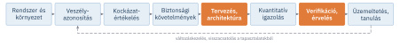
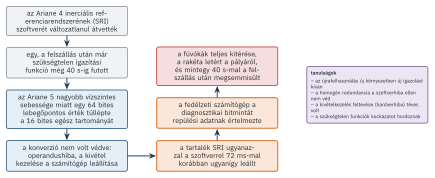
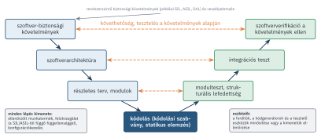
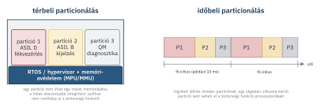
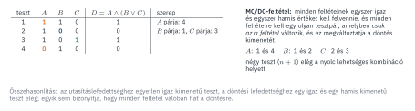

# A szoftver biztonsága {#sec-szoftver}

{width=100%}

A mai biztonságkritikus rendszerekben a funkciók egyre nagyobb részét szoftver valósítja meg: a vegyi reaktor biztonsági PLC-je, a jármű fékvezérlője, a robot biztonsági felügyelete, a repülőgép repülésvezérlése. A szoftver nem kopik, nem fárad, és nem hibásodik meg véletlenszerűen; amikor mégis rosszul működik, annak oka mindig a specifikációban, a tervben vagy a kódban rejlő **szisztematikus hiba**, amely meghatározott körülmények között determinisztikusan előjön ([-@sec-fogalmak]. fejezet). Ezért a szoftver biztonsága nem meghibásodási rátákkal, hanem a fejlesztési folyamat szigorával, az architektúrával és a verifikációval érhető el. Ebben a fejezetben áttekintjük, miben különbözik a szoftver a hardvertől, mit tanultunk a nagy szoftveres balesetekből, mit írnak elő az ágazati szabványok, és milyen technikák (kódolási szabványok, particionálás, statikus elemzés, strukturális lefedettség, formális módszerek) támogatják a biztonságos szoftver fejlesztését.

::: {.cel}
A fejezet végére képes leszel

- megmagyarázni, miért nem jellemezhető a szoftver megbízhatósága a hardveréhez hasonló meghibásodási rátával, és miért nem igazolható nagyon kis hibagyakoriság pusztán teszteléssel;
- a nagy szoftveres balesetek (Ariane 5, Therac-25, Boeing 737 MAX) tanulságait a szoftver-életciklus lépéseihez kötni;
- összevetni az IEC 61508-3, az ISO 26262-6, a DO-178C és a rokon szabványok fő követelményeit;
- kiválasztani a megfelelő kódolási, architekturális és verifikációs technikákat egy adott integritási szinthez;
- kiszámolni egy döntés MC/DC-lefedettségéhez szükséges teszteket;
- értékelni a formális módszerek, a meglévő szoftverek és a fejlesztőeszközök szerepét a biztonsági igazolásban.
:::

## Miben más a szoftver? {#sec-szoftver-mas}

A hardver meghibásodását fizikai folyamatok okozzák (kopás, öregedés, igénybevétel), ezért statisztikailag leírható, és a redundáns elemek nagyrészt egymástól függetlenül hibásodnak meg. A szoftver hibája ezzel szemben a gyártás pillanatától jelen van minden példányban, és ugyanazon bemenetre mindig ugyanúgy jelentkezik. Néhány következmény:

- **A homogén redundancia nem véd.** Két azonos szoftvert futtató csatorna ugyanott hibázik, ahogy az Ariane 5 két inerciális referenciarendszerénél történt ([-@sec-ariane]. szakasz).
- **Nincs folytonosság.** Egy mechanikus szerkezet kis terhelésváltozásra kis deformációval felel; egy programban egyetlen bit eltérése teljesen más viselkedést okozhat. Ezért a szoftvernél nem lehet néhány pontban tesztelni, és a többit „interpolálni”.
- **A bonyolultság nem látszik.** A szoftver állapottere a változók számával exponenciálisan nő, és a fizikai korlátok, amelyek a hardver bonyolultságát természetes módon fékezik, itt hiányoznak.
- **A tesztelés korlátos.** Ahogy Dijkstra megfogalmazta: a tesztelés a hibák jelenlétét mutathatja ki, a hiányukat nem.

Az utolsó pontot kvantitatívan is meg lehet fogalmazni. Butler és Finelli kimutatta, hogy egy repülésvezérlő szoftver $10^{-9}$ óránkénti hibagyakoriságát teszteléssel igazolni több mint százezer évnyi, reprezentatív üzemi körülmények közötti hibamentes futtatást igényelne [@butler1993]. Littlewood és Strigini bayesi elemzése szerint a tesztelésből és az üzemi tapasztalatból reálisan csak mérsékelt megbízhatóság igazolható; a nagyon nagy megbízhatóság állítása mindig a fejlesztési folyamatra, az architektúrára és a formális érvelésre is épül [@littlewood1993]. Ugyanez a gondolatmenet ismétlődik ma az automatizált járműveknél: Kalra és Paddock szerint a balesetek gyakoriságának statisztikailag megalapozott összevetéséhez több száz millió mérföld vezetés kellene ([-@sec-uj-kihivasok]. fejezet) [@kalra2016].

Ezért a szabványok a szoftvernél nem PFD-t vagy PFH-t, hanem **folyamat- és termékkövetelményeket** írnak elő, amelyek szigora az integritási szinttel nő. A SIL, az ASIL vagy a DAL a szoftvernél azt határozza meg, milyen módszereket kell alkalmazni, milyen részletességű dokumentációt kell készíteni, és milyen függetlenséggel kell ellenőrizni a munkát.

## Tanulságok a nagy szoftveres balesetekből {#sec-szoftver-balesetek}

### Ariane 5, 501-es repülés (1996) {#sec-ariane}

Az [-@sec-balesetek]. fejezetben bemutatott balesetek közül három a szoftver szerepe szempontjából különösen tanulságos; itt ezeket a szoftver-életciklus szemszögéből elemezzük. Az Ariane 5 1996-os első repülése mintegy negyven másodperccel a felszállás után ért véget. A vizsgálóbizottság jelentése a hibaláncot pontosan rekonstruálta ([-@fig-ariane5-hibalanc]. ábra) [@lions1996]. Az inerciális referenciarendszer szoftverét az Ariane 4-ből vették át. Egy igazítási funkció, amelyre a felszállás után már nem volt szükség, még negyven másodpercig futott. Az Ariane 5 nagyobb vízszintes sebessége miatt egy 64 bites lebegőpontos érték 16 bites egész számmá alakítása túlcsordult. A konverziót nem védték, mert az Ariane 4 pályáján ez nem fordulhatott elő; a kivételkezelés pedig, amely hardverhibát feltételezett, leállította a számítógépet. A tartalék rendszer ugyanazzal a szoftverrel néhány tized másodperccel korábban ugyanígy leállt. A fedélzeti számítógép a leállt rendszer diagnosztikai adatait repülési adatnak értelmezte, és teljesen kitérítette a fúvókákat.

{#fig-ariane5-hibalanc width=100%}

A tanulságok általánosak: az újrafelhasználás nem mentesít az igazolás alól, mert a követelmények az új környezetben mások lehetnek; a homogén redundancia nem véd a szoftverhiba ellen; a kivételkezelés feltevései (itt: minden hiba hardverhiba) maguk is hibásak lehetnek; és a szükségtelen funkciók szükségtelen kockázatot hordoznak.

### Therac-25 (1985–1987) {#sec-therac}

A Therac-25 sugárterápiás gyorsítóval ([-@sec-balesetek]. fejezet) 1985 és 1987 között hat ismert baleset történt, amelyekben a betegek a tervezett dózis sokszorosát kapták, súlyos sérüléseket és haláleseteket okozva [@leveson1993]. Az elődmodellekben hardveres reteszek akadályozták meg a veszélyes üzemállapotokat; a Therac-25-ben ezeket elhagyták, és a biztonságot teljesen a szoftverre bízták. A szoftverben versenyhelyzet (*race condition*) volt: ha a kezelő gyakorlott gyorsasággal módosította a beállításokat, a gép a módosítás előtti és utáni beállítások veszélyes keverékével sugárzott. Egy másik hiba egy egybájtos számláló túlcsordulásából eredt. A hibaüzenetek érthetetlenek voltak, a kezelők megszokták, hogy figyelmen kívül hagyják őket, és a gyártó az első jelzések után sokáig nem hitte el, hogy a szoftver hibás lehet.

A Therac-25 a szoftverbiztonság tankönyvi esete lett: a szoftver nem helyettesítheti a független védelmeket, a régi kód új környezetben új hibákat hozhat elő, az ember–gép felület a biztonsági rendszer része ([-@sec-ember]. fejezet), és a balesetek kivizsgálása a szervezet kultúráján is múlik.

### Boeing 737 MAX (2018–2019) {#sec-737max}

A Lion Air 610-es (2018) és az Ethiopian Airlines 302-es járatának (2019) katasztrófájában ([-@sec-balesetek]. fejezet) összesen 346 ember halt meg. Mindkét esetben a manőverezési jellemzőket javító rendszer (MCAS) egyetlen, hibás állásszög-érzékelő jele alapján ismételten orrnehéz irányba trimmelte a gépet. A független vizsgálatok szerint az MCAS jogosultságát a fejlesztés késői szakaszában jelentősen megnövelték, de a biztonsági értékelést nem frissítették ennek megfelelően; a rendszer egyetlen érzékelőre támaszkodott, és a biztonsági értékelés olyan pilótareakciókat feltételezett, amelyek több egyidejű figyelmeztetés mellett nem voltak reálisak [@jatr2019].

Ez a baleset már nem programozási hibáról szól: a szoftver azt tette, amit a követelmények szerint tennie kellett. A hiba a követelményekben, a rendszerszintű biztonsági elemzésben, a változáskezelésben és az emberi teljesítményre vonatkozó feltevésekben volt. Leveson régóta hangsúlyozza, hogy a szoftverrel kapcsolatos balesetek döntő többsége a hibás vagy hiányos követelményekre vezethető vissza, nem a kódolási hibákra [@leveson2011]. Lutz a NASA űrszondáinak szoftverhibáit elemezve hasonlóra jutott: a biztonsági szempontból lényeges hibák többnyire a követelmények félreértéséből és az interfészekből eredtek [@lutz1993]. A szoftverbiztonság ezért a rendszerszintű veszélyelemzéssel kezdődik ([-@sec-veszelyazonositas]. és [-@sec-stpa]. fejezet).

## A szabványok követelményei {#sec-szoftver-szabvanyok}

Az ágazati szoftverszabványok közös szerkezetűek: egy életciklus-modellt írnak elő, amelynek minden lépéséhez követelményeket, módszereket és ellenőrzési tevékenységeket rendelnek, és ezek szigorát az integritási szinthez kötik ([-@fig-szoftver-v-modell]. ábra). A legfontosabbak:

- **IEC 61508-3:** az általános szabvány szoftverrésze. Részletes táblázatokban minden SIL-hez ajánlott (R) vagy erősen ajánlott (HR) technikákat ad a követelményektől a verifikációig; ha egy erősen ajánlott technikát nem alkalmaznak, azt indokolni kell [@iec61508].
- **IEC 61511:** a folyamatipari *alkalmazási szoftvert* szabályozza, és megkülönbözteti a rögzített programú nyelveket (csak paraméterezés), a korlátozott változékonyságú nyelveket (például funkcióblokk-diagram a biztonsági PLC-ben) és a teljes változékonyságú nyelveket (általános programozási nyelvek); az utóbbiakra az IEC 61508-3 vonatkozik [@iec61511].
- **ISO 26262-6:** a közúti járművek szoftverfejlesztése ASIL-ekhez kötött módszertáblázatokkal; a 9. rész a különböző ASIL-ű szoftverelemek együttélésének (*freedom from interference*) követelményeit is rögzíti [@iso26262].
- **DO-178C:** a repülés szoftverszabványa öt fejlesztési biztosítottsági szinttel (DAL A–E). Nem módszereket, hanem *célkitűzéseket* ír elő: az A szinten 71, a B szinten 69, a C szinten 62, a D szinten 26 célkitűzést kell teljesíteni, egyre több közülük függetlenséggel [@do178c]. Kiegészítései a formális módszerekre (DO-333) és a modellalapú fejlesztésre vonatkoznak [@do333].
- **EN 50716:** a vasúti szoftverfejlesztés szabványa, amely 2023-ban váltotta fel az EN 50128-at és az EN 50657-et [@en50716].
- **IEC 62304:** az orvostechnikai szoftverek életciklusa, a lehetséges sérülés súlyossága szerinti A, B és C szoftverbiztonsági osztállyal, az ISO 14971 kockázatkezelési folyamatához kapcsolódva [@iec62304].

{#fig-szoftver-v-modell width=100%}

A szabványokban közös a **kétirányú követhetőség**: minden rendszerszintű biztonsági követelményhez követhetően tartozik szoftverkövetelmény, minden szoftverkövetelményhez terv- és kódelem, valamint teszteset, és fordítva, minden kódrészletnek valamelyik követelményből kell erednie. Ez egyszerre biztosítja, hogy semmi ne maradjon ki, és hogy ne kerüljön a szoftverbe nem szándékolt funkció (ami az Ariane 5 igazítási funkciójának esete volt).

## Architektúra: particionálás és vegyes kritikusság {#sec-particionalas}

A modern beágyazott rendszerekben egyetlen processzoron különböző integritású szoftverek futnak: egy járművezérlő egységen a fékvezérlés (ASIL D) mellett diagnosztika és kijelzés (QM vagy alacsony ASIL). Ha a kevésbé gondosan fejlesztett szoftver felülírhatja a biztonsági funkció memóriáját vagy elveheti a processzoridejét, az egész egység a legalacsonyabb integritású elem szintjére süllyed. A megoldás a **particionálás** ([-@fig-particionalas]. ábra):

- **térbeli particionálás:** a memóriavédelmi egység (MPU vagy MMU) és a valós idejű operációs rendszer vagy hypervisor biztosítja, hogy egy partíció ne írhasson a másik memóriájába;
- **időbeli particionálás:** minden partíció rögzített időrést kap, így egy végtelen ciklusba került partíció sem veheti el a biztonsági funkció idejét.

{#fig-particionalas width=100%}

A repülésben az integrált moduláris avionika és az ARINC 653 szabvány, a járműiparban az AUTOSAR és az ISO 26262-6 és -9 követelményei szabályozzák ezt [@iso26262]. A particionálás mellett a jó biztonsági architektúra egyéb elvei: modularitás és egyszerű interfészek; a biztonsági funkciók elkülönítése a nem biztonságiaktól; a hibák terjedésének korlátozása; a defenzív programozás (a bemenetek és a köztes eredmények ellenőrzése); és a [-@sec-egas]. szakaszban látott diverz felügyelet.

## Kódolás és statikus elemzés {#sec-kodolas}

A biztonságkritikus szoftvereket olyan nyelvi részhalmazban írják, amely kizárja a nem definiált vagy nehezen elemezhető konstrukciókat. A C nyelvre a **MISRA C** irányelvei a legelterjedtebbek, legújabb kiadása a MISRA C:2025 [@misra2025]. Ezek többek között tiltják vagy korlátozzák a dinamikus memóriafoglalást, a rekurziót, a nem definiált viselkedést okozó műveleteket és az implicit típuskonverziókat; az Ariane 5 hibája éppen egy nem védett típuskonverzió volt. Hasonló szerepet töltenek be a MISRA C++ és a CERT C irányelvei, a repülésben pedig az Ada és annak formálisan ellenőrizhető részhalmaza, a SPARK.

A **statikus elemzés** a kód futtatása nélkül vizsgálja a programot. Az egyszerű eszközök a kódolási szabályok megsértését keresik, a fejlettebbek, például az **absztrakt interpretáción** alapuló elemzők, matematikai bizonyosságot adnak bizonyos hibaosztályok (nullával osztás, túlcsordulás, tömbtúlindexelés, inicializálatlan változó) hiányáról. Az Astrée elemzővel így igazolták, hogy az Airbus repülésvezérlő szoftvereinek kódjában nincsenek futásidejű hibák [@delmas2007]. Az ilyen elemzés olyan bizonyosságot ad, amelyet a tesztelés sosem adhatna: minden lehetséges bemenetre érvényes.

## Tesztelés és strukturális lefedettség {#sec-strukturalis-lefedettseg}

A biztonságkritikus szoftver tesztelése **követelményalapú**: minden teszteset egy követelmény ellenőrzésére szolgál, és a követelmények normál és határesetei, valamint az érvénytelen bemenetek is lefedendők. A **strukturális lefedettség** mérése ezután megmutatja, hogy a követelményalapú tesztek a kód mely részeit futtatták meg. A le nem fedett kód vagy hiányzó követelményre (és tesztre), vagy nem szándékolt funkcióra, vagy halott kódra utal; mindhárom eset vizsgálatot igényel.

A lefedettségi mértékek egyre szigorúbbak [@hayhurst2001]:

- **utasításlefedettség:** minden utasítás legalább egyszer lefut;
- **döntési lefedettség:** minden döntés (elágazás) igaz és hamis kimenete is előfordul;
- **módosított feltétel/döntés lefedettség** (*modified condition/decision coverage*, MC/DC): ezen felül minden döntés minden feltételéről ki kell mutatni, hogy önállóan, a többi feltétel rögzítése mellett befolyásolja a döntés kimenetét.

Az MC/DC a repülésben a DAL A szoftver követelménye, a döntési lefedettség a DAL B-é, az utasításlefedettség a DAL C-é [@do178c]. Az ISO 26262-6 az ASIL D egységtesztjénél erősen ajánlja az MC/DC-t, az ASIL B és C szinten a döntési lefedettséget [@iso26262]. Az MC/DC előnye, hogy $n$ feltételhez már $n + 1$ teszttel elérhető, szemben a $2^n$ kombináció kimerítő tesztelésével, mégis kimutatja, ha egy feltétel hatását a kód rosszul valósítja meg ([-@fig-mcdc-pelda]. ábra).

{#fig-mcdc-pelda width=100%}

::: {.pelda title="MC/DC-tesztek tervezése"}
Egy reteszfeltétel: a robot csak akkor indulhat, ha az ajtó zárva van ($A$), *és* vagy a kezelő a biztonsági zónán kívül van ($B$), vagy a robot csökkentett sebességű üzemmódban van ($C$). A döntés $D = A \wedge (B \vee C)$. Az MC/DC-tesztek ([-@fig-mcdc-pelda]. ábra): (1) $A=1, B=1, C=0 \Rightarrow D=1$; (2) $A=1, B=0, C=0 \Rightarrow D=0$; (3) $A=1, B=0, C=1 \Rightarrow D=1$; (4) $A=0, B=1, C=0 \Rightarrow D=0$. Az 1–4 pár mutatja $A$, az 1–2 pár $B$, a 2–3 pár $C$ önálló hatását. Ha a programozó elfelejtette a $C$ feltételt ($D = A \wedge B$), a (3)-as teszt hibát mutat (az elvárt 1 helyett 0-t ad). Döntési lefedettséghez viszont az (1) és a (2) teszt is elég volna, és egyik sem venné észre a hiányzó feltételt. Az MC/DC sem tévedhetetlen: ha a programozó a műveleti sorrendet tévesztette el, és $(A \wedge B) \vee C$-t írt, mind a négy teszt átmegy, mert a hiba csak az $A=0, B=0, C=1$ bemenetnél jelentkezik. A strukturális lefedettség tehát a tesztkészlet *elégtelenségét* mutatja ki, a kód helyességét nem bizonyítja; a felülvizsgálat és a statikus elemzés ezért elengedhetetlen kiegészítése.
:::

A lefedettség szükséges, de nem elégséges feltétel: a 100%-os MC/DC sem bizonyítja, hogy a követelmények helyesek, vagy hogy a program időzítése és erőforrás-használata megfelelő. Ezért a biztonságkritikus szoftver verifikációja a tesztelés mellett a legrosszabb futási idő elemzését, a veremhasználat elemzését, a felülvizsgálatokat és a statikus elemzést is magában foglalja.

## Formális módszerek {#sec-formalis-modszerek}

A formális módszerek a követelményeket és a tervet matematikai nyelven írják le, és a tulajdonságokat (például „a két gyorszáró szelep sosem kap egyszerre nyitási parancsot, ha a hőmérséklet a határ fölött van”) matematikai bizonyítással vagy kimerítő állapottér-bejárással ellenőrzik. Két fő águk a **modellellenőrzés** (*model checking*), amely egy véges állapotú modell minden lehetséges viselkedését automatikusan bejárja, és ellenpéldát ad, ha egy tulajdonság sérül; és a **tételbizonyítás**, amely interaktívan, gépi ellenőrzés mellett igazolja, hogy a program megfelel a specifikációnak.

A formális módszerek ipari alkalmazása az elmúlt évtizedekben kinőtte a kutatási kuriózum státuszt. A párizsi 14-es, vezető nélküli metróvonal biztonságkritikus szoftverét a B-módszerrel fejlesztették, és a bizonyított részekben a későbbi validálás és üzemeltetés során sem találtak hibát [@behm1999]. A seL4 mikrokernel az első általános célú operációsrendszer-mag, amelynek funkcionális helyességét teljes körű gépi bizonyítás igazolja [@klein2009]. Az Amazon Web Services a TLA+ specifikációs nyelvvel olyan tervezési hibákat talált elosztott rendszereiben, amelyeket a tesztelés és a felülvizsgálat nem tárt fel [@newcombe2015]. A DO-333 kiegészítés a repülésben lehetővé teszi, hogy a formális bizonyítás bizonyos tesztelési célkitűzéseket kiváltson [@do333].

A formális módszereknek is vannak korlátai: a bizonyítás csak a specifikációhoz képest igazolja a helyességet, és ha a specifikáció hibás (mint a 737 MAX esetében a követelmények), a bizonyítás sem segít. A modellellenőrzés pedig az állapotrobbanás miatt nagy rendszereknél csak absztrakciókkal alkalmazható. Leginkább a kritikus magok (protokollok, reteszlogika, ütemezés, felügyeleti funkciók) igazolására érdemes őket használni.

## Meglévő szoftverek, eszközök és konfigurációk {#sec-meglevo-szoftver}

A biztonságkritikus termékek ritkán épülnek teljesen saját fejlesztésű szoftverből. Operációs rendszerek, kommunikációs könyvtárak, nyílt forrású komponensek és korábbi termékekből átvett modulok egyaránt előfordulnak. Ezek felhasználhatósága a szabványok szerint igazolható a megfelelő fejlesztési folyamattal (ha a dokumentáció rendelkezésre áll), az üzemi tapasztalattal (ha a korábbi használat körülményei, a változatok és a meghibásodások dokumentáltak) vagy az elem körüli védelmekkel (például a kimenet független felügyeletével) [@iec61508]. Az orvostechnikában az ismeretlen eredetű szoftver (*software of unknown provenance*, SOUP) kockázatait külön kell értékelni [@iec62304]. Az Ariane 5 tanulsága szerint az üzemi tapasztalat csak akkor érvényes, ha az új alkalmazás bemeneti tartománya és környezete a korábbiéval azonos.

A **fejlesztőeszközök** (fordítók, kódgenerátorok, statikus elemzők, tesztelő eszközök) maguk is hibát vihetnek a termékbe, vagy elrejthetik a hibákat. Az ISO 26262-8 az eszköz hatása és a hibái felderíthetősége alapján eszközbizalmi szintet rendel hozzájuk, és ennek megfelelően kell minősíteni őket vagy a kimenetüket ellenőrizni [@iso26262]; a repülésben a DO-178C kiegészítése szabályozza az eszközminősítést. Végül a **konfiguráció és a paraméterek** (határértékek, időzítések, mértékegységek) a szoftver részei: egy rosszul beállított kioldási határérték ugyanolyan veszélyes, mint egy programhiba, ezért ezek is a változáskezelés és a verifikáció hatálya alá tartoznak.

::: {.eset eset="A" title="ReaktorVéd: az alkalmazási program a biztonsági PLC-ben"}
A ReaktorVéd biztonsági logikáját a tanúsított PLC korlátozott változékonyságú nyelvén, tanúsított funkcióblokkokból építik fel (1oo2 szavazás a távadókra, időkésleltetés, kiiktatáskezelés, a szelepek kimenetei). Az IEC 61511 szerinti fő lépések: az alkalmazási program követelményei a biztonsági követelményspecifikációból erednek; a programot felülvizsgálják és szimulációval tesztelik; a gyári átvételi teszt minden ok–okozati kapcsolatot ellenőriz; a változtatásokat a változáskezelési eljárás szerint engedélyezik és újratesztelik [@iec61511]. A tipikus hibák nem a funkcióblokkokban, hanem az alkalmazásban vannak: rossz mértékegység (°C helyett K), felcserélt kimenetek, olyan kiiktatás, amely karbantartás után bekapcsolva marad, vagy egy időkésleltetés, amely a folyamatbiztonsági időnél hosszabb. A gyári és a helyszíni átvételi teszt ezért a teljes jellistát és minden kiiktatást lefed.
:::

::: {.eset eset="B" title="VészFék: szoftver ASIL-lal és teljesítménykorlátokkal"}
A vészfékező asszisztens szoftvere két, eltérő jellegű részből áll. A döntési és beavatkozási lánc (a fékigény kiszámítása, a téves fékezés elleni felügyelet, a kommunikáció a fékrendszerrel) hagyományos, ASIL szerint fejlesztett szoftver: követelményalapú tesztelés, MC/DC-lefedettség a legmagasabb ASIL-ű részeken, particionálás a többi funkciótól. Az érzékelési lánc (a tárgyak felismerése a kamera képéből) viszont gyakran gépi tanulásra épül, amelynek viselkedése nem vezethető vissza egyenként megírt követelményekre, és a hagyományos lefedettségi mértékek sem értelmezhetők rá. Ennek biztonsága a rendeltetésszerű funkció biztonságának (ISO 21448) és a mesterséges intelligencia biztonsági szabványainak tárgya ([-@sec-uj-kihivasok]. fejezet). Az architektúra ezért gyakran egy egyszerű, hagyományos módon igazolható felügyeletet tesz a gépi tanulási komponens mellé, amely a fizikailag nem plauzibilis döntéseket kiszűri.
:::

::: {.osszefoglalo}
- A szoftver hibái szisztematikusak; a szoftver nem jellemezhető a hardveréhez hasonló meghibásodási rátával, és a nagyon kis hibagyakoriság teszteléssel nem igazolható.
- A nagy szoftveres balesetek (Ariane 5, Therac-25, 737 MAX) többnyire a követelményekből, az újrafelhasználás feltevéseiből, a független védelmek hiányából és a rendszerszintű elemzés hiányosságaiból fakadtak, nem a kódolásból.
- Az ágazati szabványok az integritási szinttől függő szigorú életciklust, módszereket és független ellenőrzést írnak elő; közös elvük a kétirányú követhetőség.
- A particionálás teszi lehetővé, hogy különböző integritású szoftverek egy processzoron fussanak.
- A kódolási szabványok (MISRA C:2025) és a statikus elemzés egész hibaosztályokat zárnak ki; az absztrakt interpretáció a futásidejű hibák hiányát is bizonyíthatja.
- A követelményalapú tesztelést strukturális lefedettség egészíti ki; az MC/DC $n$ feltételhez $n+1$ teszttel ellenőrzi minden feltétel önálló hatását.
- A formális módszerek a kritikus magok helyességét matematikai bizonyossággal igazolhatják, de csak a specifikációhoz képest.
- A meglévő szoftverek, a fejlesztőeszközök és a konfigurációs adatok is az igazolás tárgyai.
:::

::: {.onell}
1. Miért nem javítja a szoftverhibák elleni védelmet, ha ugyanazt a programot két processzoron futtatjuk? Milyen hibák ellen véd mégis ez az elrendezés?
2. Hány teszt kell az $A \wedge B \wedge C$ döntés MC/DC-lefedettségéhez? Add meg őket!
3. Miért nem elég a 100%-os utasításlefedettség egy biztonsági funkció szoftverének igazolásához?
4. Egy beszállító azt állítja, hogy a szoftvere tíz év alatt több ezer berendezésben hibátlanul működött, ezért SIL 3-as alkalmazásban is használható. Milyen kérdéseket tennél fel?
5. Mi a közös az Ariane 5 és a Boeing 737 MAX balesetében a szoftver szempontjából, és mi a különbség?

::: {.megoldas}
1. Mert a szoftverhiba mindkét példányban ott van, és ugyanazon bemenetre mindkettő ugyanúgy hibázik (közös okú hiba). Az elrendezés a véletlenszerű hardverhibák és az átmeneti hibák (például sugárzás okozta bitváltás) ellen véd, ha a két csatorna eredményét összehasonlítják.
2. Négy teszt: $(1,1,1) \Rightarrow 1$, valamint $(0,1,1)$, $(1,0,1)$ és $(1,1,0)$, mindegyik $\Rightarrow 0$. Mindegyik feltételre az első teszt és a hozzá tartozó, csak abban a feltételben eltérő teszt alkot párt.
3. Mert csak azt mutatja, hogy minden utasítás lefutott, azt nem, hogy minden döntés mindkét kimenete és minden feltétel hatása ellenőrzött; és semmit sem mond a követelmények helyességéről, az időzítésről, a hiányzó funkciókról vagy a nem szándékolt viselkedésről.
4. Ugyanabban a változatban futott-e a szoftver? Hasonló volt-e az alkalmazás, a bemeneti tartomány, a környezet és a használati mód? Hogyan gyűjtötték és elemezték a meghibásodásokat, és ki ellenőrizte ezt? Mennyi az összes üzemóra, és ebből milyen konfidenciával mekkora hibagyakoriság állítható? Ismertek-e a szoftver fejlesztési folyamata és dokumentációja? Az IEC 61508 üzemi tapasztalatra vonatkozó követelményei mindezek dokumentálását kívánják.
5. Mindkettőben a szoftver a specifikációja szerint működött, és a hiba a rendszerszintű feltevésekben volt. Az Ariane 5-nél a hiba egy újrafelhasznált modul feltevéseiben (az Ariane 4 pályája) és a nem védett konverzióban rejlett, a homogén redundancia pedig nem védett ellene. A 737 MAX-nál a követelmények, a változáskezelés, az egyetlen érzékelőre épülő kialakítás és a pilótareakciókra vonatkozó feltevések voltak hibásak.
:::
:::

::: {.forras}
- Leveson, N. G. (2011): *Engineering a Safer World.* MIT Press – a szoftver szerepe a balesetekben és a követelmények elsődlegessége [@leveson2011].
- Lions, J.-L. (1996): *ARIANE 5 Flight 501 Failure: Report by the Inquiry Board.* ESA [@lions1996]; Leveson, N. G., Turner, C. S. (1993): An investigation of the Therac-25 accidents. *IEEE Computer* [@leveson1993].
- Butler, R. W., Finelli, G. B. (1993): The infeasibility of quantifying the reliability of life-critical real-time software. *IEEE TSE* [@butler1993].
- Hayhurst, K. J. et al. (2001): *A Practical Tutorial on Modified Condition/Decision Coverage.* NASA [@hayhurst2001].
- IEC 61508-3, ISO 26262-6, DO-178C, EN 50716, IEC 62304 – az ágazati szoftverszabványok [@iec61508; @iso26262; @do178c; @en50716; @iec62304].
:::
