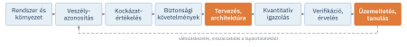
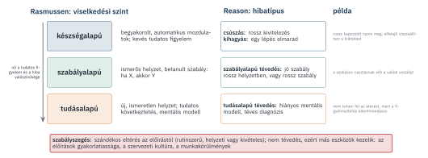
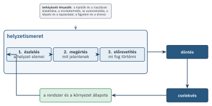
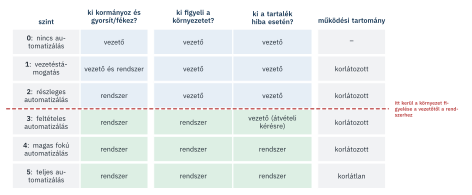
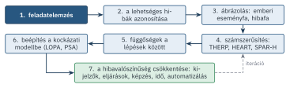

# Az ember a biztonságkritikus rendszerben {#sec-ember}

{width=100%}

A balesetvizsgálati jelentések visszatérő kifejezése az „emberi hiba”. A [-@sec-balesetek]. fejezetben azonban láttuk, hogy ez a megállapítás ritkán magyaráz bármit: a frontvonalban dolgozók tévedései többnyire a rendszer tervezéséből, a munkakörülményekből és a szervezet döntéseiből fakadnak, és ugyanezek az emberek a legtöbb nap éppen azzal tartják biztonságban a rendszert, hogy alkalmazkodnak a váratlan helyzetekhez. Ez a fejezet az embert a biztonságkritikus rendszer részeként vizsgálja: hogyan és miért tévedünk, mitől függ, hogy a kezelő érti-e a helyzetet, milyen csapdákat rejt az automatizálás, hogyan tervezhetők jó riasztási rendszerek, és hogyan számszerűsíthető az emberi teljesítmény a kockázatelemzésben.

::: {.cel}
A fejezet végére képes leszel

- az emberi tévedéseket Rasmussen viselkedési szintjei és Reason hibatípusai szerint osztályozni, és mindegyikhez megfelelő megelőző intézkedést rendelni;
- elemezni a helyzetismeret szintjeit, és felismerni a kijelzők, a riasztások és az automatizálás hatását a kezelő teljesítményére;
- megmagyarázni az automatizálás iróniáit és a járműautomatizálási szintek biztonsági következményeit;
- a riasztáskezelés fő elveit és teljesítménymutatóit alkalmazni;
- emberi hibavalószínűséget becsülni a HEART és a SPAR-H módszerrel, és értelmezni a függőségek hatását;
- megítélni, mikor számítható be a kezelői beavatkozás független védelmi rétegként.
:::

## Emberi hiba: tünet vagy ok? {#sec-emberi-hiba}

Az emberi hibának két szemlélete van. A **hagyományos szemlélet** szerint a rendszer alapvetően biztonságos, és az emberek megbízhatatlansága veszélyezteti; a megoldás a szigorúbb szabályozás, a fegyelmezés és az ember kiváltása automatizálással. Az **újabb szemlélet** szerint az emberi hiba a rendszer mélyebb problémáinak *tünete*: azt jelzi, hol nem illeszkednek egymáshoz a feladatok, az eszközök, a környezet és az emberi képességek [@reason1997; @leveson2011]. Hollnagel Safety-II szemlélete ennél is tovább megy: a biztonság nem a hibák hiánya, hanem a rendszer képessége arra, hogy változó körülmények között is sikeresen működjön, és ennek legfontosabb forrása éppen az emberi alkalmazkodás [@hollnagel2014].

A két szemlélet nem zárja ki egymást, de a gyakorlati következményük eltér. Ha egy kezelő rossz szelepet zár el, a hagyományos szemlélet a kezelőt oktatja ki, az újabb azt kérdezi meg, miért lehetett a két szelepet összetéveszteni (azonos kinézet, rossz címkézés, rossz megvilágítás, időnyomás), és a rendszert alakítja át úgy, hogy a tévedés nehezebb legyen, vagy következmények nélkül maradjon.

### Viselkedési szintek és hibatípusok {#sec-srk-gems}

Rasmussen három viselkedési szintet különböztetett meg ([-@fig-srk-gems]. ábra) [@rasmussen1983]. A **készségalapú** viselkedés begyakorolt, automatikus mozdulatsorokból áll, kevés tudatos figyelemmel (egy rutinszerű kapcsolási művelet). A **szabályalapú** viselkedés ismerős helyzetben betanult szabályokat alkalmaz („ha a nyomás magas, nyisd a lefúvatást”). A **tudásalapú** viselkedés új, ismeretlen helyzetben tudatos következtetésre és a rendszer mentális modelljére épül.

Reason erre építve osztályozta a nem szándékos hibákat [@reason1990]. A készségalapú szinten **csúszások** (a szándék jó, a kivitelezés rossz: rossz gombot nyom meg) és **kihagyások** (egy lépés elmarad: elfelejti visszaállítani a kiiktatást) fordulnak elő. A szabály- és a tudásalapú szinten **tévedések**: jó szabály rossz helyzetben, rossz szabály, illetve hiányos mentális modellen alapuló téves diagnózis. A **szabályszegés** ezektől elkülönül: szándékos eltérés az előírástól, amely lehet rutinszerű (mindenki így csinálja), helyzeti (az előírás az adott helyzetben nem követhető) vagy kivételes.

{#fig-srk-gems width=100%}

Az osztályozásnak gyakorlati haszna van, mert minden hibatípusra más intézkedés hat. A csúszások és kihagyások ellen a jó ergonómia, a megkülönböztethető kezelőszervek, az ellenőrző listák és a visszaigazolást kérő kialakítás véd; a képzés itt keveset segít, hiszen a kezelő tudja, mit kellene tennie. A szabályalapú tévedések ellen a helyzetek egyértelmű jelzése és a jó eljárások védenek. A tudásalapú tévedések ellen a rendszer működésének mély megértése, a szimulátoros képzés, a jó kijelzők és a döntéstámogatás. A szabályszegések ellen pedig a gyakorlatias, végrehajtható előírások, a munkaterhelés és az időnyomás csökkentése, és egy olyan szervezeti kultúra, amely a jelentést és a tanulást jutalmazza, nem a hibáztatást [@reason1997].

## Helyzetismeret és ember–gép felület {#sec-helyzetismeret}

A kezelő akkor dönt jól, ha érti, mi történik. Endsley modellje szerint a **helyzetismeret** (*situation awareness*) három szintű ([-@fig-helyzetismeret]. ábra) [@endsley1995]: a helyzet lényeges elemeinek **észlelése** (milyen értékeket mutatnak a műszerek), azok **megértése** (mit jelentenek együtt, milyen állapotban van a rendszer), és a közeli jövő **előrevetítése** (mi fog történni, ha nem avatkozom be). A helyzetismeret elvesztése a vizsgált légi balesetek jelentős részében szerepet játszott, és a folyamatipari és a közúti balesetekben is gyakori.

{#fig-helyzetismeret width=88%}

Az ember–gép felület tervezésének célja a helyzetismeret támogatása. Néhány jól bevált elv: a kijelző a *feladathoz* és ne a rendszer belső szerkezetéhez igazodjon; az eltérést a normál állapottól mutassa, ne csak a nyers értéket; a trendeket is jelenítse meg, mert az előrevetítéshez a változás iránya kell; az üzemmódot (kézi, automatikus, kiiktatott) mindig egyértelműen mutassa; és a ritkán használt, de kritikus funkciók is legyenek könnyen elérhetők. A Therac-25 érthetetlen hibaüzenetei ([-@sec-therac]. szakasz) és a texasi finomító hibás szintkijelzése ([-@sec-hat-baleset]. szakasz) azt mutatják, hogy a rossz felület a balesetek egyik leggyakoribb látens feltétele.

## Az automatizálás iróniái {#sec-automatizalas}

Az automatizálás a rutinfeladatokat megbízhatóbban és fáradhatatlanabbul végzi, mint az ember. Bainbridge klasszikus tanulmánya azonban rámutatott az automatizálás **iróniáira** [@bainbridge1983]. A tervezők azt automatizálják, amit tudnak, és az embernek a nehezen automatizálható, váratlan helyzetek maradnak. A kezelő feladata a felügyelet lesz, amire az ember kifejezetten rosszul alkalmas: a ritkán változó kijelzők figyelése fárasztó és unalmas. Közben a kézi készségei és a rendszer működésének megértése elsorvad, mert nem gyakorolja őket. Amikor pedig az automatika a képességei határán kiszáll, éppen akkor kell átvennie az irányítást, amikor a helyzet a legnehezebb, és ő a legkevésbé felkészült.

Parasuraman, Sheridan és Wickens modellje szerint az automatizálás négy funkcióra terjedhet ki: az információ gyűjtésére, elemzésére, a döntés kiválasztására és a végrehajtásra, és mindegyiknél különböző fokú lehet [@parasuraman2000]. A biztonság szempontjából a legkritikusabb a döntés automatizálása, mert ott a legnagyobb a veszélye a **túlzott bizalomnak** (*complacency*) és az **automatizálási torzításnak**, amikor a kezelő akkor is elfogadja a rendszer javaslatát, ha a rendelkezésére álló más információ ellentmond neki. A másik gyakori probléma az **üzemmód-tévesztés**: a kezelő azt hiszi, a rendszer egy adott üzemmódban van, miközben egy másikban működik.

::: {.baleset title="Air France 447, 2009: amikor az automatika kiszáll"}
2009\. június 1-jén az Air France Rio de Janeiróból Párizsba tartó Airbus A330-asa éjszaka, viharfelhők között repült az Atlanti-óceán felett. A sebességmérő Pitot-csöveket jégkristályok tömték el, a mért sebességek ellentmondásossá váltak, és a robotpilóta kikapcsolt. A repülésvezérlés egy kevesebb védelmet nyújtó üzemmódba váltott. A gépet irányító pilóta a váratlan helyzetben tartósan felfelé húzta az orrot, a gép átesett, és a személyzet a hátralévő négy percben nem ismerte fel az átesést. A gép az óceánba csapódott, mind a 228 ember meghalt a fedélzeten [@bea2012].

A francia vizsgálóhatóság jelentése az emberi teljesítményt a rendszer egészének összefüggésében elemezte. A pilóták a kézi magaslégköri repülést és az átesés felismerését ritkán gyakorolták; a váratlan helyzet meglepetés- és ijedtségreakciót váltott ki; a feladatmegosztás a pilóták között felbomlott; és az átesésre figyelmeztető jelzés viselkedése maga is zavaró volt: nagyon kis mért sebességnél (az adatot érvénytelennek tekintve) elhallgatott, és amikor a pilóta lenyomta az orrot, és a sebesség nőni kezdett, újra megszólalt, mintha a helyes beavatkozás okozná a veszélyt [@bea2012]. Az eset Bainbridge iróniáinak tankönyvi példája: az automatika éppen a legnehezebb helyzetben adta vissza az irányítást, olyan személyzetnek, amelynek kézi készségei és helyzetismerete erre nem voltak felkészítve.
:::

### Járműautomatizálás {#sec-jarmuautomatizalas}

A közúti járművekben az automatizálás fokozatait az SAE J3016 hat szintje írja le ([-@fig-automatizalasi-szintek]. ábra) [@sae3016]. A 0–2. szinten a vezető folyamatosan figyeli a környezetet, és ő a tartalék; a rendszer csak támogatja. A 3. szinttől a rendszer figyeli a környezetet a működési tartományán belül, a 3. szinten azonban a vezetőnek átvételi kérésre még ésszerű időn belül át kell vennie az irányítást. A 4. és az 5. szinten a rendszer maga a tartalék.

{#fig-automatizalasi-szintek width=100%}

A legnehezebb a 2. és a 3. szint. A 2. szinten a rendszer annyira jól működik, hogy a vezető hajlamos elveszíteni a figyelmét, holott neki kell azonnal beavatkoznia, ha a rendszer hibázik. A [-@sec-balesetek]. fejezetben tárgyalt 2018-as tempei baleset ennek drámai példája: a fejlesztési célú automatizált jármű biztonsági vezetője a vizsgálat szerint az út helyett a mobiltelefonját nézte, a vállalat pedig nem gondoskodott megfelelő felügyeletről és figyelemellenőrzésről [@ntsb2019]. A 3. szinten az átvételi idő a kérdés: egy hosszú ideje nem figyelő vezetőnek másodpercek, sőt több másodperc kell, mire újra kialakítja a helyzetismeretét. Ezért írják elő a szabályozások a vezető figyelmének folyamatos ellenőrzését, és azt, hogy a rendszer az átvétel elmaradása esetén maga hajtson végre minimális kockázatú manővert [@unr157].

::: {.eset eset="B" title="VészFék: az ember mint tartalék és mint zavarforrás"}
A vészfékező asszisztens 1. vagy 2. szintű funkció: a vezető felelőssége, hogy figyeljen, a rendszer csak akkor avatkozik be, ha a vezető nem reagál időben. Az emberi tényezők itt két irányból hatnak. Egyrészt a figyelmeztetésnek olyannak kell lennie, hogy a vezető gyorsan és helyesen reagáljon (hangjelzés, vizuális jelzés, rövid fékrándítás), és ne ijedjen meg annyira, hogy rosszul cselekedjen. Másrészt a túl sok téves figyelmeztetés a vezető bizalmát rontja: kikapcsolja a rendszert, vagy figyelmen kívül hagyja a jelzéseit. A téves fékezés és a téves figyelmeztetés ezért nemcsak műszaki, hanem emberi tényezői kockázat is, amelyet a rendeltetésszerű funkció biztonságának elemzése ([-@sec-uj-kihivasok]. fejezet) is figyelembe vesz.
:::

## Riasztáskezelés {#sec-riasztaskezeles}

A riasztás a kezelő figyelmét egy beavatkozást igénylő helyzetre hívja fel. A modern irányítórendszerekben egy riasztás beállítása szinte semmibe sem kerül, ezért a rendszerek gyakran túl sok riasztással rendelkeznek. Zavar idején percenként tucatnyi riasztás szólalhat meg, és a kezelő nem tudja kiválasztani a lényegeset. A **riasztásáradat** számos súlyos ipari baleset hátterében szerepelt, és a [-@sec-csokornyakkendo]. szakasz csokornyakkendő-diagramján a kezelői gát eszkalációs tényezője volt.

A riasztáskezelés szakmai irányelveit az EEMUA 191 útmutató és az ANSI/ISA-18.2 szabvány foglalja össze [@eemua191; @isa182]. Fő elveik: minden riasztásnak egyértelmű beavatkozást kell igényelnie, és a kezelőnek legyen ideje erre; a riasztásokat racionalizálni kell (felesleges, ismétlődő, állandóan aktív riasztások megszüntetése); a prioritásokat a következmény súlyossága és a rendelkezésre álló idő alapján kell kiosztani; a riasztásokat üzem közben folyamatosan mérni és javítani kell. A szokásos teljesítménymutatók: egy kezelőre jutó átlagos riasztásszám (az ajánlás tízpercenként nagyjából egy), a riasztásáradatok aránya (áradatnak a tíz percen belüli tíznél több riasztás számít), a leggyakoribb riasztások részaránya, az állandóan aktív és a tartósan elnémított riasztások száma, és a prioritások megoszlása (a riasztások nagy része alacsony, kis része magas prioritású legyen) [@isa182].

A biztonsági szempontból kritikus riasztások külön figyelmet érdemelnek: ha egy riasztást és a hozzá tartozó kezelői beavatkozást a LOPA független védelmi rétegként számít be ([-@sec-ipl]. szakasz), akkor a riasztásnak a többi riasztástól megkülönböztethetőnek, a kezelőnek pedig az előírt idő alatt képesnek kell lennie felismerni és végrehajtani a teendőt.

## Az emberi megbízhatóság elemzése {#sec-hra}

Ha az emberi beavatkozás egy védelmi réteg vagy egy hibafa alapeseménye, a kockázatelemzéshez számszerű **emberi hibavalószínűség** (*human error probability*, HEP) kell. Ezt az emberi megbízhatóság elemzése (*human reliability analysis*, HRA) adja ([-@fig-hra-folyamat]. ábra) [@kirwan1994]. A folyamat a feladat elemzésével kezdődik (milyen lépésekből áll, milyen információra és időre van szükség), majd azonosítja a lehetséges hibákat, emberi eseményfában vagy hibafában ábrázolja őket, számszerűsíti a valószínűségüket, figyelembe veszi a lépések közötti függőségeket, és az eredményt beépíti a kockázati modellbe. A legértékesebb kimenet sokszor nem a szám, hanem annak felismerése, mi csökkentené a hibavalószínűséget.

{#fig-hra-folyamat width=92%}

A három legelterjedtebb számszerűsítő módszer:

- **THERP** (*technique for human error rate prediction*): a nukleáris ipar számára kidolgozott, részletes módszer, amely a feladatot elemi lépésekre bontja, mindegyikhez táblázatos alapvalószínűséget rendel, és ezeket a teljesítményt befolyásoló tényezőkkel módosítja [@swain1983]. A lépések közötti **függőséget** öt szinttel kezeli: ha a független valószínűség $N$, a feltételes valószínűség kis függőségnél $(1 + 19N)/20$, közepesnél $(1 + 6N)/7$, nagynál $(1 + N)/2$, teljes függőségnél 1. Ez fontos: ha ugyanaz a kezelő ellenőrzi a saját munkáját, a második lépés hibavalószínűsége közel sem független az elsőétől.
- **HEART** (*human error assessment and reduction technique*): egyszerűbb, gyorsan alkalmazható módszer. A feladatot kilenc általános feladattípus egyikébe sorolja, mindegyikhez névleges hibavalószínűség tartozik, majd a hibát előidéző körülmények (*error producing conditions*, EPC) szorzóival módosítja, a hatásuk becsült arányával súlyozva [@williams1988].
- **SPAR-H**: az amerikai nukleáris hatóság egyszerűsített módszere, amely a feladatot diagnózisra (névleges HEP = 0,01) és végrehajtásra (névleges HEP = 0,001) bontja, és nyolc teljesítményt befolyásoló tényező (rendelkezésre álló idő, stressz, bonyolultság, tapasztalat és képzés, eljárások, ergonómia és ember–gép felület, munkaképesség, munkafolyamatok) szorzóival módosítja [@gertman2005].

::: {.pelda title="Emberi hibavalószínűség becslése a HEART módszerrel"}
Egy kezelőnek egy rutinszerű, jól begyakorolt, gyors és viszonylag kis szakértelmet igénylő műveletet kell végrehajtania (egy kézi szelep elzárása egy ismert helyen). A HEART szerint ez az E feladattípus, névleges hibavalószínűsége 0,02 [@williams1988]. Két hibát előidéző körülmény áll fenn: kevés idő van a hiba észlelésére és kijavítására (szorzója 11), és a kezelő tapasztalatlan (szorzója 3). Az elemző a két körülmény hatásának arányát 0,4-re, illetve 0,5-re becsüli. A súlyozott szorzók: $(11 - 1)\cdot 0{,}4 + 1 = 5$ és $(3 - 1)\cdot 0{,}5 + 1 = 2$, így

$$
\text{HEP} = 0{,}02 \cdot 5 \cdot 2 = 0{,}2 .
$$

Ez tízszerese a névleges értéknek. A számítás egyben azt is megmutatja, hol érdemes beavatkozni: ha a kezelőnek több idő jut (például mert egy automatikus előriasztás korábban jelez), az első szorzó 1-re csökken, és a HEP 0,04 lesz; ha tapasztalt kezelő végzi a műveletet, további felére.
:::

A HRA-módszerek eredményei bizonytalanok: ugyanarra a feladatra különböző elemzők és módszerek akár egy nagyságrenddel eltérő értéket is kaphatnak [@kirwan1994]. A HEP-értékeket ezért nagyságrendi becslésként, a feltevések gondos dokumentálásával és érzékenységvizsgálattal érdemes használni, és a módszer ereje inkább a hibát előidéző körülmények szisztematikus azonosításában rejlik.

::: {.eset eset="A" title="ReaktorVéd: beszámítható-e a kezelő?"}
A LOPA a TAH-103 riasztást és a kezelői beavatkozást $\text{PFD} = 0{,}1$ értékű független védelmi rétegként számította be ([-@tbl-lopa-reaktorved]. táblázat). Ezt a SPAR-H módszerrel ellenőrizzük. A *diagnózis* (a riasztás felismerése és a helyes teendő kiválasztása) névleges HEP-je 0,01. A rendelkezésre álló idő (legalább 20 perc a felfutásig) a szükségeshez képest elegendő, szorzója 1. A stressz magas (egy megfutó reakció veszélye), szorzója 2. A diagnózis közepesen bonyolult (a riasztás oka lehet a hűtővízszivattyú, a szabályozószelep vagy egy mérési hiba), szorzója 2. A többi tényező névleges. Így a diagnózis HEP-je $0{,}01\cdot 2\cdot 2 = 0{,}04$. A *végrehajtás* (az adagolás leállítása és a tartalék szivattyú indítása a kezelőpultról) névleges HEP-je 0,001, magas stresszel 0,002. Az együttes HEP ≈ 0,042, ami alátámasztja a 0,1-es beszámítást, és mutatja, hogy a tartalék nem túl nagy.

A feltételek azonban kritikusak: a riasztásnak magas prioritásúnak és a riasztásáradatban is megkülönböztethetőnek kell lennie; a teendőt írásos eljárás rögzíti, amelyet a kezelők szimulátoron gyakorolnak; és éjszakai műszakban is van képzett kezelő a pultnál. Ha a riasztási rendszer túlterhelt, vagy az eljárás hiányos, a SPAR-H szorzói (ergonómia, eljárások) tízszeresre vagy ötvenszeresre is nőhetnek [@gertman2005], és a réteg nem számítható be.
:::

::: {.eset eset="C" title="KoboCella: együttműködés, bizalom és megkerülés"}
A kollaboratív robotcellában az ember és a gép szoros együttműködése új emberi tényezői kérdéseket vet fel. A szerelőnek meg kell bíznia a robotban ahhoz, hogy hatékonyan dolgozzon mellette, de nem szabad túlzottan megbíznia benne. A robot mozgásának kiszámíthatónak kell lennie (azonos pályák, jelzőfények a mozgás irányáról és a sebességről), mert a meglepő mozdulatok ijedtséget és hirtelen, veszélyes reakciókat váltanak ki. A biztonsági funkciók túl gyakori beavatkozása ([-@sec-markov-korlatai]. szakasz) arra ösztönözheti a dolgozókat, hogy megkerüljék a védelmet. Az ISO 12100 ezért a kockázatbecslés részeként kifejezetten vizsgáltatja a védőintézkedések megkerülésének lehetőségét és ösztönzőit, és az előrelátható helytelen használatot is [@iso12100]. A tervezésnek ezért a szerelők bevonásával, a valós munkafolyamatok megfigyelésével kell történnie.
:::

::: {.osszefoglalo}
- Az emberi hiba többnyire a rendszer mélyebb problémáinak tünete; a Safety-II szemlélet szerint az emberi alkalmazkodás a biztonság forrása is.
- Rasmussen készség-, szabály- és tudásalapú szintjei és Reason hibatípusai (csúszás, kihagyás, tévedés, szabályszegés) más-más intézkedést kívánnak.
- A helyzetismeret (észlelés, megértés, előrevetítés) a jó döntés feltétele; a kijelzők, a riasztások és az automatizálás erősen befolyásolja.
- Az automatizálás iróniái: az embernek a legnehezebb helyzetek maradnak, készségei elsorvadnak, és a legrosszabb pillanatban kell átvennie az irányítást.
- Az SAE J3016 szerint a 2. és a 3. szint között kerül a környezet figyelése a vezetőtől a rendszerhez; a vezető figyelmének ellenőrzése és a minimális kockázatú manőver ezért alapkövetelmény.
- A riasztáskezelés elvei: minden riasztás beavatkozást igényel, racionalizálás, következmény- és időalapú prioritás, folyamatos mérés.
- Az emberi hibavalószínűség THERP-, HEART- vagy SPAR-H-módszerrel becsülhető; az eredmény nagyságrendi, és a lépések közötti függőség döntő lehet.
:::

::: {.onell}
1. Egy karbantartó egy szivattyú cseréje után elfelejti kinyitni a nyomóoldali szelepet. Melyik hibatípus ez? Milyen intézkedés hatékony ellene?
2. Miért nem elég egy tudásalapú tévedés után a kezelőt újra kiképezni?
3. Egy feladat diagnózisát SPAR-H szerint értékeljük: a rendelkezésre álló idő épphogy elegendő (szorzó 10), a stressz magas (2), a többi tényező névleges. Mekkora a diagnózis hibavalószínűsége?
4. Egy kezelő elvégez egy kritikus lépést ($N = 0{,}01$), majd ugyanő ellenőrzi. Mekkora annak a valószínűsége, hogy az ellenőrzés is elmarad, ha a THERP szerint nagy a függőség? Mennyi lenne függetlenséggel?
5. Miért veszélyesebb lehet egy 2. szintű vezetéstámogató rendszer, mint egy 1. szintű, pedig többet segít?

::: {.megoldas}
1. Kihagyás (készségalapú szint). Hatékony ellene az ellenőrző lista, a munkaengedélyben rögzített visszaállítási lépés, a független ellenőrzés, és olyan műszaki megoldás, amely a szivattyú indítását megakadályozza, ha a szelep zárva van (retesz).
2. Mert a tudásalapú tévedés oka gyakran a rendszer viselkedésének nehezen érthetősége, a hiányos vagy félrevezető információ, vagy egy olyan helyzet, amelyet a képzés nem fedett le. A képzés mellett a kijelzőket, a döntéstámogatást és a rendszer átláthatóságát is javítani kell.
3. $0{,}01\cdot 10\cdot 2 = 0{,}2$.
4. Nagy függőségnél $(1 + N)/2 = (1 + 0{,}01)/2 \approx 0{,}505$, tehát az ellenőrzés az esetek felében nem fogja meg a hibát; az együttes valószínűség $0{,}01\cdot 0{,}505 \approx 5\cdot10^{-3}$. Függetlenséggel $0{,}01^2 = 10^{-4}$. A független ellenőrzés (más személy, más időpont) ezért sokkal értékesebb.
5. Mert a 2. szintű rendszer egyszerre kormányoz és gyorsít, így a vezető aktív szerepe megszűnik, de felelőssége megmarad: folyamatosan figyelnie kell, és azonnal be kell avatkoznia. A jól működő rendszer túlzott bizalmat és figyelemvesztést okoz, ezért a ritka hibákra a vezető lassabban vagy egyáltalán nem reagál.
:::
:::

::: {.forras}
- Reason, J. (1990): *Human Error.* Cambridge University Press [@reason1990]; Reason, J. (1997): *Managing the Risks of Organizational Accidents.* Ashgate [@reason1997].
- Endsley, M. R. (1995): Toward a theory of situation awareness in dynamic systems. *Human Factors* [@endsley1995].
- Bainbridge, L. (1983): Ironies of automation. *Automatica* [@bainbridge1983]; Parasuraman, R., Sheridan, T. B., Wickens, C. D. (2000): A model for types and levels of human interaction with automation [@parasuraman2000].
- Kirwan, B. (1994): *A Guide to Practical Human Reliability Assessment.* Taylor & Francis [@kirwan1994]; Gertman, D. et al. (2005): *The SPAR-H Human Reliability Analysis Method* (NUREG/CR-6883) [@gertman2005].
- BEA (2012): *Final Report on the Accident on 1st June 2009 to the Airbus A330-203, Flight AF 447* [@bea2012].
- EEMUA 191 és ANSI/ISA-18.2 – a riasztáskezelés irányelvei [@eemua191; @isa182].
:::
