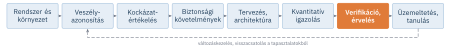
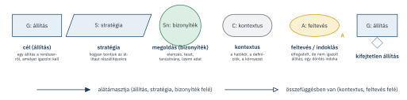
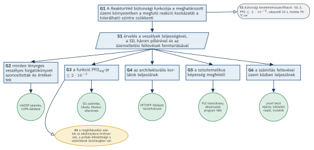
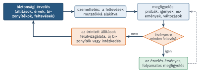

# Biztonsági érvelés és igazolás {#sec-biztonsagi-erveles}

{width=100%}

Az előző fejezetek sokféle elemzést, számítást és tervezési döntést mutattak be. Egy biztonságkritikus rendszer üzembe helyezésekor azonban nem elég, hogy ezek egyenként elkészültek: valakinek (a hatóságnak, egy független értékelőnek, a vállalat vezetésének, végső soron a társadalomnak) meg kell győződnie arról, hogy *együtt* elegendők a rendszer biztonságának alátámasztására. Erre szolgál a **biztonsági érvelés** (*safety case*): egy strukturált érvelés, amely bizonyítékokra támaszkodva meggyőzően és ellenőrizhetően mutatja be, hogy a rendszer egy adott alkalmazásban és környezetben elfogadhatóan biztonságos. Ebben a fejezetben megismerjük a biztonsági érvelés eredetét és elemeit, a célstruktúra-jelölést (GSN), a ReaktorVéd biztonsági érvelésének vázát, a független értékelés formáit, a biztonsági érvelések tipikus gyengeségeit, végül az üzemeltetés során folyamatosan karbantartott, „élő” biztonsági érvelés gondolatát.

::: {.cel}
A fejezet végére képes leszel

- megmagyarázni a biztonsági érvelés célját, elemeit és szerepét a különböző ágazatok szabályozásában;
- GSN-jelöléssel felépíteni egy biztonsági érvelés vázát, és azonosítani benne az állításokat, a stratégiákat, a bizonyítékokat, a kontextust és a feltevéseket;
- az eddigi elemzéseket (veszélyelemzés, LOPA, hibafa, SIL-igazolás, szoftverigazolás) egy koherens érvelésbe rendezni;
- felismerni a biztonsági érvelések tipikus gyengeségeit, és a független értékelés szerepét;
- megtervezni, hogyan marad érvényes egy biztonsági érvelés az üzemeltetés és a változások során.
:::

## A biztonsági érvelés eredete és célja {#sec-erveles-eredet}

A biztonsági érvelés mint szabályozási eszköz súlyos balesetek tanulságaiból született. Az Északi-tengeren 1988. július 6-án a Piper Alpha olajfúró platformon bekövetkezett robbanás és tűz 167 ember életét követelte. A Cullen-vizsgálat megállapította, hogy az előíró jellegű szabályozás (amely részletes műszaki előírások betartását ellenőrzi) nem volt képes kezelni egy bonyolult létesítmény kockázatait, és azt javasolta, hogy az üzemeltetőnek kelljen bizonyítania: azonosította a súlyos baleseti veszélyeket, és a kockázatokat a lehető legalacsonyabbra csökkentette [@cullen1990]. Ez a **célkitűzés-alapú szabályozás** (*goal-based regulation*) a brit offshore iparban 1992-ben lépett életbe, és azóta sok ágazatban elterjedt.

A biztonsági érvelés ma számos szabályozásban és szabványban kötelező vagy ajánlott munkatermék: az Egyesült Királyságban az offshore és a nukleáris iparban, a vasúti biztonsági jelzőrendszereknél az EN 50129 szerint [@en50129], a közúti járművekben az ISO 26262 szerint [@iso26262], az autonóm termékekre pedig az UL 4600 egész szabványa a biztonsági érvelésre épül [@ul4600]. A folyamatiparban az IEC 61511 nem használja ezt a kifejezést, de a funkcionális biztonsági értékelés és a dokumentációs követelmények lényegében ugyanezt szolgálják [@iec61511].

A biztonsági érvelés három dolgot kapcsol össze: az **állításokat** (mit állítunk a rendszer biztonságáról), a **bizonyítékokat** (elemzések, tesztek, tanúsítványok, üzemi tapasztalat) és az **érvelést**, amely megmutatja, *miért* támasztják alá a bizonyítékok az állításokat [@kelly1998]. A harmadik elem a legfontosabb és a leggyakrabban hiányzó: egy halom dokumentum önmagában nem érv. Ahhoz, hogy egy értékelő meggyőződhessen a rendszer biztonságáról, látnia kell, hogyan függenek össze az egyes bizonyítékok, mely feltevésekre épülnek, és mi hiányzik.

## A célstruktúra-jelölés (GSN) {#sec-gsn}

A biztonsági érvelések leírására a legelterjedtebb grafikus nyelv a **célstruktúra-jelölés** (*Goal Structuring Notation*, GSN), amelyet Tim Kelly dolgozott ki a York-i Egyetemen [@kelly1998; @kelly2004], és amelynek ma a 3. változatú közösségi szabványa érvényes [@gsn2021]. A GSN elemei ([-@fig-gsn-jelolesek]. ábra):

- **cél (állítás):** egy állítás a rendszerről, amelyet igazolni kell („a funkció PFD-je legfeljebb $2\cdot10^{-3}$”);
- **stratégia:** az érvelés módja, ahogyan egy állítást részállításokra bontunk („érvelés a SIL három pillére szerint”);
- **megoldás (bizonyíték):** egy elemzés, teszt, tanúsítvány vagy üzemi adat, amely egy állítást közvetlenül alátámaszt;
- **kontextus:** a hatókör, a definíciók, a működési környezet, amelyre az állítás vonatkozik;
- **feltevés és indoklás:** elfogadott, de nem igazolt állítás, illetve egy stratégia vagy döntés indoka;
- **kifejtetlen állítás:** amelynek alátámasztása még hiányzik (a fejlesztés közben hasznos jelölés).

{#fig-gsn-jelolesek width=100%}

A GSN-érvelés fentről lefelé épül: a legfelső állítás (rendszerint „a rendszer elfogadhatóan biztonságos az adott környezetben”) stratégiákon keresztül részállításokra bomlik, és minden ág egy vagy több bizonyítékkal zárul. A jól felépített érvelésben minden állítás egyértelmű, ellenőrizhető mondat, minden stratégia megmondja, miért elegendő a részállítások összessége, és a kontextus és a feltevések pontosan rögzítik az érvelés érvényességi körét. A GSN szabvány ismétlődő érvelési mintákat (*patterns*) és moduláris érveléseket is támogat, amelyek a nagy, több beszállítós rendszereknél nélkülözhetetlenek [@gsn2021].

::: {.eset eset="A" title="ReaktorVéd: a biztonsági érvelés váza"}
A ReaktorVéd biztonsági funkciójának érvelése ([-@fig-gsn-reaktorved]. ábra) a G1 állításból indul: a funkció a meghatározott üzemi környezetben a megfutó reakció kockázatát a tolerálható szintre csökkenti. A kontextus (C1) a biztonsági követelményspecifikáció. Az S1 stratégia öt részállításra bontja az érvelést:

- **G2:** minden lényeges veszélyes forgatókönyvet azonosítottak és értékeltek – bizonyíték a HAZOP-jelentés és a LOPA-táblázat ([-@sec-veszelyazonositas]. és [-@sec-esemenyfa]. fejezet);
- **G3:** a funkció PFD~avg~-je legfeljebb $2\cdot10^{-3}$ – bizonyíték a SIL-számítás, a hibafa és a Markov-modell összevetése ([-@sec-hibafa]–[-@sec-sil]. fejezet); a számítás az A1 feltevésre épül (a meghibásodási adatok érvényesek, a próbák lefedettsége a számítással összhangban van);
- **G4:** az architekturális korlátok teljesülnek – bizonyíték a HFT/SFF-táblázat és a tanúsítványok;
- **G5:** a szisztematikus képesség megfelelő – bizonyíték a PLC tanúsítványa és az alkalmazási program verifikációja és validálása ([-@sec-szoftver]. fejezet);
- **G6:** a számítás feltevései üzem közben teljesülnek – bizonyíték a proof teszt eljárása, a kiiktatások naplója és a teljesítménymutatók.

{#fig-gsn-reaktorved width=100%}

Az érvelés felépítése közben két hiányosság derült ki, ami a módszer egyik fő hasznát mutatja. Az A1 feltevés első változata egyszerűen „a meghibásodási adatok érvényesek” volt; a [-@sec-pst-ptc]. szakasz elemzése után a csapat felismerte, hogy a próbák lefedettsége a feltevés kritikus része, és ezt explicitté tette. A G6 állítás eredetileg hiányzott; a csapat úgy gondolta, hogy az üzemeltetés „már nem a projekt része”. A biztonsági érvelés azonban arról szól, hogy a rendszer az *életciklusa során* biztonságos, és ez nem igazolható az üzemeltetési feltételek nélkül.
:::

## Független értékelés {#sec-fuggetlen-ertekeles}

A biztonsági érvelés értéke azon múlik, mennyire alapos és pártatlan a felülvizsgálata. A szabványok ezért az integritási szinttől függő **függetlenséget** írnak elő a verifikációban és az értékelésben. Az IEC 61511 a **funkcionális biztonsági értékelést** (*functional safety assessment*, FSA) öt ponton írja elő vagy ajánlja: a veszély- és kockázatelemzés és a követelményspecifikáció után, a tervezés után, a telepítés, az üzembe helyezés és a validálás után (a veszélyes anyagok bevezetése előtt), az üzemeltetési tapasztalatok megszerzése után, és a módosítások után [@iec61511]. Az ISO 26262 megerősítő intézkedéseket (*confirmation measures*) ír elő: a munkatermékek megerősítő felülvizsgálatát, a funkcionális biztonsági auditot és a funkcionális biztonsági értékelést, az ASIL-tól függő függetlenségi szinttel [@iso26262].

A független értékelő nem a hibák vadászata miatt fontos, hanem mert a fejlesztőcsapat óhatatlanul a saját feltevéseinek foglya. Egy kívülálló könnyebben észreveszi a hiányzó veszélyeket, az indokolatlan feltevéseket és az érvelés gyenge pontjait.

## A biztonsági érvelések gyengeségei {#sec-erveles-gyengesegei}

A biztonsági érvelés hatékony eszköz, de visszaélhető vagy kiüresíthető. A legtanulságosabb példa a brit királyi légierő Nimrod XV230 felderítő repülőgépének 2006-os afganisztáni katasztrófája, amelyben tizennégy katona halt meg. A gép biztonsági érvelését néhány évvel korábban készítették el, de a független vizsgálat szerint az érvelés súlyos hibákat tartalmazott, és egy olyan veszélyt, amely a balesethez vezetett, nem értékelt megfelelően. Haddon-Cave jelentése szerint a biztonsági érvelés papírmunkává, a megfelelés kipipálásává vált, amely a dokumentáció mennyiségét tévesztette össze a biztonság igazolásával, és a szervezetben mindenki azt feltételezte, hogy valaki más gondoskodik a valódi kockázatokról [@haddoncave2009].

A tipikus gyengeségek:

- **megerősítési torzítás:** az érvelés természeténél fogva arra ösztönöz, hogy a biztonságot alátámasztó bizonyítékokat keressük, ne a cáfolókat; a jó érvelés ezért kifejezetten foglalkozik az ellenérvekkel és a kétségekkel;
- **a bizonyíték és az állítás közti rés:** a bizonyíték csak egy szűkebb állítást támaszt alá, mint amire használják (például egy teszt csak normál körülményeket fedett le);
- **rejtett feltevések:** az érvelés egy olyan feltevésen múlik, amelyet sehol nem mondtak ki (például hogy a próbák minden hibát felfednek);
- **elavulás:** a rendszer, a környezet vagy a használat megváltozott, az érvelés nem;
- **a mennyiség mint minőség:** több ezer oldal dokumentáció, amelyből senki sem látja, mi az érv lényege.

A GSN 3. változata ezért lehetővé teszi, hogy az érvelés kapcsolataihoz bizonyossági pontokat (*assurance claim points*) rendeljünk, ahol külön érvelés mutatja be, mennyire bízhatunk az adott lépésben [@gsn2021]. Az UL 4600 pedig minden fejezetéhez jellegzetes hibalistákat ad, amelyeket az értékelőnek ellenőriznie kell [@ul4600].

## Az élő biztonsági érvelés {#sec-elo-erveles}

A biztonsági érvelést hagyományosan az üzembe helyezés előtt készítik el, és utána legfeljebb a nagyobb módosítások idején veszik elő. Ez a gyakorlat két okból elégtelen. Egyrészt az érvelés feltevései (meghibásodási ráták, próbák lefedettsége, a kezelők reakcióideje, az igények gyakorisága) üzem közben változnak, és csak a működő rendszer adataiból ellenőrizhetők. Másrészt a tanuló, adaptív rendszerek (például a gépi tanulási komponensek) viselkedése az üzemeltetés során is változhat ([-@sec-uj-kihivasok]. fejezet). Denney, Pai és Habli ezért **dinamikus biztonsági érvelést** javasolnak, amelynek érvényességét a rendszer működése során folyamatosan ellenőrzik, és amely a megfigyelt adatok alapján frissül [@denney2015]. Az UL 4600 hasonló elven **biztonsági teljesítménymutatókat** (*safety performance indicators*) követel meg, amelyek az érvelés feltevéseinek érvényességét mérik az üzemeltetés során [@ul4600].

Az élő érvelés ciklusa ([-@fig-elo-biztonsagi-erveles]. ábra) a feltevéseket mérhető mutatókká alakítja; a próbák, az igények, az események és a változások adatait folyamatosan összeveti velük; és ha egy feltevés sérül, az érintett állításokat felülvizsgálja, új bizonyítékot gyűjt vagy intézkedést hoz. Ez a gondolat a [-@sec-csokornyakkendo]. szakaszban látott gátállapot-követést általánosítja, és összekapcsolja a biztonsági érvelést a változáskezeléssel ([-@sec-eletciklus]. fejezet).

{#fig-elo-biztonsagi-erveles width=92%}

::: {.eset eset="A" title="ReaktorVéd: a feltevések mutatói"}
A G6 állítás alatti mutatók: a gyorszáró szelepek proof tesztjeinek és részleges löketpróbáinak teljesítése az ütemterv szerint; a próbák során talált hibák száma és jellege (a meghibásodási ráta feltevésének ellenőrzésére); a valódi igények gyakorisága (a LOPA kezdő esemény gyakoriságának ellenőrzésére); a kiiktatások száma és időtartama; a biztonsági funkció téves leállásainak gyakorisága; a TAH-103 riasztás megszólalása és a kezelői reakcióidő; a riasztási rendszer teljesítménymutatói. Ha például a próbákon a vártnál több szelephiba derül ki, vagy a kiiktatások összideje meghaladja a feltételezett értéket, az érvelést felül kell vizsgálni, és szükség esetén módosítani a karbantartási stratégiát vagy a tervet. A biztonsági érvelés így a karbantartási és üzemeltetési döntések mindennapi eszközévé válik.
:::

::: {.eset eset="B" title="VészFék: érvelés hiba nélküli veszélyekre is"}
A vészfékező asszisztens biztonsági érvelése két nagy ágból áll. Az egyik a funkcionális biztonságé (ISO 26262): a hardver- és a szoftverhibák elleni védelem, az ASIL-követelmények teljesülése. A másik a rendeltetésszerű funkció biztonságáé (ISO 21448): annak igazolása, hogy a teljesítőképesség korlátai (például az érzékelés ködben vagy a szokatlan alakú akadályok felismerése) nem okoznak elfogadhatatlan kockázatot, és a fennmaradó ismeretlen veszélyes helyzetek valószínűsége kellően kicsi ([-@sec-uj-kihivasok]. fejezet). A második ág bizonyítékai nagyrészt statisztikai és szimulációs jellegűek, és az érvelés üzem közbeni frissítése (a terepen gyűjtött adatok alapján) itt különösen fontos.
:::

::: {.eset eset="C" title="KoboCella: a műszaki dokumentáció mint érvelés"}
A gépekre vonatkozó (EU) 2023/1230 rendelet szerint a gyártónak műszaki dokumentációt kell összeállítania, amely tartalmazza a kockázatértékelést, az alkalmazott szabványokat, a biztonsági funkciók igazolását és a vizsgálati eredményeket, és ennek alapján állítja ki az EU-megfelelőségi nyilatkozatot [@eu2023machinery]. Bár a rendelet nem használja a biztonsági érvelés kifejezést, egy jól felépített műszaki dokumentáció valójában az: állítások (a cella megfelel az alapvető egészségvédelmi és biztonsági követelményeknek), bizonyítékok (PL-számítások, mérések, ütközési erőmérések) és érvelés (miért elegendők ezek). A GSN szerkezet itt is segít abban, hogy a dokumentáció ne csak egy iratgyűjtő, hanem egy ellenőrizhető érvelés legyen.
:::

::: {.osszefoglalo}
- A biztonsági érvelés strukturált érvelés, amely bizonyítékokra támaszkodva mutatja be, hogy a rendszer egy adott alkalmazásban és környezetben elfogadhatóan biztonságos; a célkitűzés-alapú szabályozás eszköze, a Piper Alpha-katasztrófa tanulságaiból született.
- Elemei az állítások, az érvelés (stratégiák), a bizonyítékok, a kontextus és a feltevések; az érvelés a leggyakrabban hiányzó elem.
- A GSN szabványos grafikus jelölés, amely fentről lefelé bontja az állításokat, és mintákat és modularitást is támogat.
- A ReaktorVéd érvelése a veszélyek teljességére, a SIL három pillérére és az üzemeltetési feltevések fenntartására épül; felépítése során rejtett feltevések kerültek felszínre.
- A független értékelés az integritási szinttől függő függetlenséggel szükséges.
- A tipikus gyengeségek a megerősítési torzítás, a bizonyíték és az állítás közti rés, a rejtett feltevések, az elavulás és a dokumentációmennyiség; a Nimrod-katasztrófa mutatta meg a kiüresedett érvelés veszélyét.
- Az élő biztonsági érvelés a feltevéseket mutatókká alakítja, és az üzemeltetés során folyamatosan ellenőrzi.
:::

::: {.onell}
1. Miben különbözik a célkitűzés-alapú szabályozás az előíró jellegű szabályozástól? Milyen előnyei és kockázatai vannak?
2. Egy biztonsági érvelésben ez az állítás szerepel: „A szoftvert alaposan tesztelték.” Mi a baj vele? Fogalmazd meg jobban!
3. Melyik GSN-elemmel ábrázolnád: (a) a ReaktorVéd üzemi hőmérséklet-tartományát; (b) azt, hogy a távadók meghibásodási rátája a gyártói adatnak felel meg; (c) a HAZOP-jelentést?
4. Miért nem elég a biztonsági érvelést az üzembe helyezés előtt elkészíteni?
5. Milyen tanulságokat fogalmazott meg a Nimrod-vizsgálat a biztonsági érvelésekről?

::: {.megoldas}
1. Az előíró szabályozás részletes műszaki követelmények betartását ellenőrzi; a célkitűzés-alapú szabályozás azt követeli meg, hogy az üzemeltető bizonyítsa: azonosította a veszélyeket, és elfogadható szintre csökkentette a kockázatokat. Előnye, hogy az egyedi és új rendszerekhez is alkalmazható, és a kockázatokra összpontosít; kockázata, hogy a minősége a felkészültségen és az őszinteségen múlik, és könnyen formális papírmunkává válhat.
2. Nem ellenőrizhető: nem mondja meg, mit, mi ellen és milyen kritérium szerint teszteltek. Jobban: „A szoftver minden biztonsági követelményét követelményalapú teszt ellenőrzi, a tesztek a kód MC/DC-lefedettségét 100%-ban elérik, és minden teszt sikeres.” Ez állítás, amelyet a tesztjelentés és a lefedettségi jelentés közvetlenül alátámaszt.
3. (a) kontextus; (b) feltevés (ha nem igazoljuk) vagy egy részállítás, amelyet üzemi adatokkal támasztunk alá; (c) megoldás (bizonyíték).
4. Mert az érvelés feltevései (meghibásodási ráták, próbák, igénygyakoriság, kezelői teljesítmény) üzem közben változhatnak, és csak a működő rendszer adataiból ellenőrizhetők; a módosítások és a környezet változásai pedig az érvelés egyes részeit érvényteleníthetik.
5. Hogy a biztonsági érvelés könnyen papírmunkává válik, ha a megfelelés igazolására és nem a valódi veszélyek feltárására készül; hogy a dokumentáció mennyisége nem pótolja az érvelés minőségét; hogy a felelősség szétaprózódása miatt mindenki másra számít; és hogy az érvelést a rendszer egész életciklusa során karban kell tartani.
:::
:::

::: {.forras}
- Kelly, T. P. (1998): *Arguing Safety – A Systematic Approach to Managing Safety Cases.* PhD-értekezés, University of York [@kelly1998].
- Assurance Case Working Group (2021): *Goal Structuring Notation Community Standard*, 3. változat. SCSC [@gsn2021].
- Haddon-Cave, C. (2009): *The Nimrod Review.* The Stationery Office [@haddoncave2009].
- UL 4600:2023 – az autonóm termékek biztonsági érvelésen alapuló értékelése [@ul4600].
- Denney, E., Pai, G., Habli, I. (2015): Dynamic safety cases for through-life safety assurance. ICSE [@denney2015].
:::
