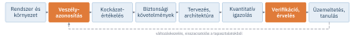
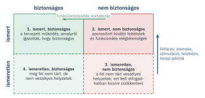
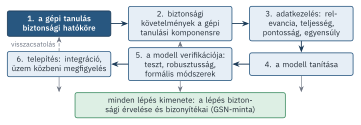
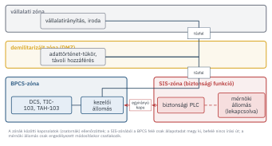
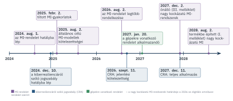

# Új kihívások: rendeltetésszerű funkció, mesterséges intelligencia és kiberbiztonság {#sec-uj-kihivasok}

{width=100%}

A könyv eddigi módszerei egy közös feltevésre épültek: a veszélyes helyzetek forrása valaminek a *meghibásodása* (egy alkatrész, egy szoftver, egy emberi művelet), vagy legalábbis az elemek közötti nem szándékolt kölcsönhatás. Három fejlemény ezt a képet alapjaiban bővíti. Az automatizált járművek és robotok veszélyt okozhatnak úgy is, hogy semmi sem hibásodik meg, egyszerűen azért, mert a funkciójuk teljesítőképessége egy adott helyzetben nem elegendő. A gépi tanulással készült komponensek viselkedését nem egyenként megírt követelmények, hanem adatok határozzák meg, és a hagyományos verifikációs módszerek nagy része nem alkalmazható rájuk. A hálózatba kapcsolt rendszerekben pedig egy szándékos támadás is veszélyes helyzetet teremthet, amely ellen a valószínűségi modellek nem védenek. Ez a fejezet ezt a három kihívást, a rájuk adott szabványosítási és szabályozási válaszokat, végül a mesterséges intelligencia szerepét a biztonsági mérnök munkájában tekinti át.

::: {.cel}
A fejezet végére képes leszel

- megkülönböztetni a funkcionális biztonság és a rendeltetésszerű funkció biztonságának (SOTIF) tárgykörét, és alkalmazni a SOTIF négy területének gondolatmenetét;
- megbecsülni, mekkora üzemi tapasztalat kell egy automatizált rendszer biztonságának statisztikai igazolásához;
- összefoglalni a gépi tanulási komponensek biztonságának fő kihívásait és az AMLAS, az ISO/PAS 8800 és az ISO/IEC TR 5469 válaszait;
- biztonsági architektúrát javasolni gépi tanulási komponenst tartalmazó rendszerre;
- elemezni a kiberbiztonság és a funkcionális biztonság kapcsolatát, és alkalmazni az IEC 62443 zóna- és csatornamodelljét;
- áttekinteni az MI-rendelet, a gépekre vonatkozó rendelet és a kiberrezilienciáról szóló jogszabály biztonsági vonatkozásait és ütemezését;
- felelősen használni a nagy nyelvi modelleket a biztonsági elemzések támogatására.
:::

## A rendeltetésszerű funkció biztonsága {#sec-sotif}

A 2018-as tempei baleset ([-@sec-balesetek]. fejezet) jól mutatja a problémát: az automatizált jármű érzékelői működtek, a szoftver a specifikációja szerint futott, mégis halálos baleset történt, mert a rendszer nem tudta időben helyesen osztályozni a kerékpárját toló gyalogost [@ntsb2019]. Az ISO 26262 a hibák és a meghibásodások okozta veszélyekkel foglalkozik, ezért ilyen esetekre nem ad választ. Ezt a rést tölti ki az ISO 21448, a **rendeltetésszerű funkció biztonsága** (*safety of the intended functionality*, SOTIF) [@iso21448].

A SOTIF szerint veszélyt okozhatnak a **funkcionális elégtelenségek**: a specifikáció hiányosságai (a tervezők nem gondoltak egy helyzetre) és a teljesítőképesség korlátai (az érzékelő vagy az algoritmus egy helyzetben nem elég pontos). Ezeket **kiváltó feltételek** (*triggering conditions*) hozzák felszínre: alacsonyan álló nap, köd, erős eső, tükröződő felület, szokatlan alakú tárgy, váratlan emberi viselkedés. A SOTIF célja, hogy a lehetséges forgatókönyveket négy területre osztva ([-@fig-sotif-teruletek]. ábra) a **nem biztonságos ismert** (2.) és különösen a **nem biztonságos ismeretlen** (3.) területet elfogadhatóan kicsire csökkentse. Az ismert veszélyes forgatókönyveket funkciómódosítással kezeljük (jobb érzékelés, érzékelőfúzió, a működési tartomány korlátozása, a vezető figyelmeztetése); az ismeretlen területet pedig elemzéssel, szimulációval, célzott teszteléssel és a terepi adatok gyűjtésével „tárjuk fel”, azaz ismertté tesszük.

{#fig-sotif-teruletek width=85%}

A SOTIF kulcsfogalma a **működési tervezési tartomány** (*operational design domain*, ODD): azoknak a körülményeknek a köre (úttípus, sebesség, időjárás, napszak, forgalmi helyzetek), amelyekre a rendszert tervezték. A biztonsági igazolás csak az ODD-n belül érvényes, és a rendszernek fel kell ismernie, ha elhagyja azt. Az automatizált vezetési rendszerek tervezésére, verifikációjára és validálására az ISO/TS 5083 ad átfogó keretet, amely a funkcionális biztonságot, a SOTIF-ot és a kiberbiztonságot egyetlen biztonsági érvelésbe foglalja [@isots5083]; az ENSZ 157. számú előírása pedig a sávtartó automatizált rendszerek jóváhagyási követelményeit rögzíti [@unr157].

::: {.eset eset="B" title="VészFék: kiváltó feltételek és fantomfékezés"}
A vészfékező asszisztens SOTIF-elemzése két irányban keres kiváltó feltételeket. A **téves fékezés** (fantomfékezés) jellegzetes kiváltói: hidak és felüljárók, amelyeket a radar akadálynak érzékel; az úttestbe épített fémfedlapok és -lemezek erős radarvisszaverődése; a kamerát elvakító alacsony nap; árnyékok és útburkolati jelek, amelyeket a képfeldolgozás tárgynak vél. A **fékezés elmaradásának** kiváltói: sötét ruhás gyalogos éjszaka, szokatlan alakú tárgy (például kerékpárt toló ember vagy egy felborult jármű), köd és erős eső. A funkciómódosítások: a radar és a kamera eredményének összevetése (a téves fékezés ellen mindkettő megerősítése, a fékezés elmaradása ellen a figyelmeztetés már egyetlen érzékelő jelzésére), a működés korlátozása rossz látási viszonyok között, és a vezető tájékoztatása. Az ismeretlen terület csökkentésére a gyártó nagy mennyiségű terepi adatot és szimulált forgatókönyvet elemez, és a kiadott járművek adataiból folyamatosan keresi az új kiváltó feltételeket.
:::

### Mennyi tesztelés kell? {#sec-mennyi-teszt}

Az automatizált járművek biztonságának egyik kézenfekvő igazolása az lenne, hogy elég sokat vezetünk velük baleset nélkül. A [-@sec-megbizhatosag]. fejezet megbízhatósági becslései megmutatják, miért nem járható ez az út. Ha egy rendszer $t$ ideig (vagy távolságon) hibamentesen működött, akkor $C$ konfidenciaszinten a hibagyakoriság felső korlátja $\lambda_C = -\ln(1 - C)/t$. Kalra és Paddock ezt az amerikai közúti halálozási gyakoriságra alkalmazta, amely 2013-ban körülbelül 1,09 haláleset volt százmillió mérföldenként [@kalra2016]. Ahhoz, hogy 95%-os konfidenciával kimutassuk, hogy egy automatizált járműflotta *legalább ilyen jó*, halálos baleset nélkül

$$
t = \frac{-\ln(1 - 0{,}95)}{1{,}09\cdot10^{-8}\ \text{mérföld}^{-1}} = \frac{3{,}0}{1{,}09\cdot10^{-8}} \approx 2{,}75\cdot10^{8}\ \text{mérföld}
$$

vezetés kellene, és annak kimutatásához, hogy *lényegesen jobb* is, nagyságrendekkel több. Ez a gondolatmenet ugyanaz, amelyet Butler és Finelli a szoftverekre alkalmazott ([-@sec-szoftver-mas]. szakasz): a nagyon ritka eseményekre vonatkozó biztonsági állítás nem igazolható pusztán üzemi tapasztalattal. A megoldás a **forgatókönyv-alapú validálás**, amely a releváns és a kritikus helyzeteket szisztematikusan azonosítja, szimulációban és tesztpályán vizsgálja, és a közúti tapasztalatot ennek kiegészítésére használja [@koopman2016]; valamint a biztonsági érvelés, amely ezeket a bizonyítékokat összefogja, és az üzemeltetés során folyamatosan frissül ([-@sec-elo-erveles]. szakasz) [@ul4600].

## Gépi tanulás a biztonságkritikus rendszerekben {#sec-gepi-tanulas}

A gépi tanulási (ML) komponensek, különösen a mély neurális hálók, olyan feladatokban érnek el kiemelkedő teljesítményt, amelyekre hagyományos algoritmust nem lehet írni: képek és jelenetek értelmezésében, összetett mintázatok felismerésében, az emberi viselkedés előrejelzésében. A biztonsági igazolás szempontjából azonban alapvetően különböznek a hagyományos szoftvertől:

- **Az adat a specifikáció.** A komponens viselkedését nem egyenként megírt követelmények, hanem a tanítóadatok határozzák meg. Ha egy helyzet nem szerepel megfelelő arányban az adatokban, a modell viselkedése ott kiszámíthatatlan.
- **Eloszláseltolódás.** A modell a tanítási adatok eloszlásán működik jól; ha a valós környezet ettől eltér (új járműtípusok, más éghajlat, kopott útburkolati jelek), a teljesítmény észrevétlenül romolhat.
- **Robusztusság.** Szegedy és munkatársai kimutatták, hogy szemmel észrevehetetlen, gondosan megválasztott változtatások a bemeneten egy neurális hálót teljesen téves osztályozásra késztethetnek [@szegedy2014]; ez egyszerre biztonsági és kiberbiztonsági kockázat.
- **Átláthatatlanság.** A modell belső működése nem vezethető vissza ember által érthető szabályokra, ezért a hagyományos felülvizsgálat és a strukturális lefedettség nem alkalmazható.
- **Nem szándékolt optimalizálás.** Amodei és munkatársai számos módját írták le annak, ahogyan egy tanuló rendszer a célfüggvényét a tervezők szándékával ellentétesen, nem kívánt mellékhatásokkal teljesítheti [@amodei2016].

Salay, Queiroz és Czarnecki elemzése szerint az ISO 26262 szoftverfejlesztési módszereinek jelentős része csak részben vagy egyáltalán nem alkalmazható a gépi tanulási komponensekre [@salay2017]. Erre a kihívásra az elmúlt években több útmutató és szabvány született.

Az **AMLAS** (*Assurance of Machine Learning for use in Autonomous Systems*) a York-i Egyetem módszertana, amely a gépi tanulási komponens fejlesztését hat lépésre bontja, és mindegyikhez egy biztonsági érvelési mintát és a szükséges bizonyítékokat rendeli ([-@fig-amlas-folyamat]. ábra) [@hawkins2021]: a gépi tanulás biztonsági hatókörének meghatározása, a komponens biztonsági követelményei (például a teljesítmény, a robusztusság és az értelmezhetőség követelményei), az adatkezelés (a tanító-, a validáló- és a tesztadatok relevanciája, teljessége, pontossága és kiegyensúlyozottsága), a modell tanítása, a modell verifikációja (független tesztadatokon, robusztussági vizsgálatokkal, ahol lehet, formális módszerekkel), végül a telepítés és az üzem közbeni megfigyelés.

{#fig-amlas-folyamat width=92%}

Az **ISO/PAS 8800** a közúti járművek mesterséges intelligenciát tartalmazó rendszereinek biztonságára ad útmutatást: az ISO 26262 és az ISO 21448 kiegészítéseként az MI-alapú rendszerelemek biztonsági életciklusát, a biztonsági követelmények levezetését, az adatok életciklusát és az üzem közbeni megfigyelést szabályozza [@isopas8800]. Az **ISO/IEC TR 5469** ágazatfüggetlen technikai jelentés a mesterséges intelligencia funkcionális biztonsági alkalmazásairól: áttekinti, milyen szerepben (a biztonsági funkción belül vagy azon kívül) és milyen feltételekkel használható MI, milyen tulajdonságai befolyásolják a biztonságot, és milyen intézkedések segítenek a kockázatok kezelésében [@isotr5469].

### Architekturális válasz: egyszerűség a bonyolultság felügyeletére {#sec-simplex}

A gépi tanulási komponensek biztonságának talán legerősebb eszköze az architektúra. A **Simplex-architektúra** gondolata szerint egy nagy teljesítményű, de nehezen igazolható vezérlő mellé egy egyszerű, hagyományos módszerekkel igazolható biztonsági vezérlőt és egy döntési logikát teszünk, amely átkapcsol az egyszerű vezérlőre, ha a rendszer állapota a biztonságos tartomány határához közelít [@sha2001]. Ugyanez a minta jelenik meg a [-@sec-egas]. szakasz E-Gas felügyeletében és a ReaktorVéd független biztonsági funkciójában: a bonyolult funkciót egy egyszerű, diverz, független felügyelet ellenőrzi. Gépi tanulási komponensekre alkalmazva ez lehet egy fizikai plauzibilitás-ellenőrzés (a jármű nem fékezhet erősen, ha egyik független érzékelő sem lát akadályt), egy hagyományos érzékelőre épülő biztonsági burok (a robot sebességét a tanúsított lézerszkenner korlátozza, akármit is javasol a kamerás MI), vagy a bemenet eloszláson kívüliségének (*out-of-distribution*) felismerése, amely ilyenkor egy óvatosabb üzemmódba kapcsol.

::: {.eset eset="C" title="KoboCella: kamerás személyfelismerés gépi tanulással"}
A KoboCella fejlesztői szeretnék a lézerszkennert egy kamerás, gépi tanulásos személyfelismerővel kiegészíteni, amely a szerelő testtartását és mozgásának irányát is felismeri, és így finomabban szabályozhatná a robot sebességét. A gépekre vonatkozó (EU) 2023/1230 rendelet szerint azonban a teljesen vagy részben önfejlesztő viselkedésű, gépi tanulást alkalmazó biztonsági alkatrészek, amelyek biztonsági funkciót látnak el, a fokozott kockázatú termékek közé tartoznak, és bejelentett szervezet bevonásával kell értékelni a megfelelőségüket [@eu2023machinery]. A csapat ezért olyan architektúrát választ, amelyben a biztonsági funkciót továbbra is a tanúsított lézerszkenner és a robotvezérlő kétcsatornás biztonsági része látja el (PL~r~ szerint igazolva); a kamerás MI csak a *termelékenységet* javítja, a biztonsági határokon belül (például a robot pályáját tervezi át, hogy elkerülje a szerelőt). Az MI hibája így legfeljebb felesleges lassítást okozhat, veszélyes helyzetet nem. Ha a jövőben az MI-t a biztonsági funkcióba is be akarják építeni, az AMLAS-hoz és az ISO/IEC TR 5469-hez hasonló teljes igazolásra lesz szükség.
:::

## Kiberbiztonság és funkcionális biztonság {#sec-kiberbiztonsag}

A biztonsági elemzések hagyományosan véletlen meghibásodásokkal és nem szándékos tévedésekkel számolnak. A támadó azonban nem véletlenszerűen viselkedik: a leggyengébb pontot keresi, több „meghibásodást” idézhet elő egyszerre, és éppen a ritka, nem tesztelt állapotokat használja ki. A valószínűségi modellek függetlenségi feltevései vele szemben értelmetlenek. Ezért a kiberbiztonság (*security*) nem illeszthető be egyszerűen a megbízhatósági számításokba, hanem külön elemzést és külön intézkedéseket igényel, amelyeket a funkcionális biztonsággal (*safety*) össze kell hangolni [@iec63069; @young2014].

Az ipari irányítórendszerek elleni támadások közül a biztonsági mérnök számára a legtanulságosabb a 2017-ben egy közel-keleti petrolkémiai üzemben felfedezett kártevő, amelyet az amerikai hatóságok HatMan, a kutatók Triton vagy Trisis néven írtak le: a támadók a biztonsági műszeres rendszer vezérlőit vették célba, és megpróbálták átprogramozni őket. A támadás azért derült ki, mert a vezérlők hibát észleltek, és biztonságos állapotba, leállásba vitték az üzemet [@cisa2019]. A tanulság súlyos: a biztonsági funkció, az utolsó műszaki védelmi réteg maga is célpont lehet, és egy sikeres támadás egyszerre iktathatja ki a védelmet és idézheti elő a veszélyes helyzetet.

A folyamatiparban az IEC 61511 2016-os kiadása előírja, hogy a biztonsági műszeres rendszerre kiberbiztonsági kockázatértékelést kell végezni [@iec61511], az ipari automatizálás kiberbiztonságának szabványsorozata pedig az IEC 62443. Ennek alapgondolata a **zónák és csatornák** modellje ([-@fig-zonak-csatornak]. ábra): a rendszert azonos biztonsági követelményű zónákra osztjuk, a zónák közötti kommunikációt ellenőrzött csatornákra korlátozzuk, és minden zónához célzott biztonsági szintet rendelünk [@iec62443]. A közúti járművekben az ISO/SAE 21434 a kiberbiztonsági mérnöki folyamatot, benne a fenyegetés- és kockázatelemzést (TARA) szabályozza [@iso21434], az ENSZ 155. számú előírása pedig 2024 júliusától minden új jármű forgalomba helyezésének feltétele egy tanúsított kiberbiztonsági irányítási rendszer [@unr155].

{#fig-zonak-csatornak width=95%}

A biztonság és a kiberbiztonság nemcsak kiegészítik, hanem befolyásolhatják is egymást. Egy kiberbiztonsági intézkedés veszélyeztetheti a biztonságot: ha a kezelői állomás néhány hibás jelszó után zárol, egy vészhelyzetben a kezelő kizárhatja magát; ha egy biztonsági frissítés a biztonsági PLC szoftverét módosítja, az újra validálást igényel. Fordítva, egy biztonsági funkció kiberbiztonsági kockázatot teremthet: egy távoli kioldás-visszaállítási lehetőség támadási útvonal lehet. Ezért a két terület elemzését közös keretben érdemes végezni; az STPA rendszerelméleti megközelítése ([-@sec-stpa]. fejezet) például kiterjeszthető a nem biztonságos irányítási műveletek szándékos előidézésére is (STPA-Sec) [@young2014].

::: {.eset eset="A" title="ReaktorVéd: a biztonsági funkció kiberbiztonsága"}
A ReaktorVéd kiberbiztonsági kockázatértékelése megállapította, hogy a biztonsági PLC diagnosztikai adatait a karbantartók a vállalati hálózatról is szeretnék látni, és a mérnöki állomás az eredeti tervben állandóan csatlakozott a biztonsági hálózathoz. A módosított architektúrában a biztonsági funkció önálló zóna; a BPCS felé csak egy egyirányú adatkapun keresztül megy ki állapotadat; a mérnöki állomás csak engedélyezett módosításkor, fizikai kulccsal csatlakoztatható; a biztonsági PLC-n a program módosítása csak a helyszínen, kulcskapcsolóval engedélyezhető. A biztonsági érvelés ([-@sec-biztonsagi-erveles]. fejezet) G5 ága kiegészül egy állítással: a biztonsági funkció integritását kiberbiztonsági intézkedések védik, és a feltevések (például hogy a mérnöki állomás csak engedéllyel csatlakozik) teljesülését a változáskezelés és az auditok ellenőrzik.
:::

## A szabályozás új rétegei {#sec-uj-szabalyozas}

Az Európai Unióban három új rendelet alakítja át a biztonságkritikus termékek szabályozását ([-@fig-szabalyozasi-idovonal]. ábra).

A **gépekre vonatkozó (EU) 2023/1230 rendelet** 2027. január 20-tól váltja fel a gépi irányelvet. Az új rendelet kifejezetten kezeli a mesterséges intelligenciát és a kiberbiztonságot: a gépeknek a kiszámíthatóan változó, önfejlesztő viselkedés mellett is biztonságosnak kell maradniuk, és a biztonsági funkciókat védeni kell a rosszindulatú befolyásolással szemben [@eu2023machinery].

A **mesterséges intelligenciáról szóló (EU) 2024/1689 rendelet** (MI-rendelet) kockázatalapú szabályozást vezet be. A nagy kockázatú MI-rendszerek közé tartoznak azok, amelyek az uniós harmonizációs jogszabályok (például a gépekre, a játékokra, az orvostechnikai eszközökre vonatkozó szabályok) hatálya alá tartozó termékek biztonsági alkatrészei. Rájuk kockázatkezelési rendszer, adatkezelési követelmények, műszaki dokumentáció, naplózás, átláthatóság, emberi felügyelet, valamint pontossági, robusztussági és kiberbiztonsági követelmények vonatkoznak [@eu2024ai]. A nagy kockázatú rendszerekre vonatkozó kötelezettségek alkalmazását a 2026 júliusában kihirdetett digitális omnibusz-rendelet elhalasztotta: az önálló (III. mellékletbeli) rendszerekre 2027. december 2-tól, a termékekbe biztonsági alkatrészként beépített (I. mellékletbeli) rendszerekre 2028. augusztus 2-tól kell alkalmazni őket [@eu2026omnibus].

A **kiberrezilienciáról szóló (EU) 2024/2847 rendelet** a digitális elemeket tartalmazó termékekre ír elő kiberbiztonsági követelményeket a teljes életciklusra, a sérülékenységek kezelésével és a biztonsági frissítésekkel együtt. A súlyos incidensek és az aktívan kihasznált sérülékenységek jelentési kötelezettsége 2026. szeptember 11-től, a rendelet többi része 2027. december 11-től alkalmazandó [@eu2024cra].

{#fig-szabalyozasi-idovonal width=100%}

A három rendelet egymásra épül: egy MI-alapú biztonsági alkatrészt tartalmazó, hálózatba kapcsolt gépre egyszerre vonatkozhat mindhárom. A harmonizált szabványok kidolgozása folyamatban van, és a következő években várhatóan a funkcionális biztonsági szabványok (köztük az IEC 61508 harmadik, 2027-re várt kiadása) is beépítik az MI-re és a kiberbiztonságra vonatkozó követelményeket. A mérnöki gyakorlat szempontjából a legfontosabb üzenet: a biztonság, a kiberbiztonság és az MI megbízhatósága nem kezelhető külön silókban; közös kockázatelemzés, közös architektúra és közös, élő biztonsági érvelés kell hozzájuk.

## A mesterséges intelligencia mint a biztonsági mérnök eszköze {#sec-mi-eszkoz}

A nagy nyelvi modellek a biztonsági mérnök munkáját is megváltoztatják. Segíthetnek a veszélyazonosítás ötletgyűjtésében (vezérszavas eltérések, meghibásodási módok, nem biztonságos irányítási műveletek felvetésében), a szabványok és a szakirodalom áttekintésében, a dokumentáció előkészítésében, a számítások ellenőrzésében és a gyakorlati útmutató notebookjaihoz hasonló elemző kódok megírásában. Diemert és Weber kísérleti vizsgálata szerint egy nagy nyelvi modell hasznos javaslatokkal segítheti a veszélyelemzést, de a javaslatok egy része téves vagy irreleváns, és a modell nem helyettesíti a szakértői ítéletet [@diemert2023].

A felelős használat elvei a [-@sec-ember]. fejezet automatizálási tanulságaiból következnek: a modell ötletgyűjtő partner, nem döntéshozó; minden állítását ellenőrizni kell, különösen a számokat, a szabványhivatkozásokat és a jogi állításokat; vigyázni kell az automatizálási torzításra, amely a gépi javaslatot hajlamos elfogadni akkor is, ha a saját tudásunk ellentmond neki; a bizalmas tervadatokat csak megfelelő adatvédelmi feltételekkel szabad megosztani; és a biztonsági érvelésben dokumentálni kell, hogy egy elemzésben milyen szerepet játszott a modell, és ki ellenőrizte a kimenetét.

::: {.prompt title="Nagy nyelvi modell mint STPA-segítő"}
*„Egy kollaboratív robotcella STPA-elemzését végezzük. Az irányító a robotvezérlő biztonsági része; irányítási műveletei: sebességcsökkentés, biztonságos megállás, újraindítás. A visszacsatolás a lézerszkenner jele (személy a 0,5 m-es, illetve az 1,2 m-es zónában) és a robot sebességmérése. A veszteség: a szerelő sérülése; a veszély: a robot nagy sebességgel mozog, miközben a szerelő a közös munkatérben van. Mind a négy nem biztonságos irányítási művelet típusára (nem adja ki; kiadja, amikor nem kellene; rossz időben vagy sorrendben adja ki; túl korán leállítja vagy túl sokáig alkalmazza) sorolj fel lehetséges eseteket, és mindegyikhez a kontextust. Utána javasolj okozati forgatókönyveket a visszacsatolás hibáira is. Jelöld, ha egy javaslatod bizonytalan, és ne hivatkozz olyan szabványpontra, amelyben nem vagy biztos.”*

A modell válaszát a csapat a saját elemzésével veti össze ([-@sec-stpa]. fejezet); a kimenet csak akkor kerülhet a jegyzőkönyvbe, ha egy szakértő ellenőrizte és elfogadta.
:::

## Kitekintés {#sec-kitekintes}

A biztonságkritikus rendszerek tudománya az első hibafáktól a tanuló, hálózatba kapcsolt, ember és gép közötti munkamegosztásra épülő rendszerekig jutott. A könyv módszerei ehhez a fejlődéshez három irányban adnak kapaszkodót. A **valószínűségi modellek** (megbízhatóság, hibafa, eseményfa, Markov-modellek, SIL-igazolás) ott maradnak nélkülözhetetlenek, ahol a meghibásodások véletlenszerűek és az adatok megbízhatók. A **rendszerelméleti szemlélet** (STAMP, STPA, a biztonsági kultúra, a Safety-II) ott, ahol a balesetek a kölcsönhatásokból, a szervezetből és a változásból fakadnak. A **biztonsági érvelés** pedig az a keret, amely a kettőt, a tervezési döntéseket és az üzemeltetés tapasztalatait egyetlen, ellenőrizhető és élő egésszé fogja össze. Az új technológiák nem teszik feleslegessé ezeket az eszközöket; éppen ellenkezőleg, a gépi tanulás, az autonómia és a hálózatosodás korában a biztonsági mérnök legfontosabb képessége az lesz, hogy tudja, melyik eszköz mire alkalmas, és mire nem.

::: {.labor}
A gyakorlati útmutató 12. laborja egy projektfeladat: egy választott rendszerre (például egy automatizált raktári járműre vagy egy orvostechnikai infúziós pumpára) a könyv módszereit végigvezetve kell elkészíteni a veszélyelemzést, a kockázatértékelést, a biztonsági követelményeket, a kvantitatív igazolást és a biztonsági érvelés vázát. Az útmutató mintapromptokat is ad a nagy nyelvi modellek felelős használatához az egyes lépésekben.
:::

::: {.osszefoglalo}
- A SOTIF (ISO 21448) a meghibásodás nélkül, a funkcionális elégtelenségekből és a kiváltó feltételekből eredő veszélyekkel foglalkozik; célja a nem biztonságos ismert és ismeretlen forgatókönyvek elfogadhatóan kicsire csökkentése.
- A ritka eseményekre vonatkozó biztonsági állítás nem igazolható pusztán üzemi tapasztalattal: az emberi vezetővel egyenértékű halálozási gyakoriság 95%-os konfidenciájú kimutatásához mintegy 275 millió mérföld kellene; a forgatókönyv-alapú validálás és a biztonsági érvelés a megoldás.
- A gépi tanulási komponensek biztonságának kihívásai: az adat mint specifikáció, az eloszláseltolódás, a robusztusság, az átláthatatlanság és a nem szándékolt optimalizálás; az AMLAS, az ISO/PAS 8800 és az ISO/IEC TR 5469 ad rájuk választ.
- Az architektúra a legerősebb eszköz: egy egyszerű, igazolható felügyelet (Simplex-minta) korlátozza a bonyolult komponens hatását.
- A támadó nem véletlenszerű; a kiberbiztonságot külön, de a funkcionális biztonsággal összehangoltan kell kezelni (IEC 62443, ISO/SAE 21434, IEC 61511 kiberbiztonsági értékelés). A Triton-támadás a biztonsági funkciót vette célba.
- A gépekre vonatkozó rendelet, az MI-rendelet és a kiberrezilienciáról szóló jogszabály 2026 és 2028 között fokozatosan alkalmazandó; a nagy kockázatú MI-rendszerek határidejét a 2026-os digitális omnibusz-rendelet 2027 decemberére, illetve 2028 augusztusára tolta ki.
- A nagy nyelvi modellek hasznos segítők a biztonsági elemzésben, de minden kimenetüket szakértőnek kell ellenőriznie.
:::

::: {.onell}
1. Miben különbözik a fantomfékezés oka egy hibás radarérzékelő okozta téves fékezéstől? Melyik szabvány melyiket kezeli?
2. Egy automatizált rendszer hibagyakoriságára $10^{-7}$ óránkénti felső korlátot szeretnénk igazolni 90%-os konfidenciával, hibamentes üzemi tapasztalatból. Hány üzemóra kell?
3. Miért nem elég egy gépi tanulási modell tesztadatokon mért 99,9%-os pontossága a biztonsági igazoláshoz?
4. Javasolj Simplex-jellegű architektúrát egy MI-alapú gyalogosfelismerőt tartalmazó vészfékező rendszerre!
5. Mondj egy példát arra, amikor egy kiberbiztonsági intézkedés a funkcionális biztonságot rontja, és egyet a fordítottjára!

::: {.megoldas}
1. A fantomfékezés során semmi sem hibásodik meg: az érzékelés teljesítőképessége egy kiváltó feltétel (például egy híd vagy fémlemez) mellett nem elegendő, ez a SOTIF (ISO 21448) tárgya. A hibás radar okozta téves fékezés meghibásodás következménye, ez az ISO 26262 tárgya.
2. $t = -\ln(1 - 0{,}9)/10^{-7} = 2{,}30\cdot10^{7}$ óra, azaz több mint 2600 év egyetlen rendszerre, vagy például ezer rendszer 2,6 évnyi hibamentes működése.
3. Mert a pontosság egy átlag a tesztadatok eloszlásán: nem mond semmit a ritka, de veszélyes helyzetekről, az eloszláson kívüli bemenetekről, a robusztusságról és arról, hogy a tévedések *milyen* hibák (veszélyes vagy ártalmatlan). A biztonsági követelményeket a veszélyes hibamódokra kell megfogalmazni és igazolni, a működési tartomány teljes lefedésével.
4. Például: az MI-alapú felismerő javaslatot tesz a fékezésre, de az erős fékezéshez egy független, hagyományos módszerrel igazolt csatorna (például a radar távolság- és sebességmérése alapján számolt ütközési idő) megerősítése kell; a téves fékezés ellen az MI egyedül csak figyelmeztetést vagy enyhe fékezést kezdeményezhet. Ha a felismerő bemenete eloszláson kívülinek tűnik (például szokatlan időjárás), a rendszer óvatosabb üzemmódba vált, és a vezetőt figyelmezteti.
5. Kiberbiztonság rontja a biztonságot: a kezelői állomás zárolása hibás jelszavak után vészhelyzetben kizárhatja a kezelőt; egy kötelező frissítés újravalidálás nélkül megváltoztathatja a biztonsági funkció viselkedését. Biztonság rontja a kiberbiztonságot: egy távoli kioldás-visszaállítás vagy egy állandóan csatlakozó karbantartói hozzáférés, amelyet a gyors helyreállítás érdekében építettek be, támadási útvonalat nyit.
:::
:::

::: {.forras}
- ISO 21448:2022 – a rendeltetésszerű funkció biztonsága [@iso21448]; ISO/TS 5083:2025 – az automatizált vezetési rendszerek biztonsága [@isots5083].
- Kalra, N., Paddock, S. M. (2016): Driving to safety. *Transportation Research Part A* [@kalra2016].
- Hawkins, R. et al. (2021): *Guidance on the Assurance of Machine Learning in Autonomous Systems (AMLAS)* [@hawkins2021]; ISO/PAS 8800:2024 [@isopas8800]; ISO/IEC TR 5469:2024 [@isotr5469].
- Sha, L. (2001): Using simplicity to control complexity. *IEEE Software* [@sha2001].
- IEC 62443 és IEC TR 63069 – az ipari kiberbiztonság és a funkcionális biztonság összehangolása [@iec62443; @iec63069].
- (EU) 2023/1230, (EU) 2024/1689 és (EU) 2024/2847 rendelet, valamint a 2026-os digitális omnibusz-rendelet [@eu2023machinery; @eu2024ai; @eu2024cra; @eu2026omnibus].
:::
