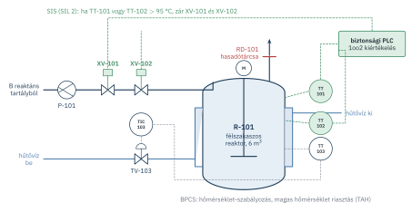

# A három esettanulmány {#sec-esettanulmanyok}

A könyv módszereit három kitalált, de valós mérnöki problémákat modellező esettanulmány köti össze. Ez a függelék összefoglalja a leírásukat, a számításokban használt adatokat és a fejezetekben kapott eredményeket. A számértékek a szakirodalomban szokásos nagyságrendekben mozognak; a ReaktorVéd minden számát egyetlen Python-szkript állítja elő, amely a könyv forrásában (`_shared/esetek/`) és a gyakorlati útmutató notebookjaiban is megtalálható, így minden eredmény reprodukálható.

## A – ReaktorVéd: exoterm reaktor védelmi rendszere {#sec-b-reaktorved}

**A folyamat.** Félszakaszos üzemű keverős reaktor, amelyben exoterm reakció zajlik. A B reaktánst a P-101 szivattyú adagolja két, sorba kötött gyorszáró szelepen (XV-101, XV-102) át. A reakcióhőt a köpenyben áramló hűtővíz vonja el; a hőmérsékletet a TIC-103 szabályozó tartja az alapjelen. A reaktoron hasadótárcsa (RD-101) is van, amelynek kétfázisú áramlásra való méretezése az elemzés idején nem igazolt ([-@sec-veszelyazonositas]. fejezet).

{width=90%}

**A veszélyes forgatókönyv.** A hűtővíz kiesése (évi 0,1 gyakorisággal) exoterm fázisban (az esetek felében) megfutó reakcióhoz, a reaktor felhasadásához, mérgező kibocsátáshoz és halálos sérüléshez vezethet. A vállalati kritérium szerint egy halálos kimenetelű forgatókönyv tolerálható gyakorisága $10^{-5}$/év.

**A biztonsági funkció.** Két hőmérséklet-távadó (TT-101/102, 1oo2) méri a reaktor hőmérsékletét; 95 °C fölött a tanúsított biztonsági PLC mindkét gyorszáró szelepet zárja (1oo2 a „zárás” funkcióra), 10 másodpercen belül. A végleges kialakítás hibabiztos: a szelepek energiamentesítésre zárnak, a távadók élő nullás áramhurokkal csatlakoznak, a tápellátás redundáns.

| Paraméter | Érték | Fejezet |
|:--|:--|:--|
| kezdő esemény (hűtővíz-kiesés) | $0{,}1$/év | [-@sec-kockazatertekeles]., [-@sec-esemenyfa]. |
| feltételt teremtő tényező (exoterm fázis) | $0{,}5$ | [-@sec-esemenyfa]. |
| riasztás és kezelői beavatkozás (IPL) | PFD $= 0{,}1$ (SPAR-H szerint ≈ 0,04) | [-@sec-esemenyfa]., [-@sec-ember]. |
| tolerálható gyakoriság | $10^{-5}$/év | [-@sec-kockazatertekeles]. |
| a SIF szükséges PFD-je | $\le 2\cdot10^{-3}$ (SIL 2, RRF ≥ 500) | [-@sec-esemenyfa]. |
| távadók | $\lambda_{DU} = 4\cdot10^{-7}$, $\lambda_{DD} = 6\cdot10^{-7}$, $\lambda_S = 5\cdot10^{-7}\,\text{h}^{-1}$; $\beta = 5\%$, $\beta_D = 2{,}5\%$ | [-@sec-sil]. |
| biztonsági PLC | PFD $= 5\cdot10^{-5}$, SIL 3-ra tanúsított | [-@sec-sil]. |
| gyorszáró szelepek | $\lambda_{DU} = 2{,}5\cdot10^{-6}\,\text{h}^{-1}$, $\beta = 10\%$ | [-@sec-sil]. |
| proof teszt időköze, javítási idő | $T_1 = 8760$ h, MTTR $= 8$ h | [-@sec-sil]. |
| tápegység (energiával működtetett változat) | igénykori kiesés $10^{-3}$ | [-@sec-hibafa]. |

: A ReaktorVéd fő adatai {#tbl-b-reaktorved-adatok}

**Az eredmények áttekintése.** A [-@tbl-b-reaktorved-eredmenyek]. táblázat megmutatja, hogyan finomodott a biztonsági funkció értékelése a könyv során. A sorozat maga is tanulság: a naiv blokkdiagram nagyságrenddel optimistább a helyes eredménynél, az első tervváltozat rejtett egypontos hibákat tartalmazott, és a próbák minősége döntően befolyásolja az eredményt.

| Modell, változat | Eredmény | Fejezet |
|:--|--:|:--|
| megbízhatósági blokkdiagram (független elemek) | PFD $\approx 1{,}7\cdot10^{-4}$ | [-@sec-rbd]. |
| hibafa, energiával működtetett szelepek, közös tápegységek | PFD $= 2{,}17\cdot10^{-3}$ | [-@sec-hibafa]. |
| hibafa, hibabiztos kialakítás, közös okok nélkül | PFD $= 1{,}73\cdot10^{-4}$ | [-@sec-hibafa]. |
| hibafa, hibabiztos kialakítás, β-tényezős közös okokkal | PFD $= 1{,}335\cdot10^{-3}$ | [-@sec-hibafa]. |
| többfázisú Markov-modell (csak a szelepek) | PFD $= 1{,}22\cdot10^{-3}$ | [-@sec-markov]. |
| IEC 61508-6 képletek (a végleges igazolás) | PFD $= 1{,}369\cdot10^{-3}$, RRF $= 731$ | [-@sec-sil]. |
| 90%-os proof teszt lefedettséggel | PFD $= 2{,}69\cdot10^{-3}$ (nem teljesül) | [-@sec-sil]. |
| havi részleges löketpróbával | PFD $= 6{,}63\cdot10^{-4}$, RRF $= 1508$ | [-@sec-sil]. |
| reaktorfelhasadás gyakorisága (eseményfa) | $6{,}8\cdot10^{-6}$/év | [-@sec-esemenyfa]. |
| egy kezelő egyéni kockázata ebből | $1{,}5\cdot10^{-6}$/év | [-@sec-kockazatertekeles]. |
| téves leállások (egyszeres → redundáns táp → 2oo3 távadók) | $0{,}133 \to 0{,}046 \to 0{,}026$/év | [-@sec-sil]. |

: A ReaktorVéd biztonsági funkciójának értékelése a könyv fejezeteiben {#tbl-b-reaktorved-eredmenyek}

## B – VészFék: automatikus vészfékező asszisztens {#sec-b-veszfek}

**A funkció.** Személygépkocsi vészfékező asszisztense (AEB), amely a radar és a kamera adatai alapján felismeri a jármű előtti akadályokat (járművek, gyalogosok, kerékpárosok), figyelmezteti a vezetőt, és ha az nem reagál, önállóan fékez. A rendszer elemei: frontradar (77 GHz), frontkamera, érzékelőfúziós és döntési vezérlőegység, valamint az elektrohidraulikus fékaktuátor és a stabilitásvezérlő, amely a fékezést végrehajtja. A funkció a vezető kiegészítője (SAE J3016 szerint legfeljebb 2. szint), ezért hibára elnémuló kialakítású: hiba esetén kikapcsol és jelez ([-@sec-architekturak]. fejezet).

**A két veszély.** A funkció kétféleképpen okozhat kárt: indokolatlan erős fékezéssel (ráfutásos baleset) és a fékezés elmaradásával (ütközés). A HARA szerint az indokolatlan teljes erejű fékezés autópályán, követő jármű jelenlétében S3, E4, C3, azaz **ASIL D** ([-@sec-eletciklus]. fejezet); a biztonsági cél az, hogy a funkció ne kezdeményezhessen indokolatlan, egy határértéknél nagyobb lassulású fékezést 60 km/h fölött.

**A fejezetekben.** A VészFék a balesetek tanulságainál (a tempei baleset, [-@sec-balesetek]. fejezet), a funkcionális veszélyelemzésnél ([-@sec-veszelyazonositas]. fejezet), a radarérzékelő FMEA-jánál ([-@sec-fmea]. fejezet), az STPA nem biztonságos irányítási műveleteinél ([-@sec-stpa]. fejezet), a két csúcseseményű hibafánál ([-@sec-hibafa]. fejezet), a hardvermetrikáknál ([-@sec-sil]. fejezet), a hibaviselkedési stratégiáknál ([-@sec-architekturak]. fejezet), a szoftver és a gépi tanulás határán ([-@sec-szoftver]. fejezet), az ember mint tartalék kérdésénél ([-@sec-ember]. fejezet), a kétágú biztonsági érvelésnél ([-@sec-biztonsagi-erveles]. fejezet) és a SOTIF kiváltó feltételeinél ([-@sec-uj-kihivasok]. fejezet) jelenik meg.

## C – KoboCella: kollaboratív robotcella {#sec-b-kobocella}

**A cella.** Egy szerelőcella, amelyben egy könnyű, kollaboratív robotkar és egy szerelő közös munkatérben dolgozik. A fő veszélyek a robotkar mozgási energiája (ütközés) és a megfogó szorítóereje (becsípődés).

**A biztonsági funkciók.** Sebesség- és távolságfelügyelet: ha a lézerszkenner a robot 1,2 m-es körzetében személyt érzékel, a robot sebessége legfeljebb 250 mm/s; 0,5 m-en belül a robot biztonságosan megáll. Erő- és teljesítménykorlátozás az ISO/TS 15066 biomechanikai határértékei szerint. Hiba esetén a hajtások biztonságos nyomatékmentesítése (STO).

| Jellemző | Érték | Fejezet |
|:--|:--|:--|
| szükséges teljesítményszint a sebességfelügyeletre | PL~r~ = e (S2, F2, P2); inherens tervezéssel (S1) PL~r~ = c lehetne | [-@sec-eletciklus]. |
| architektúra | 4-es kategória, kétcsatornás (1oo2), kölcsönös diagnosztika | [-@sec-rbd]., [-@sec-architekturak]. |
| a biztonságos megállítás PFH-ja | $1{,}01\cdot10^{-8}\,\text{h}^{-1}$ (PL e) | [-@sec-sil]. |
| a robothajtás csapágyainak Weibull-paraméterei | $\beta = 2{,}73$, $\eta = 10\,170$ h, MTTF ≈ 9050 h | [-@sec-megbizhatosag]. |
| rendelkezésre állás gyakori biztonsági megállásokkal | 0,968 (óránként 6 belépés, 20 s megállás) | [-@sec-markov]. |

: A KoboCella fő adatai {#tbl-b-kobocella-adatok}

**A fejezetekben.** A KoboCella a háromlépcsős kockázatcsökkentésnél ([-@sec-kockazatertekeles]. fejezet), az előzetes veszélyelemzésnél ([-@sec-veszelyazonositas]. fejezet), a PL~r~ meghatározásánál ([-@sec-eletciklus]. fejezet), az STPA részletes példájában ([-@sec-stpa]. fejezet), a Weibull-elemzésnél ([-@sec-megbizhatosag]. fejezet), a nagy igénybevételű eseményfánál ([-@sec-esemenyfa]. fejezet), a biztonság és a rendelkezésre állás kapcsolatánál ([-@sec-markov]. fejezet), a PFH-számításnál ([-@sec-sil]. fejezet), az ember–robot együttműködés emberi tényezőinél ([-@sec-ember]. fejezet), a műszaki dokumentációnál ([-@sec-biztonsagi-erveles]. fejezet) és a gépi tanulásos személyfelismerés szabályozási kérdéseinél ([-@sec-uj-kihivasok]. fejezet) szerepel.
