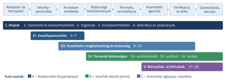

# Előszó {.unnumbered}

Egy vegyipari reaktor hűtése leáll. Egy autó radarja egy kidobott fémdobozt gyalogosnak lát. Egy kollaboratív robot karja a megengedettnél gyorsabban közelít a mellette dolgozó szerelőhöz. Mindhárom helyzetben ugyanaz a kérdés: elvégzi-e a rendszer akkor is a dolgát, amikor valami elromlik, vagy amikor a környezete másképp viselkedik, mint ahogy a tervezők gondolták. Ez a könyv arról szól, hogyan lehet erre a kérdésre megalapozott, számokkal és érvekkel alátámasztott választ adni.

A biztonságkritikus rendszer olyan rendszer, amelynek hibás működése emberéletet, egészséget, a természeti környezetet vagy jelentős anyagi értéket veszélyeztethet. Ilyen a folyamatipari védelmi rendszer, a jármű fék- és kormányrendszere, a vasúti biztosítóberendezés, a repülőgép repülésvezérlése, az orvostechnikai eszköz és az ipari robotcella. A felsorolás egyre hosszabb, mert a szoftver, a hálózati kapcsolat és a gépi tanulás egyre több olyan döntést hoz meg, amelyet korábban ember hozott meg.

## Kinek szól a könyv?

Minden mérnöknek és szakembernek, aki biztonságkritikus rendszert tervez, fejleszt, üzemeltet, értékel vagy engedélyez, iparágtól függetlenül. A gépészmérnök, a vegyészmérnök, a villamosmérnök, a mechatronikai mérnök, a mérnökinformatikus és a minőségügyi szakember ugyanazokra a módszerekre támaszkodik, csak más szabványok más szavaival. A könyv ezért a közös elméleti magot tanítja, és mindig megmutatja, hogyan jelenik meg ugyanaz a gondolat a folyamatiparban (IEC 61511), a közúti járműveknél (ISO 26262, ISO 21448), a gépiparban (ISO 13849, IEC 62061), a vasútnál (EN 50126-sorozat), a repülésben (ARP4754B, ARP4761A, DO-178C) és az orvostechnikában (ISO 14971, IEC 62304).

A könyv mesterképzésben és posztgraduális képzésben tankönyvként, a gyakorló mérnök számára kézikönyvként használható. Az előismeretek szerények: valószínűségszámítási alapok (amelyeket az [-@sec-valoszinuseg]. függelék összefoglal), alapfokú lineáris algebra és differenciálegyenletek, valamint mérnöki rendszerszemlélet.

## Mit ad a könyv?

A könyv három dologra tanít meg.

1. **Látni a veszélyt.** A balesetek mintázatainak és a veszélyazonosítás módszereinek (HAZOP, FMEA, STPA) megismerése után az olvasó módszeresen tárja fel, mi romolhat el, és milyen következménnyel.
2. **Számolni a kockázattal.** A megbízhatóság-elmélet, a blokkdiagramok, a hibafák, az eseményfák, a Markov-modellek és a biztonsági funkciók PFD- és PFH-számítása megmutatja, mekkora a maradó kockázat, és hol érdemes csökkenteni.
3. **Érvelni a biztonságról.** A biztonsági architektúrák, a szoftverfejlesztési és emberi tényezős követelmények, valamint a biztonsági érvelés (safety case) eszközei abban segítenek, hogy a rendszer biztonságát a megrendelő, a hatóság és a független értékelő számára is átláthatóan igazolni lehessen.

## A könyv felépítése

A könyv a biztonsági életciklust követi ([-@fig-szerkezet]. ábra). Az I. rész leteszi az alapokat: a balesetek tanulságait, a fogalmakat, a kockázat elfogadhatóságának kérdését és a szabványok rendszerét. A II. rész a veszélyazonosítás három nagy módszercsaládját mutatja be. A III. rész a könyv módszertani gerince: a kvantitatív megbízhatósági és biztonsági modellezés a valószínűségi alapoktól a biztonsági funkciók integritásának igazolásáig. A IV. rész a tervezési elvekkel, a szoftverrel és az emberrel foglalkozik. Az V. rész a biztonsági érvelést és a legújabb kihívásokat tárgyalja: a rendeltetésszerű funkció biztonságát (SOTIF), a mesterséges intelligenciát és a kiberbiztonság és a biztonság kapcsolatát.

{#fig-szerkezet width=100%}

Minden fejezet egy kis életciklus-térképpel kezdődik, amely megmutatja, hol tartunk. A fejezetek elején tanulási eredmények állnak, a végén összefoglalás, önellenőrző kérdések (megoldással) és válogatott továbbolvasnivaló.

## Három futó eset

A módszereket három, a könyvön végigvezetett esettanulmány köti össze. Mindhárom kitalált, de valós mérnöki problémákat modellez, a számértékek a szakirodalomban szokásos nagyságrendekben mozognak. Részletes leírásuk a [-@sec-esettanulmanyok]. függelékben található.

::: {.eset eset="A" title="A – ReaktorVéd: exoterm reaktor védelmi rendszere"}
Félszakaszos üzemű keverős reaktor, amelyben exoterm reakció zajlik. Ha a hűtés kiesik, a hőmérséklet megfuthat, a nyomás a tartály teherbírása fölé nőhet. Ezen az eseten követjük végig a HAZOP-ot, a rétegzett védelem elemzését (LOPA), a biztonsági integritási szint (SIL) kiosztását, a hibafát és a biztonsági funkció PFD-számítását.
:::

::: {.eset eset="B" title="B – VészFék: automatikus vészfékező asszisztens"}
Személygépkocsi radaros és kamerás vészfékező asszisztense (AEB) elektrohidraulikus fékaktuátorral. Ezen az eseten mutatjuk be a veszélyelemzést és kockázatbecslést (HARA), az ASIL-besorolást, az FMEA-t és FMEDA-t, a hibatűrő architektúrákat, valamint a rendeltetésszerű funkció biztonságát és a gépi tanulás biztonsági kérdéseit.
:::

::: {.eset eset="C" title="C – KoboCella: kollaboratív robotcella"}
Összeszerelő cella, amelyben ember és kollaboratív robot közös munkatérben dolgozik. Ezen az eseten mutatjuk be a gépbiztonsági kockázatértékelést (ISO 12100), a szükséges teljesítményszint (PL) meghatározását, a rendszerelméleti veszélyelemzést (STPA) és az emberi tényezők szerepét. A KoboCella a sorozat *Rendszermérnökség* kötetében is szerepel; itt a biztonsági szempontjait bontjuk ki.
:::

## Válogatott útvonalak

A fejezetek önállóan is olvashatók. Néhány javasolt útvonal:

| Útvonal | Ajánlott fejezetek |
|:--|:--|
| Gyors bevezetés a biztonságtechnikába | 1., 2., 3., 4., 5., 17. |
| Folyamatbiztonság (IEC 61511) | 2., 3., 5., 10., 11., 13., 14. |
| Közúti járművek (ISO 26262, ISO 21448) | 2., 4., 5., 6., 14., 15., 18. |
| Gépbiztonság és robotika | 3., 4., 7., 9., 13., 16. |
| Megbízhatósági modellezés | 8., 9., 10., 11., 12., A. függelék |
| Szoftver és MI-alapú rendszerek | 7., 15., 17., 18. |

: Javasolt olvasási útvonalak {#tbl-utvonalak}

## A gyakorlati útmutató

A kézikönyvhöz külön kötet tartozik: a [*Gyakorlati útmutató*](https://complexsystemsintelligence.github.io/biztonsagkritikus-rendszerek/gyakorlat/). Ebben minden módszerhez lépésenként vezetett feladat, böngészőben futó interaktív alkalmazás és Google Colabban futtatható Python-notebook tartozik. A kézikönyv szövegében a **Gyakorlat** feliratú dobozok jelzik, melyik feladat kapcsolódik az adott részhez.

## Jelölések és szóhasználat

A könyv a magyar szakszavakat használja, és első előfordulásukkor megadja az angol megfelelőjüket. A teljes magyar–angol szószedet a [-@sec-szoszedet]. függelékben található. A kiemelődobozok jelentése:

- **Tanulási eredmények:** mit tudsz a fejezet végére.
- **Fogalom:** pontos definíció, lehetőleg szabványos megfogalmazásban.
- **Futó eset (A, B, C):** a három esettanulmány aktuális lépése.
- **Kidolgozott példa:** lépésenként végigszámolt feladat.
- **Gyakori buktató:** tipikus tévedés, amelyet a gyakorlatban sokszor látni.
- **Esettanulmány egy balesetből:** valós baleset tanulsága a vizsgálati jelentések alapján.
- **Kitekintés:** haladó vagy szomszédos téma.
- **Gyakorlat:** a kapcsolódó feladat a gyakorlati útmutatóban.
- **Önellenőrzés:** kérdések lenyitható megoldással.

A valószínűségeket és gyakoriságokat tudományos jelöléssel írjuk ($10^{-4}$), a meghibásodási rátákat óránkénti értékben ($\text{h}^{-1}$) vagy FIT-ben (1 FIT $=10^{-9}\,\text{h}^{-1}$) adjuk meg.

## Előzmények és köszönetnyilvánítás

A könyv a Pannon Egyetem mechatronikai mesterképzéséhez 2014-ben készült *Biztonságkritikus rendszerek* című egyetemi jegyzet [@abonyi2014] teljes átdolgozásával jött létre. A jegyzet kockázatelemzési és megbízhatósági fejezeteiből a módszertani mag megmaradt, de minden fejezet újraíródott. A szabványi háttér a mai kiadásokat követi, és a hibás vagy elavult definíciók javítva lettek. Új fejezetek születtek a balesetmodellekről, a HAZOP-ról, az STPA-ról, a rétegzett védelemről, a Markov-modellekről, a biztonsági funkciók igazolásáról, az emberi megbízhatóságról, a biztonsági érvelésről, valamint a SOTIF, a mesterséges intelligencia és a kiberbiztonság témaköréről. Minden ábra új, saját vektorgrafika.

Köszönettel tartozom a jegyzet egykori társszerzőjének, Fülep Tímeának, akinek a járműipari biztonsági stratégiákról és a fékrendszer-architektúrákról írt fejezetei a 14. fejezet egyes példáinak kiindulópontjai voltak. Köszönöm a Pannon Egyetem hallgatóinak a jegyzet évekig tartó használata során adott visszajelzéseiket.

## Javítások és visszajelzés

A könyv nyílt, folyamatosan javított kiadvány. Hibát, pontatlanságot vagy javaslatot a webes változat oldalain található „Hiba vagy javaslat bejelentése” hivatkozáson keresztül lehet jelezni. Minden kiadás saját DOI-azonosítót kap, így pontosan hivatkozható; a kiadások közös azonosítója [10.5281/zenodo.24413011](https://doi.org/10.5281/zenodo.24413011), amely mindig a legfrissebb változatra mutat.

::: {.kitekintes title="A szabványokról"}
A könyv sok szabványra hivatkozik, de egyiket sem helyettesíti. A szabványok pontos követelményeit mindig az érvényes kiadás eredeti szövegéből kell venni. A könyv a 2026 végén érvényes kiadásokat követi; ahol új kiadás készül (például az IEC 61508 és az ISO 26262 harmadik kiadása), ott ezt jelezzük.
:::
